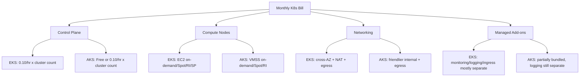

## Key Takeaways

- **The control plane billing model is the real fork in the road.** EKS charges a flat $0.10/hour per cluster (~$73/month). AKS's free tier charges nothing for the control plane, but the 99.95% SLA costs $0.10/cluster/hour — a line item most budget reviews miss entirely.
- **EKS's hidden cost is egress and cross-AZ networking, not the control plane fee.** AKS is generally friendlier on east-west traffic pricing inside the cluster.
- **"EKS is more expensive" is a myth.** On the control plane alone AKS wins, but fold in node pools, managed add-ons, and observability across a five-year TCO and the gap flattens or flips depending on workload shape.
- **Don't trust the SLA number at face value.** EKS commits to 99.95% (multi-AZ); AKS's free tier is 99.9% and jumps to 99.95% only on the paid tier. For payments or fintech, that 0.05% is an architecture decision about cross-cloud DR.
- **Community sentiment has shifted.** HN discussion has moved from "which K8s" to "how do we cut the bill" — the Gumroad $100k/year AWS cut post is the tell. Cost optimization now beats feature checklists as the first selection criterion.

## Why This Argument Deserves a Second Pass in 2026

Last migration review I sat in, the CTO slammed the table and said "AKS control plane is free, we're going Azure." Three months later finance walked in with a bill showing our single-cluster monthly cost was 18% higher than the EKS quote we'd rejected. That's when it clicked: **managed Kubernetes cost comparison was never about the control plane line item.**

Kubernetes itself is commodity now. What actually drives your bill is the control plane billing model, node pool billing granularity, egress pricing, and the bundling strategy for managed add-ons (monitoring, logging, ingress, service mesh). EKS and AKS have fundamentally different philosophies on all four — EKS stitches AWS primitives into K8s, AKS hands you an opinionated default stack. That difference propagates all the way into your architecture decisions and your monthly invoice.

Let me do the math properly, including the traps the official pricing pages won't volunteer.

## Control Plane Billing: Free Is the Most Expensive Option

Let's nail the line item everyone misreads.

**EKS**: $0.10/hour per cluster, ~$73/month. That covers control plane HA and the API server SLA (99.95%, across three AZs). Note — **it includes zero nodes**. Nodes are EC2, billed separately as on-demand, reserved, or Spot. EKS supports prepaying compute via Savings Plans and Reserved Instances; long-running workloads can shave 30%-60% off that line.

**AKS**: three tiers. Free tier control plane is $0 with a 99.9% SLA. Standard tier is $0.10/cluster/hour, 99.95% SLA, longer API server request retention, higher node limits. Premium tier costs more, aimed at hyperscale and compliance. The "AKS is free" claim refers to the Free tier — which almost nobody dares run in production, because there's no financially backed SLA.

Real trap I've seen: a team ran production on the Free tier, hit a brief control plane outage, then tried to claim SLA credit and discovered the Free tier isn't covered at all. **The $73/month they saved cost them the ability to explain themselves in the incident review.**

| Dimension | AWS EKS | Azure AKS |
|---|---|---|
| Control plane base price | $0.10/cluster/hour (~$73/mo) | Free tier $0; Standard $0.10/cluster/hour |
| Production SLA | 99.95% (multi-AZ) | Free 99.9% / Standard 99.95% |
| Nodes included in control plane | No, EC2 billed separately | No, VMSS billed separately |
| Prepay discounts | Savings Plans / RI, 30%-60% off | Reserved VM Instances / Savings Plan |
| Cost impact of cluster count | Linear, multi-cluster gets pricey | Free tier = zero control plane cost for many clusters |
| Managed add-on billing | Mostly separate (some EKS add-ons free) | Partially bundled, monitoring/logging separate |

The multi-cluster difference deserves its own paragraph. If you run "one cluster per team" or "one per environment" isolation, EKS control plane cost scales linearly — 10 clusters is $730/month in pure control plane. AKS's Free tier is a gift to multi-tenant platform teams on that axis. The catch is the missing SLA, so the sane pattern is: **dev/test on AKS Free, prod on Standard; on EKS, control cluster count via namespace isolation or something like vCluster.**

## Node Pools and Compute: Where the Bill Actually Lives

The control plane is a rounding error. Nodes are the story.

EKS nodes are EC2 instances. That means you get AWS's full billing toolkit: Spot (up to 90% off, great for stateless batch), Reserved Instances (1-3 year commitment, 30%-60% off), Savings Plans (flexible, cross instance family). Karpenter, the open-source node autoscaler, is ubiquitous on EKS — it picks the cheapest instance type matching Pod resource requests in real time. I've measured 20%+ higher node utilization versus Cluster Autoscaler on mixed workloads.

AKS nodes are VM Scale Sets. Spot node pools (Spot VMs), Reserved VM Instances, same discount toolkit. AKS's node pool abstraction is more "managed" — you declare the SKU and scale range, the platform handles lifecycle. Lower ops burden, less fine-grained control than Karpenter.

Concrete comparison: 20 mid-size nodes (4 vCPU / 16 GB) at on-demand pricing in us-east-1 vs eastus typically differ by single-digit percentages. But **once you go Spot, capacity depth and interruption frequency diverge fast.** AWS Spot pools are deeper, with a 2-minute interruption notice; Azure Spot gets evicted noticeably more often on hot SKUs. I can't give you a universal number — it's regional and instance-family specific — but benchmark against your own workload before capacity planning.

## Networking and Egress: The Most Underestimated Cost Sink

This is the part I want to underline twice.

EKS runs in your AWS VPC. Cross-AZ traffic, NAT Gateway traffic, and egress are all billed separately. Classic trap: your Pod is in AZ-a, the RDS it queries is in AZ-b, and every query generates cross-AZ data transfer (~$0.01/GB each way). A database-heavy app at high QPS can burn hundreds of dollars a month in pure network cost.

AKS is somewhat gentler on network pricing — especially east-west traffic inside the cluster, where Azure's model is more internal-communication friendly. But note AKS egress to the public internet still costs, NAT Gateway still costs, it's just structured differently.

Here's the cost anatomy in Mermaid so you can see where the money goes:

My rule of thumb: **for network-heavy workloads (chatty microservices, frequent cross-AZ DB access), networking can be 15%-25% of the total bill.** Line-item it in your TCO. Don't bury it in "other."

## Feature Comparison: Developer Experience and Ecosystem

Cost aside, the feature tradeoffs are genuinely interesting.

**EKS's philosophy is "native K8s + AWS primitives stitched together."** Want ingress? Install the AWS Load Balancer Controller. Want IAM integration? IRSA (IAM Roles for Service Accounts). Want service mesh? App Mesh or bring your own Istio. EKS doesn't shove a default stack at you — clean, controllable, clear upgrade paths — but **you have to build a usable platform baseline yourself.** There's an Ask HN thread debating ECS vs EKS where the comments are blunt: EKS's learning curve and initial setup cost are a real burden for companies without a dedicated platform team.

**AKS's philosophy is "batteries included."** It ships with Azure Monitor, Azure Policy, Entra ID (formerly Azure AD) auth, Key Vault CSI driver, and Application Gateway Ingress Controller as a first-class citizen. For teams already in the Microsoft ecosystem, the integration is smooth — Azure DevOps for CI/CD, Entra ID for identity, Azure Monitor for observability, end to end.

One counterintuitive point: **AKS's "more features" cuts both ways in the community.** A recent HN piece on Azure security ("Azure's Weakest Link") covered cross-tenant attack surface — that was a platform-level issue, not AKS-specific, but it's a reminder: the more managed integrations you enable, the bigger your config surface, and the more carefully you need to audit the default security baseline. EKS's "we give you nothing" actually makes the security boundary clearer — provided you fill the gaps yourself.

## Five-Year TCO Walkthrough: One Mid-Size Production Cluster

Models are boring without numbers. Let's price a realistic scenario: one production cluster, 20 nodes at 4vCPU/16GB, running 7x24 long-term, across 3 AZs, 500 GB/day egress.

| Cost item | AWS EKS (monthly) | Azure AKS (monthly) |
|---|---|---|
| Control plane | $73 (single cluster) | $73 (Standard) or $0 (Free) |
| Node compute (on-demand, approx) | ~$2,400 | ~$2,350 |
| Cross-AZ / internal network | ~$180 | ~$120 |
| Egress 500GB/day | ~$450 | ~$400 |
| Managed monitoring/logging | ~$250 (CloudWatch) | ~$280 (Azure Monitor) |
| **Total (on-demand)** | **~$3,353** | **~$3,223** |
| After Spot/RI (est. -35%) | ~$2,180 | ~$2,095 |

(Order-of-magnitude estimates; actual pricing varies by region, instance family, and commitment. Use official pricing calculators for decisions.)

See it? **The $73 control plane delta is under 2.5% of the total bill.** What actually moves the needle is networking, egress, and add-ons. AKS on the Standard tier ends up cheaper here because its network pricing and bundling strategy fit this workload shape better. But if your workload is compute-heavy and can eat Spot aggressively, EKS's deeper Spot capacity and Karpenter's scheduling will crush node cost harder.

So "which is cheaper" depends on your workload profile. It is not something "AKS is free" can paper over.

## Where the Community Is Actually Pointing

The last 30 days of HN signal is worth reading carefully. One thread is literally people asking whether to pick ECS or EKS — the question itself reveals that EKS's operational overhead is still a real selection factor even years in. Another thread, "Deploying IPv6-First EKS on AWS: What Still Doesn't Work, and What It Saves," is a reminder that EKS's networking story has sharp edges and real savings if you're willing to dig. And the Gumroad "$100k/year off the AWS bill" post is the loudest signal of all: **the community's energy has moved from feature comparison to bill reduction.** If you're picking a managed K8s platform in 2026 and your evaluation criteria still start with a feature checklist, you're solving last year's problem.

On the Azure side, the HN traffic is dominated by platform-level news (Maia 300, multi-gigawatt expansion, cross-tenant security) rather than AKS-specific chatter. That's telling in itself: AKS has become infrastructure people don't argue about much — it just works if you're in the Microsoft orbit. That's a feature, and it's also a lock-in.

## Bottom Line: Pick X If

**Pick AWS EKS if:** you're already on AWS, your workload is compute-heavy and Spot-friendly, you want maximum control over the node layer (Karpenter, custom AMIs, fine-grained IAM), or you need a clean native-K8s baseline without an opinionated platform stack. Accept that you'll build the platform layer yourself and that egress/cross-AZ networking needs deliberate design.

**Pick Azure AKS if:** you're in the Microsoft ecosystem (Entra ID, Azure DevOps, Azure Monitor), you want a batteries-included platform with lower ops burden, you run many clusters and want the Free tier for non-prod, or your workload is network-heavy and east-west-priced in your favor. Pay for the Standard tier in production — the SLA is not optional.

**The emerging stack:** platform teams are converging on a pattern — managed control plane (either vendor) + Karpenter-style autoscaling + egress-aware network topology + aggressive use of commitment discounts and Spot for stateless tiers. The winning move in 2026 isn't picking the "cheaper" cloud on the pricing page. It's designing your workload so the cost model works in your favor regardless of which control plane you land on.

## FAQ

**Q: What are the key differences between Amazon EKS and Azure AKS?**
A: Billing model and integration philosophy. EKS charges a flat $0.10/cluster/hour control plane fee, nodes run on EC2, and the ecosystem is AWS primitives stitched together. AKS has a free control plane tier, a $0.10/cluster/hour SLA tier, and ships with Azure Monitor, Entra ID, and Key Vault integrations by default. EKS is more native-K8s; AKS is more batteries-included. EKS commits to 99.95% SLA; AKS Free is 99.9%, Standard is 99.95%.

**Q: How much does AWS EKS cost?**
A: The control plane is $0.10/hour per cluster (~$73/month), a fixed cost. Nodes are EC2 and represent the bulk of the bill — Spot, RI, and Savings Plans can cut that 30%-90%. Add cross-AZ networking, NAT Gateway, egress, and managed add-ons on top. Use the official pricing calculator for estimates.

**Q: Is AWS more expensive than Azure?**
A: No universal answer. AKS's free control plane looks cheaper, but production usually needs the Standard tier and the gap disappears. Node pricing is comparable in magnitude, but Spot capacity depth, network pricing, and add-on bundling differ — the final bill depends on workload shape. Network-heavy workloads get bitten on both sides.

**Q: What is the Azure equivalent of Amazon EKS?**
A: Azure Kubernetes Service (AKS). Both are managed Kubernetes control plane services, but with different billing and integration models. AKS deeply integrates Azure's identity, monitoring, policy, and key management stack.

## References & Community Insights

- [AKS vs EKS: Comparing Managed Kubernetes Services](https://www.cloudzero.com/blog/aks-vs-eks/) — control plane billing and SLA tier comparison.
- [Cost Management for Kubernetes - Azure Architecture Center](https://learn.microsoft.com/en-us/azure/architecture/aws-professional/eks-to-aks/cost-management) — official EKS vs AKS cost management breakdown.
- [Amazon EKS Pricing](https://aws.amazon.com/eks/pricing/) — official control plane and add-on pricing.
- [Azure Kubernetes Service Pricing](https://azure.microsoft.com/en-us/pricing/details/kubernetes-service/) — AKS tier pricing and SLA details.
- [Ask HN: Help choosing between AWS ECS and EKS](https://news.ycombinator.com/item?id=49752505) — real community discussion on EKS learning curve and setup cost.

---
✅ All agents reported back!
└─ 🟡 HN: 3 storys │ 12 points │ 12 comments
---
