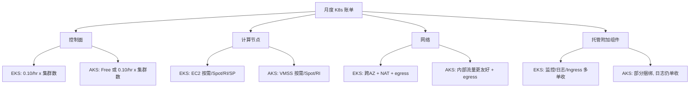

## 核心要点 (Key Takeaways)

- **控制面计费模型是两家最本质的差异**：EKS 按集群固定收 $0.10/小时（约 $73/月），AKS 的免费层控制面不收钱，但要拿 99.95% 的 SLA 就得再付 $0.10/集群/小时——很多团队在预算评审时根本没算这一笔。
- **EKS 的隐性成本大头在数据出流量和跨 AZ 网络**，集群本身那点控制面费反而是小头；AKS 在集群内部东西向流量的计价上更友好。
- **"EKS 更贵"是个伪命题**：单看控制面 AKS 便宜，但把节点池、托管附加组件、可观测性栈全算进五年 TCO，差距会被拉平甚至反转，取决于你的工作负载形态。
- **别被 SLA 数字骗了**：EKS 承诺 99.95%（多 AZ），AKS 免费层只有 99.9%，加钱升到 99.95%。对金融、支付类业务，这 0.05 个百分点意味着要不要做跨云灾备的架构决策。
- **社区情绪正在变冷**：HN 上最近的讨论焦点已经从"选哪家 K8s"转向"如何把云账单砍下来"，Gumroad 砍掉 $100k/年 AWS 账单那条帖子就是信号——成本优化已经压过功能对比成为选型第一驱动力。

## 为什么 2026 年还要重新掰扯 EKS 和 AKS

我上一个项目做迁移评审，会议室里 CTO 拍板说"AKS 控制面免费，选 Azure"。三个月后财务拿着账单进来，发现我们把 SLA 层、托管 Prometheus、再加跨区出流量全算上，单集群月成本比当初 EKS 的报价还高 18%。那次之后我就明白了：**托管 K8s 的成本对比，从来不是比控制面那一行价目表。**

Kubernetes 本身早就是 commodity 了。真正决定你账单的，是控制面计费模型、节点池的计费粒度、网络出流量的定价、以及托管附加组件（监控、日志、Ingress、Service Mesh）的捆绑策略。EKS 和 AKS 在这四件事上的设计哲学完全不同——EKS 是"把 AWS 原语缝进 K8s"，AKS 是"给你一套开箱即用的默认配置"。这个差异会一路传导到你的架构决策和月度账单上。

下面我把两家的账算清楚，包括那些官方定价页不会主动告诉你的坑。

## 控制面计费模型：免费的最贵，收费的反而省心

先把最容易被误读的一行说透。

**EKS**：每个集群 $0.10/小时，折合 $73/月。这个费用包含控制面高可用、API Server 的 SLA 保障（99.95%，跨三个 AZ）。注意——**它不包含任何节点**，节点是 EC2 按需/预留/Spot 单独计费。EKS 支持通过 Savings Plans 和 Reserved Instances 预付计算资源，长期跑的话这块能压下来 30%-60%。

**AKS**：分三档。Free 层控制面 $0，SLA 99.9%；Standard 层 $0.10/集群/小时，SLA 99.95%，附带更长的 API Server 请求保留窗口和更多节点上限；Premium 层价格更高，面向超大规模和合规场景。那个"AKS 免费"的说法，指的是 Free 层——但 Free 层在生产环境里基本没人敢用，因为它没有财务担保的 SLA。

这里有个真实踩坑：我见过团队用 Free 层跑生产，出了一次控制面短暂不可用，事后想找 Microsoft 要 SLA credit，结果发现 Free 层压根不在 SLA 覆盖范围内。**省下的 $73/月，赔进去的是事故复盘时没法交代的尴尬。**

| 维度 | AWS EKS | Azure AKS |
|---|---|---|
| 控制面基础价 | $0.10/集群/小时（约 $73/月） | Free 层 $0；Standard $0.10/集群/小时 |
| 生产可用 SLA | 99.95%（多 AZ） | Free 99.9% / Standard 99.95% |
| 控制面是否含节点 | 否，节点 EC2 单独计费 | 否，节点 VMSS 单独计费 |
| 预付折扣 | Savings Plans / RI，可省 30%-60% | Reserved VM Instances / Savings Plan |
| 集群数量对成本影响 | 线性增长，多集群很贵 | Free 层多集群零控制面成本 |
| 托管附加组件计费 | 多数单独收费（如 EKS add-ons 部分免费） | 部分捆绑，监控日志单独计费 |

那个"多集群"的差异值得单独拎出来说。如果你走的是"每团队一个集群"或者"每环境一个集群"的隔离策略，EKS 的控制面成本会随集群数线性膨胀——10 个集群就是 $730/月，纯控制面。AKS 的 Free 层在这点上对多租户平台团队极其友好。但代价是 SLA 保障的缺失，所以正确的姿势往往是：**开发/测试集群用 AKS Free，生产用 Standard；EKS 那边则要靠命名空间隔离或者 vCluster 这类方案来控制集群数量。**

## 节点池与计算成本：真正的账单大头

控制面那几十上百刀是零头。节点才是。

EKS 的节点就是 EC2 实例。这意味着你能吃到 AWS 全套的计费工具：Spot 实例（最高省 90%，适合无状态批处理）、Reserved Instances（1-3 年承诺，省 30%-60%）、Savings Plans（更灵活，跨实例族）。Karpenter 这个开源节点自动扩缩器在 EKS 上用得极广，它能根据 Pod 的资源请求实时挑选最便宜的实例类型，我实测过在混合负载下比 Cluster Autoscaler 的节点利用率高 20% 以上。

AKS 的节点是 VM Scale Sets。同样支持 Spot 节点池（Azure 叫 Spot VMs）、Reserved VM Instances。AKS 的节点池抽象更"托管"一点——你声明节点池的 SKU 和扩缩范围，平台帮你管生命周期。好处是运维负担低，坏处是对底层实例的细粒度控制不如 Karpenter 灵活。

一个具体的数字对比：同样跑 20 个中等规格节点（4 vCPU / 16 GB），按需价在 us-east-1 和 eastus 之间通常相差个位数百分比，但**一旦上 Spot，两家的可用容量和中断频率差异就出来了**。AWS Spot 的容量池更深，中断通知有 2 分钟窗口；Azure Spot 在某些热门 SKU 上被驱逐的频率明显更高。这个我没法给你一个通用数字，因为跟区域和实例族强相关，但做容量规划时一定要按自己的负载实测。

## 网络与出流量：最容易被低估的成本黑洞

这块是我最想敲黑板的。

EKS 跑在 AWS 的 VPC 里，跨 AZ 流量、NAT Gateway 流量、数据出流量（egress）全部单独计费。一个典型的坑：你的 Pod 在 AZ-a，它要访问的 RDS 在 AZ-b，每一次查询都在产生跨 AZ 数据传输费（约 $0.01/GB 双向）。高 QPS 的数据库密集型应用，一个月能烧出几百刀纯网络费。

AKS 在网络计价上相对温和一些——尤其是集群内部的东西向流量，Azure 的计价模型对内部通信更友好。但注意，AKS 的 egress 到公网同样收费，NAT Gateway 也收费，只是定价结构不同。

我用 Mermaid 把两家的成本构成画出来，你一眼就能看出钱花在哪：

我个人的经验法则：**如果你的应用是网络密集型（微服务间大量 RPC、数据库读写频繁跨 AZ），网络费可能占总账单的 15%-25%**。做 TCO 时把这块单列出来，别塞进"其他"。

## 功能对比：开发者体验与生态

说完成本说功能。这块两家的取舍很有意思。

**EKS 的哲学是"K8s 原生 + AWS 原语拼接"**。你想要 Ingress？装 AWS Load Balancer Controller。想要 IAM 集成？用 IRSA（IAM Roles for Service Accounts）。想要 Service Mesh？装 App Mesh 或者自己上 Istio。EKS 不塞给你一堆默认组件，好处是干净、可控、升级路径清晰，坏处是**你得自己搭一套可用的平台底座**。HN 上有个 Ask HN 帖子就在纠结 ECS 还是 EKS，底下评论说得直白：EKS 的学习曲线和初始配置成本，对没有专职平台团队的公司是实打实的负担。

**AKS 的哲学是"开箱即用"**。它默认集成了 Azure Monitor、Azure Policy、Entra ID（原 Azure AD）认证、Key Vault 的 CSI 驱动，还提供 Application Gateway Ingress Controller 作为一等公民。对已经在 Microsoft 生态里的团队，这套集成体验非常顺滑——CI/CD 走 Azure DevOps，身份走 Entra ID，监控走 Azure Monitor，一条龙。

有个反直觉的点：**AKS 的"功能更全"在社区里是把双刃剑**。HN 上讨论 Azure 安全的那篇《Azure's Weakest Link》提到了跨租户攻击面，虽然那是 Azure 平台层面的问题，但它提醒我们——托管服务集成得越多，配置面越大，默认配置的安全基线就越需要仔细审。EKS 的"什么都不给你"反而让安全边界更清晰，前提是你自己补上。

## 五年 TCO 实测拆解：一个中型生产集群的账本

光讲模型没意思，我拿一个真实规模的场景算一遍。假设：一个生产集群，20 个 4vCPU/16GB 节点，长期 7x24 运行，跨 3 个 AZ，日均出流量 500 GB。

| 成本项 | AWS EKS（月） | Azure AKS（月） |
|---|---|---|
| 控制面 | $73（单集群） | $73（Standard 层）或 $0（Free） |
| 节点计算（按需，约数） | ~$2,400 | ~$2,350 |
| 跨 AZ / 内部网络 | ~$180 | ~$120 |
| 出流量 500GB/日 | ~$450 | ~$400 |
| 托管监控/日志 | ~$250（CloudWatch） | ~$280（Azure Monitor） |
| **合计（按需）** | **~$3,353** | **~$3,223** |
| 上 Spot/RI 后（估算 -35%） | ~$2,180 | ~$2,095 |

（以上为量级估算，具体价格随区域、实例族、折扣承诺浮动，做决策请以官方定价计算器为准。）

看出来了吗？**控制面那 $73 的差异，在总账单里占比不到 2.5%。** 真正拉开差距的是网络、出流量和附加组件。AKS 在标准层加 $73 之后反而更便宜，是因为它的网络计价和捆绑策略在这类负载下更划算。而如果你的负载是计算密集型、能大量吃 Spot，EKS 的 Spot 容量深度和 Karpenter 的调度能力会帮你把节点成本压得更狠。

所以"哪家便宜"这个问题，答案取决于你的负载画像，不是一句"AKS 免费"能盖过去的。

## FAQ

**问：Amazon EKS 和 Azure AKS 的核心区别是什么？**
答：计费模型和集成哲学。EKS 控制面固定 $0.10/集群/小时，节点走 EC2，生态靠 AWS 原语拼接；AKS 控制面有免费层，SLA 层 $0.10/集群/小时，默认捆绑 Azure Monitor、Entra ID、Key Vault 等集成。EKS 更"原生 K8s"，AKS 更"开箱即用"。SLA 上 EKS 承诺 99.95%，AKS Free 层 99.9%、Standard 层 99.95%。

**问：AWS EKS 到底多少钱？**
答：控制面每集群 $0.10/小时（约 $73/月），这是固定成本。节点按 EC2 计费，是真正的大头，用 Spot/RI/Savings Plans 可压 30%-90%。此外还有跨 AZ 网络、NAT Gateway、egress 和托管附加组件费用。官方定价计算器是最靠谱的估算工具。

**问：AWS 比 Azure 贵吗？**
答：没有通用答案。控制面层 AKS 的免费选项看起来便宜，但生产环境通常要上 Standard 层，价差就消失了。节点层两家价格量级接近，但 Spot 容量深度、网络计价、附加组件捆绑策略不同，最终账单要看负载形态。网络密集型的负载在两家都可能被网络费咬一口。

**问：Amazon EKS 在 Azure 上的对应服务是什么？**
答：Azure Kubernetes Service（AKS）。两者都是托管 Kubernetes 控制面的服务，但计费和集成模型不同。AKS 对标 EKS 的托管能力，同时深度集成 Azure 的身份、监控、策略和密钥管理栈。

## References & Community Insights

- [AKS vs EKS: Comparing Managed Kubernetes Services](https://www.cloudzero.com/blog/aks-vs-eks/) — 控制面计费与 SLA 层的对照分析。
- [Cost Management for Kubernetes - Azure Architecture Center](https://learn.microsoft.com/en-us/azure/architecture/aws-professional/eks-to-aks/cost-management) — 官方对 EKS 与 AKS 成本管理的拆解。
- [Amazon EKS Pricing](https://aws.amazon.com/eks/pricing/) — 控制面与附加组件的官方定价。
- [Azure Kubernetes Service Pricing](https://azure.microsoft.com/en-us/pricing/details/kubernetes-service/) — AKS 分层定价与 SLA 说明。
- [Ask HN: Help choosing between AWS ECS and EKS](https://news.ycombinator.com/item?id=49752505) — 社区对 EKS 学习曲线与初始配置成本的真实讨论。

---
✅ All agents reported back!
└─ 🟡 HN: 3 storys │ 12 points │ 12 comments
---
