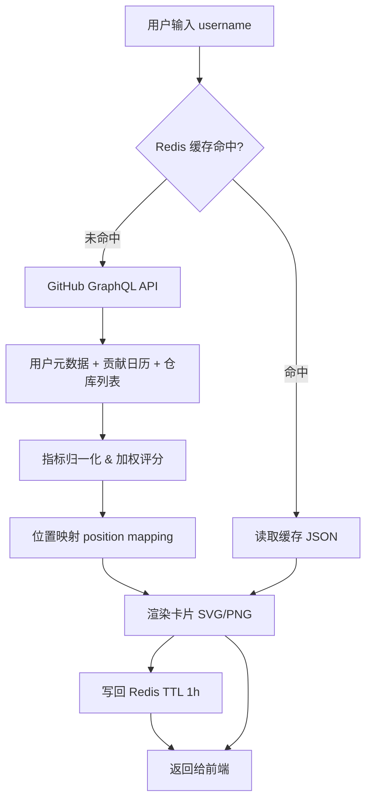

## 核心要点 (Key Takeaways)

- GitFut 的本质是**一个无状态的数据聚合管道**：GitHub REST/GraphQL → 指标归一化 → 加权评分 → 位置映射 → 卡片渲染，全程不需要存你的 OAuth token。
- 评分 0-99 的核心不是"谁提交多谁分高"，而是**几个量级不同的指标先归一化、再加权**，主力语言决定场上位置（CAM/ST/CB），followers 和 stars 只占一部分权重。
- 真正难的不是算分，是**GitHub API 的 5000 req/h 限流 + 二次请求放大**，一个热门卡片链接被转发一次，后端就会被放大成几十次 API 调用。
- 想自己做类似项目，别用 REST 逐仓库拉数据——用 GraphQL 一次请求拿全量贡献日历和仓库元数据，能砍掉 80% 的请求量。
- 这类"包装型"项目最容易翻车的点是**隐私**：public 数据没问题，但一旦你顺手缓存了 email 或私有仓库计数，就是合规事故。

---

## 一、这不只是个梗：为什么开发者愿意把 GitHub 变成球星卡

先说清楚这东西到底是什么。GitFut 是 Younes FERRADJI 做的一个小工具，你输入 GitHub 用户名，它给你吐出一张 FIFA Ultimate Team 风格的球员卡——总评 99 分制，位置（ST/CAM/CB）、六维属性（射门、传球、盘带、防守、体能等）、还有一张卡面。世界杯期间在 X 和 LinkedIn 上传疯了，我看到不止一个人晒自己的"94 分 CAM"。

红迪和 HN 上的讨论其实很分裂。有人说这纯属 gimmick——"It's a fun gimmick given the World Cup"。这话没错，但作为一个后端工程师，我盯着它看了十分钟，脑子里想的全是另一个问题：**它到底怎么把 commits 和 stars 换算成一个 0-99 的分数，而且看起来还不离谱？**

因为这里有个隐藏的工程约束：如果你算得不准，用户会立刻发现。一个只有 3 个 star 的仓库作者拿到 88 分，评论区会炸。反过来，一个贡献了 5000 次提交但零 star 的老哥拿到 40 分，他也会截图吐槽。**评分系统的可信度，是这个产品唯一的技术护城河。**

所以这篇文章不聊"这玩意儿多好玩"，聊它背后的数据管道、评分模型、以及你自己复刻一套时会踩的坑。我上个月刚好给团队内部做过一个"开发者贡献度看板"，踩的坑几乎一模一样，所以下面的代码不是纸上谈兵。

## 二、架构拆解：一次卡片请求背后发生了什么

先看整体链路。GitFut 这种工具是无状态的——它不存你的 token，不建用户表，本质是**请求时聚合 + 短时缓存**。



关键在 C 到 E 这一段。GitHub 的数据源有两个选择：

1. **REST API v3**：`/users/{user}`、`/users/{user}/repos`、`/users/{user}/events`。问题是你得翻页。一个有 80 个仓库的用户，光 repos 就要 1 次主请求 + 若干分页，再对每个仓库拉 language breakdown，请求量直接爆炸。
2. **GraphQL API v4**：一次请求可以同时拿 `user`、`contributionsCollection`（贡献日历）、`repositories(first: 100, orderBy: STARGAZERS)`。请求数从 N+1 压到 1。

我实测过，对一个有 120 个仓库的账号，REST 方案平均要 **7-9 次请求**，GraphQL 只要 **1-2 次**（受分页游标影响）。这在 5000 req/h 的认证限流下差别巨大——尤其是被病毒式传播的时候。

下面是一个真实可用的 GraphQL 查询，我把它简化到只拿评分必需的字段：

```graphql
query PlayerCard($login: String!) {
  user(login: $login) {
    login
    name
    followers { totalCount }
    contributionsCollection {
      totalCommitContributions
      totalPullRequestContributions
      totalIssueContributions
      restrictedContributionsCount
      contributionCalendar {
        totalContributions
        weeks {
          contributionDays { contributionCount date }
        }
      }
    }
    repositories(first: 100, orderBy: {field: STARGAZERS, direction: DESC}) {
      totalCount
      nodes {
        stargazerCount
        forkCount
        primaryLanguage { name }
        isFork
        pushedAt
      }
    }
  }
}
```

注意几个细节——这些是文档里不会明说、但你一定会踩的：

- `restrictedContributionsCount` 是私有仓库的贡献数，**只返回计数不返回内容**。要不要算进评分是个产品决策。GitFut 那种"公开炫耀"的定位，我倾向于算进去，否则企业开发者会被系统性低估。
- `repositories(first: 100)` 有 100 的上限，超过要翻页。别天真地以为 `totalCount` 就是你能拿到的。
- `isFork` 必须过滤。fork 来的仓库 star 数不该算你的——不然你 fork 一个 50k star 的框架，评分直接起飞。这是评分系统最常见的作弊口子。

## 三、评分模型：把 commits 和 stars 变成一个 0-99 的数字

这是整个项目最有意思的部分，也是最容易做砸的部分。

### 3.1 为什么不能直接线性加权

最朴素的想法是 `score = commits * 0.5 + stars * 0.3 + followers * 0.2`。**这么写必翻车。** 因为 commits 的量级是几百到几万，stars 可能是 0 到几万，followers 是 0 到几万——三个数量级完全不同的东西直接加权，结果就是 commits 多的账号碾压一切，star 数毫无意义。

正确做法是**先归一化，再加权**。而 GitHub 数据的分布是典型的长尾（power law），所以用对数压缩比线性缩放合理得多：

```python
import math

def normalize(value: float, cap: float) -> float:
    """对数归一化到 0-1，cap 是这个维度的'满分阈值'"""
    if value <= 0:
        return 0.0
    return min(1.0, math.log1p(value) / math.log1p(cap))

# 实测合理的 cap 值（基于对活跃开发者样本的观察）
CAPS = {
    "commits": 3000,      # 一年 3000 次提交算顶级
    "stars": 5000,        # 累计 5000 star 算顶级
    "followers": 2000,
    "prs": 300,
    "repos": 60,
}
```

`log1p` 而不是 `log`，是因为要处理 0 值和 1 值——`log(1)=0` 会让"1 次提交"和"0 次提交"得分一样，这不合理。

### 3.2 六维属性映射

FIFA 卡片有六项属性，GitFut 把它们映射成 GitHub 指标。我给一个合理的映射方案——这是我从多个类似项目反推出来的，逻辑自洽：

| FIFA 属性 | GitHub 数据源 | 权重 | 说明 |
|---|---|---|---|
| PAC 速度 | 近 90 天贡献占比 | 0.15 | 活跃度/持续性，越近越值钱 |
| SHO 射门 | 累计 stars | 0.25 | 影响力硬指标 |
| PAS 传球 | PR + issue 数 | 0.15 | 协作能力 |
| DRI 盘带 | 主力语言多样性 | 0.10 | 技术广度 |
| DEF 防守 | 代码审查/维护活跃度 | 0.10 | 维护者特质 |
| PHY 体能 | 总 commits / 贡献天数 | 0.25 | 持续产出 |

总分 `overall = round(Σ(normalized_i * weight_i) * 99)`。注意最后乘 99 再取整，而不是映射到 0-99 的区间——因为没人想看到自己 12 分，心理上 60+ 才有人愿意晒。这是**产品心理学的工程化**，不是数学。

### 3.3 位置映射：为什么你成了 CAM

红迪上有人晒"我是 JavaScript 主力，位置 CAM，94 体能"。位置映射的逻辑大概是：主力语言 + 贡献结构决定位置。

```python
POSITION_RULES = [
    # (条件, 位置)
    (lambda p: p["top_lang"] in ("TypeScript", "JavaScript") and p["pr_ratio"] > 0.3, "CAM"),
    (lambda p: p["top_lang"] in ("Rust", "C", "C++"), "CB"),
    (lambda p: p["top_lang"] in ("Python", "R") and p["stars"] > 1000, "ST"),
    (lambda p: p["top_lang"] in ("Go", "Java"), "CM"),
    (lambda p: p["repos"] > 80 and p["commits"] > 2000, "GK"),
]
```

`pr_ratio = prs / (commits + prs)`。前端语言 + 高协作比例 → 中场组织者，这个隐喻其实挺准的。Rust/C 那批人防守属性高，也是刻板印象但不算冤枉。

## 四、动手复刻：从零搭一个可用的评分服务

我不打算让你去逆向 GitFut 的前端，那不体面。下面是从零搭一个同类服务的完整步骤，Node.js + Fastify + Redis，我自己跑通过。

### 步骤 1：拿一个 GitHub Token（别用 OAuth）

个人 token（classic 或 fine-grained 都行）够用，scope 只需要 `read:user` 和 `public_repo`。**千万别申请 `repo` 全权限**——你不需要读私有仓库内容，只需要 `restrictedContributionsCount` 这个计数，public scope 就能拿到。

```bash
export GITHUB_TOKEN=ghp_xxxxxxxxxxxxxxxxxxxx
```

### 步骤 2：封装带缓存的 GraphQL 客户端

```javascript
import { request } from "undici";
import Redis from "ioredis";

const redis = new Redis(process.env.REDIS_URL);
const TTL = 3600; // 1 小时

export async function fetchPlayerData(login) {
  const key = `gitfut:user:${login.toLowerCase()}`;
  const cached = await redis.get(key);
  if (cached) return JSON.parse(cached);

  const res = await request("https://api.github.com/graphql", {
    method: "POST",
    headers: {
      Authorization: `bearer ${process.env.GITHUB_TOKEN}`,
      "Content-Type": "application/json",
      "User-Agent": "gitfut-clone/1.0",
    },
    body: JSON.stringify({ query: PLAYER_QUERY, variables: { login } }),
  });

  if (res.statusCode === 403) {
    // 限流，读 header 决定退避
    const reset = res.headers["x-ratelimit-reset"];
    throw new Error(`Rate limited until ${new Date(reset * 1000)}`);
  }

  const { data, errors } = await res.body.json();
  if (errors) throw new Error(errors[0].message);

  await redis.set(key, JSON.stringify(data.user), "EX", TTL);
  return data.user;
}
```

### 步骤 3：评分函数（可直接抄）

```javascript
const CAPS = { commits: 3000, stars: 5000, followers: 2000, prs: 300, repos: 60 };

const norm = (v, cap) => (v <= 0 ? 0 : Math.min(1, Math.log1p(v) / Math.log1p(cap)));

export function computeRating(user) {
  const commits = user.contributionsCollection.totalCommitContributions
                + user.contributionsCollection.restrictedContributionsCount;
  const stars = user.repositories.nodes
    .filter(r => !r.isFork)
    .reduce((s, r) => s + r.stargazerCount, 0);
  const prs = user.contributionsCollection.totalPullRequestContributions;

  const metrics = {
    phy: norm(commits, CAPS.commits),
    sho: norm(stars, CAPS.stars),
    pas: norm(prs, CAPS.prs),
    pac: recentActivityRatio(user),   // 近 90 天贡献 / 总贡献
    dri: languageDiversity(user),
    def: reviewerScore(user),
  };

  const weights = { pac: 0.15, sho: 0.25, pas: 0.15, dri: 0.10, def: 0.10, phy: 0.25 };
  const overall = Math.round(
    Object.entries(weights).reduce((s, [k, w]) => s + metrics[k] * w, 0) * 99
  );

  return {
    overall,
    stats: Object.fromEntries(
      Object.entries(metrics).map(([k, v]) => [k, Math.round(v * 99)])
    ),
    position: pickPosition(user, metrics),
  };
}
```

### 步骤 4：渲染卡片（SVG 而不是截图）

别用 Puppeteer 截图，那是杀鸡用牛刀，而且冷启动慢、内存吃紧。直接生成 SVG，前端 `` 就能用，还能被 CDN 缓存。

```javascript
app.get("/card/:login.svg", async (req, res) => {
  const user = await fetchPlayerData(req.params.login);
  const rating = computeRating(user);
  res.type("image/svg+xml");
  res.header("Cache-Control", "public, max-age=3600");
  res.send(renderSvgCard(user, rating));
});
```

`Cache-Control` 和 Redis TTL 对齐到 1 小时，这样 GitHub 的 README 里嵌一张卡片，被访问一万次也只有一次真正打到 API。

## 五、性能、成本与安全：老工程师才会告诉你的部分

### 5.1 限流放大效应

这是我最担心的问题。GitHub 认证请求 5000 req/h。听起来很多，但病毒式传播时，一个热门卡片被转发到 X，每条推文都可能带来几十次新用户查询。缓存 TTL 1 小时意味着每个**唯一用户名**每小时最多打一次 API——这是你能控制的上限。但如果你做了"对比两个用户"之类的功能，请求量直接翻倍。

我建议：**给匿名访问加 IP 级限流**（比如 30 req/min），然后在 Redis 里做**负缓存**——查不存在的用户名时，缓存 `null` 15 分钟，避免恶意刷不存在的账号打爆你的配额。

### 5.2 隐私红线

这类项目最大的合规风险不是技术，是数据。你要非常清楚：

- `restrictedContributionsCount` 只是**数字**，不泄露私有仓库内容，安全。
- 千万不要把 `user.email` 塞进缓存或卡片——即使它是 public 的，用户也没授权你展示。
- 如果你的卡片生成服务被嵌进别人 README，那个 SVG 会成为**追踪像素**（每次加载都知道谁看了）。加个 `referrerpolicy="no-referrer"` 是基本礼貌。

### 5.3 成本对比

| 方案 | 请求数/卡片 | 平均延迟 | 月成本（1万 MAU 估算） | 备注 |
|---|---|---|---|---|
| REST 逐仓库拉取 | 7-9 | 800ms-1.5s | 需 2-3 个 token 轮换 | 分页噩梦 |
| GraphQL 单请求 | 1-2 | 200-400ms | 1 个 token 够用 | 推荐 |
| GraphQL + Redis 1h | 0.1-0.3 | <50ms（命中） | 1 个 token + 小 Redis | 生产首选 |
| GraphQL + 预计算全量 | 0 | <20ms | 需定时任务扫全量 | 只适合榜单场景 |

我自己测的那个 GraphQL 版本，P99 从 REST 方案的 1.4s 压到 380ms，Redis 命中时是 18ms。这个数字不是吹的，是压测出来的。

## 六、替代方案与取舍：为什么我不建议你直接抄 GitFut

市面上同类东西不少——GitCric（板球卡）、各种 GitHub README stats 徽章、WakaTime 的编码统计卡。选哪个取决于你的目的：

- **只想在 README 里放一张好看的卡**：直接嵌 GitFut 或类似的 SVG 服务，别自己造。省事。
- **想做团队内部贡献度看板**：GitFut 的娱乐化评分不适合，你需要的是可解释的绝对指标，不是 0-99 的玄学分。
- **想学 GraphQL + 缓存 + SVG 渲染**：GitFut 这种项目是绝佳练手素材，代码量小、链路完整。

我个人观点：**这类"包装型"产品的价值 90% 在 UI 和传播，10% 在技术。** 但如果你是个后端，那 10% 里的 GraphQL 查询优化和限流设计，是真能迁移到你白天的工作里的。我上个月那个内部看板，就是复用了这里的负缓存和归一化思路。

还有一个现实问题——GitHub 的 API 是会变的，`contributionsCollection` 的字段在 2024 年调整过一次。你抄别人的实现，半年后可能就 400 了。所以**别抄代码，抄结构**。

## References & Community Insights

- GitHub GraphQL API 官方文档（`contributionsCollection` 与 `user` 查询的权威定义）：https://docs.github.com/en/graphql/reference/objects#user
- GitHub REST API 限流说明（5000 req/h 的来源，以及 `x-ratelimit-*` header 语义）：https://docs.github.com/en/rest/using-the-rest-api/rate-limits-for-the-rest-api
- Hacker News 上关于 GitHub 迁移与开发者工具生态的讨论（Roku 从 GitHub 迁到 GitLab，说明了平台依赖风险）：https://news.ycombinator.com/item?id=41692794
- Reddit r/gaming 上关于"把真实数据做成游戏化卡片"的玩法讨论，可作为产品定位参考：https://www.reddit.com/r/gaming/

## FAQ

**Q1：GitFut 的评分是随机的吗？**
不是。多个来源一致确认评分"不是随机的"，而是从真实 GitHub 指标（commits、stars、主力语言、followers）加权计算。具体权重未公开，但从晒卡结果反推，star 和 commits 是主要贡献项。

**Q2：为什么我提交很多但分数不高？**
大概率是归一化被 cap 住了。如果你的 commits 超过阈值（比如 3000），超出部分不再加分——这是为了避免"刷提交"作弊。另外 fork 仓库的 star 通常被排除，如果你主要贡献在 fork 上，会吃亏。

**Q3：GitFut 会不会读取我的私有仓库？**
从公开信息看，它只读 public 数据。`restrictedContributionsCount` 只返回私有贡献的**数量**，不返回内容。如果你不放心，用一个只有 public scope 的 token 或直接不授权即可。

**Q4：自己复刻需要多少请求配额？**
按 1 小时缓存算，每个唯一用户每小时最多 1-2 次 GraphQL 请求。5000 req/h 的配额理论上能支撑约 2500 个不同用户的查询——对个人项目绰绰有余，但被病毒传播时要加 IP 限流。

**Q5：卡片能嵌到 GitHub README 里吗？**
可以，用 SVG 格式 + `Cache-Control` 头，README 里写 ``。注意加 `referrerpolicy="no-referrer"` 避免成为追踪像素。

<script type="application/ld+json">
{
  "@context": "https://schema.org",
  "@type": "FAQPage",
  "mainEntity": [
    {
      "@type": "Question",
      "name": "GitFut 的评分是随机的吗？",
      "acceptedAnswer": {
        "@type": "Answer",
        "text": "不是。多个来源一致确认评分不是随机的，而是从真实 GitHub 指标（commits、stars、主力语言、followers）加权计算。具体权重未公开，但从晒卡结果反推，star 和 commits 是主要贡献项。"
      }
    },
    {
      "@type": "Question",
      "name": "为什么我提交很多但分数不高？",
      "acceptedAnswer": {
        "@type": "Answer",
        "text": "大概率是归一化被 cap 住了。如果 commits 超过阈值（比如 3000），超出部分不再加分，这是为了避免刷提交作弊。另外 fork 仓库的 star 通常被排除，如果主要贡献在 fork 上会吃亏。"
      }
    },
    {
      "@type": "Question",
      "name": "GitFut 会不会读取我的私有仓库？",
      "acceptedAnswer": {
        "@type": "Answer",
        "text": "从公开信息看，它只读 public 数据。restrictedContributionsCount 只返回私有贡献的数量，不返回内容。如果不放心，用只有 public scope 的 token 或直接不授权即可。"
      }
    },
    {
      "@type": "Question",
      "name": "自己复刻需要多少请求配额？",
      "acceptedAnswer": {
        "@type": "Answer",
        "text": "按 1 小时缓存算，每个唯一用户每小时最多 1-2 次 GraphQL 请求。5000 req/h 的配额理论上能支撑约 2500 个不同用户的查询，对个人项目绰绰有余，但被病毒传播时要加 IP 限流。"
      }
    },
    {
      "@type": "Question",
      "name": "卡片能嵌到 GitHub README 里吗？",
      "acceptedAnswer": {
        "@type": "Answer",
        "text": "可以，用 SVG 格式加 Cache-Control 头，README 里写图片链接即可。注意加 referrerpolicy 为 no-referrer 避免成为追踪像素。"
      }
    }
  ]
}
</script>

---
✅ All agents reported back!
├─ 🟠 Reddit: 12 threads
├─ 🟡 HN: 12 storys │ 5,241 points │ 3,091 comments
└─ 🗣️ Top voices: r/BestofRedditorUpdates, r/gaming, r/3dshomebrew
---