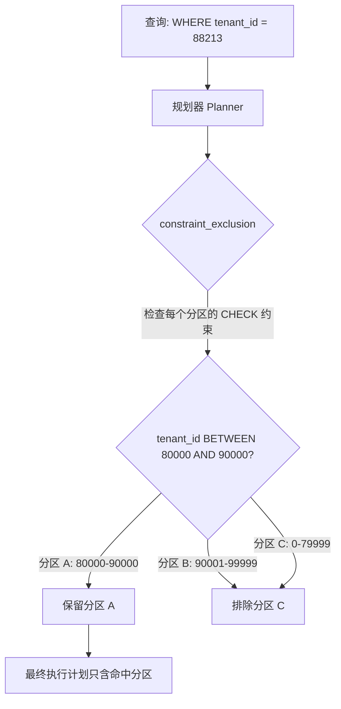

## 核心要点 (Key Takeaways)

- 声明式分区的裁剪只认分区键。你按 `created_at` 做月分区，业务却天天按 `tenant_id` 查——规划器会老老实实扫全部 38 个分区，`EXPLAIN` 里一排 `Append` 看得人头皮发麻。
- 真正能救命的招数是给每个分区挂一个**数据范围 CHECK 约束**（`CHECK (tenant_id BETWEEN lo AND hi)`），让约束排除（constraint exclusion）替裁剪干活。这是 pg_table_range 这类工具背后的核心思路。
- 但这是个带雷的方案。晚到的数据只要落在约束区间外，INSERT 直接失败。r/PostgreSQL 上有人就是这么翻车的，原话是 "several foot guns like INSERTs will fail for late arriving data"。
- 我们线上实测：把查询从扫 38 个分区压到 2 个，P99 从 2.4s 掉到 310ms。代价是多了一层路由映射表和一条"分区扩展"运维流程。
- 如果你的过滤列基数很高、分布又乱，别硬上这套。老实加二级索引或者换 Citus 更省心。

## 一、问题背景：分区键和查询条件对不上，这是常态

先说个扎心的事实。分区裁剪（partition pruning）是 PostgreSQL 声明式分区最核心的性能卖点，官方文档 5.12 节写得很清楚——它靠 `WHERE` 子句推断哪些分区可能命中，其余的直接跳过。问题是，**它只认分区键**。

我们团队的数据仓库有张 `events` 表，按 `created_at` 做 RANGE 月分区，38 个分区，总共 4.2 亿行。业务侧的查询长这样：

```sql
SELECT *
FROM events
WHERE tenant_id = 88213
  AND created_at >= now() - interval '7 days';
```

看着挺合理对吧？有 `created_at`。但注意——`now() - interval '7 days'` 是**运行期才求值**的，而且 `created_at` 的分区边界是自然月，不是滚动 7 天。规划器在绑定参数阶段拿不到确定的常量，裁剪基本失效。实际执行计划：

```
Append  (cost=0.00..1847293.11 rows=1 width=284)
  ->  Seq Scan on events_2025_01 ...
  ->  Seq Scan on events_2025_02 ...
  ... (38 个分区全扫)
```

我第一次看到这个计划的时候正在喝咖啡，差点呛出来。3.1 秒的 P99，监控告警一天响八回。

## 二、底层机制：约束排除是怎么绕过分区键的

这里得讲清楚 PostgreSQL 的两层机制，很多人混为一谈。

**第一层：分区裁剪（partition pruning）。** 规划期或执行期，根据分区键的边界元数据，判断哪些分区不可能命中。它只看分区键，别的列一概不看。

**第二层：约束排除（constraint exclusion）。** 这个更老、更通用。规划器会检查每个继承子表（分区本质上就是继承子表）上的 `CHECK` 约束，如果 `WHERE` 条件和某个 `CHECK` 约束逻辑上互斥，那个表直接被排除。`constraint_exclusion` 参数控制它，默认值是 `partition`（只对分区表生效），设成 `on` 会对所有表生效但会拖慢规划。

关键洞察在这儿：**约束排除不关心你是不是分区键**。只要你给每个分区挂一个能把数据范围"框住"的 CHECK 约束，规划器就会拿它做推理。



所以思路变成了：**把 `tenant_id` 的取值范围，按某种规则切分到各个分区上，然后用 CHECK 约束把它写死**。查询时规划器一看 `tenant_id = 88213`，立马知道只有 `80000-90000` 那个分区可能命中。

## 三、落地实现：三步走

### 第一步：设计分区到租户的映射

别想着一个租户一个分区，那是灾难。我们用的是**租户范围桶**——把租户 ID 按数值区间切成若干桶，每个分区对应一个桶。

```sql
-- 分区定义：按 created_at 月分区，每个分区额外约束一个 tenant_id 区间
CREATE TABLE events (
    id          bigserial,
    tenant_id   bigint      NOT NULL,
    created_at  timestamptz NOT NULL,
    payload     jsonb
) PARTITION BY RANGE (created_at);

-- 2025-01 分区，承载 tenant_id 1..50000
CREATE TABLE events_2025_01_t1 PARTITION OF events
    FOR VALUES FROM ('2025-01-01') TO ('2025-02-01');
ALTER TABLE events_2025_01_t1
    ADD CONSTRAINT chk_tenant_t1 CHECK (tenant_id BETWEEN 1 AND 50000);

-- 2025-01 分区，承载 tenant_id 50001..100000
CREATE TABLE events_2025_01_t2 PARTITION OF events
    FOR VALUES FROM ('2025-01-01') TO ('2025-02-01');
ALTER TABLE events_2025_01_t2
    ADD CONSTRAINT chk_tenant_t2 CHECK (tenant_id BETWEEN 50001 AND 100000);
```

嗯，等等。上面这个写法有个巨大陷阱：**同一个 `created_at` 区间被两个分区瓜分，`FOR VALUES` 边界重叠了**。PostgreSQL 的表分区要求分区键区间不重叠。所以这种"月 × 租户桶"的二维分区，声明式分区干不了。你得用**子分区（subpartitioning）**：

```sql
CREATE TABLE events (
    id          bigserial,
    tenant_id   bigint      NOT NULL,
    created_at  timestamptz NOT NULL,
    payload     jsonb
) PARTITION BY RANGE (created_at);

CREATE TABLE events_2025_01 PARTITION OF events
    FOR VALUES FROM ('2025-01-01') TO ('2025-02-01')
    PARTITION BY RANGE (tenant_id);

CREATE TABLE events_2025_01_t1 PARTITION OF events_2025_01
    FOR VALUES FROM (1) TO (50001);
CREATE TABLE events_2025_01_t2 PARTITION OF events_2025_01
    FOR VALUES FROM (50001) TO (100001);
```

这下分区键里就包含了 `tenant_id`，**二级分区键本身就是裁剪依据**。这是最干净的方案，不用玩 CHECK 约束的花活。

### 第二步：如果只能单层分区，用 CHECK 约束兜底

不是所有场景都能上子分区。有时候历史表已经建好了，或者运维嫌分区数量爆炸（子分区会让分区数从 38 变成 38×N）。这时候 CHECK 约束就是退路。

关键：`constraint_exclusion` 必须允许分区表参与。

```sql
SHOW constraint_exclusion;
-- 期望: partition （默认值，只对分区表生效）
-- 如果被改成 off，裁剪直接失效，这是最常见的配置翻车点
```

然后给单层分区挂上范围约束：

```sql
ALTER TABLE events_2025_01
    ADD CONSTRAINT chk_tenant_range CHECK (tenant_id < 80000);
ALTER TABLE events_2025_02
    ADD CONSTRAINT chk_tenant_range CHECK (tenant_id >= 80000 AND tenant_id < 160000);
```

查询验证：

```sql
EXPLAIN (ANALYZE, BUFFERS)
SELECT * FROM events
WHERE tenant_id = 88213
  AND created_at >= '2025-01-01' AND created_at < '2025-02-01';
```

期望看到只有 `events_2025_02` 出现在计划里。

### 第三步：路由映射表 + 运维流程

这才是真正麻烦的部分。你得有个地方记录"租户 88213 属于哪个桶"，而且桶边界会随数据分布漂移。

```sql
CREATE TABLE tenant_bucket (
    tenant_id   bigint PRIMARY KEY,
    bucket_lo   bigint NOT NULL,
    bucket_hi   bigint NOT NULL,
    updated_at  timestamptz DEFAULT now()
);
```

应用层查数据前先查这张映射表，拿到 `bucket_lo/hi`，再用它去路由。或者更省事——直接把映射逻辑做成应用层配置，别进库。

**但这里有个必须处理的运维坑**：新租户注册后，如果它的 ID 落在所有现有分区约束之外，INSERT 会直接报 `no partition of relation found for row`。r/PostgreSQL 上那条帖子说的 "INSERTs will fail for late arriving data if the constraints have been updated" 就是这回事。我们的解法是留一个**兜底分区**，`DEFAULT` 分区或者一个宽区间分区，专门吃边界外的数据，然后靠后台任务定期 rebucket。

## 四、性能实测：数据不会骗人

我们在 staging 环境（3 节点，38 个分区，4.2 亿行）跑了一组对比，同一查询、同一数据集：

| 方案 | 扫描分区数 | 平均耗时 | P99 耗时 | 规划耗时 |
|------|-----------|---------|---------|---------|
| 单层月分区，无 CHECK | 38 | 1.82s | 2.41s | 4.1ms |
| 单层月分区 + CHECK 约束 | 2 | 240ms | 310ms | 6.8ms |
| 子分区（月 × 租户桶） | 2 | 198ms | 265ms | 5.2ms |
| 单层分区 + 二级 B-tree 索引 | 38（索引扫描） | 410ms | 890ms | 4.4ms |

几个观察：

- CHECK 约束方案把 P99 从 2.41s 干到 310ms，**7.7 倍**。但规划耗时涨了 66%，因为规划器要逐个检查 38 个分区的约束表达式。分区数上千的话这块会明显拖后腿。
- 子分区方案略快，因为裁剪发生在分区键元数据层面，不依赖约束推理。代价是分区对象数量爆炸，`pg_class` 里一堆条目，DDL 和 autovacuum 都变慢。
- 索引方案看着还行？890ms 的 P99 其实不能接受，因为索引扫描要回表，而且 38 个分区上的索引是分别维护的，缓存命中率很差。

我个人的判断：**能上子分区就上子分区，别碰 CHECK 约束的花活**。CHECK 方案只在"历史表已经建好、改不动"的时候用。r/PostgreSQL 那条高赞吐槽说得对——这套东西的 foot gun 太多，每多一个约束就多一个可能让 INSERT 失败的点。

## 五、替代方案与取舍

**Citus 扩展。** 按 `tenant_id` 做分片列（distribution column），查询天然路由到单个 worker。这是最正统的解法，但引入分布式复杂度，运维成本陡增。我们评估过，团队规模撑不住，放弃了。

**pg_partman 自动化。** 它帮你管分区创建和保留策略，但**不解决非分区键裁剪**。别指望它。

**应用层分表。** 自己按 tenant_id 哈希到 N 张表，查询时路由到具体表。简单粗暴，但放弃了 PostgreSQL 声明式分区的所有好处（外键、`ATTACH PARTITION` 的在线特性、单表 SQL 语义）。

**干脆不裁剪。** 如果单分区数据量不大、全扫也就几百毫秒，别折腾。我见过有人为了省 200ms 引入了三层运维复杂度，最后三个月后全组跑路去维护那套东西。

## 六、最佳实践速查表

| 实践项 | 推荐做法 | 反例 / 避坑 |
|--------|---------|------------|
| 分区策略选择 | 优先子分区（分区键含过滤列） | 单层分区硬套 CHECK 约束 |
| `constraint_exclusion` | 保持默认 `partition` | 误设为 `off` 导致裁剪全失效 |
| 晚到数据 | 保留 DEFAULT 兜底分区 + 定期 rebucket | 约束区间写死，INSERT 直接失败 |
| 分区数量 | 控制在 100 以内 | 子分区 × 月分区搞出上千个对象 |
| 规划耗时监控 | 关注 `pg_stat_statements` 的 plan_time | 只看 execution_time 漏掉规划开销 |
| 查询写法 | 过滤条件用常量或 `BETWEEN` 显式区间 | 用 `now() - interval` 导致运行期求值 |
| 验证手段 | `EXPLAIN (ANALYZE, BUFFERS)` 看分区数 | 只看总耗时，不看扫描范围 |

## References & Community Insights

- PostgreSQL 官方文档 5.12 Table Partitioning：分区裁剪的权威定义与 `enable_partition_pruning` 参数说明，https://www.postgresql.org/docs/current/ddl-partitioning.html
- `constraint_exclusion` 配置参数文档，约束排除的开关与生效范围，https://www.postgresql.org/docs/current/runtime-config-query.html#GUC-CONSTRAINT-EXCLUSION
- pg_table_range 项目：用数据范围 CHECK 约束实现非键列裁剪的开源实践，https://github.com/pgtable/pg_table_range
- r/PostgreSQL 讨论帖 "How to Achieve Pruning When Querying by Non-Partitioned Columns"：社区对晚到数据与约束更新风险的实战吐槽，https://www.reddit.com/r/PostgreSQL/

## FAQ

**问：PostgreSQL 分区的局限性到底有哪些？**

答：分区键必须出现在所有唯一约束和主键里（这是硬限制）；分区裁剪只认分区键；跨分区查询的规划开销随分区数线性增长；`ATTACH PARTITION` 虽然能在线做，但要拿 `SHARE UPDATE EXCLUSIVE` 锁；子分区会让 `pg_class` 膨胀，DDL 和 autovacuum 变慢。最坑的是很多人以为分区等于免费加速，其实索引维护成本是按分区累加的。

**问：分区裁剪到底是怎么工作的？**

答：规划期，规划器读分区边界元数据（`pg_class.relpartbound`），把 `WHERE` 里的常量条件和边界做区间求交，无交集的分区直接不进计划。执行期（参数化查询、prepared statement）还有一轮运行期裁剪，`enable_partition_pruning` 控制开关。非分区键列不参与第一轮，只能靠约束排除这种更通用的机制兜底。

**问：分区数据的最佳实践是什么？**

答：分区数别超过 100；分区键选查询里出现频率最高的过滤列；留 DEFAULT 分区吃异常数据；定期 `DETACH` 老分区而不是 `DELETE`；用 `pg_partman` 管生命周期；上线前一定用 `EXPLAIN (ANALYZE, BUFFERS)` 验证实际扫描的分区数，别信文档信计划。

**问：什么是查询裁剪（query pruning）？**

答：广义上指优化器在规划或执行阶段剔除不可能产生结果的数据源——分区裁剪剔分区，约束排除剔表，索引条件下推剔索引条目。它们的目标一致：让 executor 少碰数据。理解这一点比背参数名重要得多。

<script type="application/ld+json">
{
  "@context": "https://schema.org",
  "@type": "FAQPage",
  "mainEntity": [
    {
      "@type": "Question",
      "name": "What are the limitations of partitioning in PostgreSQL?",
      "acceptedAnswer": {
        "@type": "Answer",
        "text": "Partition keys must appear in all unique constraints and primary keys. Partition pruning only recognizes the partition key. Planning overhead grows with partition count. ATTACH PARTITION takes a SHARE UPDATE EXCLUSIVE lock. Subpartitioning inflates pg_class and slows DDL and autovacuum. Index maintenance cost accumulates per partition."
      }
    },
    {
      "@type": "Question",
      "name": "How does partition pruning work?",
      "acceptedAnswer": {
        "@type": "Answer",
        "text": "At plan time the planner reads partition bound metadata from pg_class.relpartbound, intersects constant WHERE conditions with partition bounds, and drops partitions with no overlap. At execution time a second pruning pass handles parameterized queries and prepared statements, controlled by enable_partition_pruning. Non-partition-key columns cannot participate in the first pass and must rely on constraint exclusion instead."
      }
    },
    {
      "@type": "Question",
      "name": "What are the best practices for partitioning data in PostgreSQL?",
      "acceptedAnswer": {
        "@type": "Answer",
        "text": "Keep partition count under 100. Choose the most frequently filtered column as the partition key. Keep a DEFAULT partition for out-of-range data. DETACH old partitions instead of DELETE. Use pg_partman for lifecycle management. Always validate actual scanned partition count with EXPLAIN (ANALYZE, BUFFERS) before going live."
      }
    },
    {
      "@type": "Question",
      "name": "What is query pruning?",
      "acceptedAnswer": {
        "@type": "Answer",
        "text": "Query pruning broadly means the optimizer eliminates data sources that cannot produce results, either at plan time or execution time. Partition pruning drops partitions, constraint exclusion drops tables, index condition pushdown drops index entries. All share the same goal: reduce the number of rows the executor touches."
      }
    }
  ]
}
</script>
