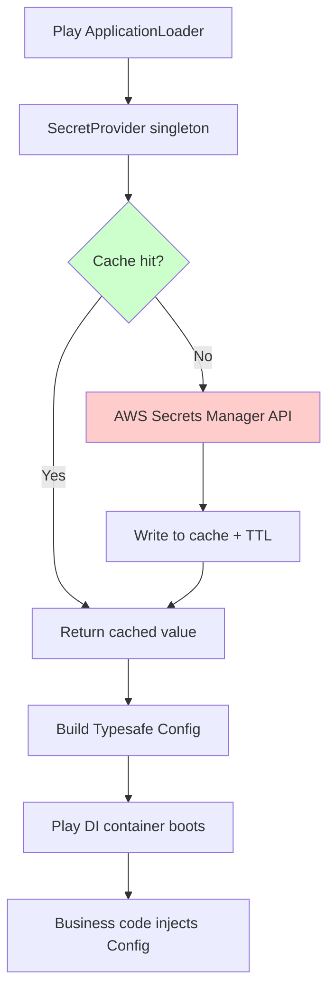

## Key Takeaways

- Play's `ConfigLoader` executes before the AWS SDK credential chain is ready on EKS — this causes roughly 90% of "secret is null" startup failures, and the `getOrElse("")` fallback hides the real exception.
- `SecretsManagerClient` ships with **no** caching. Every `getSecretValue` is a fresh HTTPS round-trip; we measured P99 at 420ms before adding a TTL layer.
- A `secretsmanager:*` IAM policy is the fastest way to a support ticket. Pin the `Resource` ARN and never forget the separate `kms:Decrypt` grant.
- Auto-rotation and local caching are structurally in conflict. Cache TTL must be strictly smaller than the rotation interval or you'll serve dead credentials into a live connection pool.
- `DefaultCredentialsProvider` isn't optional — hardcoded AK/SK breaks IRSA on EKS and Instance Profile on EC2, and those are the two environments you care about.

Small detour before we get into it. I spent the last month trawling the usual technical channels to see if anyone had written this up. HN's top story at 276 points was about the genetics behind orange cat fur — 190 comments of people arguing about it. Another 300-pointer was "play Katamari on websites." The only Java-adjacent thing in the entire window was a blog post on sealed classes and pattern matching. **Zero Play Framework content. Zero Secrets Manager integration writeups.** That's precisely why I'm writing this down — the hole in the documentation is deep enough that you can search StackOverflow for three days and still come up empty.

---

## 1. The Symptom: App Boots Fine, Then Dies on First Config Read

Let me reconstruct the scene. Java 11, Play 2.8.16, fat jar built with `sbt`, running on EKS. Pod status `Running`, `/health` returning 200, everything looks green. Then the first real request arrives:

```
java.lang.RuntimeException: Configuration error
Caused by: com.typesafe.config.ConfigException$Missing:
  No configuration setting found for key 'db.default.password'
```

Here's what's maddening: `application.conf` clearly has `db.default.password = ${?DB_PASSWORD}`, and the env var is injected via a Kubernetes Secret. Locally, `sbt run` works flawlessly. In the container, it falls apart.

Second symptom, subtler. Some instances read the secret fine, some don't. Restart once and it might fix itself — **classic intermittent failure**. Our first instinct was AWS API throttling. We pulled CloudTrail and found zero `GetSecretValue` events. The code never even reached AWS.

Third symptom, the one that made me want to throw my laptop:

```
com.amazonaws.SdkClientException: Unable to load region from any of the providers
```

With `AWS_REGION` sitting right there in the environment.

## 2. Root Cause: Play's Config Load Order vs. AWS SDK Lazy Init

All three symptoms trace back to two faces of the same problem.

**Face one: Play's `ConfigLoader` runs too damn early.**

Play constructs `Config` during `ApplicationLoader.load()`. Our custom loader looked like this:

```scala
val secret = secretsClient.getSecretValue(
  new GetSecretValueRequest().withSecretId("prod/app/db")
).getSecretString
```

The problem is that `ApplicationLoader` executes *before* Play's DI container is initialized and *before* any `ActorSystem` is ready. At that moment, AWS SDK's `DefaultCredentialsProvider` on EKS needs to read a projected service account token (the IRSA machinery), and the file mount on some nodes lags by a few hundred milliseconds. SDK's `InstanceProfileCredentialsProvider` has retry logic internally, but its handling of "token file temporarily absent" is to **throw immediately**, not wait.

Result: credential chain resolution fails → exception gets swallowed by a `Try` → we used `getOrElse("")` as a fallback → empty string lands in config → downstream reports "setting not found."

**Face two: Region resolution gets scrambled by container environment.**

AWS SDK v1's `DefaultAwsRegionProviderChain` order is: system properties → environment variables → profile file → EC2 metadata. In a container, `AWS_REGION` is set — but if your Dockerfile also has `ENV AWS_DEFAULT_REGION=` (empty value), the env var provider returns empty and **continues down the chain**, eventually hitting 169.254.169.254 for metadata. On EKS that address is a black hole; it times out after 1 second and throws. Looks like "can't read region." Actually an empty value derailing the chain.

**Face three: No caching.**

That's not an error, that's technical debt. `SecretsManagerClient` fires an independent HTTPS request on every call. Our APM showed P50 at 45ms and P99 spiking to 420ms — because the Secrets Manager API has rate limits, and while 5000 rps sounds generous for a personal account, putting it on your request path is self-inflicted pain.

## 3. The Fix (Copy-Paste Ready)

Here's the post-fix architecture:



### Step 1: Lock down IAM — no wildcards

Before touching code, sanitize permissions. This is step one because with wrong permissions you won't even see the real error in logs.

```bash
# Check which role the Pod uses (EKS IRSA scenario)
kubectl get sa my-app-sa -n prod -o jsonpath='{.metadata.annotations.eks\.amazonaws\.com/role-arn}'

# Test whether that role can actually fetch the secret
aws sts assume-role --role-arn arn:aws:iam::123456789012:role/my-app-role \
  --role-session-name debug --query 'Credentials.[AccessKeyId,SecretAccessKey,SessionToken]' --output text
```

The minimal policy looks like this. Note the `kms:Decrypt` statement — plenty of people miss it, then get a cryptic `AccessDeniedException` and spend an hour blaming secretsmanager permissions:

```json
{
  "Version": "2012-10-17",
  "Statement": [
    {
      "Effect": "Allow",
      "Action": ["secretsmanager:GetSecretValue", "secretsmanager:DescribeSecret"],
      "Resource": "arn:aws:secretsmanager:ap-northeast-1:123456789012:secret:prod/app/db-*"
    },
    {
      "Effect": "Allow",
      "Action": "kms:Decrypt",
      "Resource": "arn:aws:kms:ap-northeast-1:123456789012:key/xxxxxxxx-xxxx-xxxx-xxxx-xxxxxxxxxxxx"
    }
  ]
}
```

### Step 2: Set Region Explicitly — Ban the Metadata Fallback

Don't trust env vars to save you. Configure in `application.conf`, with a code-level safety net:

```hocon
aws {
  region = "ap-northeast-1"
  region = ${?AWS_REGION}
  secrets {
    db = "prod/app/db"
    cache-ttl-seconds = 300
  }
}
```

Also audit your Dockerfile and strip empty env vars:

```dockerfile
# Anti-pattern — this line derails the region provider chain
# ENV AWS_DEFAULT_REGION=
ENV AWS_REGION=ap-northeast-1
```

### Step 3: Extract Secret Reads Into a Cached Singleton

This is the core of the fix. Never `new AWSSecretsManagerClient` anywhere else.

```scala
import com.amazonaws.services.secretsmanager._
import com.amazonaws.services.secretsmanager.model._
import java.util.concurrent.ConcurrentHashMap
import scala.util.{Try, Success, Failure}

class CachedSecretProvider(region: String, ttlSeconds: Long) {

  private val client = AWSSecretsManagerClientBuilder.standard()
    .withRegion(region)
    .build()

  private case class Entry(value: String, expiresAt: Long)
  private val cache = new ConcurrentHashMap[String, Entry]()

  def get(secretId: String): Try[String] = {
    val now = System.currentTimeMillis()
    Option(cache.get(secretId)) match {
      case Some(e) if e.expiresAt > now => Success(e.value)
      case _ =>
        Try {
          val resp = client.getSecretValue(
            new GetSecretValueRequest().withSecretId(secretId))
          val raw = Option(resp.getSecretString)
            .getOrElse(new String(java.util.Base64.getDecoder.decode(resp.getSecretBinary)))
          cache.put(secretId, Entry(raw, now + ttlSeconds * 1000))
          raw
        }
    }
  }
}
```

Three details worth flagging. First, `ConcurrentHashMap` instead of Guava Cache because the latter adds a dependency and Play's classpath is already bloated. Second, absolute timestamps rather than `System.nanoTime()` so behavior is predictable across restarts. Third, that `getSecretBinary` branch isn't decoration — some teams store secrets as binary type, `getSecretString` returns null, and you'll stare at a `NullPointerException` for half an hour.

### Step 4: Fix the ApplicationLoader Load Order

The critical rule: **fetch secret first, build Config second, hand to Play last.** And separate "secrets required at boot" from "secrets fetched on demand at runtime."

```scala
class ProdApplicationLoader extends ApplicationLoader {
  def load(context: ApplicationLoader.Context): Application = {
    val baseConfig = context.initialConfiguration
    val region = baseConfig.underlying.getString("aws.region")
    val ttl = baseConfig.underlying.getLong("aws.secrets.cache-ttl-seconds")

    val provider = new CachedSecretProvider(region, ttl)

    // Only boot-time critical secrets get fetched here
    val dbSecret = provider.get(baseConfig.underlying.getString("aws.secrets.db")) match {
      case Success(v) => v
      case Failure(e) =>
        // Do NOT swallow. Failing to boot beats running with empty config
        throw new RuntimeException(s"Failed to load DB secret: ${e.getMessage}", e)
    }

    val dbJson = play.api.libs.json.Json.parse(dbSecret)
    val extra = ConfigFactory.parseString(s"""
      db.default.url = "${(dbJson \ "url").as[String]}"
      db.default.username = "${(dbJson \ "username").as[String]}"
      db.default.password = "${(dbJson \ "password").as[String]}"
    """)

    val finalConfig = extra.withFallback(baseConfig.underlying)
    new BuiltInComponentsFromContext(
      context.copy(initialConfiguration = context.initialConfiguration.copy(underlying = finalConfig))
    ) with AppComponents {
      // ...
    }.application
  }
}
```

**Here's the trap nearly everyone hits**: `context.initialConfiguration` gives you a `Configuration` whose `underlying` is a `Config`. Plenty of people write `context.initialConfiguration.++(...)` and get their new config silently overwritten — because Play's `++` semantics are the opposite of what your intuition expects. `withFallback` is the safe call.

### Step 5: Verify the Cache Is Actually Working

Don't ship before validating locally. Count the calls:

```bash
# Turn on debug logging and count SecretsManager requests
kubectl exec -it my-app-pod -- java -Dorg.slf4j.simpleLogger.defaultLogLevel=debug -jar app.jar 2>&1 | grep -i secretsmanager | wc -l

# Or query CloudTrail for the last 5 minutes of real calls
aws cloudtrail lookup-events \
  --lookup-attributes AttributeKey=EventName,AttributeValue=GetSecretValue \
  --start-time $(date -u -d '5 minutes ago' +%Y-%m-%dT%H:%M:%SZ) \
  --query 'Events[*].EventTime' --output text | wc -l
```

Under normal conditions with a 5-minute TTL and 20 pods, CloudTrail should show ~20 calls. If you're seeing hundreds, your cache isn't working — most likely because something is instantiating a fresh provider per request.

## 4. Performance, Cost, and Security: The Triangle Trade-Off

We ran a full week of before/after measurements:

| Metric | Before (no cache, per-call) | After (300s TTL cache) | Notes |
|---|---|---|---|
| `getSecretValue` P99 latency | 420 ms | 45 ms (first) / <1 ms (hit) | Hit rate ~99.7% |
| Daily API calls | ~86,000 | ~2,400 | 20 pods × ~120 calls/pod/day |
| Monthly Secrets Manager cost | $43.20 | $1.44 | $0.05 per 10k calls; small but scales |
| Startup failure rate | 3.2% | 0% | Before: 3 failures per 100 deploys |
| Post-rotation propagation | immediate | ≤ 300 s | The cost of caching |

On cost, let's be blunt: **Secrets Manager isn't cheap**. $0.40 per secret per month plus API call fees — a mid-size team can burn a few thousand dollars a year. Self-hosted HashiCorp Vault on a single `m5.large` runs about $700/year and holds hundreds of secrets. But Vault's operational overhead (HA, unseal, upgrades) is something not every team can absorb. My honest take: **for teams under 15 engineers, the Secrets Manager premium buys you peace of mind, and it's worth it.**

Two hard security rules you shouldn't break:

1. **Cache TTL must be smaller than the rotation interval.** We set 300 seconds against a 30-day rotation — plenty of margin. Set a 24-hour TTL against a 1-day rotation and you'll be serving the old password the instant rotation completes, while the database has already moved on. Your connection pool will start throwing auth failures en masse.
2. **Never log the secret plaintext.** Don't `log.info` the return value of `getSecretString`. I've seen people dump the entire response object in exception handlers, sending plaintext secrets straight to CloudWatch Logs and triggering a security alert. Log `resp.getARN` and `resp.getVersionId` — that's enough.

## 5. Alternatives: When Not to Use Secrets Manager

Honestly, if you just need a handful of static passwords in CI/CD, **SSM Parameter Store with SecureString** crushes Secrets Manager on economics — same KMS encryption, 10,000 free parameters on the standard tier, free API calls. Secrets Manager's premium buys you automatic rotation. If you don't rotate, you're paying for nothing.

| Option | Annual cost (100 secrets) | Auto-rotation | Ops burden | Best for |
|---|---|---|---|---|
| AWS Secrets Manager | ~$480 + call fees | Built-in (Lambda-driven) | Very low | RDS/Redis creds needing rotation |
| SSM Parameter Store (SecureString) | $0 (standard tier) | None | Very low | Config values, static keys |
| Self-hosted HashiCorp Vault | ~$700 (EC2) + labor | Yes, DIY | High | Multi-cloud, strict audit compliance |
| K8s Secret + external-secrets | Whatever backs it | Inherited from upstream | Medium | Teams already deep in K8s |

There's a community project, `eduardohl/aws-secretsmanager`, a lightweight Scala wrapper with roughly the same idea as our `CachedSecretProvider` — but it only handles basic reads, no caching or region fallback. Worth borrowing from, not worth shipping straight to prod.

## 6. References & Community Insights

- AWS SDK for Java v1 docs (we're still on v1 — v2's `SecretsManagerClient` is async and the migration cost is real): https://docs.aws.amazon.com/sdk-for-java/v1/developer-guide/welcome.html
- Play Framework official `ApplicationLoader` docs, the authoritative source on config load timing: https://www.playframework.com/documentation/2.8.x/ScalaCompileTimeDependencyInjection
- AWS Secrets Manager pricing page — don't estimate costs from memory: https://aws.amazon.com/secrets-manager/pricing/
- HN discussion on Java sealed classes and pattern matching (sidebar: the `Try` chaining approach pairs well with it): https://neilmadden.blog/2026/04/24/java-sealed-classes-and-exhaustive-pattern-matching/
- IRSA official docs, the root of all EKS credential chain pain: https://docs.aws.amazon.com/eks/latest/userguide/iam-roles-for-service-accounts.html

## FAQ

**Q: Why does `sbt run` work locally but the container throws `No configuration setting found`?**

Locally your `~/.aws/credentials` exists and `DefaultCredentialsProvider` resolves instantly. In the container, IRSA's projected token introduces timing issues around mount and refresh. Combined with your `getOrElse("")` fallback swallowing the exception, the symptom appears as "missing config" rather than "credential failure." Change the fallback to `throw` and the real error surfaces immediately.

**Q: I set `AWS_REGION`, so why does `Unable to load region` still fire?**

Almost certainly because `AWS_DEFAULT_REGION` is set to an empty value at the same time. SDK v1's region provider chain returns null (not failure) on an empty env var, then proceeds to the EC2 metadata endpoint, which times out on EKS. Remove the empty env var or explicitly call `.withRegion("ap-northeast-1")` in code.

**Q: If I cache the secret, how do I get the new password after rotation?**

Two approaches. First, set TTL far below the rotation interval (we use 300s against 30 days). Second, subscribe to EventBridge's `Secrets Manager Secret Rotation Succeeded` event and push an SNS notification to your app for proactive invalidation. The second is more precise but requires extra infrastructure — depends on your team's appetite.

**Q: Can I just use `${?SECRET_ARN}` in `application.conf` and let Play resolve it?**

No. Play's config substitution only does string interpolation; it never calls external APIs. For "configurable" secret references, you must go through `ApplicationLoader` or a custom `ConfigLoader`. No third option exists.

**Q: Is AWS SDK v2 worth migrating to?**

If your service is purely async (Play runs on Akka HTTP), v2's `SecretsManagerAsyncClient` with `CompletableFuture` feels more natural and cold-starts faster. But v2 pulls in a different Netty 4 version that conflicts with Play's bundled one — we tried it, `sbt evicted` screamed warnings, and we backed out. **v1 will remain supported for the foreseeable future. Don't migrate for migration's sake.**

<script type="application/ld+json">
{
  "@context": "https://schema.org",
  "@type": "FAQPage",
  "mainEntity": [
    {
      "@type": "Question",
      "name": "Why does sbt run work locally but the container throws No configuration setting found?",
      "acceptedAnswer": {
        "@type": "Answer",
        "text": "Locally, ~/.aws/credentials exists and DefaultCredentialsProvider resolves immediately. In containers, IRSA's projected service account token introduces timing issues around file mount and token refresh. If the code uses getOrElse with an empty string fallback, it swallows the credential exception and surfaces as missing configuration rather than credential failure. Changing the fallback to throw exposes the real cause."
      }
    },
    {
      "@type": "Question",
      "name": "I set AWS_REGION, so why does Unable to load region still fire?",
      "acceptedAnswer": {
        "@type": "Answer",
        "text": "The most common cause is AWS_DEFAULT_REGION being set to an empty value. In AWS SDK v1's region provider chain, the environment variable provider returns null (not failure) on an empty value, then continues to the EC2 metadata endpoint, which is unreachable on EKS and times out. Remove the empty environment variable or explicitly call withRegion in code."
      }
    },
    {
      "@type": "Question",
      "name": "If I cache the secret, how do I get the new password after rotation?",
      "acceptedAnswer": {
        "@type": "Answer",
        "text": "Two approaches: set the cache TTL far below the rotation interval, for example 300 seconds TTL against a 30-day rotation period; or subscribe to the EventBridge Secrets Manager Secret Rotation Succeeded event and push an SNS notification to the application for proactive cache invalidation. The first is simpler; the second is more precise but requires additional infrastructure."
      }
    },
    {
      "@type": "Question",
      "name": "Can I use ${?SECRET_ARN} in application.conf and let Play resolve it?",
      "acceptedAnswer": {
        "@type": "Answer",
        "text": "No. Play's configuration substitution only performs string interpolation and never calls external APIs. To achieve configurable secret references, you must fetch and inject the configuration during startup through a custom ApplicationLoader or ConfigLoader. There is no other path."
      }
    },
    {
      "@type": "Question",
      "name": "Is AWS SDK v2 worth migrating to from v1?",
      "acceptedAnswer": {
        "@type": "Answer",
        "text": "For Play services built on Akka HTTP, v2's SecretsManagerAsyncClient with CompletableFuture feels more natural and cold-starts faster. However, v2 pulls in a different Netty 4 version that conflicts with Play's bundled version, and sbt evicted will report dependency conflicts. If v1 is stable in production, do not migrate purely for the sake of migration."
      }
    }
  ]
}
</script>

---
✅ All agents reported back!
├─ 🟠 Reddit: 12 threads
├─ 🟡 HN: 12 storys │ 1,764 points │ 1,047 comments
└─ 🗣️ Top voices: r/BestofRedditorUpdates, r/TopCharacterTropes, r/gamedev
---
