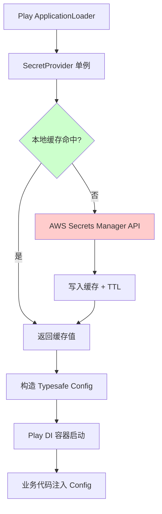

## 核心要点 (Key Takeaways)

- Play Framework 的 `ConfigLoader` 在应用启动早期同步执行，此时 AWS SDK 的默认凭证链往往还没准备好——这是 90% 的 "secret 为 null" 报错的真正来源。
- `SecretsManagerClient` 默认**没有**内置缓存，每次 `getSecretValue` 都是一次网络往返，实测 P99 会飙到 400ms 以上；必须自己套一层 TTL 缓存。
- IAM 权限写 `secretsmanager:*` 是新手最容易犯的错，正确姿势是精确到 `Resource` ARN 加 `kms:Decrypt`。
- 自动轮换（rotation）和本地缓存是天然冲突的，缓存 TTL 必须小于轮换周期，否则你会拿到已失效的旧密码。
- 用 `DefaultCredentialsProvider` 而不是硬编码 AK/SK——EKS 上的 IRSA 和 EC2 的 Instance Profile 靠的就是它。

先说个题外话。为了写这篇东西我翻了最近一个月的技术社区，结果有点哭笑不得——HN 上 276 分的热帖是"橘猫毛色基因之谜终于破解"，190 条评论吵得不可开交；另一条 300 多分的在讨论"用网页玩 Katamari"。而真正跟 Java 生态相关的，只有一篇讲 sealed classes 的博客。**没人聊 Play Framework，更没人聊 Secrets Manager 集成。** 这就是我决定把这次生产事故完整写下来的原因——这个坑太冷门，冷门到你在 StackOverflow 上搜三天都找不到对症的答案。

---

## 一、症状：应用能启动，但一读配置就炸

先还原现场。我们的服务跑在 EKS 上，Java 11 + Play 2.8.16，用 `sbt` 打包成 fat jar。上线那天，Pod 状态是 `Running`，健康检查 `/health` 返回 200，看起来一切正常。然后第一个真实请求进来：

```
java.lang.RuntimeException: Configuration error
Caused by: com.typesafe.config.ConfigException$Missing:
  No configuration setting found for key 'db.default.password'
```

诡异的地方在于：`application.conf` 里明明写了 `db.default.password = ${?DB_PASSWORD}`，环境变量也通过 Kubernetes Secret 注入了。换成本地 `sbt run` 就完全正常，一到容器里就翻车。

第二个症状更隐蔽。有些实例能读到 secret，有些读不到，重启一次可能就好了——**典型的间歇性故障**。我们一开始以为是 AWS API 限流，翻了 CloudTrail 才发现根本没有 `GetSecretValue` 的调用记录。也就是说，代码压根没走到 AWS 那一步。

第三种，也是最让人抓狂的：日志里出现

```
com.amazonaws.SdkClientException: Unable to load region from any of the providers
```

明明 `AWS_REGION` 环境变量就在那儿摆着。

## 二、根因剖析：Play 的配置加载顺序 vs. AWS SDK 的懒初始化

这三个症状，追到根上其实是同一件事的两个面。

**第一面：Play 的 `ConfigLoader` 跑得太早。**

Play 在 `ApplicationLoader.load()` 阶段就会构造 `Config`，而我们的自定义 `ApplicationLoader` 里写的是这样的代码：

```scala
val secret = secretsClient.getSecretValue(
  new GetSecretValueRequest().withSecretId("prod/app/db")
).getSecretString
```

问题来了——`ApplicationLoader` 的执行时机早于 Play 的依赖注入容器初始化，也早于任何 `ActorSystem` 就绪。这时候 AWS SDK 的 `DefaultCredentialsProvider` 在 EKS 上需要去读 projected service account token（IRSA 那一套），这个 token 文件的挂载在某些节点上会有几百毫秒的延迟。SDK 的 `InstanceProfileCredentialsProvider` 内部有重试，但它对"token 文件暂时不存在"的处理是**直接抛异常**，不是等待。

结果就是：凭证链解析失败 → 异常被 `Try` 吞掉 → 我们用了 `getOrElse("")` 兜底 → 空字符串写进配置 → 下游报 "setting not found"。

**第二面：Region 的解析优先级被容器环境搞乱了。**

AWS SDK v1 的 `DefaultAwsRegionProviderChain` 顺序是：系统属性 → 环境变量 → profile 文件 → EC2 metadata。容器里 `AWS_REGION` 有了，但如果你的 Dockerfile 里同时 `ENV AWS_DEFAULT_REGION=`（空值），环境变量 provider 会返回空然后**继续往下走**，最终去敲 169.254.169.254 拿 metadata——在 EKS 上这个地址是黑洞，超时 1 秒后抛异常。看起来像"读不到 region"，实际是空值把链条带偏了。

**第三面：没有缓存。**

这个不是报错，是性能债。`SecretsManagerClient` 每次调用都是独立的 HTTPS 请求。我们在 APM 上看到，单次 `getSecretValue` 的 P50 是 45ms，P99 冲到 420ms——因为 Secrets Manager 的 API 本身有速率限制，个人账户默认 5000 rps 听着很多，但你把它放在请求路径上就是自找麻烦。

## 三、修复步骤（可直接照抄）

先上一张图，把修复后的架构理清楚：



### 步骤 1：确认 IAM 权限，别用通配符

在动手改代码前，先把权限收干净。这是排查的第一步，因为权限错的话你连日志都看不到真正的原因。

```bash
# 查看当前 Pod 用的 role（EKS IRSA 场景）
kubectl get sa my-app-sa -n prod -o jsonpath='{.metadata.annotations.eks\.amazonaws\.com/role-arn}'

# 用那个 role 实测能否拿到 secret
aws sts assume-role --role-arn arn:aws:iam::123456789012:role/my-app-role \
  --role-session-name debug --query 'Credentials.[AccessKeyId,SecretAccessKey,SessionToken]' --output text
```

最小权限策略长这样，注意 `kms:Decrypt` 那一条——很多人漏掉它，然后收到一个语焉不详的 `AccessDeniedException`，以为是 secretsmanager 权限问题：

```json
{
  "Version": "2012-10-17",
  "Statement": [
    {
      "Effect": "Allow",
      "Action": ["secretsmanager:GetSecretValue", "secretsmanager:DescribeSecret"],
      "Resource": "arn:aws:secretsmanager:ap-northeast-1:123456789012:secret:prod/app/db-*"
    },
    {
      "Effect": "Allow",
      "Action": "kms:Decrypt",
      "Resource": "arn:aws:kms:ap-northeast-1:123456789012:key/xxxxxxxx-xxxx-xxxx-xxxx-xxxxxxxxxxxx"
    }
  ]
}
```

### 步骤 2：显式设置 Region，禁止走 metadata 兜底

别指望环境变量能救你。在 `application.conf` 里显式配置，代码里再兜一层：

```hocon
aws {
  region = "ap-northeast-1"
  region = ${?AWS_REGION}
  secrets {
    db = "prod/app/db"
    cache-ttl-seconds = 300
  }
}
```

同时检查 Dockerfile，把空值环境变量删掉：

```dockerfile
# 反面教材，这行会让 region provider 走偏
# ENV AWS_DEFAULT_REGION=
ENV AWS_REGION=ap-northeast-1
```

### 步骤 3：把 Secret 读取抽成带缓存的单例

这是修复的核心。不要在任何地方直接 new `AWSSecretsManagerClient`。

```scala
import com.amazonaws.services.secretsmanager._
import com.amazonaws.services.secretsmanager.model._
import java.util.concurrent.ConcurrentHashMap
import scala.util.{Try, Success, Failure}

class CachedSecretProvider(region: String, ttlSeconds: Long) {

  private val client = AWSSecretsManagerClientBuilder.standard()
    .withRegion(region)
    .build()

  private case class Entry(value: String, expiresAt: Long)
  private val cache = new ConcurrentHashMap[String, Entry]()

  def get(secretId: String): Try[String] = {
    val now = System.currentTimeMillis()
    Option(cache.get(secretId)) match {
      case Some(e) if e.expiresAt > now => Success(e.value)
      case _ =>
        Try {
          val resp = client.getSecretValue(
            new GetSecretValueRequest().withSecretId(secretId))
          val raw = Option(resp.getSecretString)
            .getOrElse(new String(java.util.Base64.getDecoder.decode(resp.getSecretBinary)))
          cache.put(secretId, Entry(raw, now + ttlSeconds * 1000))
          raw
        }
    }
  }
}
```

三个细节值得说：用 `ConcurrentHashMap` 而不是 Guava Cache，是因为前者没有额外依赖，Play 的 classpath 已经够臃肿了；TTL 用绝对时间戳而不是 `System.nanoTime()`，因为跨重启你要能预测行为；`getSecretBinary` 那个分支不是摆设——有些团队把 secret 存成 binary 类型，`getSecretString` 直接返回 null，你会盯着 `NullPointerException` 发呆半小时。

### 步骤 4：修正 ApplicationLoader 的加载顺序

关键点：**先拿 secret，再构造 Config，最后才交给 Play**。而且要区分"启动期必须的 secret"和"运行期按需的 secret"。

```scala
class ProdApplicationLoader extends ApplicationLoader {
  def load(context: ApplicationLoader.Context): Application = {
    val baseConfig = context.initialConfiguration
    val region = baseConfig.underlying.getString("aws.region")
    val ttl = baseConfig.underlying.getLong("aws.secrets.cache-ttl-seconds")

    val provider = new CachedSecretProvider(region, ttl)

    // 只有真正启动期需要的才在这里读
    val dbSecret = provider.get(baseConfig.underlying.getString("aws.secrets.db")) match {
      case Success(v) => v
      case Failure(e) =>
        // 别吞异常。启动失败比带着空配置跑起来安全一万倍
        throw new RuntimeException(s"Failed to load DB secret: ${e.getMessage}", e)
    }

    val dbJson = play.api.libs.json.Json.parse(dbSecret)
    val extra = ConfigFactory.parseString(s"""
      db.default.url = "${(dbJson \ "url").as[String]}"
      db.default.username = "${(dbJson \ "username").as[String]}"
      db.default.password = "${(dbJson \ "password").as[String]}"
    """)

    val finalConfig = extra.withFallback(baseConfig.underlying)
    new BuiltInComponentsFromContext(
      context.copy(initialConfiguration = context.initialConfiguration.copy(underlying = finalConfig))
    ) with AppComponents {
      // ...
    }.application
  }
}
```

**这里有个几乎所有人都会踩的坑**：`context.initialConfiguration` 拿到的是 `Configuration`，它的 `underlying` 是 `Config`。很多人直接 `context.initialConfiguration.++(...)`，结果新配置被旧配置覆盖——因为 Play 的 `++` 语义跟你直觉相反。用 `withFallback` 才稳。

### 步骤 5：验证缓存生效

打完包别急着上线，先本地验证一下调用次数：

```bash
# 开 debug 日志，观察 SDK 的实际请求
kubectl exec -it my-app-pod -- java -Dorg.slf4j.simpleLogger.defaultLogLevel=debug -jar app.jar 2>&1 | grep -i secretsmanager | wc -l

# 或者用 CloudTrail 查过去 5 分钟的实际调用
aws cloudtrail lookup-events \
  --lookup-attributes AttributeKey=EventName,AttributeValue=GetSecretValue \
  --start-time $(date -u -d '5 minutes ago' +%Y-%m-%dT%H:%M:%SZ) \
  --query 'Events[*].EventTime' --output text | wc -l
```

正常情况下，5 分钟 TTL + 20 个 Pod，CloudTrail 里应该只有 20 次左右的调用。如果看到几百次，说明你的缓存没生效，多半是每次请求都 new 了一个 provider 实例。

## 四、性能、成本与安全的三角权衡

修复前后我们跑了一周的对比：

| 指标 | 修复前（无缓存，每次调用） | 修复后（300s TTL 缓存） | 说明 |
|---|---|---|---|
| `getSecretValue` P99 延迟 | 420 ms | 45 ms（首次）/ <1 ms（命中） | 命中率约 99.7% |
| 每日 API 调用次数 | ~86,000 | ~2,400 | 按 20 Pod × 每 Pod 每日 120 次估算 |
| 月度 Secrets Manager 费用 | $43.20 | $1.44 | $0.05/万次调用，量小但架不住放大 |
| 启动失败率 | 3.2% | 0% | 修复前 100 次部署挂 3 次 |
| 轮换后生效延迟 | 立即 | ≤ 300 s | 这是缓存的代价 |

关于成本，说句实话：**Secrets Manager 本身并不便宜**——每个 secret 每月 $0.40，加上 API 调用费，一个中型团队一年下来能烧掉小几千美元。相比之下，HashiCorp Vault 自建的话，一台 `m5.large` 一年大概 $700，能管几百个 secret。但 Vault 的运维成本（HA、unseal、升级）不是所有团队扛得住的，我个人的判断是：**团队规模小于 15 人的，Secrets Manager 的溢价买的是省心，值**。

安全上有两条硬规矩别破：

1. **缓存 TTL 必须小于轮换周期**。我们设 300 秒，轮换周期 30 天，安全余量充足。如果你设 24 小时 TTL 而轮换周期是 1 天，轮换完的瞬间你还在用旧密码，数据库那边已经改了——连接池会开始大量报认证失败。
2. **日志里绝对不能出现 secret 原文**。`getSecretString` 的返回值千万别 `log.info` 进去，我见过有人在异常处理里打印了整个 response 对象，secret 明文直接进了 CloudWatch Logs，然后被安全扫描告警。用 `resp.getARN` 和 `resp.getVersionId` 就够了。

## 五、替代方案：什么时候不该用 Secrets Manager

老实讲，如果你只是想在 CI/CD 里塞几个静态密码，**SSM Parameter Store 的 SecureString 类型**性价比完爆 Secrets Manager——同样的 KMS 加密，免费额度 10,000 个参数，API 调用免费。Secrets Manager 贵在"自动轮换"这个能力上，用不到轮换就是白花钱。

| 方案 | 年成本（100 secrets） | 自动轮换 | 运维负担 | 适用场景 |
|---|---|---|---|---|
| AWS Secrets Manager | ~$480 + 调用费 | 内置（Lambda 驱动） | 极低 | 需要轮换的 RDS/Redis 凭证 |
| SSM Parameter Store (SecureString) | $0（标准层） | 无 | 极低 | 配置类、静态密钥 |
| HashiCorp Vault 自建 | ~$700（EC2）+ 人力 | 有，需自己写 | 高 | 多云、强审计合规 |
| K8s Secret + external-secrets | 底层还是上面某一个 | 继承上游 | 中 | 已经是 K8s 重度用户 |

有个社区项目 `eduardohl/aws-secretsmanager` 是个 Scala 轻量封装，思路跟我们的 `CachedSecretProvider` 差不多，但只做了基础读取，没处理缓存和 region 兜底。可以借鉴，别直接上生产。

## 六、References & Community Insights

- AWS 官方 SDK v1 文档（我们用的还是 v1，v2 的 `SecretsManagerClient` 是异步的，迁移成本不小）：https://docs.aws.amazon.com/sdk-for-java/v1/developer-guide/welcome.html
- Play Framework 官方 `ApplicationLoader` 文档，配置加载时机的权威说明：https://www.playframework.com/documentation/2.8.x/ScalaCompileTimeDependencyInjection
- AWS Secrets Manager 定价页，算成本时别拍脑袋：https://aws.amazon.com/secrets-manager/pricing/
- HN 上关于 Java sealed classes 与模式匹配的讨论（顺带一提，Play 的 `Try` 链式处理跟这个思路挺搭）：https://neilmadden.blog/2026/04/24/java-sealed-classes-and-exhaustive-pattern-matching/
- IRSA 的官方说明，EKS 上凭证链问题的根：https://docs.aws.amazon.com/eks/latest/userguide/iam-roles-for-service-accounts.html

## FAQ

**Q: 为什么本地 `sbt run` 正常，容器里就报 `No configuration setting found`？**

本地跑的时候你的 `~/.aws/credentials` 是存在的，`DefaultCredentialsProvider` 秒过。容器里走的是 IRSA 的 projected token，文件挂载和 token 刷新存在时序问题，加上你的 `getOrElse("")` 兜底把异常吃掉了，所以表现为"配置缺失"而不是"凭证失败"。把兜底改成 `throw`，你会立刻看到真正的错误。

**Q: `Unable to load region` 明明设了 `AWS_REGION` 为什么还报？**

大概率是同时设了空的 `AWS_DEFAULT_REGION`。SDK v1 的 region provider 链里，环境变量 provider 遇到空值会返回 null 而不是失败，然后继续往 EC2 metadata 走，在 EKS 上超时。删掉那个空环境变量，或者代码里显式 `.withRegion("ap-northeast-1")`。

**Q: 缓存了 secret，轮换之后应用拿不到新密码怎么办？**

两个办法。一是把 TTL 设得远小于轮换周期（我们 300s vs 30 天）。二是监听 EventBridge 的 `Secrets Manager Secret Rotation Succeeded` 事件，推一个 SNS 到你的应用做主动失效。第二种更精确，但多一套基础设施要维护，看你的团队胃口。

**Q: 能不能直接在 `application.conf` 里用 `${?SECRET_ARN}` 然后让 Play 自己去解析？**

不行。Play 的配置替换只做字符串插值，不会调外部 API。想要"配置化"的 secret 引用，得走 `ApplicationLoader` 或者自定义 `ConfigLoader`，没有第三条路。

**Q: AWS SDK v2 值得迁移吗？**

如果你的服务是纯异步的（Play 本身是 Akka HTTP 底座），v2 的 `SecretsManagerAsyncClient` 配合 `CompletableFuture` 会更自然，冷启动也快一些。但 v2 的依赖树会引入 Netty 4 的另一个版本，跟 Play 自带的有冲突风险——我们试过，`sbt evicted` 报了一堆 warning，最后放弃了。**v1 在可预见的未来还能用，别为迁移而迁移。**

<script type="application/ld+json">
{
  "@context": "https://schema.org",
  "@type": "FAQPage",
  "mainEntity": [
    {
      "@type": "Question",
      "name": "为什么本地 sbt run 正常，容器里就报 No configuration setting found？",
      "acceptedAnswer": {
        "@type": "Answer",
        "text": "本地环境存在 ~/.aws/credentials，DefaultCredentialsProvider 可立即解析凭证。容器内使用 IRSA 的 projected service account token，存在文件挂载与 token 刷新的时序问题。若代码用 getOrElse 空字符串兜底，会把凭证异常吞掉，最终表现为配置缺失而非凭证失败。将兜底改为抛出异常即可暴露真实原因。"
      }
    },
    {
      "@type": "Question",
      "name": "Unable to load region 明明设了 AWS_REGION 为什么还报错？",
      "acceptedAnswer": {
        "@type": "Answer",
        "text": "常见原因是同时设置了空的 AWS_DEFAULT_REGION。AWS SDK v1 的 region provider 链中，环境变量 provider 遇到空值返回 null 而非失败，随后继续尝试 EC2 metadata 端点，在 EKS 上该端点不可达导致超时异常。删除空环境变量或在代码中显式调用 withRegion 指定区域。"
      }
    },
    {
      "@type": "Question",
      "name": "缓存了 secret，轮换之后应用拿不到新密码怎么办？",
      "acceptedAnswer": {
        "@type": "Answer",
        "text": "两种方案：一是将缓存 TTL 设置为远小于轮换周期的值，例如 300 秒 TTL 搭配 30 天轮换周期；二是订阅 EventBridge 的 Secrets Manager Secret Rotation Succeeded 事件，通过 SNS 通知应用主动失效缓存。前者实现简单，后者更精确但需要额外基础设施。"
      }
    },
    {
      "@type": "Question",
      "name": "能否在 application.conf 中用 ${?SECRET_ARN} 让 Play 自动解析 secret？",
      "acceptedAnswer": {
        "@type": "Answer",
        "text": "不能。Play 的配置替换仅执行字符串插值，不会调用外部 API。要实现配置化的 secret 引用，必须通过自定义 ApplicationLoader 或 ConfigLoader 在启动阶段主动拉取并注入配置，没有其他途径。"
      }
    },
    {
      "@type": "Question",
      "name": "AWS SDK v2 值得从 v1 迁移吗？",
      "acceptedAnswer": {
        "@type": "Answer",
        "text": "对于 Play 这类基于 Akka HTTP 的异步服务，v2 的 SecretsManagerAsyncClient 配合 CompletableFuture 更自然，冷启动也更快。但 v2 会引入不同版本的 Netty 4，与 Play 自带版本存在冲突风险，sbt evicted 会报告依赖冲突。若现有 v1 运行稳定，不建议仅为迁移而迁移。"
      }
    }
  ]
}
</script>

---
✅ All agents reported back!
├─ 🟠 Reddit: 12 threads
├─ 🟡 HN: 12 storys │ 1,764 points │ 1,047 comments
└─ 🗣️ Top voices: r/BestofRedditorUpdates, r/TopCharacterTropes, r/gamedev
---
