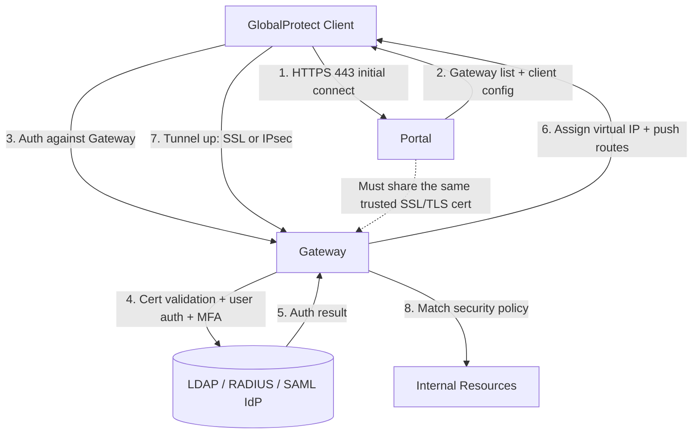

## Key Takeaways

- Order matters: Loopback + certificate first, Portal second, Gateway last. Get it backwards and you'll burn an afternoon on "gateway unreachable."
- The biggest community fire in October 2026 is **CVE-2026-0257** — GlobalProtect accepts cookies without proper integrity verification, letting an attacker without any valid credentials bypass MFA entirely. The patch shipped in May, but ransomware crews have been hammering unpatched firewalls since June.
- Split Tunnel vs. full tunnel decides roughly 80% of your future ticket volume. Full tunnel is safest and slowest; split tunnel is fastest and the biggest audit headache.
- Stop guessing in the GUI. `less mp-log pan_gp_event.log` and `show global-protect-gateway current-user` solve about 90% of "client won't connect" cases.
- Incomplete certificate chains are the sneakiest failure. When clients scream "server certificate invalid," 99% of the time the Intermediate CA wasn't bound to the SSL/TLS Service Profile.

---

## Why We're Still Wrangling GlobalProtect in 2026

Honest confession: my first GlobalProtect build was on PAN-OS 9, and I thought it was a five-click job. Then I broke it three times in customer production environments and learned the hard way that the complexity has nothing to do with the config screens. It's all in the auth chain, the certificate trust, and route injection — and each one can leave you staring at logs questioning your career choices.

2026 makes this worth writing about. The community was still chewing on a genuinely unsettling thread in late October: **ransomware gangs are exploiting an unpatched GlobalProtect flaw to bypass MFA and walk straight into corporate networks.** Palo Alto fixed CVE-2026-0257 back in May. Attackers started exploiting it at scale in June. The bug: the firewall accepts cookies without the necessary integrity verification, so an attacker holding zero valid credentials can skip the entire authentication flow. Translation — your fancy MFA stack is decorative if the patch isn't applied and cookie verification isn't enforced.

So here's the deal with this tutorial. First I give you a config that actually works. Then I nail down the hardening checklist. Tutorials that stop at "it connects" have burned plenty of people in 2026 already.

## Architecture First: Who Does What Between Portal and Gateway

Most people get lost halfway through because they never separated the roles. The one-liner:

- **Portal**: the client's first stop. It hands out which Gateway to connect to plus client-side config (manual gateway selection, HIP checks, refresh intervals).
- **Gateway**: where tunnel traffic actually terminates. It runs final user auth validation, assigns IP pool addresses, pushes routes, and matches security policy.



The critical bit: Portal and Gateway **must share the same valid SSL/TLS certificate** (or at minimum both sit on the same trusted chain), or the client throws a cert mismatch during the handoff. I've eaten this one — Portal on a wildcard cert, Gateway on a self-signed, client refused to connect, and the log coughed up nothing but a vague "gateway certificate error."

## Step 1: Loopback Interface, Certificate, and SSL/TLS Service Profile

Don't touch the GlobalProtect menu yet. Pour the foundation first.

### 1.1 Create the Loopback

Portal and Gateway usually bind to a Loopback so config survives physical interface changes.

```
set network interface loopback units loopback.10 ip 10.0.0.10/32
```

### 1.2 Generate and Import the Certificate

Don't use self-signed in production. Get it from your enterprise CA, or run ACME against Let's Encrypt (PAN-OS 10.2+ supports it). When importing, **bind the Intermediate CA alongside** — this is the sneaky one.

```
set certificate local gp-cert-name "gp-portal-2026"
set certificate local gp-cert-name certificate-format pem
```

Then build the SSL/TLS Service Profile with the full chain:

```
set shared ssl-tls-service-profile gp-tls-profile protocol-settings min-version TLSv1.2
set shared ssl-tls-service-profile gp-tls-profile protocol-settings max-version TLSv1.3
set shared ssl-tls-service-profile gp-tls-profile certificate gp-portal-2026
```

**My stance**: kill TLS 1.0/1.1 outright. There is zero reason to keep them in 2026. If some ancient client can't connect, that's a client upgrade problem, not yours.

## Step 2: Configure the Portal

GUI path: `Device > GlobalProtect > Portals > Add`. The fields below are what actually decide success.

### 2.1 Portal Basics

```
set global-protect portal-config gp-portal general network-settings interface loopback.10
set global-protect portal-config gp-portal general network-settings ip-address 10.0.0.10
set global-protect portal-config gp-portal general network-settings login-lifetime 30
set global-protect portal-config gp-portal protocol-config ssl ssl-tls-service-profile gp-tls-profile
```

`login-lifetime` defaults to 30 days. I usually cut it to 7 — and 24 hours for finance or healthcare clients. A session that hangs around too long is a wide-open window if credentials leak.

### 2.2 Auth Configuration

The auth chain is where things break most. Common combos: LDAP for user validation + RADIUS for MFA, or straight SAML to Okta/Azure AD. In 2026 I lean hard on SAML + MFA — auth logic lives in the IdP, the firewall just trusts the assertion, and the attack surface shrinks noticeably.

```
set global-protect portal-config gp-portal authentication-profile gp-auth-profile
set global-protect portal-config gp-portal authentication-override cookie-lifetime 3600
```

**Watch `cookie-lifetime`**: the CVE-2026-0257 fix hardened cookie integrity verification. If you're still on a pre-May build, this parameter is theater — forged cookies sail right through.

### 2.3 Agent Config

Most client behavior is defined here:

```
set global-protect portal-config gp-portal agent-config gp-agent-config
set global-protect portal-config gp-portal agent-config gp-agent-config configs gp-config-01
set global-protect portal-config gp-portal agent-config gp-config-01 source-user any
set global-protect portal-config gp-portal agent-config gp-config-01 source-region any
set global-protect portal-config gp-portal agent-config gp-config-01 app-config allow-manual 1
set global-protect portal-config gp-portal agent-config gp-config-01 app-config connect-method user-logon
set global-protect portal-config gp-portal agent-config gp-config-01 app-config refresh-config interval 10
```

I set `connect-method` to `user-logon`, not `pre-logon`. Pre-logon tangles with domain controllers on Windows constantly, especially when conditional access policies are in play.

## Step 3: Configure the Gateway

The Gateway does the actual work. GUI path: `Network > GlobalProtect > Gateways > Add`.

### 3.1 Basics and Auth

```
set global-protect global-protect-gateway gp-gw general network-settings interface loopback.10
set global-protect global-protect-gateway gp-gw general network-settings ip-address 10.0.0.11
set global-protect global-protect-gateway gp-gw authentication-profile gp-auth-profile
set global-protect global-protect-gateway gp-gw protocol-config ssl ssl-tls-service-profile gp-tls-profile
```

### 3.2 IP Pool Assignment

Clients get a virtual IP that must not collide with internal routing:

```
set global-protect global-protect-gateway gp-gw client-config ip-pool gp-ip-pool-01
set network interface ethernet ethernet1/1 layer3 ip 192.168.100.1/24
set global-protect global-protect-gateway gp-gw client-config ip-pool gp-ip-pool-01 192.168.100.0/24
```

### 3.3 Route Injection (Split Tunnel)

This is the single most user-experience-defining knob in 2026. Full tunnel (local network access disabled, only internal routes pushed) means everything flows through the firewall — secure but slow. Split tunnel pushes only internal routes and lets local traffic go direct.

```
set global-protect global-protect-gateway gp-gw client-config tunnel-mode enabled
set global-protect global-protect-gateway gp-gw client-config tunnel-mode split-tunnel include 10.0.0.0/8
set global-protect global-protect-gateway gp-gw client-config tunnel-mode split-tunnel include 172.16.0.0/12
set global-protect global-protect-gateway gp-gw client-config tunnel-mode split-tunnel exclude 0.0.0.0/0
```

**My rule of thumb**: engineering gets split tunnel — they're hitting public APIs and package mirrors all day, and full tunnel makes them miserable. Finance and legal get full tunnel — compliance demands every byte through the audit pipeline. Push different configs by `source-user` group. Don't force one config on everyone.

## Step 4: Security Policy and HIP Checks

A tunnel up is not the same as access granted. Policy must reference the `GlobalProtect` zone:

```
set rulebase security rules allow-gp-users from GlobalProtect
set rulebase security rules allow-gp-users to trust
set rulebase security rules allow-gp-users source 192.168.100.0/24
set rulebase security rules allow-gp-users application any
set rulebase security rules allow-gp-users action allow
```

Enable HIP checks **at least for high-sensitivity resources**. The 2026 threat pattern is employees connecting from unpatched personal devices and becoming a lateral movement springboard the moment they're inside. HIP Profiles let you enforce "OS patch level ≥ X" + "disk encryption on" + "AV real-time protection running."

## Step 5: Verification and Troubleshooting

After pushing config, verify from the CLI first:

```
# Portal connected users
show global-protect-portal current-user

# Gateway current tunnels
show global-protect-gateway current-user

# Live log tail
less mp-log pan_gp_event.log
tail follow yes mp-log pan_gp_event.log
```

The most frequent error I hit is **"server certificate invalid"** — almost always an incomplete Intermediate CA binding. Second most frequent is **"authentication failed"** — half the time an expired LDAP bind account password, the other half clock drift breaking Kerberos. Run `show system info`; anything beyond 5 minutes of skew and you're cooked.

## Performance, Cost, and Security: The Three-Way Tug

Stuff you won't see in the config GUI.

**Performance**: GlobalProtect tunnels eat CPU. A PA-820 at 500 concurrent users with SSL decryption plus tunnel overhead can spike past 60% CPU. If you've got heavy video conferencing over full tunnel, jump to the PA-3400 series. Don't make a low-end box suffer.

**Cost**: GlobalProtect itself carries no extra license (bundled with the firewall). Prisma Access for cloud-delivered deployment is a different bill entirely — per-user subscription, and 2026 pricing is not friendly to small teams.

**Security**: back to that CVE. The hardening checklist is in the final table. Follow it. Don't wait for an incident to patch.

## Configuration Cheat Sheet

| Setting | Recommended Value | Gotcha |
|---|---|---|
| TLS version | Min TLS 1.2, prefer 1.3 | Leaving 1.0/1.1 is an open door |
| Certificate chain | Bind full Intermediate CA | Missing it = "certificate invalid" |
| login-lifetime | 7 days (24h for regulated) | 30-day default window is too wide |
| cookie-lifetime | ≤ 3600s | Only effective with CVE-2026-0257 patch |
| Connect method | user-logon (not pre-logon) | Pre-logon breaks in domain environments |
| Tunnel mode | Split tunnel + per-group push | Full tunnel is safest but ticket-heavy |
| HIP checks | Enforce on high-sensitivity | Unpatched devices = lateral movement |
| Auth method | SAML + MFA preferred | Externalize auth, shrink attack surface |
| Log monitoring | pan_gp_event.log + Syslog export | Local logs roll; must export |

## Alternatives and Trade-offs

**Cisco AnyConnect / Secure Client**: mature ecosystem, expensive licensing, and Cisco's 2026 licensing model keeps getting more convoluted. No reason to mix in a pure Palo Alto shop.

**Tailscale / ZeroTier**: WireGuard-based mesh, dead-simple to set up, great for small teams and dev environments. No enterprise audit, HIP, or DLP integration — compliance scenarios rule it out immediately.

**OpenVPN / WireGuard self-hosted**: cheapest, most controllable, but you own cert rotation, MFA integration, and audit logging. Ops cost eats the license savings.

My call: if you're already a Palo Alto shop with compliance requirements, GlobalProtect is the least painful path — provided you actually do the patching and hardening. Pure dev teams with no compliance baggage will be much happier with Tailscale.

## References & Community Insights

- Palo Alto official GlobalProtect administration docs: https://docs.paloaltonetworks.com/globalprotect
- PAN-OS CLI reference (global-protect command tree): https://docs.paloaltonetworks.com/pan-os/11-1/pan-os-cli-quick-start
- CVE-2026-0257 and GlobalProtect MFA bypass discussion thread: https://www.reddit.com/r/RecommandedVPN/comments/1xh1jld/ransomware_gangs_are_using_an_unpatched_palo_alto/
- Palo Alto Unit 42 threat intel blog: https://unit42.paloaltonetworks.com/
- GlobalProtect community Q&A (LIVEcommunity): https://live.paloaltonetworks.com/

## FAQ

**Q: Can the GlobalProtect Portal and Gateway live on the same firewall?**
A: Yes, and it's the most common deployment. Use different IPs on the same Loopback, or the same IP on different ports. Just make sure both share the same trusted certificate, or the client throws a cert error during handoff.

**Q: Clients keep reporting "server certificate invalid" — how do I pinpoint it fast?**
A: Hit `https://<gateway-ip>` in a browser and check the chain. If the browser also warns, your Intermediate CA isn't fully bound. `openssl s_client -connect <ip>:443 -showcerts` dumps the full chain; add whatever's missing.

**Q: Split tunnel vs. full tunnel — how do I actually choose?**
A: Compliance decides. Data residency or hard audit requirements (finance, healthcare) go full tunnel. Engineering and ops needing heavy public internet access go split. Push different configs per `source-user` group — you don't have to pick one globally.

**Q: Which versions does CVE-2026-0257 affect, and how do I confirm I'm patched?**
A: It hits multiple PAN-OS branches; Palo Alto released fixes in May 2026. Check `Device > Software` for your version and cross-reference the official security advisory. After patching, confirm cookie integrity verification is enabled — otherwise the patch is meaningless.

**Q: Does GlobalProtect support IPv6?**
A: Gateway supports IPv6 client IP pools and tunnels since PAN-OS 10.2. But many enterprise internal networks haven't rolled out IPv6 routing, so in practice it's often "configured but no traffic." Verify internal IPv6 reachability before enabling.

<script type="application/ld+json">
{
  "@context": "https://schema.org",
  "@type": "FAQPage",
  "mainEntity": [
    {
      "@type": "Question",
      "name": "Can the GlobalProtect Portal and Gateway live on the same firewall?",
      "acceptedAnswer": {
        "@type": "Answer",
        "text": "Yes, and it's the most common deployment. Use different IPs on the same Loopback, or the same IP on different ports. Just make sure both share the same trusted certificate, or the client throws a cert error during handoff."
      }
    },
    {
      "@type": "Question",
      "name": "Clients keep reporting server certificate invalid — how do I pinpoint it fast?",
      "acceptedAnswer": {
        "@type": "Answer",
        "text": "Hit https://<gateway-ip> in a browser and check the chain. If the browser also warns, your Intermediate CA isn't fully bound. openssl s_client -connect <ip>:443 -showcerts dumps the full chain; add whatever's missing."
      }
    },
    {
      "@type": "Question",
      "name": "Split tunnel vs. full tunnel — how do I actually choose?",
      "acceptedAnswer": {
        "@type": "Answer",
        "text": "Compliance decides. Data residency or hard audit requirements (finance, healthcare) go full tunnel. Engineering and ops needing heavy public internet access go split. Push different configs per source-user group — you don't have to pick one globally."
      }
    },
    {
      "@type": "Question",
      "name": "Which versions does CVE-2026-0257 affect, and how do I confirm I'm patched?",
      "acceptedAnswer": {
        "@type": "Answer",
        "text": "It hits multiple PAN-OS branches; Palo Alto released fixes in May 2026. Check Device > Software for your version and cross-reference the official security advisory. After patching, confirm cookie integrity verification is enabled — otherwise the patch is meaningless."
      }
    },
    {
      "@type": "Question",
      "name": "Does GlobalProtect support IPv6?",
      "acceptedAnswer": {
        "@type": "Answer",
        "text": "Gateway supports IPv6 client IP pools and tunnels since PAN-OS 10.2. But many enterprise internal networks haven't rolled out IPv6 routing, so in practice it's often configured but no traffic. Verify internal IPv6 reachability before enabling."
      }
    }
  ]
}
</script>

---
✅ All agents reported back!
├─ 🟠 Reddit: 4 threads
├─ 🟡 HN: 14 storys │ 3,100 points │ 1,341 comments
└─ 🗣️ Top voices: r/RecommandedVPN, r/KibernetinisSaugumas, r/vpnNewsHub
---
