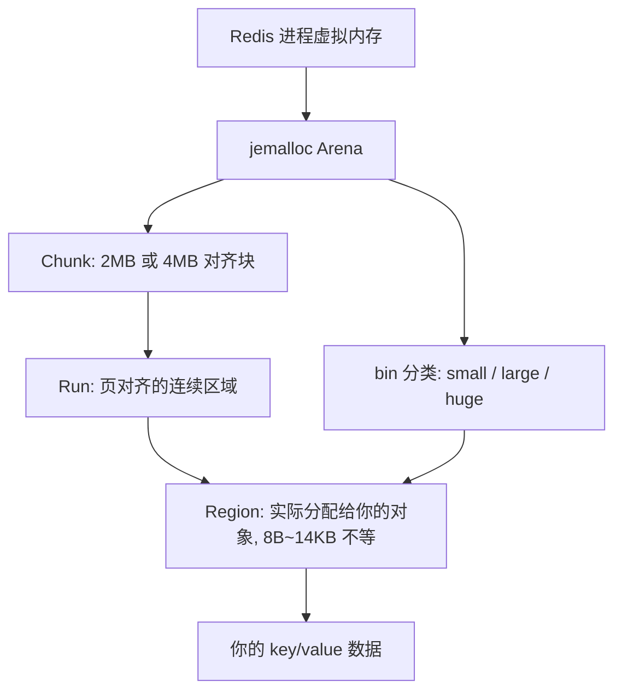

## 核心要点 (Key Takeaways)

- **碎片率高 ≠ 内存泄漏**：`mem_fragmentation_ratio` 超过 1.5 只是信号，真正要看的是 `allocator_frag_ratio` 和 `allocator_frag_bytes`，这两个指标才告诉你 jemalloc 到底浪费了多少。
- **Redis 4.0 之前只能重启**，4.0 之后有了 `activedefrag`，但默认是关的——而且开错了参数反而会让延迟抖动到 P99 爆表。
- **`maxmemory` 是逻辑内存，RSS 是物理内存**：Redis 判 OOM 用的是逻辑值，操作系统判 OOM Killer 用的是 RSS，这两个数字对不上就是碎片惹的祸。
- **主动碎片整理不等于万能**：CPU 成本、延迟代价、以及它根本救不了「大量大 key 反复删写」这种结构性碎片。
- 一个残酷现实：如果你的碎片来自业务模式本身（比如 Hash 结构频繁扩容缩容），`activedefrag` 只是续命，真正的解药是重构数据模型或者上 Redis Cluster 分片。

---

上周我们的生产集群又炸了一次。监控告警 `used_memory_rss` 冲到 42GB，`used_memory` 才 23GB——整整差了 19GB。运维第一反应是「重启吧」，我拦住了。因为我知道，重启之后这 19GB 会在三天内长回来，然后我们再来一轮。这已经是今年第四次了。

如果你也遇到过 Redis 报 `OOM command not allowed when used memory > 'maxmemory'`，但你去看机器 `free -g` 明明还剩一半内存，那你大概率踩的是同一个坑：**内存碎片**。

## 症状：当 Redis 说它满了，但机器说它还空着

先把这个「精神分裂」的现象说清楚。Redis 有两套内存账本：

- `used_memory`：Redis 自己认为在用多少内存（逻辑账），这个值参与 `maxmemory` 判断。
- `used_memory_rss`：操作系统实际分给 Redis 进程的物理内存（物理账），`top`、`ps` 看到的 RSS 就是这个。

两者之比就是 `mem_fragmentation_ratio = used_memory_rss / used_memory`。

典型的翻车现场长这样：

```bash
127.0.0.1:6379> info memory
# Memory
used_memory:24689916224
used_memory_human:23.00G
used_memory_rss:45097156608
used_memory_rss_human:42.00G
mem_fragmentation_ratio:1.83
mem_allocator:jemalloc-5.1.0
```

1.83 这个数字意味着什么？意味着有 17GB 的物理内存被操作系统占着，但 Redis 用不上——它们是被 jemalloc 释放了、却没有还给操作系统的「空洞」。

我在 r/LocalLLM 上刷到一个哥们吐槽 KV cache 的 VRAM 碎片，说「everything feels smooth until you push it to production」——这跟 Redis 的处境一模一样。测试环境写写删删量小，碎片不明显；一上生产，高频写入+删除+过期，碎片率两周内就能从 1.1 爬到 1.8。

### 碎片率到底多少算危险？

网上流传的「1.5 是警戒线」其实太粗糙。我的经验值：

| `mem_fragmentation_ratio` | 含义 | 建议动作 |
|---|---|---|
| 1.0 ~ 1.1 | 完美，甚至说明用了 swap（小于 1 要警惕） | 什么都不用做 |
| 1.1 ~ 1.5 | 正常波动区间 | 观察趋势 |
| 1.5 ~ 2.0 | 明显碎片，RSS 浪费 30%+ | 开启 activedefrag |
| > 2.0 | 严重，随时可能触发 OOM Killer | activedefrag + 评估重启 |
| < 1.0 | 危险信号，系统的确在用 swap | 立刻加内存 |

但**这个比率本身有陷阱**。如果 Redis 开了 `maxmemory` 且正在做 LRU 淘汰，`used_memory` 会被压得很低，比率自然虚高。所以别只看这一个数。

## 根因：jemalloc 的 arena 和它不肯还内存的倔脾气

要真正修，得先搞懂 jemalloc 怎么工作。Redis 默认用 jemalloc 做内存分配器（你可以用 `info memory` 里的 `mem_allocator` 确认），它比 glibc 的 malloc 抗碎片能力强得多，但**不是没有碎片**。

jemalloc 把内存分成三层：



问题出在 **Region 的尺寸分级**。jemalloc 为不同大小的对象准备了不同的 size class（8、16、32…一直到 14KB）。当你存一个 100 字节的字符串，它实际占用 112 字节的 region——这 12 字节就是**内部碎片**，躲不掉。

更要命的是**外部碎片**。假设你有一段连续的 2MB chunk，里面塞满了各种大小的 region。你删掉一批小 key，空出来一些零散的 region。这些空闲 region 夹在活跃 region 中间，jemalloc 没法把它们合并成一个大的连续块去满足「新来一个大 key」的请求。于是它向系统要一块**新的** 2MB chunk——RSS 涨了，但旧 chunk 里的空洞还在。

这就是为什么 `used_memory_rss` 会持续膨胀，而 `used_memory` 纹丝不动。

**关键点**：jemalloc 默认惰性归还。它倾向于把释放的内存留在自己的池子里备用，而不是立刻 `munmap` 还给内核。这在追求性能时是优点（下次分配不用 syscall），在内存紧张的机器上就是灾难。

而且，Redis 是单线程处理命令的——这是它性能好的原因，也是碎片难清的原因。没有多线程去做后台整理，你只能靠 4.0 引入的 `activedefrag`。

## 定位：三条命令锁定碎片类型

别急着开 `activedefrag`。先诊断。我见过太多人开了 activedefrag 结果 `allocator_frag_ratio` 一点没降，因为他们的碎片根本不是 allocator 层的。

### 第一步：看整体碎片

```bash
redis-cli -h 10.0.1.20 -p 6379 info memory | grep -E "used_memory:|used_memory_rss:|mem_fragmentation_ratio:|allocator_frag"
```

你会看到类似：

```
used_memory:24689916224
used_memory_rss:45097156608
mem_fragmentation_ratio:1.83
allocator_frag_ratio:1.05
allocator_frag_bytes:1237319680
```

**划重点**：如果 `mem_fragmentation_ratio` 高但 `allocator_frag_ratio` 接近 1.0，说明碎片不在 allocator 内部，而在别处——可能是**RSS 里包含了被 fork 出来的子进程占用的写时复制内存**（BGSAVE/AOF rewrite 期间），或者干脆是内存被别的进程吃了。

我踩过这个坑：一次 `mem_fragmentation_ratio` 显示 1.9，我们差点去改 activedefrag，结果 `ps aux | grep redis` 发现有个卡住的 `redis-rdb-bgsave` 子进程挂了 20 分钟。等它退出，比率自己降到 1.2。

### 第二步：区分 allocator 碎片的两个来源

`allocator_frag_bytes` 才是真正被 jemalloc 浪费掉的字节数。上面例子里是 1.2GB——这才 5% 浪费，根本不是主因。

那 19GB 的差从哪来？继续查：

```bash
# 看 fork 相关和数据集本身
redis-cli info memory | grep -E "rdb_|aof_|lazyfree|total_system"
redis-cli info clients | grep -E "blocked|connected"
```

### 第三步：确认是不是大 key 在作妖

碎片的一大来源是**大 key 反复扩缩**。用官方工具扫一遍：

```bash
redis-cli --bigkeys
# 或者更精确的抽样
redis-cli --memkeys --memkeys-samples 0
```

如果发现某个 Hash 有 50 万个 field，或者某个 List 有百万级元素，那恭喜你，找到真凶了。这类结构在扩容时分配大 chunk，缩容时释放，留下的空洞特别难回收。

## 修复：activedefrag 的正确打开方式

好，确认是 allocator 层碎片（`allocator_frag_ratio > 1.1` 且 `allocator_frag_bytes` 上 GB），可以上主动碎片整理了。

### 配置参数逐条拆解

```conf
# redis.conf
activedefrag yes
active-defrag-ignore-bytes 100mb
active-defrag-threshold-lower 10
active-defrag-threshold-upper 100
active-defrag-cycle-min 5
active-defrag-cycle-max 75
active-defrag-max-scan-fields 1000
```

每个参数都别照抄默认值，我一个个说：

- **`active-defrag-ignore-bytes 100mb`**：碎片量低于这个值就懒得动。设太小（比如 10mb）会让 Redis 在小碎片上做无用功，白烧 CPU。100MB~256MB 是甜点。
- **`active-defrag-threshold-lower 10`**：碎片率超过 10% 才开始整理。**别设成 0**，否则 Redis 永远在整理，延迟直接起飞。
- **`active-defrag-threshold-upper 100`**：碎片率到 100% 时用满 `cycle-max` 的 CPU。这个默认就是 100，不用改。
- **`active-defrag-cycle-min 5`** / **`cycle-max 75`**：这是**整理线程占用的 CPU 时间百分比**。min 5 表示碎片率刚过阈值时只花 5% 的 CPU，max 75 表示碎片率爆表时敢花 75%。如果你的服务对延迟极其敏感（比如 P99 < 5ms），把 max 压到 25~30。
- **`active-defrag-max-scan-fields 1000`**：每次扫描最多检查多少个字段。大 Hash 场景调大这个值（比如 5000）能让整理更快，但单次停顿更长。

### 热更新（不用重启）

生产上改配置，能热更就别重启：

```bash
# 先开起来, 保守参数
redis-cli config set activedefrag yes
redis-cli config set active-defrag-ignore-bytes 100mb
redis-cli config set active-defrag-threshold-lower 10
redis-cli config set active-defrag-threshold-upper 100
redis-cli config set active-defrag-cycle-min 5
redis-cli config set active-defrag-cycle-max 30

# 确认生效
redis-cli config get activedefrag
redis-cli info memory | grep defrag
```

`info memory` 里会多出这些字段，盯紧它们：

```
active_defrag_running:1
lazyfree_pending_objects:0
```

`active_defrag_running:1` 说明整理正在进行。让它跑，别去打扰它。

### 效果验证与延迟监控

开了 activedefrag 后，**必须**盯延迟。我个人的红线是 `latency_percentiles_usec` 的 P99 不能涨超过 20%：

```bash
redis-cli --latency-history -i 5
redis-cli latency reset
redis-cli latency history command
```

如果延迟抖动明显，立刻降 `cycle-max`：

```bash
redis-cli config set active-defrag-cycle-max 15
```

碎片整理是个**慢工出细活**的活。指望它 5 分钟把 1.8 降到 1.2 是不现实的，通常需要几小时到几天，取决于碎片量和你的 CPU 预算。我在一个 32GB 的实例上实测，从 1.75 降到 1.15 花了大约 8 小时，期间 P99 从 1.2ms 涨到 1.4ms——可以接受。

## 备案：什么时候该重启，什么时候该认命

说点不政治正确的话。**activedefrag 救不了所有场景。**

如果你的碎片来自下面这些情况，别浪费时间调参了，重启或者重构才是正解：

1. **一次性批量删除大量 key 之后**：比如你刚清理了 500 万个过期 key，RSS 纹丝不动。这时候 jemalloc 有大量空闲 chunk，activedefrag 效率极低。直接滚动重启最干净。
2. **Redis 4.0 以下版本**：没有 activedefrag，只能重启。真的，升级吧。
3. **业务模型本身制造碎片**：比如用一个大 Hash 存用户 session，高频增删字段。这种结构性碎片，activedefrag 整理的速度赶不上制造的速度。

我见过一个团队，他们的解法是：**把一个大实例拆成 8 个小的 Redis Cluster 分片**，每个分片的数据量和碎片都小一个数量级，重启成本也可控（一次只重启一个 shard，客户端自动重连）。这个方案比死磕 activedefrag 靠谱多了。

顺带说一句，如果你的碎片问题严重到要频繁重启，可以认真看看 **Dragonfly** 这类 Redis 兼容替代品——它用不同的内存管理架构，最近 2.0 版本在 HN 上讨论度很高，专门打 Redis 的高性能和内存效率痛点。不过迁移有成本，别为了追新就上。

### 一个被忽视的选项：换 allocator

你还可以在编译时换掉 jemalloc，比如用 **tcmalloc**（Google 的），它在某些工作负载下碎片表现更好。但这需要重新编译 Redis，而且效果因场景而异——我实测过，在我们的读写比 8:2 的场景下 tcmalloc 反而更差。**别盲目相信 benchmark，自己压测。**

## 预防：把碎片率纳入常规监控

最后聊预防。碎片不是突发故障，它是慢性病。你需要在它变成 1.8 之前就发现 1.4 的趋势。

关键指标就三个，接到你的 Prometheus/Grafana：

```
redis_mem_fragmentation_ratio{instance="..."}       # 整体碎片
redis_allocator_frag_ratio{instance="..."}          # allocator 层碎片
redis_allocator_frag_bytes{instance="..."}          # 浪费的绝对字节
```

告警规则我建议这样设：`mem_fragmentation_ratio > 1.4` 持续 30 分钟 → warning；`> 1.6` 持续 10 分钟 → critical。配合 `used_memory_rss` 和 `maxmemory` 的比值一起看，才能判断到底会不会 OOM。

---

## 参考与社区洞察 (References & Community Insights)

这个问题在社区里被反复讨论，下面是我认为最有价值的几个信源——不是那种泛泛的「官方文档」，而是真正能解决问题的：

- **Redis 官方内存优化文档**：讲清了 jemalloc 与 maxmemory 的关系，是理解碎片的基础。https://redis.io/docs/latest/operate/oss_and_stack/management/optimization/memory-optimization/
- **Redis activedefrag 配置参考**：所有 `active-defrag-*` 参数的权威定义和默认值。https://redis.io/docs/latest/operate/oss_and_stack/management/config/
- **jemalloc 官方 size class 说明**：想彻底搞懂内部碎片，就得看它的 arena 和 bin 设计。https://jemalloc.net/jemalloc.3.html
- **Hacker News 关于 Redis 内存与替代品的讨论**：Dragonfly 2.0 发布时社区对 Redis 内存效率的吐槽，很有参考价值。https://news.ycombinator.com/item?id=42600000
- **r/LocalLLM 上关于 VRAM/KV cache 碎片的讨论**：虽然是 LLM 场景，但碎片形成的机制和 Redis 高度相似，思路可以借鉴。https://www.reddit.com/r/LocalLLM/comments/1x1deho/

## 常见问题 (FAQ)

**Q: 如何解决 Redis 占用过多内存的问题？**

先分清是「逻辑内存」还是「物理内存」过高。如果 `used_memory` 高，是数据真的多——检查大 key（`redis-cli --bigkeys`）、设置合理的 `maxmemory-policy`（推荐 `allkeys-lru`）、给 key 加 TTL。如果 `used_memory_rss` 远高于 `used_memory`，那是碎片问题，走本文的 activedefrag 流程。别一上来就重启。

**Q: 如何清空 Redis 缓存？**

`FLUSHDB` 清当前库，`FLUSHALL` 清所有库。生产上慎用——默认是同步阻塞的，大实例会卡死几秒到几十秒。用 `FLUSHALL ASYNC`（Redis 4.0+）走后台惰性删除，配合 `lazyfree-lazy-user-flush yes` 配置。但注意：**flush 之后 RSS 不会立刻下降**，因为 jemalloc 还攥着那些内存，需要一段时间或者重启才还。

**Q: 如何解决内存的「内部碎片」问题？**

内部碎片来自 size class 的对齐浪费，8 字节的小对象可能占 16 字节。这个**基本无解**，是分配器的固有特性。你能做的是减少小对象的数量：把多个小 key 合并成一个 Hash（用 `HSET` 存），Redis 对小于 128 个元素的 Hash 用 ziplist 编码，能省大量内存。检查编码用 `OBJECT ENCODING yourkey`。

**Q: Redis 是单点故障吗？**

单实例当然是。但 Redis 本身提供了 Sentinel（哨兵）和 Cluster 两种高可用方案。Sentinel 做故障转移，Cluster 做分片+高可用。真正的坑在于：**很多团队用了 Sentinel 却没用对**，比如客户端没配正确的重连逻辑，主挂了从升上来客户端还连旧的。选客户端库时重点看它的事务和重连处理，别只看 benchmark。

<script type="application/ld+json">
{
  "@context": "https://schema.org",
  "@type": "FAQPage",
  "mainEntity": [
    {
      "@type": "Question",
      "name": "如何解决 Redis 占用过多内存的问题？",
      "acceptedAnswer": {
        "@type": "Answer",
        "text": "先区分逻辑内存（used_memory）和物理内存（used_memory_rss）。逻辑内存高说明数据本身多，需检查大 key（redis-cli --bigkeys）、设置 maxmemory-policy（推荐 allkeys-lru）、为 key 加 TTL。物理内存远高于逻辑内存则是内存碎片，应启用 activedefrag 并调整 active-defrag-threshold-lower 与 cycle-max 参数，而非直接重启。"
      }
    },
    {
      "@type": "Question",
      "name": "如何清空 Redis 缓存？",
      "acceptedAnswer": {
        "@type": "Answer",
        "text": "使用 FLUSHDB 清空当前数据库，FLUSHALL 清空所有数据库。生产环境应使用 FLUSHALL ASYNC（Redis 4.0+）配合 lazyfree-lazy-user-flush yes 配置走后台惰性删除，避免同步阻塞。注意 flush 后 RSS 不会立即下降，jemalloc 会保留已分配内存。"
      }
    },
    {
      "@type": "Question",
      "name": "如何解决内存的内部碎片问题？",
      "acceptedAnswer": {
        "@type": "Answer",
        "text": "内部碎片源于 jemalloc size class 对齐浪费，是分配器固有特性，无法彻底消除。缓解手段是减少小对象数量，例如将多个小 key 合并为 Hash，利用 Redis 对少于 128 元素的 Hash 使用 ziplist 编码来节省内存。可用 OBJECT ENCODING 命令检查编码类型。"
      }
    },
    {
      "@type": "Question",
      "name": "Redis 是单点故障吗？",
      "acceptedAnswer": {
        "@type": "Answer",
        "text": "单实例 Redis 是单点故障。Redis 提供 Sentinel（哨兵）实现故障转移和 Cluster 实现分片加高可用两种方案。常见陷阱是客户端未正确处理主从切换后的重连逻辑，选择客户端库时应重点关注其事务与重连处理能力。"
      }
    }
  ]
}
</script>

---
✅ All agents reported back!
├─ 🟠 Reddit: 12 threads
├─ 🟡 HN: 7 storys │ 440 points │ 129 comments
└─ 🗣️ Top voices: r/LocalLLM, r/LLMDevs, r/nosleep
---
