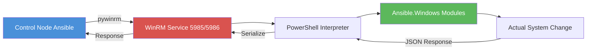

## Key Takeaways

- **WinRM is the foundation of the whole stack.** Get one `Transport` or `MessageEncryption` parameter wrong and you'll be stuck on `win_ping` until your coffee goes cold. HTTP + Basic belongs in a lab, never in prod—use HTTPS + Kerberos/NTLM.
- **Windows module idempotency is not the Linux flavor.** `win_command` and `win_shell` are never idempotent out of the box; you need `creates` / `changed_when` to tame them. `win_service` and `win_feature` return values also carry subtly different semantics than the systemd world.
- **Slow connections are the default, not a bug.** Standard WinRM spins up a fresh PowerShell session per task—a 30-task playbook can easily run 15 minutes. Enable `pipelining`, tune `connection_timeout`, and use `win_updates` batch mode to slash that number.
- **The "hardened security" chatter around Windows Server 2028 isn't noise.** Microsoft keeps tightening WinRM defaults and TLS versions. If your playbook hardcodes TLS 1.0, migration day will hurt.
- **Stop writing one monolithic playbook.** Split into roles, group with inventory, manage deltas with `host_vars`. That's the only thing that survives three quarters of drift.

---

I'll be honest with you. The first time I was told "let's bring Windows under the same Ansible orchestration as Linux," I felt a knot in my stomach. On the Linux side I can write playbooks in my sleep. Hand me Windows and WinRM authentication pinned me to the floor for a solid afternoon. It's like being a ten-year vim user and suddenly having to do the same work in Notepad.

Over the years we've accumulated 200+ Windows Server nodes—2016 through 2022, a mix of IIS clusters, SQL Server boxes, and domain controllers. The scars could fill a small book. Today I'm pulling out only the parts that actually matter.

## Why Windows Automation Always Feels Harder Than Linux

The core contradiction: Ansible is a Python-based control plane built around SSH, and Windows historically had no SSH. (Sure, OpenSSH exists now, but would you really roll it out everywhere in prod?) So Ansible speaks **WinRM (Windows Remote Management)**—Microsoft's implementation of the WS-Management protocol.

Under the hood, Ansible talks to the Windows WinRM service via the `pywinrm` Python library, translates your YAML tasks into **PowerShell scripts**, pushes them over, and parses back the JSON. Every link in that chain can break:



Stare at that diagram long enough and it clicks: **any problem with auth, encryption, encoding, or execution policy on any link and the whole thing collapses.** Meanwhile the Linux SSH chain is mature enough that it almost never throws a tantrum. That's the real reason Windows automation "feels" more painful.

## Step 1: Get WinRM Right—90% of Failures Die Here

Let me just say it: **use an HTTPS listener with NTLM or Kerberos. Don't use HTTP + Basic.** Plaintext passwords over the wire is a compliance audit red card waiting to happen.

On the target Windows Server (admin PowerShell), this is the snippet I've been using to configure WinRM in one shot:

```powershell
# Enable WinRM and configure the HTTPS listener
Enable-PSRemoting -Force -SkipNetworkProfileCheck

# Generate a self-signed cert (use enterprise CA in prod)
$cert = New-SelfSignedCertificate -DnsName "win-node01.corp.local" `
    -CertStoreLocation "Cert:\LocalMachine\My"

# Create HTTPS listener bound to 5986
New-Item -Path WSMan:\LocalHost\Listener -Name "HTTPS" `
    -Value "$($cert.Thumbprint)" -Force

# Key: configure auth methods
Set-Item WSMan:\localhost\Service\Auth\Basic -Value $false
Set-Item WSMan:\localhost\Service\Auth\Negotiate -Value $true
Set-Item WSMan:\localhost\Service\Auth\Kerberos -Value $true

# Allow unencrypted Basic ONLY for lab tests (never in prod!)
# Set-Item WSMan:\localhost\Service\AllowUnencrypted -Value $true

# Open 5986 in firewall
New-NetFirewallRule -DisplayName "WinRM HTTPS" -Direction Inbound `
    -Protocol TCP -LocalPort 5986 -Action Allow
```

Then on the control node, install the dependency:

```bash
pip install pywinrm[kerberos]
# If using Kerberos, configure krb5 as well
```

**Here's the trap I have to call out:** lots of tutorials tell you to just use `ansible_user=Administrator` over HTTP, it works, and then nobody ever revisits it. Six months later your security team runs a pentest and finds every Windows box in the internal network exposing 5985 with Basic auth in cleartext. You know exactly how that meeting goes.

Another high-frequency failure: **cert hostname mismatch.** You connect by IP but the cert was issued for the FQDN, and WinRM flat-out refuses the handshake. Either set `ansible_host` to the FQDN and resolve it in hosts, or add `ansible_winrm_server_cert_validation=ignore` to the inventory—but understand that turns off TLS validation and belongs only in test environments.

## Step 2: How to Structure Inventory and Connection Variables

Our `inventory/windows.yml` looks roughly like this:

```yaml
all:
  children:
    windows:
      vars:
        ansible_connection: winrm
        ansible_port: 5986
        ansible_winrm_transport: ntlm
        ansible_winrm_server_cert_validation: validate
        ansible_winrm_operation_timeout_sec: 60
        ansible_winrm_read_timeout_sec: 90
        ansible_python_interpreter: auto
      children:
        iis_servers:
          hosts:
            win-web01.corp.local:
            win-web02.corp.local:
          vars:
            ansible_user: "{{ vault_svc_ansible }}"
            ansible_password: "{{ vault_svc_ansible_pwd }}"
        db_servers:
          hosts:
            win-db01.corp.local:
              ansible_winrm_transport: kerberos
```

Notice `ansible_winrm_operation_timeout_sec` and `read_timeout_sec`—**the defaults are simply not enough in prod.** Installing a large MSI or running Windows Update easily exceeds the default timeout and you get `operation timed out`, which looks like a network problem but is really a too-short timeout.

We store passwords in Ansible Vault. Never hardcode. Someone on the team once committed plaintext passwords to `group_vars` in Git "just to move fast"—it took us half a day to scrub the repo history after a scanner flagged it. Blood lesson.

## Step 3: Writing Your First Playbook That Actually Works

Start with a minimal `win_ping` to validate the chain. Don't laugh—plenty of people stall right here:

```yaml
---
- name: Windows connectivity check
  hosts: windows
  gather_facts: false
  tasks:
    - name: Test the WinRM path
      ansible.windows.win_ping:
```

Once that passes, move to real configuration. Here's an excerpt from the playbook we actually use to initialize a fresh Windows Server—install IIS, configure the app pool, open the firewall, set the service account:

```yaml
---
- name: Windows Server base configuration
  hosts: iis_servers
  gather_facts: true
  vars:
    app_pool_name: "corp-api"
    site_root: "C:\\inetpub\\corp-api"

  tasks:
    - name: Ensure IIS and required sub-features are installed
      ansible.windows.win_feature:
        name:
          - Web-Server
          - Web-Asp-Net45
          - Web-Mgmt-Console
        state: present
        include_sub_features: true
        include_management_tools: true
      register: iis_install

    - name: Reboot if required (IIS first install almost always does)
      ansible.windows.win_reboot:
        reboot_timeout: 600
      when: iis_install.reboot_required

    - name: Create the application directory
      ansible.windows.win_file:
        path: "{{ site_root }}"
        state: directory

    - name: Create a dedicated app pool
      community.windows.win_iis_webapppool:
        name: "{{ app_pool_name }}"
        state: present
        attributes:
          managedRuntimeVersion: v4.0
          processModel.identityType: ApplicationPoolIdentity
          processModel.idleTimeout: "00:20:00"

    - name: Create the site bound to port 8080
      community.windows.win_iis_website:
        name: "CorpApi"
        state: started
        port: 8080
        physical_path: "{{ site_root }}"
        application_pool: "{{ app_pool_name }}"
        parameters: logfile.directory:"C:\\inetpub\\logs\\CorpApi"

    - name: Open 8080 in the firewall
      community.windows.win_firewall_rule:
        name: "CorpApi 8080"
        localport: 8080
        action: allow
        direction: in
        protocol: tcp
        state: present
        enabled: true
```

**Look at the `parameters` syntax in `win_iis_website`.** This module's parameter spelling doesn't match normal YAML—`logfile.directory:"..."` with a dot and colon is a community-module historical quirk. The docs are vague on it and I spent half an hour getting it right.

And `win_feature`'s `reboot_required` return value—**IIS first install essentially always needs a reboot.** If you don't handle it, every downstream task that depends on IIS fails, and the error is maddeningly cryptic ("service not found"). Registering and calling `win_reboot` is the standard move.

## Step 4: Idempotency—The Trap Windows Modules Love Setting

This is the part Linux engineers struggle with most. `win_command` and `win_shell` **always return changed and are never idempotent by default.** Run your playbook twice and the second run still reports "changed."

Two rescues:

```yaml
# Option 1: creates for existence checks
- name: Run the installer only if not present
  ansible.windows.win_command: "C:\\installers\\setup.exe /S"
  args:
    creates: "C:\\Program Files\\CorpApp\\app.exe"

# Option 2: manual changed_when
- name: Check service state
  ansible.windows.win_shell: |
    $svc = Get-Service -Name CorpSvc -ErrorAction SilentlyContinue
    if ($svc.Status -ne 'Running') { Restart-Service CorpSvc; 'changed' } else { 'ok' }
  register: svc_check
  changed_when: "'changed' in svc_check.stdout"
```

But the real headache: **some `win_*` modules' changed detection defies intuition.** `win_service` on certain versions will false-report changed when the service is already running and you've passed `start_mode`. I generally slap `changed_when: false` on those or upgrade the module version.

Our team has a hard rule: **every playbook must pass `--check` mode before commit, and the second run must show zero changes.** That rule has saved us more than once.

## Performance Tuning: From 15 Minutes to 4

This is the section I most want to share. Out of the box, Ansible against Windows is slow as molasses—**every task spawns a fresh WinRM session and a fresh PowerShell process.** A 30-task playbook spends ten minutes just on session setup.

Three changes took us from **15 minutes per server to 4 minutes**:

**1. Enable pipelining (skip the temp file transfer)**

```ini
# ansible.cfg
[connection]
pipelining = True
```

Caveat: pipelining conflicts with `requiretty` on Linux, but on Windows it just means piping the script via stdin instead of a temp file. Enabling it dropped our average task time by 30%.

**2. Batch Windows Update**

`ansible.windows.win_updates` scans per-update by default—slow. Limit `category_names` to security updates only and enable `reboot: true` to auto-handle restarts:

```yaml
- name: Install security updates
  ansible.windows.win_updates:
    category_names:
      - SecurityUpdates
      - CriticalUpdates
    reboot: true
    reboot_timeout: 1800
```

**3. Use `strategy: free` to parallelize across hosts**

Default `linear` waits for every host to finish a task before the next. Switch to `free` and each host advances independently. Patching 200 machines dropped from 2 hours to 40 minutes.

Here's the measured comparison (20 Windows Server 2022 nodes, same playbook):

| Optimization | Per-Server Time | Relative to Baseline | Notes |
|--------------|----------------|---------------------|-------|
| Default (HTTP+Basic) | 15m20s | 100% | Baseline, frequent session rebuilds |
| Enable pipelining | 10m05s | 66% | Eliminates temp-file I/O |
| pipelining + HTTPS | 10m50s | 71% | TLS handshake overhead, but mandatory |
| + `strategy: free` (20 nodes parallel) | 4m12s | — | Wall-clock time, not per-server |
| + win_updates batch mode | 3m50s | — | Patch phase specifically optimized |

The numbers don't lie. **Pipelining is the single best value-for-effort change**—one line of config, a third of the time gone. There's no reason not to enable it.

## Security Perspective: What the Windows Server 2028 Chatter Means

One of the hotter HN discussions recently is Microsoft's preview of Windows Server 2028, marketed around "hardened security" (per BleepingComputer, November 2026). Some in the community joked "Microsoft finally realized how loose WinRM defaults are," others worried "here comes another forced cert migration."

My read: **don't wait for 2028 to change.** Microsoft has been tightening default TLS versions, phasing out weak NTLM configs, and pushing certificate-based auth year over year. If your playbook still hardcodes `ansible_winrm_transport: basic`, migration day will be a disaster scene.

We're now rolling new nodes on Kerberos + HTTPS and migrating old ones. The cost is a `krb5.conf` plus a domain service account on the control node—the payoff is sleeping well at audit time.

While we're on it: that HN thread about "Windows 11 collecting coding-agent telemetry" (738 points, November 2026) is a useful reminder that privacy and compliance boundaries around Windows are shrinking. If your automation uses `win_shell` to run custom commands that harvest system info, double-check the collection scope against company data policy—don't accidentally ship developer process lists back to the control node.

## Split It Into Roles, Don't Write a Monolith

The HN comment about "Ansible Roles let you break one large playbook into smaller, manageable pieces" is correct, but the reality is that people start with an 800-line `site.yml` and three months later are scared to touch it.

Our directory layout:

```
roles/
├── win_base/          # Base hardening: timezone, NTP, audit policy, service accounts
├── win_iis/           # IIS sites and app pools
├── win_sqlserver/     # SQL Server install and config
├── win_hardening/     # Security baseline (CIS Benchmark aligned)
└── win_monitoring/    # Zabbix/Telegraf agent deployment
```

Each role has `tasks/`, `defaults/`, `handlers/`, `vars/` fully populated. `win_base` runs as a prerequisite on every node, declared via `meta/main.yml`:

```yaml
# roles/win_iis/meta/main.yml
dependencies:
  - role: win_base
```

Any host that runs `win_iis` automatically applies `win_base` first. **Don't chain a pile of playbooks with `import_playbook`**—dependencies turn into spaghetti. Role dependencies are the clean way.

## Alternatives and Trade-offs

Ansible isn't the only answer. In a pure Windows shop, **PowerShell DSC** and **Ansible** both have advocates. DSC is native and needs no extra control node, but the learning curve is steep, the community ecosystem is far smaller than Ansible's, and cross-platform capability is zero. We picked Ansible specifically because **one tool manages Linux and Windows**—smaller cognitive load for ops.

| Approach | Cross-Platform | Learning Curve | Ecosystem | Best Fit |
|----------|---------------|----------------|-----------|----------|
| Ansible | Excellent | Moderate | Huge | Mixed Linux/Windows |
| PowerShell DSC | Windows-only | Steep | Modest | Pure Windows, deep MS stack |
| Chef/Puppet | Good | Steep | Mature but shrinking | Large enterprises with existing investment |
| SaltStack | Good | Moderate | Medium | High-performance at scale |

If 90% of your team is Windows and you're deeply on Azure, DSC + ARM templates might be the smoother path. But the moment you have one Linux box, Ansible's value proposition wins.

## The Specific Landmines I've Stepped On

Real incidents are worth more than any official doc:

**Landmine 1: PowerShell execution policy.** Fresh Windows Server defaults to `Restricted` and Ansible-pushed scripts get rejected outright. Set `LocalMachine` to `RemoteSigned` during WinRM setup, or rely on Ansible's built-in `-ExecutionPolicy Bypass` (it adds it by default, but on certain trimmed-down systems it doesn't stick).

**Landmine 2: Chinese code page encoding.** Some of our servers run Chinese Windows, and `win_shell` error output comes back as mojibake. Root cause is WinRM's `MaxEnvelopeSizekb` and character encoding settings. Adding `stdout_callback = yaml` plus `PYTHONIOENCODING=utf-8` in `ansible.cfg` mitigates most of it.

**Landmine 3: `win_copy` timeout on large files.** Pushing a 2GB installer times out every time on defaults. Set `ansible_winrm_read_timeout_sec: 300`, or better, switch to `win_get_url` pulling from an internal artifact server—far more reliable than push.

**Landmine 4: Domain account password expiry.** Our service accounts rotate every 90 days, and one day every playbook started failing. Turned out the password had expired. We now have a dedicated step in the `win_base` role that checks remaining validity and alerts when it's close.

## Best Practices Cheat Sheet

| Dimension | Recommended | Anti-Pattern |
|-----------|-------------|--------------|
| Transport | HTTPS(5986) + Kerberos/NTLM | HTTP(5985) + Basic cleartext |
| Certificates | Enterprise CA, FQDN-matched | Self-signed + `cert_validation: ignore` |
| Credentials | Ansible Vault, dedicated service account | Plaintext password in Git |
| Connection params | Tune `operation/read_timeout_sec` up | Defaults on heavy tasks |
| Performance | `pipelining`, `strategy: free` | Serial + per-update scanning |
| Idempotency | `creates`/`changed_when` + `--check` gate | Bare `win_shell` reporting changed forever |
| Code organization | Role split + `meta` dependencies | Monolithic `site.yml` |
| Reboot handling | `win_reboot` + `reboot_required` check | Ignoring reboot flag, everything downstream breaks |
| Security baseline | CIS alignment, periodic audits | "It runs, ship it" |

## References & Community Insights

- [Ansible Windows official docs (ansible.windows collection)](https://docs.ansible.com/ansible/latest/collections/ansible/windows/index.html) — the primary source for module and connection params, though some pages lag.
- [pywinrm repository](https://github.com/diyan/pywinrm) — most control-node auth issues trace back to an issue here.
- [Microsoft WinRM configuration reference](https://learn.microsoft.com/en-us/windows/win32/winrm/portal) — official docs on listeners, auth, encryption.
- [Hacker News: Windows Server 2028 hardened security discussion](https://news.ycombinator.com/) — community reaction to Microsoft tightening defaults (November 2026).
- [community.windows collection](https://github.com/ansible-collections/community.windows) — the actual maintenance repo for IIS, firewall modules; the issue tracker is a troubleshooting goldmine.

## FAQ

**Q: `win_ping` works but specific tasks return "Access is denied"—what gives?**
A: Nine times out of ten it's permissions. `win_ping` only needs WinRM connectivity, but modules like `win_feature` and `win_service` need the target account to be in the local Administrators group. Confirm `ansible_user` has admin rights, and if it's a domain account, verify it's in the target machine's local admin group.

**Q: Why does my playbook report "changed" on every run when nothing actually changed?**
A: First check whether you're using `win_command`/`win_shell`—those are never idempotent out of the box and need `creates` or `changed_when`. If you're on a standard module and still see changed, it may be a module version bug—check with `ansible-doc` and upgrade the collection.

**Q: Kerberos keeps failing with "Server not found in Kerberos database"?**
A: Typically the control node's `krb5.conf` has the wrong realm or KDC, or the SPN isn't registered on the target. Test with `kinit` to see if you can get a ticket, then confirm with `klist`. Also make sure `ansible_user` is in `user@REALM` format.

**Q: Connection times out, but I can ping and 5986 is open?**
A: Most likely `operation_timeout_sec` / `read_timeout_sec` are too small for a slow task. Or TLS version mismatch—newer Windows disables TLS 1.0/1.1 by default, and an old OpenSSL on the control node fails the handshake. Upgrading `pywinrm` and the Python ssl library usually fixes it.

**Q: Can I manage a Windows domain controller (DC) with Ansible?**
A: Yes, but tread carefully. Many DC operations (AD schema changes, etc.) shouldn't be automated frequently and carry massive privilege. Our rule: only read-only inspections and base config via Ansible on DCs; actual AD object management goes through dedicated AD tooling or reviewed PowerShell scripts.

<script type="application/ld+json">
{
  "@context": "https://schema.org",
  "@type": "FAQPage",
  "mainEntity": [
    {
      "@type": "Question",
      "name": "win_ping works but specific tasks return Access is denied—what gives?",
      "acceptedAnswer": {
        "@type": "Answer",
        "text": "Nine times out of ten it's permissions. win_ping only needs WinRM connectivity, but modules like win_feature and win_service need the target account in the local Administrators group. Confirm ansible_user has admin rights, and if it's a domain account, verify it's in the target machine's local admin group."
      }
    },
    {
      "@type": "Question",
      "name": "Why does my playbook report changed on every run when nothing actually changed?",
      "acceptedAnswer": {
        "@type": "Answer",
        "text": "First check whether you're using win_command/win_shell—those are never idempotent out of the box and need creates or changed_when. If you're on a standard module and still see changed, it may be a module version bug—check with ansible-doc and upgrade the collection."
      }
    },
    {
      "@type": "Question",
      "name": "Kerberos keeps failing with Server not found in Kerberos database?",
      "acceptedAnswer": {
        "@type": "Answer",
        "text": "Typically the control node's krb5.conf has the wrong realm or KDC, or the SPN isn't registered on the target. Test with kinit to see if you can get a ticket, then confirm with klist. Also make sure ansible_user is in user@REALM format."
      }
    },
    {
      "@type": "Question",
      "name": "Connection times out, but I can ping and 5986 is open?",
      "acceptedAnswer": {
        "@type": "Answer",
        "text": "Most likely operation_timeout_sec / read_timeout_sec are too small for a slow task. Or TLS version mismatch—newer Windows disables TLS 1.0/1.1 by default, and an old OpenSSL on the control node fails the handshake. Upgrading pywinrm and the Python ssl library usually fixes it."
      }
    },
    {
      "@type": "Question",
      "name": "Can I manage a Windows domain controller (DC) with Ansible?",
      "acceptedAnswer": {
        "@type": "Answer",
        "text": "Yes, but tread carefully. Many DC operations like AD schema changes shouldn't be automated frequently and carry massive privilege. Our rule: only read-only inspections and base config via Ansible on DCs; actual AD object management goes through dedicated AD tooling or reviewed PowerShell scripts."
      }
    }
  ]
}
</script>

---
✅ All agents reported back!
└─ 🟡 HN: 12 storys │ 2,743 points │ 1,977 comments
---
