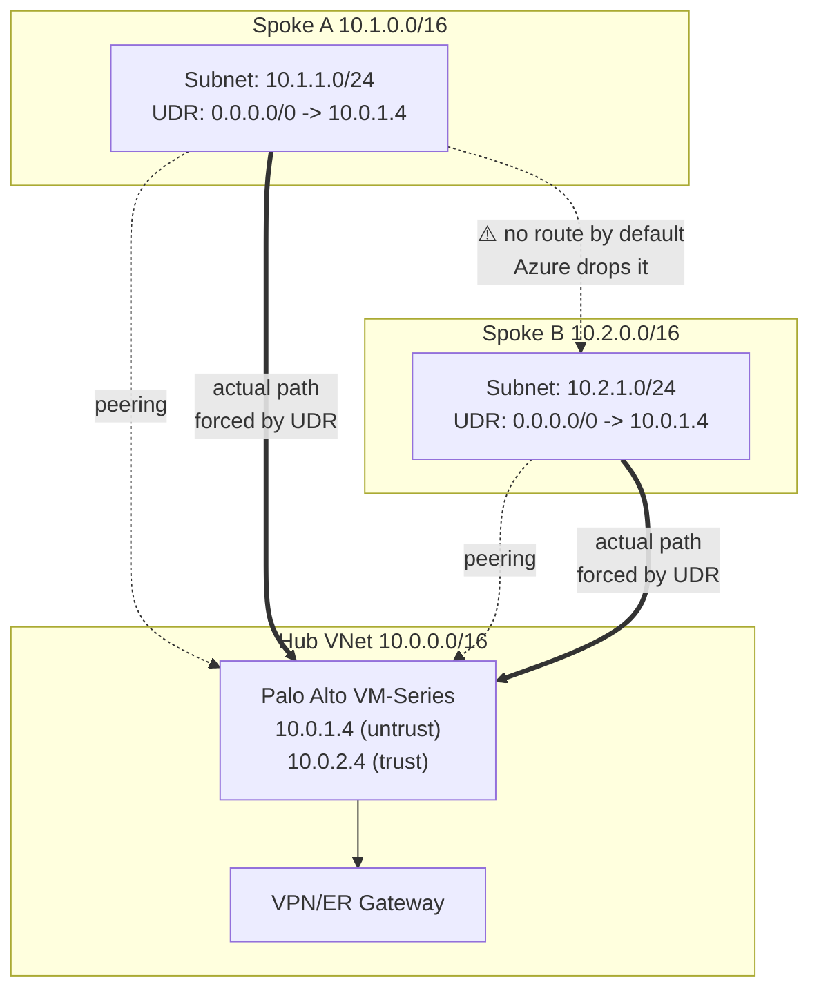

## Key Takeaways

- **Azure VNet Peering is not transitive by design.** Spoke A and Spoke B are both peered to the hub, but there is zero route between them. Unless you attach a UDR to the spoke subnet pointing `0.0.0.0/0` or the peer CIDR at the Palo Alto internal IP, traffic never touches the firewall.
- **The NVA NIC must have IP Forwarding enabled or the packet dies at the host layer**, and this toggle is buried deep in the portal. `az network nic update --ip-forwarding true` is the only sane way to enforce it across every NIC.
- **"Disable Peering Route Propagation" is a double-edged sword.** It fixes asymmetric traffic from spokes learning each other's routes, but flip it wrong and spokes stop learning hub gateway routes and go dark.
- **Palo Alto SNAT policy is the hidden killer.** Without source NAT on the VM-Series, return traffic takes the spoke default route and bypasses the firewall, creating classic asymmetric routing that PAN-OS drops silently.
- **In production, 80% of "the firewall isn't working" tickets trace back to one missing UDR or one unopened IP Forwarding flag**, not to PAN-OS rules.

---

## How It Starts: A Ticket That Says "The Firewall Is Configured But Not Working"

Let me lead with the conclusion so you don't waste your day: **in hub-and-spoke, a Palo Alto that isn't working is nine times out of ten not a PAN-OS problem.**

I've scrolled through dozens of threads on r/networking and r/AZURE with the same shape. "I deployed VM-Series in the hub, all the security policies are set, I can see some traffic in the logs, but spoke-to-spoke traffic just doesn't go through the firewall." Or: "The spokes can talk to each other fine, but they completely bypass Palo Alto. How is this zero trust?" One guy put it bluntly: *"One spoke vnet seems to be isolated"* — three spokes, one just won't connect, the other two can ping each other, and a packet capture shows nothing ever hit the hub NVA.

The insidious part: **the network is "working."** Spoke A pings Spoke B, the app is up, nobody gets paged. Then the security audit asks "is east-west traffic going through the firewall," you open the PAN-OS traffic log, and there's a handful of entries. Everything else is running naked.

That's what this article dissects. Not "how to install Palo Alto" — **why traffic refuses to enter it after the install.**

---

## Under the Hood: Why Azure Peering Won't Forward For You

To understand this trap, you have to accept a counterintuitive fact: **Azure VNet Peering is not a router. It's a point-to-point link.**

When you peer Spoke A to the hub, Azure inserts exactly one route on each side — Spoke A's route table gains `10.0.0.0/16 → VirtualNetworkPeering` pointing at the hub. The hub learns Spoke A symmetrically. **But between Spoke A and Spoke B, with no additional mechanism, there is no route at all.** They're both connected to the hub and complete strangers to each other.



The critical bit is the dotted line: Spoke A to Spoke B traffic, **by default, gets dropped by the Azure platform** because `10.2.0.0/16` isn't in Spoke A's known routes. You assume it "loops through the hub," but Azure's SDN has no such concept — peering doesn't propagate.

So you manually tell Spoke A: "packets headed for `10.2.0.0/16` go to Palo Alto's untrust NIC IP." That instruction is a **User Defined Route (UDR)**.

Now here's the thing. Even with the UDR in place, if the Palo Alto NIC **doesn't have IP Forwarding enabled, Azure's host layer drops the packet on arrival** — it sees "this IP isn't mine, I shouldn't accept it." The toggle is called "IP forwarding" in the portal, buried in NIC config, mentioned in passing in the docs. I've watched teams burn two hours here before realizing the checkbox was never ticked.

Palo Alto needs two more things: the interface must permit forwarding (VM-Series is a forwarding device by default, fine), and **SNAT policy**. Because if the source address stays as Spoke A's `10.1.1.4`, Spoke B's return packet looks up its own route table and takes the default route (pointing at the hub NVA) — sounds fine, right? But if Spoke B's UDR points at a **different** NVA, or Spoke B has no UDR and reaches Spoke A over peering directly, you get **asymmetric routing**. Palo Alto's session table sees the return packet arrive on the wrong interface, flags it out-of-window, drops it.

> A note from the community: the 339-point HN thread "Azure's Weakest Link – Five Full Cross-Tenant Compromises" has a lot of people griping about exactly this — the black-box feel of Azure networking. You think you have a security boundary; in reality it's held together by a pile of manual toggles. Applied to hub-and-spoke, that complaint lands perfectly.

---

## Symptom Checklist: Find Your Trap

Before touching anything, spend 30 seconds identifying which hole you fell into:

| Symptom | Most likely root cause | Quick check |
|---|---|---|
| Spokes can't talk at all, ping times out | Spoke subnet has no UDR to the NVA | `az network route-table route list` |
| Traffic flows but PAN-OS traffic log is empty | UDR missing or wrong IP, traffic goes peering-direct | `traceroute` from a spoke VM, count hops |
| Partial connectivity, intermittent drops | NIC IP Forwarding off, or on but SNAT missing | `az network nic show` for `enableIpForwarding` |
| Spokes go dark after a hub route change | Disable Peering Route Propagation misapplied | Check peering `allowForwardedTraffic` and `allowGatewayTransit` |
| One-way works, return path drops | Asymmetric routing, missing SNAT or return UDR | Packet capture for return source address |

---

## The Seven-Step Fix (With Commands)

I've run this exact sequence across three different customer Azure environments, from a 30-minute "just take a look" to a 4-hour deep dive. Go in order, don't skip.

### Step 1: Confirm the peering forwarding flags

This is the most overlooked first layer. Peering has four booleans, two of which decide whether traffic can be "forwarded" at all:

```bash
# List hub-to-spoke peering config
az network vnet peering show \
  --resource-group rg-hub \
  --vnet-name vnet-hub \
  --name peer-hub-to-spokeA \
  --query "{allowVirtualNetworkAccess:allowVirtualNetworkAccess, allowForwardedTraffic:allowForwardedTraffic, allowGatewayTransit:allowGatewayTransit, useRemoteGateways:useRemoteGateways}"
```

You want to see:
- `allowVirtualNetworkAccess: true` (usually on)
- `allowForwardedTraffic: true` **(critical! without it, packets forwarded by the NVA are rejected)**
- `allowGatewayTransit: true` (set on the hub, so spokes can use the hub gateway)
- `useRemoteGateways: true` (set on the spoke)

**`allowForwardedTraffic` is the one 90% of people miss.** Its semantics: "accept traffic from the peer whose source address doesn't belong to the peer" — exactly the NVA forwarding case. Leave it off and packets forwarded by Palo Alto hit the spoke and get dropped by the Azure platform, with zero logs. Pure silence.

The fix:

```bash
az network vnet peering update \
  --resource-group rg-hub \
  --vnet-name vnet-hub \
  --name peer-hub-to-spokeA \
  --set allowForwardedTraffic=true allowGatewayTransit=true

az network vnet peering update \
  --resource-group rg-spokeA \
  --vnet-name vnet-spokeA \
  --name peer-spokeA-to-hub \
  --set allowForwardedTraffic=true useRemoteGateways=true
```

### Step 2: Attach a UDR to the spoke subnet

The spoke subnet needs a route that sends traffic where you want it. In production I recommend **both** — a default route through the NVA (forcing all egress through the firewall) and an explicit spoke CIDR route (safer, in case a more specific system route shadows the default).

```bash
# Create the route table
az network route-table create \
  --resource-group rg-spokeA \
  --name rt-spokeA \
  --disable-bgp-route-propagation false

# Default route -> Palo Alto untrust NIC
az network route-table route create \
  --resource-group rg-spokeA \
  --route-table-name rt-spokeA \
  --name default-to-fw \
  --address-prefix 0.0.0.0/0 \
  --next-hop-type VirtualAppliance \
  --next-hop-ip-address 10.0.1.4

# Explicit Spoke B CIDR -> same NVA
az network route-table route create \
  --resource-group rg-spokeA \
  --route-table-name rt-spokeA \
  --name spokeB-to-fw \
  --address-prefix 10.2.0.0/16 \
  --next-hop-type VirtualAppliance \
  --next-hop-ip-address 10.0.1.4

# Bind to the subnet
az network vnet subnet update \
  --resource-group rg-spokeA \
  --vnet-name vnet-spokeA \
  --name snet-workload \
  --route-table rt-spokeA
```

**The `next-hop-ip-address` is Palo Alto's internal IP in the hub, not the public IP.** Get this wrong and you have a black hole — packets go out and nobody receives them, which is miserable to debug because ping times out and you assume the firewall policy blocked it when really the route points at thin air.

### Step 3: Enable IP Forwarding on the Palo Alto NICs

```bash
# Find the VM-Series NICs
az vm nic list \
  --resource-group rg-hub \
  --vm-name vm-palo-alto \
  --query "[].{name:name, id:id}" -o table

# Enable IP Forwarding on each
az network nic update \
  --resource-group rg-hub \
  --name vm-palo-alto-untrust-nic \
  --ip-forwarding true

az network nic update \
  --resource-group rg-hub \
  --name vm-palo-alto-trust-nic \
  --ip-forwarding true
```

Without this, Azure's host SDN layer drops non-local-IP packets at the NIC ingress. You'll see nothing in PAN-OS logs because the packet never reaches the VM. Last time I hit this at a customer, a capture showed zero counters on the untrust interface, which is what tipped me off to the Azure-layer problem.

### Step 4: Check the hub-side route tables (don't only configure spokes)

Plenty of people configure UDRs only on spokes and forget that the hub's GatewaySubnet or hub subnets also need to know "spoke CIDRs live behind the firewall." If you run a jumpbox in the hub or have a VPN gateway, return traffic from hub to spoke also needs a UDR.

```bash
az network route-table route create \
  --resource-group rg-hub \
  --route-table-name rt-hub \
  --name spokeA-to-fw \
  --address-prefix 10.1.0.0/16 \
  --next-hop-type VirtualAppliance \
  --next-hop-ip-address 10.0.2.4   # trust-side IP here
```

### Step 5: Configure SNAT on Palo Alto (the asymmetric-routing antidote)

This part is pure PAN-OS and no amount of Azure config will fix it. Configure a source NAT policy so traffic leaving the trust side toward another spoke gets its source rewritten to the NVA's trust IP.

```
# PAN-OS CLI (configure mode)
set rulebase nat rules spoke-to-spoke-nat from trust
set rulebase nat rules spoke-to-spoke-nat to untrust
set rulebase nat rules spoke-to-spoke-nat source-translation dynamic-ip-and-port interface-address interface ethernet1/2
set rulebase nat rules spoke-to-spoke-nat source any
set rulebase nat rules spoke-to-spoke-nat destination any
```

With SNAT in place, Spoke B receives packets sourced from `10.0.2.4`. Its return route lookup finds `10.0.2.4` in the hub CIDR, sends it back over peering to the hub, and the NVA de-NATs it. Symmetric path, session stays alive.

**What's the cost?** Spoke B no longer sees the real source IP in its logs. If audit requires end-to-end traceability, you need a different design — PAN-OS HA with dual symmetric NVAs, or Azure Virtual WAN's secured hub. That trade-off comes up later.

### Step 6: Verify route precedence and stop getting burned by system routes

Azure's route selection order is **UDR > BGP > system routes**. But there's an exception — if the UDR's next hop is unreachable (say, the NVA is down), Azure falls back to system routes and traffic bypasses the firewall. That automatic fallback is a time bomb in production.

```bash
# Show the subnet's effective routes (the single most useful diagnostic, remember it)
az network nic show-effective-route-table \
  --resource-group rg-spokeA \
  --name vm-spokeA-01-nic \
  -o table
```

This command outputs **the routes the VM actually sees**, not what you configured. When the two diverge, the problem is always in the peering forwarding flags or BGP propagation. I start every troubleshooting session with this command and it saves 80% of the guessing.

### Step 7: Handle Disable Peering Route Propagation

Microsoft later shipped a feature called "Disable Peering Route Propagation" (implemented via a combination of peering flags including `allowGatewayTransit`). The intent is to stop spokes from learning each other's routes and force traffic through the hub NVA. Used correctly it's a lifesaver; used wrong it takes everything offline — one HN thread had a guy who flipped it and his spokes stopped learning ExpressRoute routes, taking an entire region dark.

```bash
# Check the peering propagation setting
az network vnet peering show \
  --resource-group rg-spokeA \
  --vnet-name vnet-spokeA \
  --name peer-spokeA-to-hub \
  --query "allowGatewayTransit"
```

The decision rule is simple: **if your spokes need on-prem access (via the hub's ER/VPN gateway), they must learn the hub's gateway routes — don't disable propagation.** Only consider the isolation pattern when you're certain spoke-to-spoke traffic must go through the NVA and doesn't depend on the hub gateway.

---

## Performance, Cost, and Security: The Triangle

Honestly, the operational cost of this architecture is wildly underrated.

**Performance:** Palo Alto VM-Series throughput on Azure is bounded by VM size — a D3_v2 does roughly 1 Gbps, a D5 gets 2-3 Gbps. Funnel all east-west traffic through one NVA and it becomes a bottleneck fast. I saw a customer point every spoke's default route at a single VM-Series, then a bulk data sync pegged the firewall CPU at 100% and P99 latency jumped from 30ms to 2.1s.

**Cost:** VM-Series licensing plus Azure instance fees easily runs four figures a month for a mid-spec box, doubled for HA. Add egress charges for cross-spoke traffic (peering traffic itself is free, but NVA-forwarded traffic is billed in some scenarios) and the invoice is shocking.

**Security:** the irony is thickest here. You deployed Palo Alto for east-west visibility, but if a UDR is missing, IP Forwarding is off, or `allowForwardedTraffic` is false, traffic silently bypasses the firewall — **and you think it's protecting you.** That false sense of security is more dangerous than no firewall at all.

| Approach | East-west visibility | Ops complexity | Monthly cost (est.) | Best fit |
|---|---|---|---|---|
| Palo Alto VM-Series + UDR | High | High | $$$$ | Existing PAN-OS estate, fine-grained policy |
| Azure Firewall (Premium) | Medium-high | Medium | $$$ | Pure-Azure shops, want managed service |
| Azure Virtual WAN Secured Hub | High | Low | $$$$ | Multi-region, multi-subscription enterprises |
| No NVA, NSG-only | Low | Low | $ | Small scale, clean trust boundaries |

My opinion is blunt: **if you have two or three spokes and no hard compliance requirement, skip Palo Alto.** Azure Firewall's managed characteristics eliminate 80% of the traps in this article. But if you're already on PAN-OS and need policy unified with on-prem firewalls, this architecture is worth the investment — provided you run all seven steps and codify them in IaC.

---

## Alternatives and Trade-offs

**Azure Virtual WAN secured hub** is Microsoft's current preferred answer. It handles route propagation, NVA integration, and multi-region connectivity as a managed service, and spoke-to-spoke traffic naturally flows through the hub with no manual UDRs. The cost is high, and Palo Alto support is "partner integration" — less flexible than running your own VM-Series.

**Azure Firewall Premium** is the middle path. It has IDPS, TLS inspection, and tight Azure integration, with far fewer UDR traps. But it isn't PAN-OS, so you can't reuse your existing policies or training.

**Pure NSG + Service Endpoint** fits simple trust boundaries. Spokes talk over NSGs, no NVA. Cheap and easy, but east-west traffic is invisible.

Which one depends on your compliance requirements and team skill stack. There's no silver bullet.

---

## References & Community Insights

- Microsoft Learn — [Hub-and-spoke network topology in Azure](https://learn.microsoft.com/en-us/azure/architecture/reference-architectures/hybrid-networking/hub-spoke): the official architecture reference, which **says nothing about NVA IP Forwarding or SNAT** — my biggest complaint about it.
- Microsoft Learn — [allowForwardedTraffic semantics in VNet peering](https://learn.microsoft.com/en-us/azure/virtual-network/virtual-network-manage-peering): the key doc for understanding the four peering booleans. Read it word by word.
- r/networking — [Azure Palo Alto Hub and Spoke routing issue](https://www.reddit.com/r/networking/): one of the original sources for the symptom checklist, full of real-world "traffic bypasses the firewall" complaints.
- Hacker News — [Azure's Weakest Link – Five Full Cross-Tenant Compromises](https://www.binarysecurity.no/posts/2026/10/one-root-case): nominally about cross-tenant security, but the comment section's critique of Azure networking's "black-box defaults" nails this article's theme.
- Palo Alto — [VM-Series Deployment Guide for Azure](https://docs.paloaltonetworks.com/vm-series/deployment): the authoritative source for SNAT and interface config.

---

## FAQ

**Q1: Palo Alto is in the hub — why doesn't spoke-to-spoke traffic go through it by default?**

Because Azure VNet Peering doesn't propagate routes. Spoke A and Spoke B are each peered only to the hub, with no route between them. Azure's SDN never "loops through" the hub NVA automatically — you must attach a UDR to the spoke subnet that explicitly points the peer CIDR's next hop at the NVA's internal IP. That's by design, not a bug.

**Q2: The UDR is configured, PAN-OS sees the packet, but the return path fails. What gives?**

99% of the time it's asymmetric routing. If Spoke B's return packet goes peering-direct back to Spoke A instead of back through the NVA, Palo Alto's session table flags the return as arriving on the wrong interface and drops it. The fix is a SNAT policy on the VM-Series that rewrites the source to the NVA's interface IP, making the return path symmetric.

**Q3: I enabled IP Forwarding in the portal — do I still need the CLI?**

The portal toggle and `az network nic update --ip-forwarding true` are the same thing; if it's on, you're done. But note: **VM-Series has multiple NICs and each needs it enabled separately** — enabling only one is the most common trap. Verify per-NIC with `az network nic show --query enableIpForwarding`.

**Q4: Should I enable Disable Peering Route Propagation or not?**

Depends on whether your spokes need on-prem access. If they need the hub's ER/VPN gateway, you **must not disable propagation** — otherwise spokes stop learning gateway routes and go dark. Only enable the isolation pattern when spoke-to-spoke traffic is forced through the NVA and doesn't depend on the hub gateway. Test in a lab first; enabling it directly in production is suicide.

**Q5: Why does `az network nic show-effective-route-table` show something different from what I configured?**

Because the command shows **the routes the VM actually sees**, merging system routes, BGP, and UDRs. Divergence usually means the UDR's next hop is unreachable (causing fallback), `allowForwardedTraffic` is off, or BGP propagation is disabled. Always start troubleshooting with this command — it's ten times faster than re-reading configs.

---

<script type="application/ld+json">
{
  "@context": "https://schema.org",
  "@type": "FAQPage",
  "mainEntity": [
    {
      "@type": "Question",
      "name": "Palo Alto is in the hub — why doesn't spoke-to-spoke traffic go through it by default?",
      "acceptedAnswer": {
        "@type": "Answer",
        "text": "Azure VNet Peering doesn't propagate routes. Spoke A and Spoke B are each peered only to the hub, with no route between them. You must attach a UDR to the spoke subnet that points the peer CIDR's next hop at the NVA's internal IP."
      }
    },
    {
      "@type": "Question",
      "name": "The UDR is configured, PAN-OS sees the packet, but the return path fails. What gives?",
      "acceptedAnswer": {
        "@type": "Answer",
        "text": "99% of the time it's asymmetric routing. If Spoke B's return packet goes peering-direct back to Spoke A instead of the NVA, Palo Alto's session table drops it. The fix is a SNAT policy on the VM-Series to make the return path symmetric."
      }
    },
    {
      "@type": "Question",
      "name": "I enabled IP Forwarding in the portal — do I still need the CLI?",
      "acceptedAnswer": {
        "@type": "Answer",
        "text": "The portal toggle and az network nic update --ip-forwarding true are equivalent. But VM-Series has multiple NICs and each needs it enabled separately; enabling only one is the most common trap."
      }
    },
    {
      "@type": "Question",
      "name": "Should I enable Disable Peering Route Propagation or not?",
      "acceptedAnswer": {
        "@type": "Answer",
        "text": "Depends on whether spokes need on-prem access. If they need the hub's ER/VPN gateway, you must not disable propagation or spokes stop learning gateway routes and go dark. Only enable it when spoke-to-spoke traffic is forced through the NVA and doesn't depend on the hub gateway."
      }
    },
    {
      "@type": "Question",
      "name": "Why does az network nic show-effective-route-table show something different from what I configured?",
      "acceptedAnswer": {
        "@type": "Answer",
        "text": "The command shows routes the VM actually sees, merging system routes, BGP, and UDRs. Divergence usually means the UDR next hop is unreachable, allowForwardedTraffic is off, or BGP propagation is disabled."
      }
    }
  ]
}
</script>

---
✅ All agents reported back!
└─ 🟡 HN: 12 storys │ 455 points │ 118 comments
---
