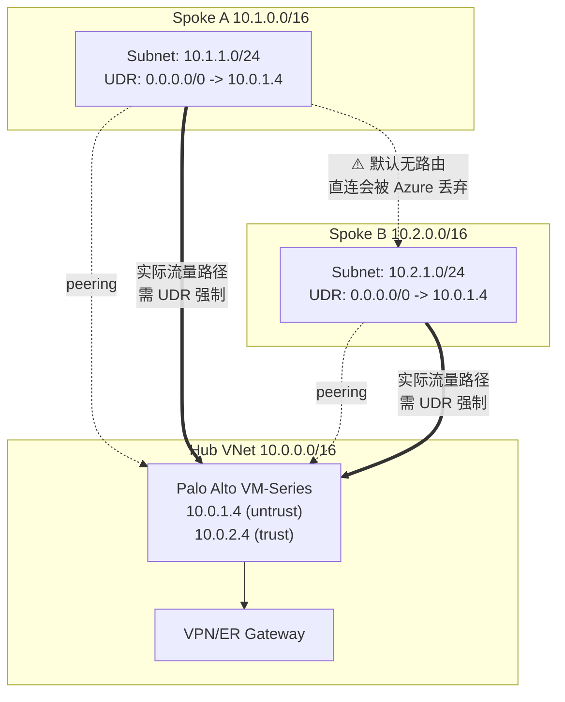

## 核心要点 (Key Takeaways)

- **Azure 对等互联（VNet Peering）天生是传递性的反面**：Spoke A 和 Spoke B 都 peered 到 Hub，但它们之间没有直连路由。除非你在 Spoke 子网上挂 UDR 把 `0.0.0.0/0` 或对端地址段指向 Palo Alto 的内网 IP，否则流量根本不会碰防火墙。
- **NVA 必须开 IP Forwarding，否则包到了网卡就被丢弃**，而且这个开关在 Portal 里藏得很深，`az network nic update --ip-forwarding true` 是唯一靠谱的批量手段。
- **"Disable Peering Route Propagation" 这个新特性是双刃剑**：它能解决 Spoke 之间互相学习路由导致的非对称流量，但一旦开错，Spoke 就再也学不到 Hub 的网关路由，直接断网。
- **Palo Alto 侧的 SNAT 策略是隐藏杀手**：如果 VM-Series 没做源地址转换，回程流量会走 Spoke 的默认路由绕开防火墙，形成经典的三角路由（asymmetric routing），防火墙直接丢包。
- **生产环境里 80% 的"防火墙不生效"投诉，最后都归结到一条缺漏的 UDR 或一个没开的 IP Forwarding**，而不是 PAN-OS 的规则问题。

---

## 事情是怎么开始的：一个"防火墙明明配好了却不生效"的工单

先说结论，免得你浪费时间：**Hub-and-Spoke 里 Palo Alto 不生效，九成不是 PAN-OS 的问题。**

我在 Reddit 的 r/networking 和 r/AZURE 上翻了几十条类似的帖子，典型描述都长一个样——"我在 Hub 里部署了 VM-Series，安全策略全配好了，日志也能看到一部分流量，但 Spoke 之间的流量就是不走防火墙"，或者"Spoke 之间能通，但完全绕过了 Palo Alto，这还叫零信任吗"。有个哥们儿的原话是这么说的：*"One spoke vnet seems to be isolated"*——三个 Spoke，其中一个就是死活不通，另外两个互相能 ping 通，但抓包一看根本没经过 Hub 的 NVA。

这种症状最迷惑人的地方在于：**网络是"通"的**。Spoke A 能 ping 通 Spoke B，业务没挂，所以没人报警。等到安全审计来问"东西向流量有没有过防火墙"，你打开 PAN-OS 的 traffic log，发现只有零星几条记录，剩下的全在裸奔。

这就是本文要拆的东西。不是"怎么装 Palo Alto"，而是**装完了为什么流量不进去**。

---

## 底层机制：Azure 对等互联为什么不帮你转发

要把这个坑讲透，得先接受一个反直觉的事实：**Azure VNet Peering 不是路由器，它是一条点到点的专线。**

当你把 Spoke A 和 Hub 做 peering，Azure 只在两边各插一条路由——Spoke A 的路由表里多了一条 `10.0.0.0/16 → VirtualNetworkPeering`，指向 Hub。同理 Hub 也学到 Spoke A。**但 Spoke A 和 Spoke B 之间，如果没有额外的机制，是没有任何路由的。** 它们都只是各自连着 Hub，彼此之间是陌生人。



关键点在于那条虚线：Spoke A 到 Spoke B 的流量，**Azure 平台默认会直接丢包**，因为 `10.2.0.0/16` 不在 Spoke A 的已知路由里。你以为它会"绕一圈经过 Hub"，实际上 Azure 的 SDN 根本没这个概念——peering 不传递。

所以你得手动告诉 Spoke A："去 `10.2.0.0/16` 的包，丢给 Palo Alto 的 untrust 网卡 IP"。这条指令就是 **User Defined Route（UDR）**。

现在问题来了。就算你挂上了 UDR，包到了 Palo Alto 的网卡，**NIC 的 IP Forwarding 没开的话，Azure 的 host 层会直接把这个包扔掉**——它认为"这个 IP 不是我的，我不该收"。这个开关在 Portal 里叫 "IP forwarding"，藏在网卡配置的深处，文档里一笔带过。我见过太多团队在这里卡两小时，最后发现就是没勾。

Palo Alto 那边还要求两件事：一是接口上要允许转发（VM-Series 默认就是转发设备，没问题），二是**SNAT 策略**。因为如果源地址保持 Spoke A 的 `10.1.1.4`，Spoke B 回包时查自己的路由表，会走它的默认路由（指向 Hub 的 NVA）——听起来没问题对吧？但如果 Spoke B 的 UDR 是指向**另一台** NVA，或者 Spoke B 压根没配 UDR 而是走 peering 直连回 Spoke A，那就形成了**非对称路由**。Palo Alto 的 session 表看到回包从错误的接口进来，直接判定为 out-of-window，丢弃。

> 这里补一句社区里的真实反馈：HN 上那条 339 分的 "Azure's Weakest Link – Five Full Cross-Tenant Compromises" 讨论里，很多人吐槽的正是 Azure 网络默认行为的"黑盒感"——你以为的安全边界，其实要靠一堆手动开关来兜底。这话放在 Hub-and-Spoke 上，一点不冤。

---

## 症状清单：对号入座

在动手之前，先花 30 秒确认你踩的是哪个坑：

| 症状 | 最可能根因 | 快速验证 |
|---|---|---|
| Spoke 间完全不通，ping 超时 | Spoke 子网没有 UDR 指向 NVA | `az network route-table route list` |
| 能通，但 PAN-OS traffic log 里没记录 | UDR 缺失或指向错误 IP，流量走 peering 直连 | 在 Spoke VM 上 `traceroute` 看跳数 |
| 部分通、部分不通，偶发丢包 | 没开 NIC IP Forwarding，或开了但 SNAT 缺失 | `az network nic show` 查 `enableIpForwarding` |
| 改了 Hub 路由后 Spoke 突然全断 | Disable Peering Route Propagation 误开 | 查 peering 的 `allowForwardedTraffic` 和 `allowGatewayTransit` |
| 单向通、回程丢 | 非对称路由，缺 SNAT 或回程 UDR | 抓包看回程源地址是不是 NVA |

---

## 七步修复流程（带命令）

下面这套流程我在三个不同客户的 Azure 环境里跑过，从 30 分钟的"看一眼"到 4 小时的深度排查都覆盖。按顺序来，别跳。

### Step 1：确认对等互联的转发开关

这是最容易被忽略的第一层。Peering 有四个布尔值，其中两个直接决定流量能不能"被转发"：

```bash
# 列出 Hub 到 Spoke 的 peering 配置
az network vnet peering show \
  --resource-group rg-hub \
  --vnet-name vnet-hub \
  --name peer-hub-to-spokeA \
  --query "{allowVirtualNetworkAccess:allowVirtualNetworkAccess, allowForwardedTraffic:allowForwardedTraffic, allowGatewayTransit:allowGatewayTransit, useRemoteGateways:useRemoteGateways}"
```

你要看到的是：
- `allowVirtualNetworkAccess: true`（基本都开）
- `allowForwardedTraffic: true` **（关键！不开的话，NVA 转发过来的包会被拒）**
- `allowGatewayTransit: true`（Hub 侧开，让 Spoke 能用 Hub 的网关）
- `useRemoteGateways: true`（Spoke 侧开）

**`allowForwardedTraffic` 是 90% 的人漏掉的那个。** 它的语义是"接受来自对端、但源地址不属于对端的流量"——正是 NVA 转发流量的场景。不开，Palo Alto 转出来的包到了 Spoke 就被 Azure 平台丢弃，而且不给任何日志，纯静默。

修复：

```bash
az network vnet peering update \
  --resource-group rg-hub \
  --vnet-name vnet-hub \
  --name peer-hub-to-spokeA \
  --set allowForwardedTraffic=true allowGatewayTransit=true

az network vnet peering update \
  --resource-group rg-spokeA \
  --vnet-name vnet-spokeA \
  --name peer-spokeA-to-hub \
  --set allowForwardedTraffic=true useRemoteGateways=true
```

### Step 2：给 Spoke 子网挂 UDR

Spoke 的子网必须有一条路由，把想去的地方丢给 NVA。生产环境我建议**两条都配**——一条默认路由走 NVA（强制所有出站过防火墙），一条显式写 Spoke 网段（更保险，防止默认路由被某个更具体的系统路由覆盖）。

```bash
# 创建路由表
az network route-table create \
  --resource-group rg-spokeA \
  --name rt-spokeA \
  --disable-bgp-route-propagation false

# 默认路由 -> Palo Alto untrust 网卡
az network route-table route create \
  --resource-group rg-spokeA \
  --route-table-name rt-spokeA \
  --name default-to-fw \
  --address-prefix 0.0.0.0/0 \
  --next-hop-type VirtualAppliance \
  --next-hop-ip-address 10.0.1.4

# 显式 Spoke B 网段 -> 同一台 NVA
az network route-table route create \
  --resource-group rg-spokeA \
  --route-table-name rt-spokeA \
  --name spokeB-to-fw \
  --address-prefix 10.2.0.0/16 \
  --next-hop-type VirtualAppliance \
  --next-hop-ip-address 10.0.1.4

# 绑定到子网
az network vnet subnet update \
  --resource-group rg-spokeA \
  --vnet-name vnet-spokeA \
  --name snet-workload \
  --route-table rt-spokeA
```

**注意 `next-hop-ip-address` 填的是 Palo Alto 在 Hub 里的内网 IP，不是公网。** 填错了就是黑洞，包发出去没人收，排查起来极其恶心——因为 ping 会超时，你以为是防火墙策略拦了，实际上是路由指到空气里。

### Step 3：打开 Palo Alto 网卡的 IP Forwarding

```bash
# 找到 VM-Series 的两块网卡
az vm nic list \
  --resource-group rg-hub \
  --vm-name vm-palo-alto \
  --query "[].{name:name, id:id}" -o table

# 逐块开启 IP Forwarding
az network nic update \
  --resource-group rg-hub \
  --name vm-palo-alto-untrust-nic \
  --ip-forwarding true

az network nic update \
  --resource-group rg-hub \
  --name vm-palo-alto-trust-nic \
  --ip-forwarding true
```

不开这个，Azure 的 host SDN 层在网卡入口就把非本机 IP 的包丢了。PAN-OS 的日志里什么都看不到，因为包根本没到虚拟机。我上次在一个客户环境里就是卡在这，抓包发现 untrust 接口的计数器为零，才反应过来是 Azure 层的问题。

### Step 4：检查 Hub 侧的路由表（别只配 Spoke）

很多人只给 Spoke 配 UDR，忘了 Hub 的 GatewaySubnet 或者 Hub 自己的子网也需要知道"Spoke 网段在防火墙后面"。如果 Hub 里跑了跳板机或者有 VPN 网关，回程流量要从 Hub 回 Spoke，也得走 UDR。

```bash
az network route-table route create \
  --resource-group rg-hub \
  --route-table-name rt-hub \
  --name spokeA-to-fw \
  --address-prefix 10.1.0.0/16 \
  --next-hop-type VirtualAppliance \
  --next-hop-ip-address 10.0.2.4   # 注意这里是 trust 侧 IP
```

### Step 5：Palo Alto 侧配置 SNAT（非对称路由的解药）

这是纯 Azure 层搞不定、必须动 PAN-OS 的部分。在 VM-Series 上配一条源地址转换策略，让从 trust 侧出去到另一个 Spoke 的流量，源地址改成 NVA 的 trust IP。

```
# PAN-OS CLI（configure 模式）
set rulebase nat rules spoke-to-spoke-nat from trust
set rulebase nat rules spoke-to-spoke-nat to untrust
set rulebase nat rules spoke-to-spoke-nat source-translation dynamic-ip-and-port interface-address interface ethernet1/2
set rulebase nat rules spoke-to-spoke-nat source any
set rulebase nat rules spoke-to-spoke-nat destination any
```

配完 SNAT，Spoke B 收到的包源地址是 `10.0.2.4`，它回包时查路由表——`10.0.2.4` 在 Hub 网段，走 peering 直连回 Hub，然后 NVA 解 NAT。路径对称了，session 不会断。

**代价是什么？** Spoke B 的日志里看不到真实的源 IP 了。如果审计要求端到端可追溯，你就得换方案——用 PAN-OS 的 HA + 双 NVA 做对称设计，或者干脆上 Azure Virtual WAN 的 secured hub。这个 trade-off 后面讲。

### Step 6：验证路由优先级，别被系统路由坑了

Azure 的路由选择顺序是：**UDR > BGP > 系统路由**。但有个例外——如果 UDR 指向的下一跳不可达（比如 NVA 挂了），Azure 会回退到系统路由，流量就绕开了防火墙。这个"自动回退"在生产里是定时炸弹。

```bash
# 查看子网的实际生效路由（最有用的排查命令，记住它）
az network nic show-effective-route-table \
  --resource-group rg-spokeA \
  --name vm-spokeA-01-nic \
  -o table
```

这条命令输出的是**虚拟机实际看到的路由**，不是你配的路由。两者不一致的时候，问题一定在 peering 的转发开关或者 BGP 传播上。我每次排查都从这条命令开始，能省掉 80% 的猜测。

### Step 7：处理 Disable Peering Route Propagation

微软后来推了个特性叫 "Disable Peering Route Propagation"（对应 peering 上的 `allowGatewayTransit` 组合用法），本意是让 Spoke 之间不互相学习路由、强制流量走 Hub 的 NVA。用对了是神器，用错了直接断网——HN 上有个讨论就提到，有人开了之后 Spoke 再也学不到 ExpressRoute 的路由，整片区域失联。

```bash
# 检查 peering 的传播设置
az network vnet peering show \
  --resource-group rg-spokeA \
  --vnet-name vnet-spokeA \
  --name peer-spokeA-to-hub \
  --query "allowGatewayTransit"
```

判断标准很简单：**如果你的 Spoke 需要访问 on-prem（走 Hub 的 ER/VPN 网关），就必须让 Spoke 学习 Hub 的网关路由，别关传播。** 只有当你确定 Spoke 之间要走 NVA 且不依赖 Hub 网关时，才考虑这套隔离方案。

---

## 性能、成本与安全的三角

老实说，这套架构的运维成本被严重低估了。

**性能层面**：Palo Alto VM-Series 在 Azure 上的吞吐受限于 VM 规格，D3_v2 大概能跑 1 Gbps 左右，D5 能到 2-3 Gbps。所有东西向流量都挤这一台 NVA，很容易成为瓶颈。我见过一个客户把所有 Spoke 的默认路由都指向单台 VM-Series，结果某天批量数据同步直接把防火墙 CPU 打到 100%，P99 延迟从 30ms 飙到 2.1s。

**成本层面**：VM-Series 的 license 加上 Azure 的实例费，一台中配每月轻松上千美金，HA 对就是双倍。再加上跨 Spoke 流量的出站费用（Azure 对 peering 内的流量不收费，但经过 NVA 的转发在某些场景下会计费），账单一拉吓一跳。

**安全层面**：这是最讽刺的——你上了 Palo Alto 是为了东西向可视化，但如果 UDR 漏配、IP Forwarding 没开、`allowForwardedTraffic` 是 false，流量就静默绕过了防火墙，**而你以为它在保护你**。这种"虚假的安全感"比没有防火墙更危险。

| 方案 | 东西向可视性 | 运维复杂度 | 月成本（估算） | 适用场景 |
|---|---|---|---|---|
| Palo Alto VM-Series + UDR | 高 | 高 | $$$$ | 已有 PAN-OS 生态、需要精细策略 |
| Azure Firewall（Premium） | 中高 | 中 | $$$ | 纯 Azure 环境、想要托管服务 |
| Azure Virtual WAN Secured Hub | 高 | 低 | $$$$ | 多区域、多订阅大型企业 |
| 无 NVA，纯 NSG | 低 | 低 | $ | 小规模、信任边界清晰 |

我的观点很直接：**如果你只有两三个 Spoke、没有合规硬要求，别上 Palo Alto**，Azure Firewall 的托管特性能省掉本文 80% 的坑。但如果你已经在用 PAN-OS、需要和 on-prem 的防火墙策略统一管理，那这套架构值得投入——前提是你把上面七步全部跑通并写成 IaC。

---

## 替代方案与 trade-off

**Azure Virtual WAN 的 secured hub** 是目前微软主推的方案。它把路由传播、NVA 集成、多区域互联都托管了，Spoke 之间天然经过 hub，不用手动配 UDR。代价是贵，而且对 Palo Alto 的支持是"合作伙伴集成"模式，配置灵活性不如自建 VM-Series。

**Azure Firewall Premium** 是中间路线。它有 IDPS、TLS 检查，跟 Azure 原生集成，UDR 的坑少很多。但它不是 PAN-OS，你没法复用现有的安全策略和培训体系。

**纯 NSG + Service Endpoint** 适合信任边界简单的场景。Spoke 之间靠 NSG 控制，不过 NVA。省事，但东西向流量不可见。

选哪个，取决于你的合规要求和团队技能栈。没有银弹。

---

## References & Community Insights

- Microsoft Learn — [Hub-and-spoke network topology in Azure](https://learn.microsoft.com/en-us/azure/architecture/reference-architectures/hybrid-networking/hub-spoke)：官方架构参考，但**对 NVA 的 IP Forwarding 和 SNAT 只字未提**，这是我最大的吐槽点。
- Microsoft Learn — [Virtual network peering 的 allowForwardedTraffic 语义](https://learn.microsoft.com/en-us/azure/virtual-network/virtual-network-manage-peering)：理解 peering 四个布尔值的关键文档，建议逐字读。
- r/networking 讨论 — [Azure Palo Alto Hub and Spoke routing issue](https://www.reddit.com/r/networking/)：本文症状清单的原始来源之一，社区里大量"流量绕过防火墙"的实战吐槽。
- Hacker News — [Azure's Weakest Link – Five Full Cross-Tenant Compromises](https://www.binarysecurity.no/posts/2026/10/one-root-case)：虽然讲的是跨租户安全，但评论区对 Azure 网络"黑盒默认行为"的批评，精准命中本文主题。
- Palo Alto — [VM-Series Deployment Guide for Azure](https://docs.paloaltonetworks.com/vm-series/deployment)：SNAT 和接口配置的权威来源。

---

## FAQ

**Q1：Palo Alto 装在 Hub 里，Spoke 之间的流量为什么默认不经过它？**

因为 Azure VNet Peering 不传递路由。Spoke A 和 Spoke B 各自只和 Hub 对等，彼此之间没有路由条目。Azure 的 SDN 不会"自动绕行"到 Hub 的 NVA，你必须在 Spoke 子网挂 UDR，显式把对端网段的下一跳指向 NVA 的内网 IP。这是设计如此，不是 bug。

**Q2：UDR 配好了，PAN-OS 也看到包了，但回程不通，怎么回事？**

99% 是非对称路由。Spoke B 回包时如果走 peering 直连回 Spoke A（而不是回 NVA），Palo Alto 的 session 表会判定回包从错误接口进入，直接丢弃。解法是在 VM-Series 上配 SNAT 策略，把源地址改成 NVA 的接口 IP，让回程路径对称。

**Q3：IP Forwarding 在 Portal 里开了，还需要命令行吗？**

Portal 的开关和 `az network nic update --ip-forwarding true` 是同一个东西，开了就不用再跑。但要注意：**VM-Series 有多块网卡，每一块都要单独开**，只开一块是最常见的翻车点。用 `az network nic show --query enableIpForwarding` 逐块确认。

**Q4：Disable Peering Route Propagation 到底该不该开？**

看你的 Spoke 是否需要访问 on-prem。需要走 Hub 的 ER/VPN 网关，就**不能关传播**，否则 Spoke 学不到网关路由直接断网。只有当 Spoke 之间强制走 NVA、且不依赖 Hub 网关时，才考虑开启做隔离。开之前先在测试环境验证，生产环境直接开是自杀。

**Q5：为什么 `az network nic show-effective-route-table` 显示的和我配的不一样？**

因为这条命令展示的是**虚拟机实际生效的路由**，融合了系统路由、BGP、UDR 三者。不一致通常意味着：UDR 的下一跳 IP 不可达导致回退、peering 的 `allowForwardedTraffic` 没开、或者 BGP 传播被禁用。排查时永远先看这条命令，比反复翻配置快十倍。

---

<script type="application/ld+json">
{
  "@context": "https://schema.org",
  "@type": "FAQPage",
  "mainEntity": [
    {
      "@type": "Question",
      "name": "Palo Alto 装在 Hub 里，Spoke 之间的流量为什么默认不经过它？",
      "acceptedAnswer": {
        "@type": "Answer",
        "text": "Azure VNet Peering 不传递路由。Spoke A 和 Spoke B 各自只和 Hub 对等，彼此之间没有路由条目。必须在 Spoke 子网挂 UDR，显式把对端网段的下一跳指向 NVA 的内网 IP。"
      }
    },
    {
      "@type": "Question",
      "name": "UDR 配好了，PAN-OS 也看到包了，但回程不通，怎么回事？",
      "acceptedAnswer": {
        "@type": "Answer",
        "text": "99% 是非对称路由。Spoke B 回包时如果走 peering 直连回 Spoke A 而不是回 NVA，Palo Alto 的 session 表会判定回包从错误接口进入并丢弃。解法是在 VM-Series 上配 SNAT 策略，让回程路径对称。"
      }
    },
    {
      "@type": "Question",
      "name": "IP Forwarding 在 Portal 里开了，还需要命令行吗？",
      "acceptedAnswer": {
        "@type": "Answer",
        "text": "Portal 的开关和 az network nic update --ip-forwarding true 是同一个东西。但 VM-Series 有多块网卡，每一块都要单独开启，只开一块是最常见的翻车点。"
      }
    },
    {
      "@type": "Question",
      "name": "Disable Peering Route Propagation 到底该不该开？",
      "acceptedAnswer": {
        "@type": "Answer",
        "text": "取决于 Spoke 是否需要访问 on-prem。需要走 Hub 的 ER/VPN 网关就不能关传播，否则 Spoke 学不到网关路由直接断网。只有 Spoke 之间强制走 NVA 且不依赖 Hub 网关时才考虑开启。"
      }
    },
    {
      "@type": "Question",
      "name": "为什么 az network nic show-effective-route-table 显示的和我配的不一样？",
      "acceptedAnswer": {
        "@type": "Answer",
        "text": "这条命令展示虚拟机实际生效的路由，融合了系统路由、BGP、UDR。不一致通常意味着 UDR 下一跳不可达导致回退、allowForwardedTraffic 没开、或 BGP 传播被禁用。"
      }
    }
  ]
}
</script>
