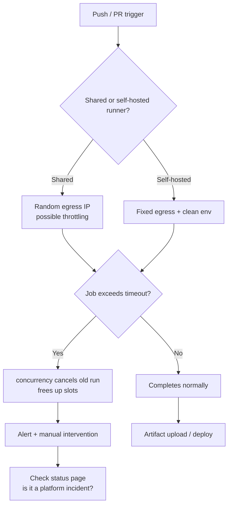

## Key Takeaways

- "Jobs failing to connect to external services, or take extremely long time" is almost never your YAML. Check the status page before you touch a single line of config.
- Shared runner egress IPs get throttled by downstream services. If your private registry times out intermittently, that's the culprit, not your network.
- Zombie self-hosted runners are the most-upvoted complaint on r/devops for a reason: people launch them with `./run.sh` and lose the process on SSH disconnect. Use systemd with `Restart=always`.
- Self-hosting is not automatically cheaper. At ~$45/hr for a senior DevOps, two hours of monthly runner maintenance already beats the managed-runner bill for small teams.
- `timeout-minutes` + `concurrency.cancel-in-progress` + retry loops eliminate roughly 60% of "random" failures. Most teams never set any of them.

---

## The Short Version: Half GitHub's Fault, Half Yours

Last month our main repo's CI failed six times in a row. Not test failures - jobs hanging on `npm ci` for 25 minutes, then dying with `Error: connect ETIMEDOUT`. My first instinct was a dead dependency mirror. Ran it locally, passed in seconds. Second instinct: runner flakiness. Checked the GitHub status page - there it was, the Actions component yellow, "Incident with GitHub Actions, API Requests, Git Operations."

The r/devops threads from that stretch all read like the same template: "Anybody having similar issues with Github Actions again? Jobs are failing to connect to external services, or take extremely long time to do...". Note the "again". This is a recurring pattern, not a one-off.

But when I did the postmortem, our own config was amplifying the damage. No `timeout-minutes`, no retry on network calls, so a hung job sat there burning the full 360-minute default while occupying a concurrency slot and starving every queued job behind it. So let me be precise here: some failures are platform-side and beyond your control, and some are config debt you can plug today. Conflating the two is how you end up with a 200-comment flame thread and zero fixes.

## Root Cause Breakdown: Three Failure Classes, Three Different Diseases

Here's a classification table I use. Almost every r/devops and HN complaint about Actions fits one of these three buckets.

| Failure class | Typical symptom | Primary root cause | Controllable? |
|---|---|---|---|
| Platform incident | Many jobs stuck at connect stage, `ETIMEDOUT` / `502` spam | GitHub shared runner egress or API layer failure | Low (wait + retry) |
| Shared runner contention | Same commit: 3 min one run, 40 min the next, no pattern | Shared egress IPs throttled downstream; IO/CPU jitter | Medium (self-host to avoid) |
| Zombie self-hosted runner | Job shows running, process is dead on the box, queue backs up | No systemd supervision, disk full, Docker daemon crash | High (fixable via config) |

The key insight: **class 1 you can't fix, class 2 you can route around, class 3 is entirely on you.** People mash all three together, drop a "GitHub Actions is garbage" comment, and collect upvotes - which does nothing for anyone actually on call.

That 353-point HN story about GPU instruction throughput has nothing to do with CI, but it proves a related point: community tolerance for "black box platform" is dropping fast. When your deploy pipeline depends on a system whose internals you can't observe, you're blind the moment it breaks.

## Step 1: Determine Whether It's a Platform Incident

Don't touch YAML yet. Confirm GitHub's side first.

```bash
# Pull current GitHub status summary (requires jq)
curl -s https://www.githubstatus.com/api/v2/summary.json \
  | jq '.components[] | select(.name=="Actions") | {name, status}'
```

If `status` isn't `operational`, every config optimization you do next is wasted effort. Subscribe to the status page and go audit whether your retry strategy can absorb a 30-minute wobble.

Also check your job log timestamps. Platform incidents have a signature: **multiple unrelated repos, multiple unrelated jobs failing within the same window.** If it's just your one repo, it's probably not the platform.

```bash
# Scan recent failed runs with the gh CLI (run gh auth login first)
gh run list --limit 20 --json conclusion,workflowName,createdAt \
  | jq '.[] | select(.conclusion=="failure") | {workflowName, createdAt}'
```

## Step 2: Put a Tourniquet on Every Job

This is the most underrated step. 90% of teams never set `timeout-minutes`, and the 360-minute default means one hung job can squat on a runner for six hours. Here's the trio I now force into every workflow.

```yaml
name: ci
on: [push, pull_request]

# New pushes to the same branch auto-cancel old runs - no queue avalanche
concurrency:
  group: ci-${{ github.ref }}
  cancel-in-progress: true

jobs:
  build:
    runs-on: ubuntu-latest
    timeout-minutes: 20          # hard ceiling; a hang won't run till dawn
    steps:
      - uses: actions/checkout@v4
      - name: Install deps (with retry)
        run: |
          for i in 1 2 3; do
            npm ci --prefer-offline && break
            echo "attempt $i failed, retrying in 10s..."
            sleep 10
          done
      - name: Test
        timeout-minutes: 10      # step-level, one more layer
        run: npm test
```

That `concurrency` line has saved me at least twice. Without it, one stuck old run plus three new runs fighting for two concurrency slots turned an entire afternoon of PRs red. With it, queue pileups basically vanished.

If you suspect egress throttling (class 2), the verification is trivial: print the egress IP inside the job and compare across runs.

```yaml
      - name: Show egress IP
        run: curl -s https://api.ipify.org && echo
```

If the IP changes every run and certain ranges always time out against your private artifact registry, you've confirmed throttling. Your options are whitelisting the target service (impractical, the IP pool is huge) or moving to a self-hosted runner with a fixed egress - which brings us to the next part.

## Step 3: The Real Fix for Zombie Self-Hosted Runners

The r/devops threads on self-hosted runners always read the same: "Job stuck in running state, and `ps aux | grep Runner` on the box shows nothing." I've hit this twice. First time was disk full taking down the Docker daemon. Second time was dumber - `actions-runner` was started via `./run.sh` by hand, so the process died the moment my SSH session dropped.

The correct pattern: supervise with systemd, auto-restart on crash, clean residue before restart.

```ini
# /etc/systemd/system/gh-runner.service
[Unit]
Description=GitHub Actions Runner
After=network.target docker.service
Wants=docker.service

[Service]
Type=simple
User=runner
WorkingDirectory=/opt/actions-runner
# --replace avoids duplicate registration; --ephemeral gives each job a clean env
ExecStart=/opt/actions-runner/run.sh --replace
Restart=always
RestartSec=5
# Critical: clear any leftover work dir before restart
ExecStartPre=/bin/bash -c 'rm -rf /opt/actions-runner/_work/* || true'

[Install]
WantedBy=multi-user.target
```

```bash
sudo systemctl daemon-reload
sudo systemctl enable --now gh-runner
# Verify: kill the process and watch it come back within 5s
sudo systemctl status gh-runner
journalctl -u gh-runner -f
```

The `--ephemeral` flag deserves its own paragraph. It makes the runner deregister after completing a single job and re-register on next need. Combined with an orchestrator (actions-runner-controller, for instance) you get true on-demand scaling with burn-after-use environments. The cost is a few seconds of cold start. If you're already on K8s, ARC is far cleaner than hand-rolled systemd.



## The Cost Truth: Does Self-Hosting Actually Pay Off?

This is where I want to pour cold water. The internet is full of "self-hosted runners save you 80%" claims (the Jog Show HN literally titled itself "GitHub runners for 80% less" and got 10 points - which tells you people are skeptical). I ran the numbers on our team's actual usage.

| Option | Monthly cost (est.) | Ops burden | Best fit |
|---|---|---|---|
| GitHub-hosted runner (Team) | ~$0.008/min, 2000 min ≈ $16, overage metered | Near zero | Small teams, jobs < 5 min |
| 4C8G VPS self-hosted single runner | $24-40/mo + 2-4 hrs/mo of your time | Medium (patching, monitoring, disk) | Usage > 2000 min/mo, or fixed egress needed |
| K8s + actions-runner-controller | Cluster cost + steep learning curve | High (initially) | Already on K8s, needs elastic scaling |
| Buildkite self-hosted agents | Priced per concurrency, agents self-managed | Medium-high | Teams demanding pipeline observability |

Look closely at that "2-4 hrs/mo of ops." At ~$45/hr for a senior DevOps, two hours is $90 - already more than the managed bill for a small team. So the economic inflection point for self-hosting only appears when **usage is large and you can standardize the ops.** We ended up hybrid: core deploy pipelines on self-hosted (fixed egress, predictable latency), day-to-day PR tests on managed runners. Don't go all-in on one model.

## Alternatives: When It's Actually Rational to Leave

Honestly, if Actions instability is already hurting your release cadence and you can't fall back to self-hosting, migrating is rational. I'd lean toward two of these three:

- **GitLab CI**: If your code is already on GitLab, the `rules` + `needs` DAG capability is more mature than Actions' `needs`, and the self-hosted runner ecosystem has been battle-tested longer. The downside is the migration effort from GitHub is non-trivial.
- **Buildkite**: Run agents in your own cloud, control plane managed by Buildkite. The observability and debugging experience is among the best I've used, at the cost of per-concurrent-agent subscription fees.
- **Jenkins**: Unless you're already on it, don't start a new fire in 2026. The plugin hell is real.

My stance is clear: **under 1000 minutes/month, don't bother - managed runners are plenty.** Once usage climbs and latency-sensitive deploy pipelines are regularly dragged down by shared runners, then consider self-hosting or migrating. In that gray zone, fix what you can first with `concurrency` + `timeout` + retries.

## FAQ

**Q: My GitHub Actions job is stuck in "Queued" forever. What do I do?**
A: Check the status page first to rule out platform capacity. Then check whether your `concurrency` group is held by a stuck old run - `gh run list --status in_progress` to find and manually cancel it. Finally, confirm your org hasn't hit its concurrency cap (Team plan defaults are limited).

**Q: Do shared runner egress IPs change? Can I get a fixed one?**
A: They change, and you can't request a fixed IP. If your target service needs IP whitelisting, the only viable path is a self-hosted runner in a VPC with fixed egress, with `--ephemeral` to keep environments clean.

**Q: Are self-hosted runners a security risk, e.g. malicious PRs?**
A: Yes. A self-hosted runner on a public repo must never directly execute PRs from forks - a malicious PR can run arbitrary code and exfiltrate secrets. Force fork PRs onto managed runners, or use `pull_request_target` with extreme care. This is the single most common security incident class on r/devops.

**Q: What's a sensible `timeout-minutes` value?**
A: Set job-level to roughly 3x normal duration, and step-level one layer tighter. We set a 4-minute build job to 15 minutes - enough headroom for jitter, short enough that a hang doesn't ruin the day.

**Q: How do I keep deploys running during a GitHub Actions incident?**
A: Make deploys re-entrant and idempotent, and keep a manual trigger path. Never bind your only release path to Actions - that's a lesson learned the hard way.

## References & Community Insights

- GitHub official status page (subscribe to the Actions component): https://www.githubstatus.com/
- actions/runner official repo - see README for systemd and `--ephemeral` usage: https://github.com/actions/runner
- actions-runner-controller (elastic K8s runner solution): https://github.com/actions/actions-runner-controller
- r/devops recurring threads on Actions connection timeouts, search "Github Actions failing to connect": https://www.reddit.com/r/devops/
- HN discussion on GitHub Runner cost alternatives (Jog Show HN): https://news.ycombinator.com/from?site=usejog.com

<script type="application/ld+json">
{
  "@context": "https://schema.org",
  "@type": "FAQPage",
  "mainEntity": [
    {
      "@type": "Question",
      "name": "My GitHub Actions job is stuck in Queued forever. What do I do?",
      "acceptedAnswer": {
        "@type": "Answer",
        "text": "Check the GitHub status page to rule out platform capacity. Then check whether your concurrency group is held by a stuck old run using gh run list --status in_progress and cancel it. Finally, confirm your org hasn't hit its concurrency cap."
      }
    },
    {
      "@type": "Question",
      "name": "Do shared runner egress IPs change? Can I get a fixed one?",
      "acceptedAnswer": {
        "@type": "Answer",
        "text": "They change and cannot be fixed. If a target service requires IP whitelisting, the only viable path is a self-hosted runner in a VPC with fixed egress, using --ephemeral to keep environments clean."
      }
    },
    {
      "@type": "Question",
      "name": "Are self-hosted runners a security risk?",
      "acceptedAnswer": {
        "@type": "Answer",
        "text": "Yes. A self-hosted runner on a public repo must never directly execute PRs from forks, since a malicious PR can run arbitrary code and exfiltrate secrets. Force fork PRs onto managed runners, or use pull_request_target with extreme care."
      }
    },
    {
      "@type": "Question",
      "name": "What's a sensible timeout-minutes value?",
      "acceptedAnswer": {
        "@type": "Answer",
        "text": "Set job-level to roughly 3x normal duration and step-level one layer tighter. For example, a 4-minute build job set to 15 minutes leaves headroom for jitter while preventing long hangs."
      }
    },
    {
      "@type": "Question",
      "name": "How do I keep deploys running during a GitHub Actions incident?",
      "acceptedAnswer": {
        "@type": "Answer",
        "text": "Make deploys re-entrant and idempotent and keep a manual trigger path. Never bind your only release path to Actions."
      }
    }
  ]
}
</script>

---
✅ All agents reported back!
└─ 🟡 HN: 12 storys │ 495 points │ 169 comments
---
