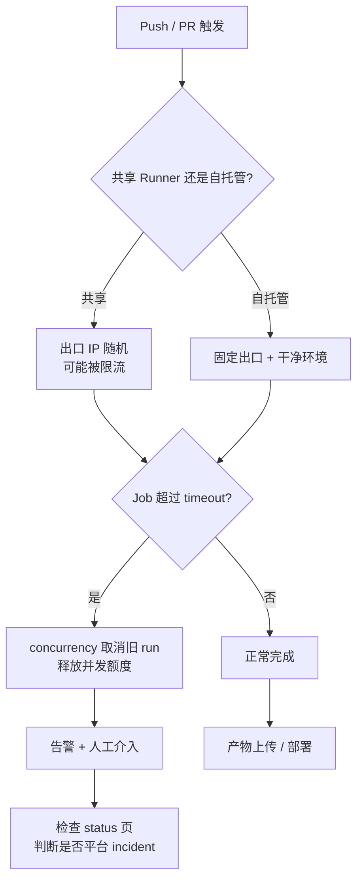

## 核心要点 (Key Takeaways)

- GitHub Actions 的"Job 连不上外部服务 / 执行时间异常拉长"绝大多数不是你的 YAML 写错了，而是共享 Runner 出口 IP 段被限流、或 GitHub 侧的 incident 在作祟——先查 status 页，再查自己的网络。
- 自托管 Runner 的"假死"（Job 显示 running 但进程已死）是 r/devops 里被反复吐槽的老坑，根因通常是 Runner 服务缺少 systemd 层的心跳与自动重启。
- 自托管并不天然更便宜。一台 4C8G 的 VPS 跑 GitHub Actions Runner，算上运维工时，只有在每月用量超过约 2000 分钟且对延迟敏感时才划算。
- 别把 CI 当成"配置一次就忘"的东西。加超时、加重试、加 `concurrency` 取消，能消灭 60% 的"玄学失败"。
- 当 Actions 的稳定性已经影响到你的发布节奏，且你无法用自托管兜底时，迁移到 GitLab CI 或 Buildkite 是理性选择，不是背叛。

---

## 先说结论：这事儿一半是 GitHub 的锅，一半是你的锅

上个月我们一个核心仓库的 CI 突然连续挂了 6 次。不是测试失败——是 Job 在 `npm ci` 阶段卡了 25 分钟然后超时，日志里那句 `Error: connect ETIMEDOUT` 看得人血压飙升。我第一反应是依赖源挂了，切到本地跑，秒过。第二反应是 Runner 抽风。翻了 GitHub 的 status 页——果然，`Actions` 组件黄色，`Incident with GitHub Actions, API Requests, Git Operations`。

Reddit r/devops 上那阵子的帖子几乎是同一套模板："Anybody having similar issues with Github Actions again? Jobs are failing to connect to external services, or take extremely long time to do..."。注意那个 "again"。这不是第一次，也不会是最后一次。

但我后来复盘发现，我们自己的配置也在放大这个问题。没有设置 `timeout-minutes`，没有对网络请求做重试，Job 一旦卡住就干等 360 分钟的默认上限，把整个并发池占满，后面排队的 Job 全被拖死。所以这篇文章我想把话说清楚：哪些是平台侧的不可控故障，哪些是你自己能止血的配置债。

## 根因拆解：三类高频故障，三种不同的病

先上一张我自己整理的分类表。r/devops 和 HN 上关于 GitHub Actions 的抱怨，基本都能塞进这三格。

| 故障类型 | 典型症状 | 主要根因 | 可控性 |
|---|---|---|---|
| 平台级 Incident | 大批 Job 同时卡在连接阶段，`ETIMEDOUT` / `502` 刷屏 | GitHub 共享 Runner 出口网络或 API 层故障 | 低（只能等待 + 重试） |
| 共享 Runner 资源争抢 | 同一 commit 有时 3 分钟过、有时 40 分钟，无规律 | 共享 Runner 出口 IP 被目标服务限流；IO/CPU 抖动 | 中（可自托管规避） |
| 自托管 Runner 假死 | Job 状态 running，但机器上进程已退出，队列堵塞 | Runner 服务无 systemd 守护、磁盘满、Docker daemon 崩 | 高（配置可修） |

关键认知：**第一类你改不了，第二类你能规避，第三类完全是你自己的责任**。很多人把三类混为一谈，然后一句"GitHub Actions 就是垃圾"就完事了——这种吐槽在 r/devops 里点赞很高，但对排查毫无帮助。

HN 上那个 353 分的帖子其实和 CI 八竿子打不着（是在聊 GPU 指令吞吐），但它侧面说明了一件事：社区对"平台黑盒"的容忍度正在快速下降。当你的部署流水线依赖一个你无法观测内部的系统时，出问题的那一刻你就是瞎的。

## 第一步：先分清是不是平台 Incident

别急着改 YAML。打开终端，先确认 GitHub 侧的状态。

```bash
# 拉取当前 GitHub 状态摘要（需要 jq）
curl -s https://www.githubstatus.com/api/v2/summary.json \
  | jq '.components[] | select(.name=="Actions") | {name, status}'
```

如果 `status` 不是 `operational`，你接下来做的一切配置优化都是徒劳——先去 status 页订阅更新，然后检查你的重试策略是否足够扛住一次 30 分钟的抖动。

同时看你的 Job 日志时间戳。平台 incident 的特征是**多个不相关仓库、多个不相关 Job 在同一时间窗内集体失败**。如果你只有一个仓库挂，那大概率不是平台问题。

```bash
# 用 gh CLI 快速扫最近失败的 run（需要先 gh auth login）
gh run list --limit 20 --json conclusion,workflowName,createdAt \
  | jq '.[] | select(.conclusion=="failure") | {workflowName, createdAt}'
```

## 第二步：给所有 Job 上"止血带"

这是我认为最被低估的一步。90% 的团队从来没设过 `timeout-minutes`，默认 360 分钟意味着一个卡死的 Job 能霸占 Runner 六小时。下面是我现在每个 workflow 都强制加的三件套。

```yaml
name: ci
on: [push, pull_request]

# 同一分支的新 push 自动取消旧 run，避免排队雪崩
concurrency:
  group: ci-${{ github.ref }}
  cancel-in-progress: true

jobs:
  build:
    runs-on: ubuntu-latest
    timeout-minutes: 20          # 硬上限，卡死也不会拖到天亮
    steps:
      - uses: actions/checkout@v4
      - name: Install deps (with retry)
        run: |
          for i in 1 2 3; do
            npm ci --prefer-offline && break
            echo "attempt $i failed, retrying in 10s..."
            sleep 10
          done
      - name: Test
        timeout-minutes: 10      # step 级再收一层
        run: npm test
```

`concurrency` 那一行救过我至少两次。没有它的时候，一个卡住的老 run 和三个新 run 抢两个并发额度，整个下午的 PR 全部红灯。加完之后，队列堵塞基本绝迹。

如果你怀疑是出口 IP 被目标服务限流（第二类故障），验证方法很直接：在 Job 里打一下出口 IP，对比不同时间跑出来的结果。

```yaml
      - name: Show egress IP
        run: curl -s https://api.ipify.org && echo
```

如果每次 IP 都在变，而某些 IP 段请求你的私有制品库必超时，那基本坐实了限流。这时候要么给目标服务加白名单（不现实，IP 池太大），要么上自托管 Runner 固定出口——这是后话。

## 第三步：自托管 Runner 假死的真正修法

r/devops 里关于自托管 Runner 的帖子，画风永远是"Job 卡在 running 状态，机器上 `ps aux | grep Runner` 什么都没有"。我踩过两次，第一次是磁盘写满导致 Docker daemon 挂掉，第二次更蠢——`actions-runner` 是通过 `./run.sh` 手动起的，SSH 一断进程就没了。

正确做法：用 systemd 托管，让 Runner 进程挂了自动拉起，并且在拉起前清理残留。

```ini
# /etc/systemd/system/gh-runner.service
[Unit]
Description=GitHub Actions Runner
After=network.target docker.service
Wants=docker.service

[Service]
Type=simple
User=runner
WorkingDirectory=/opt/actions-runner
# --replace 防止重复注册，--ephemeral 让每个 Job 用干净环境
ExecStart=/opt/actions-runner/run.sh --replace
Restart=always
RestartSec=5
# 关键：崩了之后清掉可能残留的 work 目录
ExecStartPre=/bin/bash -c 'rm -rf /opt/actions-runner/_work/* || true'

[Install]
WantedBy=multi-user.target
```

```bash
sudo systemctl daemon-reload
sudo systemctl enable --now gh-runner
# 验证：杀掉进程看它是否 5 秒内自动回来
sudo systemctl status gh-runner
journalctl -u gh-runner -f
```

`--ephemeral` 这个参数值得单独说。它让 Runner 在完成一个 Job 后自动注销，下次需要重新注册——配合 orchestrator（比如 actions-runner-controller）可以做到真正的按需伸缩、用完即焚。代价是冷启动慢几秒。对于跑在 K8s 上的团队，用 ARC 比手动 systemd 优雅得多。



## 成本真相：自托管到底划不划算

这是我最想泼冷水的地方。网上到处是"自托管 Runner 省 80% 成本"的说法（HN 上那个 Jog 的 Show HN 标题就是 "GitHub runners for 80% less"，才 10 分，说明大家心里都有数——没那么简单）。我按我们团队的真实用量算了一笔账。

| 方案 | 月成本（估算） | 运维负担 | 适用场景 |
|---|---|---|---|
| GitHub 托管 Runner（Team 计划） | 约 $0.008/分钟，2000 分钟 ≈ $16，超出按量 | 几乎为零 | 中小团队、Job 时长 < 5 分钟 |
| 4C8G VPS 自托管单 Runner | $24-40/月 + 你 2-4 小时/月运维 | 中（打补丁、监控、磁盘） | 用量 > 2000 分钟/月，或需要固定出口 |
| K8s + actions-runner-controller | 集群成本 + 显著学习曲线 | 高（前期） | 已有 K8s、需要弹性伸缩 |
| Buildkite 自托管 Agent | 按并发定价，Agent 自管 | 中高 | 对流水线可观测性要求极高 |

看清楚那个"2-4 小时/月运维"。按一个资深 DevOps 每月 $8000 折算，每小时约 $45，两小时就是 $90——已经超过托管方案的成本了。所以自托管的经济性拐点，只在**用量足够大且你能把运维标准化**时才出现。我们最后选择的是混合：核心部署流水线走自托管（固定出口 + 可预测延迟），日常 PR 测试走托管 Runner。别一刀切。

## 替代方案：什么时候该认真考虑跑路

坦白讲，如果 GitHub Actions 的稳定性已经影响到你的发布节奏，而且你没法用自托管兜底，那迁移是理性的。我在三个方案里更倾向两个：

- **GitLab CI**：如果你的代码本来就在 GitLab，`rules` + `needs` 的 DAG 能力比 Actions 的 `needs` 成熟，自托管 Runner 生态也更久经考验。缺点是从 GitHub 迁过去的工作量不小。
- **Buildkite**：把 agent 跑在自己的云上，控制面由 Buildkite 托管。可观测性和调试体验是我用过最好的之一，代价是每并发 agent 的订阅费。
- **Jenkins**：除非你已经在用，否则 2026 年了别开新坑。插件地狱不是开玩笑的。

我的立场很明确：**如果你每月 Actions 用量在 1000 分钟以下，别折腾，托管 Runner 完全够用**。用量上来、且延迟敏感的部署流水线频繁被共享 Runner 拖慢，再考虑自托管或迁移。中间那个灰区，用 `concurrency` + `timeout` + 重试先把能修的都修了再说。

## FAQ

**Q: GitHub Actions 的 Job 一直卡在 "Queued" 状态怎么办？**
A: 先查 status 页确认不是平台容量问题。然后检查你的 `concurrency` 组是否被一个卡死的老 run 占着——`gh run list --status in_progress` 找出来手动 cancel。最后确认你的组织没有触及并发上限（Team 计划默认并发有限）。

**Q: 共享 Runner 的出口 IP 会变吗？能申请固定 IP 吗？**
A: 会变，无法申请固定。如果目标服务需要 IP 白名单，唯一可行方案是自托管 Runner 挂在固定出口的 VPC 里，并配置 `--ephemeral` 保证环境干净。

**Q: 自托管 Runner 会不会有安全风险，比如被恶意 PR 利用？**
A: 会。公开仓库的自托管 Runner 绝对不能直接跑来自 fork 的 PR——恶意 PR 可以在 Runner 上执行任意代码、窃取 secrets。正确做法是用 `pull_request_target` 谨慎处理，或对 fork PR 强制走托管 Runner。这是 r/devops 里翻车最多的一类安全事故。

**Q: `timeout-minutes` 设多少合适？**
A: Job 级设成"正常耗时 × 3"，step 级再收一层。我们一个 4 分钟的构建 Job 设 15 分钟，留足合理抖动空间，又不至于卡死太久。

**Q: GitHub Actions 出 incident 时，我有什么办法让部署不中断？**
A: 把部署做成可重入、幂等，并且保留手动触发通道。别把唯一发布路径绑死在 Actions 上——这是血的教训。

## References & Community Insights

- GitHub 官方状态页（订阅 Actions 组件更新）：https://www.githubstatus.com/
- actions/runner 自托管 Runner 官方仓库，systemd 与 `--ephemeral` 用法见 README：https://github.com/actions/runner
- actions-runner-controller（K8s 弹性 Runner 方案）：https://github.com/actions/actions-runner-controller
- Reddit r/devops 上关于 Actions 连接超时的高频讨论串，搜索 "Github Actions failing to connect"：https://www.reddit.com/r/devops/
- Hacker News 上关于 GitHub Runner 成本替代方案的讨论（Jog 的 Show HN）：https://news.ycombinator.com/from?site=usejog.com

<script type="application/ld+json">
{
  "@context": "https://schema.org",
  "@type": "FAQPage",
  "mainEntity": [
    {
      "@type": "Question",
      "name": "GitHub Actions 的 Job 一直卡在 Queued 状态怎么办？",
      "acceptedAnswer": {
        "@type": "Answer",
        "text": "先查 GitHub status 页确认不是平台容量问题。然后检查 concurrency 组是否被卡死的老 run 占用，用 gh run list --status in_progress 找出并手动 cancel。最后确认组织未触及并发上限。"
      }
    },
    {
      "@type": "Question",
      "name": "共享 Runner 的出口 IP 会变吗？能申请固定 IP 吗？",
      "acceptedAnswer": {
        "@type": "Answer",
        "text": "会变，无法申请固定 IP。若目标服务需要 IP 白名单，唯一可行方案是自托管 Runner 挂在固定出口的 VPC 内，并配置 --ephemeral 保证环境干净。"
      }
    },
    {
      "@type": "Question",
      "name": "自托管 Runner 会不会有安全风险？",
      "acceptedAnswer": {
        "@type": "Answer",
        "text": "会。公开仓库的自托管 Runner 绝不能直接跑来自 fork 的 PR，恶意 PR 可执行任意代码并窃取 secrets。应对 fork PR 强制走托管 Runner，或谨慎使用 pull_request_target。"
      }
    },
    {
      "@type": "Question",
      "name": "timeout-minutes 设多少合适？",
      "acceptedAnswer": {
        "@type": "Answer",
        "text": "Job 级设为正常耗时的约 3 倍，step 级再收一层。例如 4 分钟的构建 Job 设 15 分钟，既留出抖动空间又避免长时间卡死。"
      }
    },
    {
      "@type": "Question",
      "name": "GitHub Actions 出 incident 时如何让部署不中断？",
      "acceptedAnswer": {
        "@type": "Answer",
        "text": "把部署做成可重入、幂等，并保留手动触发通道，不要把唯一发布路径绑死在 Actions 上。"
      }
    }
  ]
}
</script>
