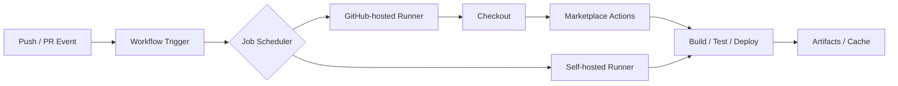
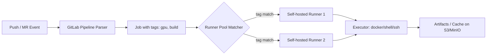

## Key Takeaways

- **Free tier ≠ free.** GitHub gives public repos unlimited standard Linux minutes, which is genuinely generous. Private repos get 2,000 minutes/month but macOS burns at a 10x multiplier — an iOS pipeline can eat your quota four times over before mid-month.
- **Runner architecture sets your ceiling.** GitHub sells managed runners plus a massive Marketplace; GitLab sells self-hosted runners that make CI effectively unlimited — if you can stomach maintaining the boxes.
- **Reliability is a real line item.** GitHub Actions had a degraded-availability incident on 2026-10-19 that hit 159 points and 134 comments on HN. GitLab had CVE-2026-97229 attempted exploitation in late October. Both demand a fallback plan.
- **Reproducibility is getting attention.** GitHub shipped workflow lockfiles in public preview on 2026-10-14 — an admission that dependency drift on third-party Actions is a genuine problem.
- **Pick by team shape, not by feature checklist.** Open source and small teams: GitHub. Compliance, self-hosting, or one-stop DevSecOps: GitLab.

I've run both platforms with actual money behind them — a ~40-person SaaS team, private repos, roughly 20k pipeline runs a month. The month our GitHub Actions bill landed, finance asked me what the four-digit number was. On GitLab, we moved build runners onto bare metal and the monthly CI bill dropped to a rounding error. The trade-off was maintenance. Let me lay out both books.

## Why Cost Analysis Beats Feature Comparison

Feature tables are everywhere. What actually keeps engineers up at night is the bill and the outage.

CI/CD cost is weirdly non-intuitive. It's not a flat subscription — it's **minutes × OS multiplier × concurrency × storage**, plus a hidden cost of human time spent waiting on pipelines, debugging YAML, and chasing dead runners. The first is the visible bill. The second is the invisible one, and it's usually bigger.

The Google snippets nailed the personalities: GitHub is "Offers a free plan," GitLab is "Predictable pricing." One uses free tier as a funnel; the other sells determinism. That framing has held up every time I've re-checked it against a real invoice.

## Under the Hood: Two Runner Architectures

### GitHub Actions: Hosted Runners and a Marketplace Supermarket

Workflows are YAML, jobs default to GitHub-hosted runners (Ubuntu/Windows/macOS). The core abstraction is the **Action** — a reusable step you pull from the Marketplace.



The upside is zero-ops onboarding: push, and a runner spins up. The downside is a black box — you don't know the underlying specs, cache hit rate, disk IO, or network bandwidth. We had a Node build take 3:12 on one run and 6:40 on the identical commit the next day. Pure runner network jitter.

### GitLab CI: `.gitlab-ci.yml` and Self-Hosted Runners as a Power Plant

GitLab's model is `.gitlab-ci.yml` plus **runner registration**. A runner is a separate process you register with a token, tag it, and jobs match to it by tag.



The key advantage: you can run runners on cheap hardware you already own. A commenter on HN put it plainly: "GitLab self-hosted runner is a big plus if you can run CI on your laptop or other cheap place, as mentioned, it means unlimited CI." We moved build runners to a 16-core/64GB bare-metal box. Monthly power cost: a couple dozen bucks. Runs: effectively unlimited.

The cost is maintenance — runner upgrades, disk cleanup, Docker daemon permissions, cache GC. Any of those can page you at 2am.

## Real Bills: Minutes, Multipliers, Storage

Here's the table I wish someone had handed me before we signed anything.

| Dimension | GitHub Actions | GitLab CI |
|---|---|---|
| Free tier (private repos) | 2,000 min/month (Free) + 500MB storage | 400 compute min/month (Free) + 10GB storage |
| Billing unit | Minutes, OS multiplier | Compute minutes, runner spec |
| Linux multiplier | 1x | 1x (hosted) |
| Windows multiplier | 2x | Plan-dependent |
| macOS multiplier | 10x | Plan-dependent |
| Public repos | **Fully free** (standard Linux) | Limited free |
| Self-hosted runner cost | Free (no minutes charged) | Free (no minutes charged) |
| Paid tier character | Pro/Team/Enterprise per-seat | Premium/Ultimate bundles security |
| Billing predictability | Medium (multipliers + Marketplace calls) | High (minutes + runner spec explicit) |
| Storage billing | Per GB-month | Per GB-month (bundled) |

Three details worth spelling out:

**The multiplier trap.** macOS runners burn at 10x. An iOS pipeline that runs 800 macOS minutes a month gets billed as 8,000 minutes — four times the entire free quota. GitHub isn't hiding this; it's documented. But the first invoice surprises people.

**The public-repo free window.** Open-source projects on standard Linux runners are genuinely free. That's the fuel for GitHub's ecosystem flywheel. GitLab's public free tier is stingier.

**Where the paid money goes.** GitLab Ultimate bundles SAST, DAST, dependency scanning, and license compliance. For teams chasing SOC2 or equivalent, that's a security-tooling line item you don't have to buy separately. GitHub relies on Marketplace assembly (CodeQL is free but scope-limited); integrated billing is a different thing.

## Ecosystem and Marketplace: Moat and Debt

GitHub Marketplace has tens of thousands of Actions — checkout, cloud deploy, everything. That's a real moat. Whatever you want to integrate, there's a preset for it.

Use it long enough and the problem surfaces: **third-party Actions are supply-chain risk**. A `uses: some-user/some-action@v3` can be a repo untouched for two years, an account that changed hands, or a tag with malicious code. The "Ask HN: What do you hate the most about GitHub Actions?" thread — the gripes cluster around supply chain and YAML complexity. We now pin every third-party Action to a commit SHA. No floating `@v3`.

GitLab takes a different route — reuse via `include` and the CI/CD Catalog. Smaller ecosystem, but more first-party oriented, smaller attack surface for supply-chain issues.

GitHub shipped workflow lockfiles in public preview on 2026-10-14. That's the platform admitting drift is real — pinning Actions for reproducibility. It's a step toward GitLab's determinism.

## Reliability and Security: Two Incidents Worth Remembering

**GitHub side:** On 2026-10-19, GitHub Actions, Pages, and Webhooks all degraded. HN hit 159 points and 134 comments, with plenty of "my deploy is stuck" replies. The hosted-runner black box compounds outages — you can't bring up your own machines when the scheduler itself is broken.

**GitLab side:** On 2026-10-28, CVE-2026-97229 was actively exploited, triggering a security incident advisory; GitLab also shipped a critical patch (19.5.1) on 10-21. Self-hosting means **patching is your job** — skip the upgrade, keep the vulnerability.

Both incidents point to the same conclusion: **CI/CD is on the critical path of production, and you need a degradation plan**. Ours: hosted runners for routine work, self-hosted runners as fallback for critical deploys, both configs kept idempotent, switch by tag in under five minutes.

There's one more signal worth flagging: on 2026-10-24, Roku moved developer repositories from GitHub to GitLab — 310 points, 226 comments on HN. Large-company migrations rarely publish their reasons, but cost structure and data sovereignty tend to be central. It's not that GitHub is broken; it's that platform lock-in hurts more at scale.

## Configuration in Practice: One Pipeline, Two Syntaxes

Same "build + test + deploy" pipeline, two very different styles.

GitHub Actions:

```yaml
name: build-test-deploy
on: [push]
jobs:
  build:
    runs-on: ubuntu-latest
    steps:
      - uses: actions/checkout@<pinned-sha>
      - uses: actions/setup-node@<pinned-sha>
        with:
          node-version: 20
      - run: npm ci
      - run: npm test
```

GitLab CI:

```yaml
stages: [build, test, deploy]

build:
  stage: build
  tags: [docker, build]
  image: node:20
  script:
    - npm ci
  cache:
    key: ${CI_COMMIT_REF_SLUG}
    paths: [node_modules/]

test:
  stage: test
  tags: [docker, build]
  script:
    - npm test
```

The difference: GitHub composes Actions via `uses`, GitLab routes jobs via `tags`. The former is simpler but opaque; the latter is controllable but you feed the machines. Neither is objectively better — it depends on your ops budget.

## Head-to-Head

| Dimension | GitHub Actions | GitLab CI |
|---|---|---|
| What it is | Hosted CI + Marketplace ecosystem | Integrated DevOps platform + self-hosted runners |
| Free tier | 2,000 private min, free public repos | 400 private compute min, limited public |
| Billing model | Minutes × OS multiplier, medium predictability | Compute minutes, high predictability |
| Runners | Hosted-first, self-hosted optional | Self-hosted-first, hosted optional |
| Ecosystem | 10k+ Marketplace Actions | CI/CD Catalog + include |
| Supply-chain risk | High (third-party Actions) | Medium (first-party components) |
| Recent incident | 2026-10 degraded availability | 2026-10 CVE exploitation attempt |
| Security scanning | CodeQL free + Marketplace assembly | Ultimate bundles SAST/DAST |
| Onboarding cost | Low | Medium (runner setup) |
| Best for | Open source / small teams / ecosystem-heavy | Compliance / mid-large / self-hosting |

## Which One I'd Pick

**GitHub Actions if**: your repos are public or open source; the team is small and won't run runners; you lean hard on Marketplace Actions; the budget tolerates multiplier-based private-repo billing. Nine times out of ten I'd pick it — as long as you accept billing uncertainty.

**GitLab CI if**: you have compliance or data-sovereignty requirements that force self-hosting; the team has ops capacity to run runners; you want bundled DevSecOps; or your hosted-runner minute costs are spiraling at scale. Self-hosted runners' "unlimited CI" is a real advantage past a certain volume.

**Hybrid**: hosted runners for routine, self-hosted fallback for critical paths. That's what we do. Both cost lines stay controlled.

## References & Community Insights

- GitHub Actions workflow lockfiles public preview: https://github.blog/changelog/2026-10-14-github-actions-workflow-lockfiles-in-public-preview/
- GitLab 19.5.1 critical patch release: https://docs.gitlab.com/releases/patches/patch-release-gitlab-19-5-1-released/
- HN thread: Ask HN on GitHub Actions gripes: https://news.ycombinator.com/item?id=50167146
- Roku developer blog on repo migration to GitLab: https://blog.roku.com/developer/gitlab-move
- GitLab CVE-2026-97229 incident (Alpine Linux advisory): https://alpinelinux.org/posts/GitLab-security-incident-CVE-2026-97229.html

Community sentiment in one line: GitHub Actions pain clusters around **reliability and supply chain**; GitLab pain clusters around **self-hosting maintenance and patching**. Both are hedging toward the other's strength — GitHub with lockfiles, GitLab with better hosted UX.

## FAQ

**Q1: Which has the better free tier, GitHub Actions or GitLab CI?**
Depends on open source. Public repos get unlimited standard Linux minutes on GitHub Actions — that's a clear win. For private repos, GitHub offers 2,000 minutes vs GitLab's 400 compute minutes; GitHub looks bigger on paper but macOS at 10x chews through quota fast. Open source → GitHub. Small private team → GitHub is friendlier to start.

**Q2: Do self-hosted runners actually save money?**
Yes, with caveats. Runners themselves are free and don't consume minutes, but you pay in hardware and maintenance. We went from a four-digit monthly bill to a rounding error after moving to bare metal, but spent roughly two engineer-days on setup. Worth it at higher volume, not worth it under ~500 pipeline runs a month.

**Q3: What's the deal with GitHub Actions' macOS multiplier?**
macOS runners burn at 10x. Ten minutes of macOS build = 100 minutes of quota. iOS/macOS projects should budget carefully and consider self-hosted Mac hardware as a fallback.

**Q4: Is GitLab self-hosted CI secure?**
As secure as your ops. The CVE-2026-97229 attempted-exploitation event showed that patching is on you. Recommendations: isolate runner networks, upgrade regularly, restrict Docker executor permissions, isolate cache storage.

**Q5: Can I mix GitHub Actions and GitLab CI?**
Yes, and many teams do. GitHub for code hosting and PRs, GitLab for CI — or the reverse. The cost is two systems' worth of mental overhead and integration maintenance. Not worth it at small scale; can be a real advantage once you're large enough to play each to its strengths.

<script type="application/ld+json">
{
  "@context": "https://schema.org",
  "@type": "FAQPage",
  "mainEntity": [
    {
      "@type": "Question",
      "name": "Which has the better free tier, GitHub Actions or GitLab CI?",
      "acceptedAnswer": {
        "@type": "Answer",
        "text": "Public repos on GitHub Actions get unlimited standard Linux minutes. For private repos, GitHub offers 2,000 minutes vs GitLab's 400 compute minutes, but macOS at 10x quickly consumes quota. Open source favors GitHub; small private teams also start easier on GitHub."
      }
    },
    {
      "@type": "Question",
      "name": "Do self-hosted runners actually save money?",
      "acceptedAnswer": {
        "@type": "Answer",
        "text": "Runners are free and don't consume minutes, but you pay in hardware and maintenance. Worth it at higher volume, not worth it under roughly 500 pipeline runs a month."
      }
    },
    {
      "@type": "Question",
      "name": "What's the deal with GitHub Actions' macOS multiplier?",
      "acceptedAnswer": {
        "@type": "Answer",
        "text": "macOS runners burn at 10x, so 10 minutes of macOS build consumes 100 minutes of quota. iOS/macOS projects should budget carefully and consider self-hosted Mac hardware."
      }
    },
    {
      "@type": "Question",
      "name": "Is GitLab self-hosted CI secure?",
      "acceptedAnswer": {
        "@type": "Answer",
        "text": "Security depends on ops. CVE-2026-97229 exploitation attempts showed patching is the user's job. Isolate runner networks, upgrade regularly, restrict Docker executor permissions, isolate cache storage."
      }
    },
    {
      "@type": "Question",
      "name": "Can I mix GitHub Actions and GitLab CI?",
      "acceptedAnswer": {
        "@type": "Answer",
        "text": "Yes. GitHub for code hosting and PRs, GitLab for CI, or reverse. The cost is two systems' mental overhead and integration maintenance; not worth it at small scale."
      }
    }
  ]
}
</script>

---
✅ All agents reported back!
└─ 🟡 HN: 6 storys │ 389 points │ 207 comments
---
