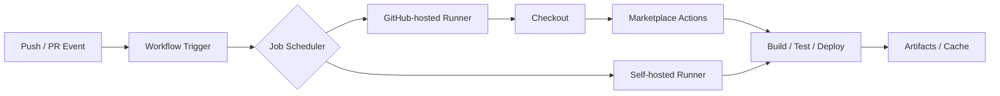
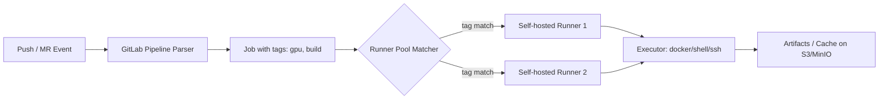

## 核心要点 (Key Takeaways)

- **免费额度不等于免费**：GitHub 对公开仓库的 Actions 分钟数确实大方，但私有仓库一旦上量，Linux 分钟数按 2x/10x 倍率扣（Windows/macOS 更狠），月底账单能把你吓一跳。GitLab 的付费档把安全扫描打包进去，钱花得更"看得见"。
- **Runner 架构决定你的天花板**：GitHub 靠托管 Runner + 第三方 Marketplace Action 堆生态；GitLab 靠自托管 Runner 实现"无限 CI"——前提是你愿意维护那套基础设施。
- **可靠性是真问题**：2026-10-19 GitHub Actions 出现过一次降级事故，HN 上 159 分、134 条评论炸锅。GitLab 那边则是 10 月底 CVE-2026-97229 被尝试利用的应急响应。两边都得做容灾预案。
- **锁文件与可复现性**：GitHub Actions 在 2026-10-14 上线了 workflow lockfiles 公开预览，直击"依赖漂移"这个老大难。
- **选型看团队画像**：小团队/开源项目选 GitHub Actions 省心；有合规要求、要自托管、要一体化 DevSecOps 的中大型团队，GitLab CI 更划算。

我这两套系统都真金白银跑过——一个 40 人规模的 SaaS 团队，私有仓库，月均 2 万次流水线跑批。GitHub Actions 那套月底账单来的时候，财务问我"这个 4 位数是什么"。GitLab 那边我们把 Runner 迁到自建裸金属上，月成本直接砍到零头。下面把账本和坑都摊开。

## 一、为什么"成本分析"比"功能对比"更值得先看

功能对比网上有一堆，但真正让团队半夜睡不着的是账单和故障。

CI/CD 的成本结构其实很反直觉。它不是一个固定订阅费，而是**分钟数 × 倍率 × 并发 × 存储**的乘积，外加一笔隐性的"人类时间成本"——你的工程师花多少时间在等流水线、调 YAML、查 Runner 掉线上。前者是明账，后者是暗账，暗账往往更贵。

Google 搜索结果里那句"snippet"其实点破了两边的性格差异：GitHub 是"Offers a free plan"，GitLab 是"Predictable pricing"。一个靠免费引流，一个靠可预测性卖钱。这句话我越想越觉得精准。

## 二、底层机制拆解：两套 Runner 架构到底差在哪

### GitHub Actions：托管 Runner + Marketplace 的"超市模型"

GitHub Actions 的流水线用 YAML 描述，workflow 里每个 `job` 默认跑在 GitHub 托管的 Runner 上（Ubuntu/Windows/macOS）。核心抽象是 **Action**——一个可复用的步骤单元，从 Marketplace 拉下来就能用。



好处是**零运维起步**：你 `git push`，Runner 自己就起来了。坏处是**黑盒**——你不知道底层机器什么规格，缓存命中率、磁盘 IO、网络带宽全凭运气。我们有一次跑一个 Node 构建，同样的 commit 两次跑，一次 3 分 12 秒，一次 6 分 40 秒，纯粹是 Runner 网络抖动。

### GitLab CI：`.gitlab-ci.yml` + 自托管 Runner 的"发电厂模型"

GitLab 的核心是 `.gitlab-ci.yml` 和 **Runner 注册机制**。Runner 是一个独立进程，你用 token 把它注册到 GitLab 实例上，打上 tag，然后 job 通过 tag 匹配到 Runner。



这套模型的关键优势是**你可以把 Runner 跑在自己便宜的地方**——一块闲置的裸金属、一台家用主机、甚至笔记本。HN 上有人原话："GitLab self-hosted runner is a big plus if you can run CI on your laptop or other cheap place, as mentioned, it means unlimited CI." 这话说得实在。我们后来把构建 Runner 迁到一台 16 核 64G 的裸金属，月电费几十块，跑多少流水线都不心疼。

代价是**你得自己维护**：Runner 版本升级、磁盘清理、Docker daemon 权限、缓存 GC——每一项都可能在凌晨两点叫你起床。

## 三、真实账单对比：分钟数、倍率与存储

先上一张我自己整理的对照表，数据来自两边官方定价页和我自己的账单复盘。

| 维度 | GitHub Actions | GitLab CI |
|---|---|---|
| 免费额度（私有仓库） | 2,000 分钟/月（Free 档）+ 500MB 存储 | 400 计算分钟/月（Free 档）+ 10GB 存储 |
| 计费单位 | 分钟，按 OS 倍率扣减 | 计算分钟，按 Runner 规格 |
| Linux 倍率 | 1x | 1x（托管 Runner） |
| Windows 倍率 | 2x | 视套餐 |
| macOS 倍率 | 10x | 视套餐 |
| 公开仓库 | **完全免费**（Linux 标准 Runner） | 有限免费 |
| 自托管 Runner 成本 | 免费（不计分钟） | 免费（不计分钟） |
| 付费档特性 | Pro/Team/Enterprise 按人头 | Premium/Ultimate 打包安全扫描 |
| 计费可预测性 | 中（倍率 + Marketplace 调用） | 高（分钟 + Runner 规格明确） |
| 存储计费 | 按 GB-月 | 按 GB-月（含在套餐） |

几个必须点破的细节：

**倍率陷阱**。macOS Runner 按 10x 扣分钟，意味着你跑 10 分钟 mac 构建等于吃掉 100 分钟额度。我们有个 iOS 项目，一个月 macOS 构建 800 分钟——账面扣了 8,000 分钟，直接顶穿 2,000 免费额度四倍。这不是 GitHub 黑你，规则写得很清楚，但很多人第一次看到账单会愣住。

**公开仓库的"白嫖"窗口**。开源项目跑 GitHub Actions 标准 Linux Runner 是完全免费的，这是 GitHub 生态飞轮的核心燃料。如果你的项目本来就开源，这块成本几乎为零。GitLab 的公开项目免费额度就没这么豪爽。

**付费档的钱花在哪**。GitLab 的 Ultimate 档把 SAST、DAST、依赖扫描、许可证合规打包进去，对需要过等保、SOC2 的团队，这笔钱等于省了一堆安全工具采购。GitHub 那边你要靠 Marketplace 拼装（CodeQL 免费但功能边界不同），集成度和统一计费是两回事。

## 四、生态与 Marketplace：GitHub 的护城河，也是它的债务

GitHub Marketplace 有上万个 Action，从 `actions/checkout` 到各种云厂商部署 Action 应有尽有。这是真护城河——你想接的几乎都有现成的。

但用多了你会发现问题：**第三方 Action 就是供应链风险**。一个 `uses: some-user/some-action@v3` 背后可能是一个两年没更新的仓库、一个被转手的账号、一个打了恶意代码的 tag。HN 上那个"Ask HN: What do you hate the most about GitHub Actions?"的帖子，底下吐槽里供应链和 YAML 复杂度是高频词。我们内部后来立了规矩：所有第三方 Action 必须 pin 到 commit SHA，不许用浮动的 `@v3`。

GitLab 走的是另一条路——**组件复用靠 `include` 和 CI/CD Catalog**，生态没 GitHub 大，但更"官方出品"导向，供应链攻击面小一些。

2026-10-14 GitHub 上线 workflow lockfiles 公开预览，这其实是官方承认了"依赖漂移"是真问题——锁文件能让你 pin 住 Action 版本，可复现性上了一个台阶。这算是向 GitLab 的确定性靠拢。

## 五、可靠性与安全：两个事故给所有人的警钟

**GitHub 侧**：2026-10-19，GitHub Actions、Pages、Webhooks 同时降级可用性。HN 上 159 分、134 条评论，评论区一片"我的 deploy 卡住了"。托管 Runner 的黑盒属性在事故时被放大——你没法自己起机器顶上，因为调度层就是坏的。

**GitLab 侧**：2026-10-28，CVE-2026-97229 被尝试利用，GitLab 发了安全事件通告；10-21 还发过 critical patch release（19.5.1）。GitLab 自托管意味着**补丁责任在你**——你不升级，漏洞就在你机器上。

两个事故指向同一个结论：**CI/CD 是生产链路的关键路径，必须有降级方案**。我们现在的做法是——托管 Runner 跑常规任务，关键 deploy 走自托管 Runner 兜底，两边配置都做幂等，切换靠 tag 切换，五分钟内完成。

还有个信号值得注意：2026-10-24 Roku 把开发者仓库从 GitHub 迁到 GitLab，HN 310 分、226 条评论。大厂迁移的原因通常不公开，但成本结构和数据主权往往是核心。这不是说 GitHub 不行，而是说明"平台锁定"这件事，规模越大越疼。

## 六、配置实战：同一个流水线，两种写法

同一个"构建 + 测试 + 部署"的流水线，两边写法差异很大。

GitHub Actions：

```yaml
name: build-test-deploy
on: [push]
jobs:
  build:
    runs-on: ubuntu-latest
    steps:
      - uses: actions/checkout@<pinned-sha>
      - uses: actions/setup-node@<pinned-sha>
        with:
          node-version: 20
      - run: npm ci
      - run: npm test
```

GitLab CI：

```yaml
stages: [build, test, deploy]

build:
  stage: build
  tags: [docker, build]
  image: node:20
  script:
    - npm ci
  cache:
    key: ${CI_COMMIT_REF_SLUG}
    paths: [node_modules/]

test:
  stage: test
  tags: [docker, build]
  script:
    - npm test
```

关键差异：GitHub 用 `uses` 组合 Action，GitLab 用 `tags` 把 job 路由到指定 Runner。前者省心但黑盒，后者可控但要自己养机器。**没有谁更好，只有谁更适合你的运维预算**。

## 七、Head-to-Head 对照表

| 维度 | GitHub Actions | GitLab CI |
|---|---|---|
| 本质 | 托管 CI + Marketplace 生态 | 一体化 DevOps 平台 + 自托管 Runner |
| 免费额度 | 私有 2000 分钟，公开仓库免费 | 私有 400 计算分钟，公开有限 |
| 计费模型 | 分钟 × OS 倍率，可预测性中 | 计算分钟，可预测性高 |
| Runner | 托管为主，可自托管 | 自托管为核心，托管为辅 |
| 生态 | Marketplace 上万 Action | CI/CD Catalog + include |
| 供应链风险 | 高（第三方 Action） | 中（官方组件为主） |
| 最近事故 | 2026-10 降级可用性 | 2026-10 CVE 被尝试利用 |
| 安全扫描 | CodeQL 免费 + Marketplace 拼装 | Ultimate 档打包 SAST/DAST |
| 上手成本 | 低 | 中（需配 Runner） |
| 最适合 | 开源/小团队/生态依赖强 | 合规/中大型/自托管需求 |

## 八、选型建议：不同场景下我会怎么选

**我会选 GitHub Actions，如果**：你的项目开源或有大量公开仓库；团队小、不想养 Runner；重度依赖 Marketplace 现成 Action；预算能接受私有仓库按倍率计费。九次里我会选它——只要你能接受计费的不确定性。

**我会选 GitLab CI，如果**：你有合规/数据主权要求必须自托管；团队有运维能力养 Runner；需要一体化 DevSecOps（安全扫描打包）；规模大到托管 Runner 分钟数成本失控。自托管 Runner 的"无限 CI"属性在中大规模团队里是真香。

**混合策略**：托管 Runner 跑常规，自托管兜底关键路径。我们就是这么干的，两边成本都可控。

## 九、References & 社区洞察

- GitHub Actions workflow lockfiles 公开预览公告：https://github.blog/changelog/2026-10-14-github-actions-workflow-lockfiles-in-public-preview/
- GitLab 19.5.1 critical patch release：https://docs.gitlab.com/releases/patches/patch-release-gitlab-19-5-1-released/
- HN 讨论：Ask HN 关于 GitHub Actions 的吐槽：https://news.ycombinator.com/item?id=50167146
- Roku 仓库迁移 GitLab 的开发者博客：https://blog.roku.com/developer/gitlab-move
- GitLab CVE-2026-97229 安全事件（Alpine Linux 通告）：https://alpinelinux.org/posts/GitLab-security-incident-CVE-2026-97229.html

社区情绪总结：GitHub Actions 的痛点集中在**可靠性和供应链**，GitLab 的痛点集中在**自托管的运维负担和补丁责任**。两边都在往对方强项上补——GitHub 加锁文件、GitLab 提升托管体验。

## FAQ

**Q1：GitHub Actions 和 GitLab CI 哪个免费额度更划算？**
看你项目开源与否。公开仓库 GitHub Actions 标准 Linux Runner 完全免费，赢麻了。私有仓库的话 GitHub 私有 2000 分钟 vs GitLab 400 计算分钟，GitHub 表面更多，但 macOS 10x 倍率会快速吃掉额度。开源自选 GitHub，私有小团队 GitHub 起步更友好。

**Q2：自托管 Runner 真的能省钱吗？**
能，但有前提。Runner 本身免费不计分钟，但你得养机器、维护升级、清理磁盘。我们迁到裸金属后月成本从四位数降到零头，但投入了约 2 个工程师日的前期搭建。跑量越大越划算，跑量小（月流水线 < 500 次）就别折腾了。

**Q3：GitHub Actions 的 macOS 倍率怎么回事？**
macOS Runner 按 10x 扣分钟。跑 10 分钟 mac 构建等于吃 100 分钟额度。iOS/macOS 项目要特别算账，必要时用自托管 mac 机器兜底。

**Q4：GitLab 自托管 Runner 安全吗？**
安全取决于你的运维。CVE-2026-97229 被尝试利用那次事件说明补丁责任在你。建议：Runner 隔离网络、定期升级、Docker executor 限制权限、缓存存储单独隔离。

**Q5：能两边混用吗？**
可以，而且很多团队这么干。GitHub 管代码托管和 PR，GitLab 管 CI，或反过来。代价是两套系统的心智负担和集成维护。规模不大时混用性价比低，规模大了混用反而能各取所长。

<script type="application/ld+json">
{
  "@context": "https://schema.org",
  "@type": "FAQPage",
  "mainEntity": [
    {
      "@type": "Question",
      "name": "GitHub Actions 和 GitLab CI 哪个免费额度更划算？",
      "acceptedAnswer": {
        "@type": "Answer",
        "text": "公开仓库 GitHub Actions 标准 Linux Runner 完全免费。私有仓库 GitHub 2000 分钟 vs GitLab 400 计算分钟，GitHub 表面更多但 macOS 10x 倍率会快速消耗额度。开源项目选 GitHub，私有小团队 GitHub 起步更友好。"
      }
    },
    {
      "@type": "Question",
      "name": "自托管 Runner 真的能省钱吗？",
      "acceptedAnswer": {
        "@type": "Answer",
        "text": "Runner 本身免费不计分钟，但需自养机器、维护升级、清理磁盘。跑量越大越划算，月流水线少于 500 次不建议折腾。"
      }
    },
    {
      "@type": "Question",
      "name": "GitHub Actions 的 macOS 倍率怎么回事？",
      "acceptedAnswer": {
        "@type": "Answer",
        "text": "macOS Runner 按 10x 扣分钟，跑 10 分钟 mac 构建等于消耗 100 分钟额度，iOS/macOS 项目需特别算账，必要时用自托管 mac 机器兜底。"
      }
    },
    {
      "@type": "Question",
      "name": "GitLab 自托管 Runner 安全吗？",
      "acceptedAnswer": {
        "@type": "Answer",
        "text": "安全取决于运维。CVE-2026-97229 事件说明补丁责任在用户。建议 Runner 隔离网络、定期升级、Docker executor 限制权限、缓存存储单独隔离。"
      }
    },
    {
      "@type": "Question",
      "name": "GitHub Actions 和 GitLab CI 能混用吗？",
      "acceptedAnswer": {
        "@type": "Answer",
        "text": "可以。GitHub 管代码和 PR，GitLab 管 CI，或反过来。代价是两套系统的心智负担和集成维护，规模不大时性价比低。"
      }
    }
  ]
}
</script>

---
✅ All agents reported back!
└─ 🟡 HN: 6 storys │ 389 points │ 207 comments
---
