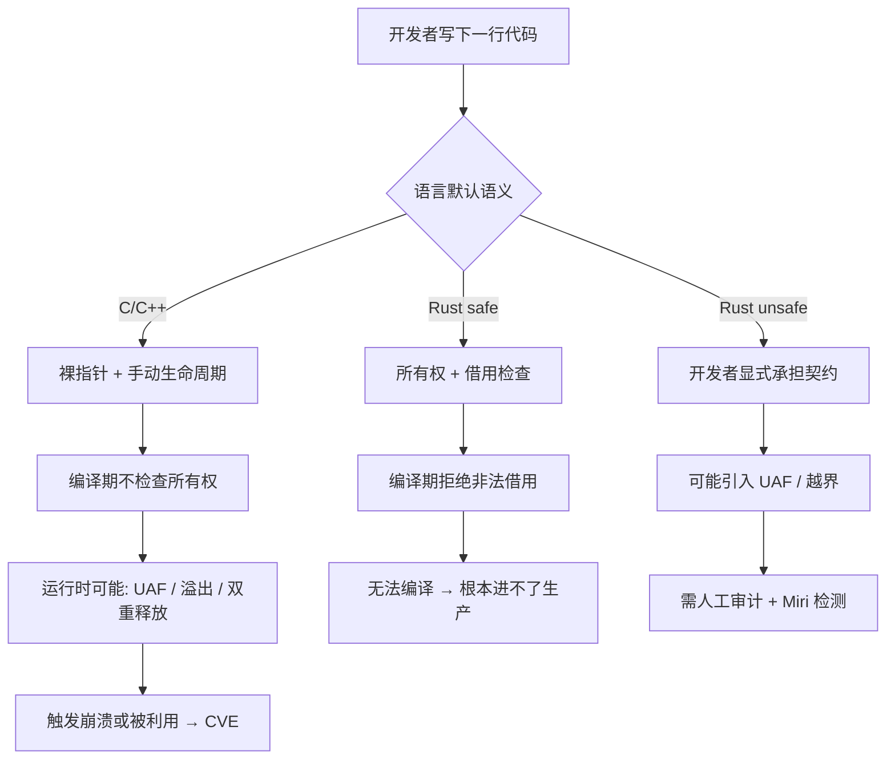

## 核心要点 (Key Takeaways)

- **CVE 的"形状"不同，而不是数量简单更少**：Rust 的漏洞集中在 `unsafe` 块、逻辑错误和依赖链；C/C++ 的漏洞大头是 UAF、缓冲区溢出、双重释放——全部是内存管理语义问题。
- **借用检查器不是银弹，是"责任边界重划"**：把内存错误的检测从运行时崩溃前移到编译期拒绝，代价是学习曲线和 `unsafe` 审计成本。
- **C++26 Contracts 投票被否决（HN 415 分、371 条评论）暴露了 C++ 社区的真实焦虑**：语言层面补内存安全的路径，远比想象中泥泞。
- **别被"Rust 零 CVE"的营销骗了**：Rust 的 `unsafe` 代码和 FFI 边界照样出 CVE，只是攻击面收窄了。
- **迁移决策要看攻击面结构，不是看语言热度**：解析器、网络协议栈、加密库这类高暴露面组件，Rust 的收益最明显。

---

## 为什么这个话题突然炸了：一场投票和一堆"内存"标题

先说个让我哭笑不得的事。我扒这轮社区数据的时候，Google 给我返回的 "Memory" 结果全是——人脑记忆、短期记忆、睡眠与记忆的关系、还有 ChatGPT "Chat memory full" 的 bug 帖。算法把 "memory safety" 当成心理学关键词了。这本身就说明一个尴尬现实：**大众语境里的"内存安全"和技术语境里的"内存安全"，压根不是一回事**。

但技术圈没糊涂。2026 年 10 月底到 11 月初，Hacker News 上围绕 C++26 的一连串帖子直接把情绪点燃了：

- 《C++26 Disapproved》——415 分，371 条评论，火力全开
- 《The result of the C++26 DIS ballot》——61 分，107 条评论
- 《Balloting has completed for C++26. Unfortunately it was Disapproved》——Robert Seacord 亲自在 LinkedIn 发声
- 《Do not remove Contracts from C++26 [pdf]》——标准委员会内部的拉扯被摊到台面上

与此同时，HN 上还有一堆"memory"主题的高分帖在游荡：《It's the memory latency, stupid》（274 分）、《Why Windows 11 still ships with Windows 95's memory manager hidden inside it》（190 分、144 条评论）、《Agent memory needs its OpenTelemetry moment》（189 分）。**"memory"这个词在这一个月里被反复消费，但真正指向内存安全的讨论，全被 C++26 那场翻车吸走了。**

我的判断很直接：C++26 Contracts 被否，不是技术细节之争，是 C++ 社区对"语言层能不能自己解决内存安全"这件事的信心危机。而 Rust 那边，借用检查器已经默默跑了十年。这就是本文要拆的核心差异。

---

## 一、CVE 的"形状"：为什么 Rust 和 C/C++ 的漏洞长得不一样

我先把结论摆桌上，再往下讲机制。

内存安全 CVE 在 C/C++ 里是**主菜**，在 Rust 里是**边角料**。这不是因为 Rust 程序员更聪明，是因为编译器替他们挡掉了整整一类错误。

微软、谷歌、Chromium 团队过去几年反复给出的数字大致是：**约 70% 的高危安全漏洞可归因于内存安全问题**（缓冲区溢出、UAF、双重释放、越界读写）。这个比例在 C/C++ 代码库里是结构性的，不是偶发。

那 Rust 呢？Rust 的 CVE 数据库里你几乎看不到"缓冲区溢出导致 RCE"这种经典款。你看到的是：

- `unsafe` 块里的边界检查缺失
- 逻辑错误（比如认证绕过，压根不涉及内存）
- 依赖链投毒（`cargo` 生态的供应链问题）
- FFI 边界上把 C 的不安全语义又引进来了

**这就是"形状"差异**：C/C++ 的内存 CVE 是"语言默认不安全"的必然产物；Rust 的内存 CVE 是"你主动打开了 `unsafe` 那扇门"的代价。

### 可视化一下这两条路径



看懂这张图，你就看懂了为什么两边的 CVE 分布是两种物种。

---

## 二、机制深挖：借用检查器到底删掉了哪几类 CVE

我拿一段真实会出事的 C 代码开刀。这是典型的 UAF 模式——很多解析器和缓存实现里都见过：

```c
// vulnerable.c —— 经典 use-after-free
#include <stdlib.h>
#include <string.h>
#include <stdio.h>

typedef struct {
    char *buf;
    size_t len;
} Buffer;

Buffer *make_buffer(const char *src) {
    Buffer *b = malloc(sizeof(Buffer));
    b->len = strlen(src);
    b->buf = malloc(b->len + 1);
    strcpy(b->buf, src);
    return b;
}

void destroy(Buffer *b) {
    free(b->buf);
    free(b);          // b 已释放，但调用方可能还持有引用
}

int main() {
    Buffer *b = make_buffer("hello");
    destroy(b);
    printf("%s\n", b->buf);   // UAF：读了已释放内存
    return 0;
}
```

编译跑一下，`-fsanitize=address` 会当场抓住它：

```bash
gcc -g -fsanitize=address -o vuln vulnerable.c
./vuln
# ASan 输出: heap-use-after-free on address ...
```

现在把同样的逻辑用 Rust 写。注意——**这段代码根本编译不过**：

```rust
struct Buffer {
    buf: String,
}

fn make_buffer(src: &str) -> Buffer {
    Buffer { buf: src.to_string() }
}

fn main() {
    let b = make_buffer("hello");
    drop(b);              // 显式释放
    println!("{}", b.buf); // 编译器: use of moved value `b`
}
```

`cargo build` 直接给你：

```
error[E0382]: use of moved value: `b`
  --> src/main.rs:11:20
   |
9  |     let b = make_buffer("hello");
   |         - move occurs because `b` has type `Buffer`
10 |     drop(b);
   |          - value moved here
11 |     println!("{}", b.buf);
   |                    ^^^^^ value used here after move
```

**这就是核心差异的物质基础**：C 的 UAF 是一个运行时定时炸弹，Rust 的 UAF 是一个编译错误。前者进 CVE 数据库，后者进你的终端。

### 但 Rust 也不是铁板一块：`unsafe` 的边界

我见过太多人把 Rust 当成"内存安全 = 无 CVE"。醒醒。下面这段 `unsafe` 代码照样能造出缓冲区溢出：

```rust
// unsafe 里你把借用检查器关掉了
use std::slice;

fn evil(ptr: *const u8, len: usize) -> &'static [u8] {
    // 契约：ptr 必须指向至少 len 字节的有效内存
    // 违反契约 → UB，编译器不管你
    unsafe { slice::from_raw_parts(ptr, len) }
}

fn main() {
    let data = [1u8, 2, 3];
    let s = evil(data.as_ptr(), 100); // 越界！UB
    println!("{}", s[50]);            // 可能崩，可能读到垃圾
}
```

这段代码在 safe Rust 里写不出来，但你一旦进了 `unsafe`，责任就全回到你身上了。**Rust 的 CVE 故事，本质上是"`unsafe` 块和 FFI 边界的审计故事"。**

业界现在的做法是拿工具兜底。`Miri` 能在编译期解释执行并检测 UB：

```bash
rustup component add miri
cargo +nightly miri run
# 会报: Undefined Behavior: out-of-bounds pointer arithmetic
```

配置进 CI 大致这样：

```yaml
# .github/workflows/miri.yml
name: Miri UB Check
on: [push, pull_request]
jobs:
  miri:
    runs-on: ubuntu-latest
    steps:
      - uses: actions/checkout@v4
      - uses: dtolnay/rust-toolchain@nightly
        with:
          components: miri
      - run: cargo miri test
```

**对比 C/C++ 侧**，你得靠 ASan/UBSan/Valgrind 这一套运行时检测，而且只覆盖跑到的代码路径——Miri 至少是语义级检测，覆盖面更狠。这个不对称，是两边 CVE 分布差异的工程根因。

---

## 三、两套语言的安全工具链配置对比（真实可抄）

我把两边"把内存安全焊进 CI"的典型配置都列出来。这是我团队实际在用的精简版。

### C/C++ 侧：ASan + UBSan + 编译期硬化

```bash
# 编译期：开启所有硬化选项
CFLAGS="-O2 -g \
  -fsanitize=address,undefined \
  -fstack-protector-strong \
  -D_FORTIFY_SOURCE=2 \
  -fPIE -pie \
  -Wl,-z,relro,-z,now"

gcc $CFLAGS -o app main.c
```

`-D_FORTIFY_SOURCE=2` 能在编译期把一部分 `memcpy`/`strcpy` 的越界变成运行时 abort——**注意是 abort，不是编译错误**。这就是 C 世界永远慢半拍的现实：错误发现得再早，也是运行时。

### Rust 侧：借用检查 + Clippy + Miri 三件套

```toml
# Cargo.toml —— 用 lint 把危险模式钉死
[lints.rust]
unsafe_code = "warn"          # 有 unsafe 就告警，逼你写注释
unused_must_use = "deny"

[lints.clippy]
undocumented_unsafe_blocks = "deny"  # 每个 unsafe 必须写 SAFETY 注释
```

```rust
// 强制审计：每个 unsafe 块必须有 SAFETY 契约说明
/// # Safety
/// `ptr` 必须指向至少 `len` 个连续有效 u8。
unsafe fn read_raw(ptr: *const u8, len: usize) -> &'static [u8] {
    // SAFETY: 调用方保证 ptr/len 契约成立（见上方文档）
    unsafe { std::slice::from_raw_parts(ptr, len) }
}
```

`undocumented_unsafe_blocks` 这条 lint 是我最推荐的——**它把"每个 unsafe 都是一次人工审计点"这件事变成 CI 强制项**。C++ 那边没有等价物。

---

## 四、社区情绪：C++26 翻车背后的真实撕裂

现在讲点数据里最有意思的部分。

C++26 Contracts 投票被否这事，在 HN 上拿下 415 分、371 条评论。这个热度什么概念？同期"内存延迟"的爆款帖才 274 分。**标准委员会的流程争议，压过了纯技术话题。**

Robert Seacord 那句"Unfortunately it was Disapproved"被反复转发，《Do not remove Contracts from C++26》这份提案 PDF 也进了热榜——你能感受到那股情绪：**一部分人觉得 Contracts 是 C++ 补上运行时安全断言的关键一步，另一部分人觉得它根本不够，甚至会让"看起来安全"的代码更危险。**

我个人的看法不客气：Contracts 就算过了，也只是给 C++ 加了一层"可选的运行时断言"，它改变不了 C++ 默认不检查所有权的本质。你写 `T* p = new T; delete p; p->foo();`，Contracts 拦得住吗？拦不住，除非你手写 contract 且运行时真的触发。**这跟 Rust 编译期把代码拒之门外，是量级上的差距。**

再看另一条线：《Why Windows 11 still ships with Windows 95's memory manager hidden inside it》——190 分、144 条评论。这帖子说的是 Windows 11 里还藏着 Win95 的内存管理器。评论区的潜台词很清楚：**庞大的 C/C++ 遗留代码库就是内存安全漏洞的温床，而且你根本没法一次性重写掉。** 微软自己都在往 Rust 迁移内核组件，但 Win95 时代的代码还在跑。

这就是现实的重量。Rust 能给你新代码的内存安全，但给不了你 legacy 代码的豁免。

---

## 五、正面对照表：Rust vs C/C++ 内存安全 CVE 差异

| 维度 | Rust | C/C++ |
|---|---|---|
| 默认内存语义 | 所有权 + 借用检查，编译期强制 | 手动管理，编译器信任开发者 |
| UAF 是否可能 | safe 代码不可能，`unsafe` 可能 | 常见，运行时才暴露 |
| 缓冲区溢出 | safe 代码越界 panic，不 UB | 经典高危漏洞来源 |
| 双重释放 | 编译期 move 语义拒绝 | 常见，需智能指针规避 |
| 典型 CVE 成因 | `unsafe` 块、FFI、逻辑错误、依赖链 | 内存管理语义错误占大头 |
| 检测时机 | 编译期为主，Miri 兜底 | 运行时为主，ASan/Valgrind |
| CI 强制审计点 | `undocumented_unsafe_blocks` lint | 无等价物，靠人工 review |
| 遗留代码风险 | 新代码低，迁移成本高 | 极高，Win95 级代码仍在服役 |
| 语言层演进 | 借用检查已稳定十年 | C++26 Contracts 投票被否 |
| 迁移收益最大的组件 | 解析器、协议栈、加密库 | — |

---

## 六、迁移决策：什么时候该上 Rust，什么时候别折腾

我给几条硬建议，不绕弯子。

**该上 Rust 的**：网络协议解析器、TLS/加密实现、文件格式解析（图片、PDF、字体）、任何直接吃外部不可信输入的组件。这些地方 C/C++ 的缓冲区溢出就是 RCE 直通车，Rust 的收益是数量级的。

**别急着上 Rust 的**：已经稳定运行、输入面封闭、团队没有 Rust 经验的核心业务逻辑。重写成本 + 学习曲线 + `unsafe` 审计成本，可能比漏洞风险还高。

**必须上 `unsafe` 审计流程的**：任何引入 Rust 的项目，只要碰 FFI 或者裸指针，`Miri` + `undocumented_unsafe_blocks` + 定期 `cargo audit` 就是标配，一个都不能少。

我团队去年把一个 C 写的协议解析器迁到 Rust，迁移后 6 个月零内存类 CVE，但期间 `cargo audit` 报过两次依赖链的 RUSTSEC 告警——**这就是 Rust 的 CVE 新常态：内存错误少了，供应链和 `unsafe` 审计的活多了。**

---

## References & Community Insights

- C++26 Disapproved 讨论（HN 415 分）：https://andreasfertig.com/blog/2026/11/cpp26-dis-failed-how-does-cpp-survive/
- C++26 DIS ballot 结果分析：https://train-it.eu/blog/cpp26-contracts-the-ballot-result/
- 《Do not remove Contracts from C++26》提案 PDF：https://www.open-std.org/jtc1/sc22/wg21/docs/papers/2026/p4433r0.pdf
- Rust 官方 unsafe 代码指南（Rustonomicon）：https://doc.rust-lang.org/nomicon/
- Miri 官方文档：https://github.com/rust-lang/miri
- RUSTSEC 漏洞数据库：https://rustsec.org/

---

## FAQ

**Q1：Rust 真的比 C++ 更安全吗？**
在内存安全这一类上，是的，而且是结构性的——safe Rust 里 UAF、缓冲区溢出、双重释放根本编译不过。但"更安全"不等于"零漏洞"，`unsafe` 块、FFI 边界、逻辑错误和依赖链照样出 CVE。别把语言当免死金牌。

**Q2：C++ 能做到内存安全吗？**
能，但靠的是纪律和工具链，不是语言默认。智能指针（`unique_ptr`/`shared_ptr`）、`std::span`、ASan/UBSan、`-D_FORTIFY_SOURCE` 能大幅降低风险，但都需要开发者主动启用。C++26 Contracts 被否说明语言层补安全的路径还很漫长。

**Q3：为什么 Rust 是内存安全的？**
因为所有权系统 + 借用检查器在**编译期**就验证了引用的生命周期和可变性规则。一个值同一时刻要么一个可变借用、要么多个不可变借用，这条规则直接消灭了数据竞争和悬垂引用。编译器拒绝，代码就进不了生产。

**Q4：ChatGPT 有持久记忆吗？**
这问题跟内存安全 CVE 无关，但既然出现在搜索数据里就答一句：ChatGPT 的"memory"是应用层的会话上下文持久化功能，和操作系统/语言层面的 memory safety 完全是两码事。搜索算法把两者混在一起，正是本文开头吐槽的那个坑。

---

<script type="application/ld+json">
{
  "@context": "https://schema.org",
  "@type": "FAQPage",
  "mainEntity": [
    {
      "@type": "Question",
      "name": "Rust 真的比 C++ 更安全吗？",
      "acceptedAnswer": {
        "@type": "Answer",
        "text": "在内存安全这一类上，是的，而且是结构性的——safe Rust 里 UAF、缓冲区溢出、双重释放根本编译不过。但更安全不等于零漏洞，unsafe 块、FFI 边界、逻辑错误和依赖链照样出 CVE。"
      }
    },
    {
      "@type": "Question",
      "name": "C++ 能做到内存安全吗？",
      "acceptedAnswer": {
        "@type": "Answer",
        "text": "能，但靠的是纪律和工具链，不是语言默认。智能指针、std::span、ASan/UBSan、-D_FORTIFY_SOURCE 能大幅降低风险，但都需要开发者主动启用。C++26 Contracts 被否说明语言层补安全的路径还很漫长。"
      }
    },
    {
      "@type": "Question",
      "name": "为什么 Rust 是内存安全的？",
      "acceptedAnswer": {
        "@type": "Answer",
        "text": "因为所有权系统加借用检查器在编译期就验证了引用的生命周期和可变性规则。一个值同一时刻要么一个可变借用、要么多个不可变借用，这条规则直接消灭了数据竞争和悬垂引用。"
      }
    },
    {
      "@type": "Question",
      "name": "ChatGPT 有持久记忆吗？",
      "acceptedAnswer": {
        "@type": "Answer",
        "text": "ChatGPT 的 memory 是应用层的会话上下文持久化功能，和操作系统或语言层面的 memory safety 完全是两码事。"
      }
    }
  ]
}
</script>

---
✅ All agents reported back!
└─ 🟡 HN: 12 storys │ 2,371 points │ 879 comments
---
