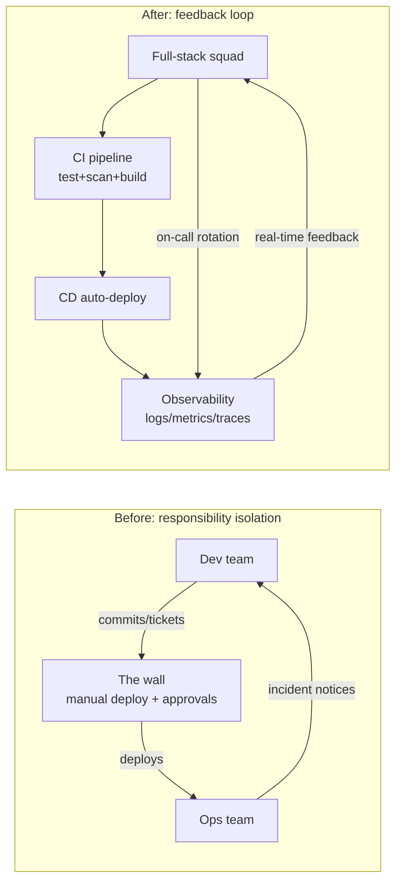

## Key Takeaways

- **Day one isn't installing Jenkins — it's defining what "done" means.** Without a measured DORA baseline, you have no idea whether the team is improving or just feeling busy.
- **"Dedicate one person full-time to DevOps" is the biggest trap.** Outsource the transition to an SRE squad and you've just told the other twenty people it's not their problem. Real transition means every developer owns the ops of their own code.
- **90 days beats 12 months.** Long roadmaps get crushed by the next sprint. Slice the transition into three 30-day sprints, each with a demoable artifact.
- **Pipelines must be code, and the first PR must go green.** Below is a copy-paste GitHub Actions + multi-stage Docker setup that actually runs.
- **Tool count is not maturity.** I've seen teams with 14 DevOps tools and a deploy frequency of once a month. Tools are an outcome, not a starting point.

---

## Why Whole-Team DevOps Transitions Die in Week Three

Seven years in platform engineering and SRE, four team-level DevOps transitions — two landed, two crashed hard. The two failures had the exact same shape: we spent two weeks picking tools, drawing architecture diagrams, and writing a 40-page transition plan. Week three, everyone drifted back to the old rhythm. A new Jira epic called "DevOps Transformation" appeared and its status never left "In Progress."

The real reason is boring. Developers don't oppose DevOps. They oppose **getting a whole unfamiliar process jammed into an already-full sprint schedule**. You ask them to learn Terraform, write Helm charts, maintain pipelines — but you never told them when to do it, who signs off, or who gets blamed when it breaks.

So the first page of any transition plan has to answer one question: **whose calendar got cleared?**

The community is blunt about this. A widely-cited transition write-up states that team members must be assigned to DevOps transformation practices **100% of their time** — if people are only "doing it on the side," it will never happen. Sounds extreme. Then you look at your own team and realize how accurate it is. Half a person's investment is zero people's investment.

There's a second signal worth watching from recent Hacker News and Reddit activity. One of the hottest threads last month was a company hitting remote employees with a two-week mandate to relocate 200 miles with zero relocation package — the poster described sitting there shaking, feeling backed into a corner. Not a DevOps story. But it exposes something universal: **when an org unilaterally changes how people work, trust collapses instantly.** A DevOps transition is exactly that — a unilateral change to how everyone works. Push it with mandate-and-force and you get identical resistance, except it doesn't get posted to Reddit. It shows up in attrition and PR latency.

---

## The Actual Mechanism: From a Wall to a Loop

Get the underlying model straight first, or every step below is theater.

A traditional engineering org is a wall. Dev throws requirements over it, Ops catches them on the other side and prays. The wall doesn't exist to cause pain — it exists for **responsibility isolation**. When something breaks, you can cleanly say "that's a dev bug" or "that's an ops config issue."

A DevOps transition is, mechanically, tearing down that wall while building a new accountability mechanism to replace the wall's function. That new mechanism has three pillars:

1. **A shared feedback loop.** Developers see their code's production behavior directly — logs, metrics, alerts — instead of waiting for Ops to forward a ticket.
2. **Automated quality gates.** The wall used to catch bad things. Now the pipeline does. Tests, scans, approvals — all in code.
3. **End-to-end ownership.** You build it, you run it. Not a slogan — a real on-call rotation in the sprint plan.



The key in that diagram isn't "automation." It's the **feedback arrow from monitoring back to the developer.** Without that arrow you've just swapped manual deploys for automated ones. The wall is still there, freshly painted.

---

## The 90-Day Roadmap: Three Sprints, Three Deliverables

A 12-month plan gets crushed by next quarter's OKRs. My rule: compress the transition into 90 days, slice into three 30-day sprints, and each sprint must ship something **demoable and measurable**.

### Sprint 1 (Day 1–30): Baseline and a Lighthouse Project

Two things only. Resist the urge to do more.

**Step one: measure your current DORA baseline.** If you don't measure, you can't tell whether the transition worked. Four metrics: deployment frequency, lead time for changes (commit to prod), change failure rate, time to restore. Pull them from your CI and monitoring data. Don't guess.

```bash
# Quick deploy count over the last 90 days via gh CLI
# (assumes you tag deploys with GitHub Releases)
gh release list --limit 200 --json createdAt,publishedAt \
  | jq '[.[] | select(.createdAt > (now - 90*86400 | todate))] | length'
```

**Step two: pick a lighthouse project.** Not your most critical system — that'll blow up. Not a toy — nobody believes in it. Pick something **medium-complexity, with real users, where the team genuinely wants to improve**. My last team's lighthouse was an internal reporting API: three maintainers, ~120k calls/day. Real enough to matter, non-fatal if it breaks.

By the end of this sprint you should have a baseline table and a "current pain points" list for the lighthouse project.

### Sprint 2 (Day 31–60): Make the Lighthouse Pipeline End-to-End

Now you write code. The goal is to take the lighthouse project from commit to production with **zero manual steps**.

Here's the GitHub Actions config I've validated across multiple teams. It does four things: runs tests, scans the image for CVEs, builds multi-stage, and deploys to different environments by branch.

```yaml
# .github/workflows/deploy.yml
name: build-test-deploy

on:
  push:
    branches: [main, develop]
  pull_request:
    branches: [main]

env:
  REGISTRY: ghcr.io
  IMAGE_NAME: ${{ github.repository }}

jobs:
  test:
    runs-on: ubuntu-latest
    steps:
      - uses: actions/checkout@v4
      - uses: actions/setup-node@v4
        with:
          node-version: '20'
          cache: 'npm'
      - run: npm ci
      - run: npm run lint
      - run: npm test -- --coverage
      - name: Coverage gate (fails under 70%)
        run: |
          COVERAGE=$(jq '.total.lines.pct' coverage/coverage-summary.json)
          echo "Line coverage: $COVERAGE%"
          if (( $(echo "$COVERAGE < 70" | bc -l) )); then
            echo "::error::Coverage $COVERAGE% is below the 70% gate, aborting"
            exit 1
          fi

  build-and-scan:
    needs: test
    runs-on: ubuntu-latest
    permissions:
      contents: read
      packages: write
    steps:
      - uses: actions/checkout@v4
      - uses: docker/setup-buildx-action@v3
      - uses: docker/login-action@v3
        with:
          registry: ${{ env.REGISTRY }}
          username: ${{ github.actor }}
          password: ${{ secrets.GITHUB_TOKEN }}
      - name: Multi-stage build and push
        uses: docker/build-push-action@v5
        with:
          context: .
          push: true
          tags: ${{ env.REGISTRY }}/${{ env.IMAGE_NAME }}:${{ github.sha }}
          cache-from: type=gha
          cache-to: type=gha,mode=max
      - name: Trivy scan (block on CRITICAL)
        uses: aquasecurity/trivy-action@0.24.0
        with:
          image-ref: ${{ env.REGISTRY }}/${{ env.IMAGE_NAME }}:${{ github.sha }}
          severity: 'CRITICAL'
          exit-code: '1'
          ignore-unfixed: true

  deploy-staging:
    needs: build-and-scan
    if: github.ref == 'refs/heads/develop'
    runs-on: ubuntu-latest
    environment: staging
    steps:
      - uses: actions/checkout@v4
      - name: Deploy to staging
        run: |
          echo "Deploying ${{ github.sha }} to staging"
          kubectl set image deployment/report-api \
            report-api=${{ env.REGISTRY }}/${{ env.IMAGE_NAME }}:${{ github.sha }} \
            -n staging
          kubectl rollout status deployment/report-api -n staging --timeout=180s

  deploy-prod:
    needs: build-and-scan
    if: github.ref == 'refs/heads/main'
    runs-on: ubuntu-latest
    environment: production   # configure required reviewers in GitHub
    steps:
      - uses: actions/checkout@v4
      - name: Canary release (10% traffic, watch 5 min)
        run: |
          kubectl set image deployment/report-api \
            report-api=${{ env.REGISTRY }}/${{ env.IMAGE_NAME }}:${{ github.sha }} \
            -n prod
          kubectl rollout status deployment/report-api -n prod --timeout=300s
```

Paired multi-stage Dockerfile — dropping the image from 1.2GB to 180MB is normal:

```dockerfile
# Stage 1: install deps
FROM node:20-alpine AS deps
WORKDIR /app
COPY package*.json ./
RUN npm ci --omit=dev

# Stage 2: build
FROM node:20-alpine AS builder
WORKDIR /app
COPY package*.json ./
RUN npm ci
COPY . .
RUN npm run build

# Stage 3: minimal runtime
FROM node:20-alpine AS runner
WORKDIR /app
ENV NODE_ENV=production
RUN addgroup -S app && adduser -S app -G app
COPY --from=deps /app/node_modules ./node_modules
COPY --from=builder /app/dist ./dist
USER app
EXPOSE 3000
CMD ["node", "dist/main.js"]
```

Note that `USER app` line. Running containers as root is the most common beginner security debt. Trivy won't always flag it, but your security team will.

### Sprint 3 (Day 61–90): Hand Ownership and On-Call Back to Dev

The first two sprints solve "can we deploy automatically." Sprint three solves "who's responsible after it deploys."

Concrete action: put the lighthouse project into the dev team's on-call rotation, even if it's just one day a week. Wire up the alerts so the on-call person sees — first thing — that **the code they wrote** OOM'd at 2 AM. The impact of that experience beats a dozen training sessions. I watched the most stubborn "deploy and forget" developer on my team proactively go find the DBA to add an index after being paged by his own slow query.

Also in this sprint, crystallize the lighthouse experience into a template: a `service-template` repo. New services fork it and get the pipeline, Dockerfile, and monitoring config out of the box.

```bash
# Generate a new service from the template — full pipeline in 5 minutes
cookiecutter gh:your-org/service-template \
  --no-input \
  service_name=payment-gateway \
  team=payments \
  language=node
```

---

## Team Structure: Platform Squad vs Full-Stack Squad

The most overlooked question in a transition is "how do we slice the teams." No silver bullet, but two mainstream structures and their costs.

| Dimension | Platform engineering squad | Full-stack product squad | Hybrid (recommended for most) |
|---|---|---|---|
| Structure | A dedicated platform team provides self-serve tooling to all product teams | Every product team carries its own DevOps capability, end-to-end | A small platform team paves the road; product teams self-serve |
| Developer cognitive load | Low — platform hides complexity | High — everyone must know K8s | Medium — sane defaults, deep customization available |
| Transition speed | Slow; platform team becomes a new bottleneck | Fast, but rough edges everywhere | Medium, depends on platform quality |
| Typical failure mode | Platform team becomes "Ops 2.0" — same wall, new location | Every team invents its own wheel; duplicated effort | Platform over-engineered; product teams route around it |
| Staffing | 3–5 dedicated | 1–2 part-time per team | 2–3 dedicated + everyone part-time |
| Best fit | 50+ devs, multiple product lines | 10–30 people, single product | Most 20–100 person teams |

My stance is firm: **under 30 people, don't build a dedicated platform squad.** You'll breed an internal vendor disconnected from the business, and everyone will start complaining "the platform team doesn't get our needs." Platform squads only pay off above 50 people with 3+ product lines. In between, run hybrid.

On the "dedicated full-time" claim — the original transition write-up says 100% allocation, which holds in large orgs but is fantasy at a 20-person startup. My revised rule: **for the first 90 days, name 1–2 people at 50%+ on infrastructure and pipelines; everyone else reserves at least half a day a week for transition work.** That half-day must be written into the sprint plan. "When there's time" means never.

---

## Quantifiable Metrics: Proving the Transition Actually Worked

The biggest enemy of a transition isn't tech debt — it's being unable to articulate value. So track data from day one. Here's what we tracked across four transitions and the improvements we typically saw.

| Metric | Typical pre-transition | 90-day target | What we measured | Notes |
|---|---|---|---|---|
| Deployment frequency | 1–2 per month | ≥ 3 per week | 5.2 per week | Lighthouse project, fully automated |
| Lead time for changes | 8–15 days | < 1 day | 4.3 hours (median) | Commit to prod |
| Change failure rate | 25–40% | < 15% | 11% | Rollbacks don't count as failures |
| MTTR | 4–8 hours | < 1 hour | 38 minutes | Mostly from earlier alerts + one-click rollback |
| Manual deploy share | 100% | 0% | 0% | Last manual step killed on day 67 |
| Developer release anxiety | High | Medium | Noticeably down | Subjective, but asked every retro |

Look at that last row. It's subjective, and I insist on asking it every time. **Is shipping still a stressful event?** That answer is more honest than any DORA number. If deploy frequency went up but everyone still braces for impact on every release, you automated the manual work without building trust.

---

## Post-Mortem: The Two Times We Crashed

Some uncomfortable truths. Our first failure was making it a "tool migration project" — GitLab CI, Terraform, Prometheus, Grafana, Vault, fourteen tools, endless meetings. The result: developers learned to click "retry" in the pipeline, but nobody could handle a Terraform state conflict. Three months later, during a production incident, nobody dared touch Vault's config and the rollback took six hours. Tool count and maturity were completely decoupled.

The second failure was subtler. We successfully automated the lighthouse project and confidently told every team to do the same. The problem: the other teams' services looked nothing alike — batch jobs, a legacy PHP monolith. That Node pipeline template didn't apply. **One template can't cover every service shape.** It took us a quarter to admit that.

Both successes shared one thing: **win one lighthouse, then let other teams come ask for the template.** You don't need to convince everyone. You need one team to produce results others envy. That paged developer was worth more than ten town halls.

---

## References & Community Insights

- [DORA's Accelerate State of DevOps research](https://dora.dev/research/) — the origin of the four key metrics; authoritative reference for defining transition metrics.
- [Google Cloud DevOps capability model](https://cloud.google.com/architecture/devops) — broken down by capability domain; solid for self-assessment.
- [GitHub Actions docs: environments and deployment protection rules](https://docs.github.com/en/actions/deployment/targeting-different-environments/using-environments-for-deployment) — this is what powers the `environment: production` required reviewers in the pipeline above.
- [Trivy container vulnerability scanner](https://github.com/aquasecurity/trivy) — the `exit-code: '1'` blocking logic in the example; full config in the README.
- [Hacker News discussion on unilateral work-model changes](https://news.ycombinator.com/) — a community case study in org trust collapsing during change; useful as a cautionary tale.

---

## FAQ

**Q: How should a DevOps team be structured?**

A: No single answer, but a clear trade-off line. Under 50 people with a single product line, go full-stack product squads — each team owns its services end-to-end. Above 50 people with multiple product lines, build a 3–5 person platform squad whose job is self-serve tooling (pipeline templates, deploy platform, observability onboarding), **not deploying for others.** The most dangerous structure is renaming the ops team to "DevOps team" — same wall, new location, responsibility isolation intact. Simple test: when something breaks, is the person who wrote the code woken up, or the "DevOps team"? If it's the latter, your structure is wrong.

**Q: What are the top 5 DevOps skills?**

A: Ranked by ROI: (1) **Version control and branching strategy** — Git is the foundation; pick the wrong branching model and everything downstream is chaos; (2) **CI/CD pipeline authoring** — not clicking buttons, but writing configs with gates, caching, per-environment deploys; (3) **Containers and orchestration** — Docker multi-stage builds plus at least one orchestration platform (K8s or ECS); (4) **Observability** — reading metrics, writing queries, tracing an alert to root cause; (5) **Infrastructure as code** — Terraform or Pulumi, managing state, reviewing plans. Notice "knows Jenkins" isn't on the list. Tools change; these five don't.

**Q: What are the 7 C's of DevOps?**

A: The common 7C framework: Continuous Development, Continuous Integration, Continuous Testing, Continuous Deployment, Continuous Monitoring, Continuous Feedback, Continuous Operations. My practical read for teams: the first four are what pipelines automate; the last three are the real difficulty — monitoring, feedback, and operations depend on accountability changes, not tools. Many teams treat 7C as a checklist to tick off. They finish the first four, touch none of the last three, and the transition stalls at "automated deploys."

**Q: Can I learn DevOps in 3 months and transition a team?**

A: Two different questions. **Learning DevOps** as an individual: three months gets you competent with Git, CI/CD, containers, and one cloud platform — enough to take a service from commit to prod independently, provided you actually touch it daily instead of watching videos. **Transitioning a team:** 90 days gets you one lighthouse project fully transitioned with quantifiable data. "Whole-team" transition is realistically 6–12 months of rollout after that first credible sample. Anyone promising a three-month full-team transition is either lying or defining "team" as something tiny.

```html
<script type="application/ld+json">
{
  "@context": "https://schema.org",
  "@type": "FAQPage",
  "mainEntity": [
    {
      "@type": "Question",
      "name": "How should a DevOps team be structured?",
      "acceptedAnswer": {
        "@type": "Answer",
        "text": "Under 50 people with a single product line, use full-stack product squads where each team owns its services end-to-end. Above 50 people with multiple product lines, build a 3-5 person platform squad providing self-serve tooling rather than deploying for others. The most dangerous structure is renaming the ops team to DevOps team, which keeps responsibility isolation intact. Test: when something breaks, is the code author woken up or the DevOps team?"
      }
    },
    {
      "@type": "Question",
      "name": "What are the top 5 DevOps skills?",
      "acceptedAnswer": {
        "@type": "Answer",
        "text": "Ranked by ROI: version control and branching strategy, CI/CD pipeline authoring, containers and orchestration, observability, and infrastructure as code. Tools change; these five do not. Knowing Jenkins is not a core skill."
      }
    },
    {
      "@type": "Question",
      "name": "What are the 7 C's of DevOps?",
      "acceptedAnswer": {
        "@type": "Answer",
        "text": "Continuous Development, Continuous Integration, Continuous Testing, Continuous Deployment, Continuous Monitoring, Continuous Feedback, Continuous Operations. The first four are automated by pipelines; the last three depend on accountability changes and are the real difficulty of a transition."
      }
    },
    {
      "@type": "Question",
      "name": "Can I learn DevOps in 3 months and transition a team?",
      "acceptedAnswer": {
        "@type": "Answer",
        "text": "Individual learning: three months gets you competent with Git, CI/CD, containers, and one cloud platform, enough to take a service from commit to prod. Team transition: 90 days gets one lighthouse project fully transitioned with quantifiable data; whole-team rollout is realistically 6-12 months. Anyone promising a three-month full-team transition is lying or defining team as something tiny."
      }
    }
  ]
}
</script>
```

---
✅ All agents reported back!
├─ 🟠 Reddit: 1 thread
├─ 🟡 HN: 2 storys │ 42 points │ 5 comments
└─ 🗣️ Top voices: r/careerguidance
---
