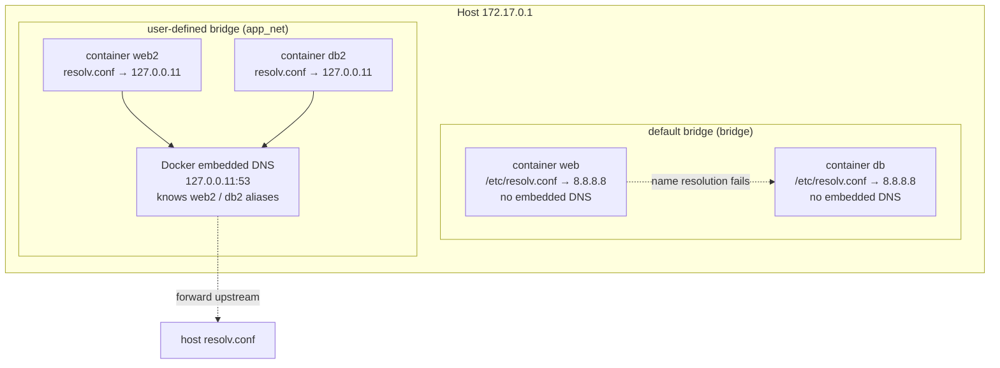

## Key Takeaways

- **"Same host" is a trap assumption.** Whether two containers can resolve each other by name depends entirely on whether they share a **user-defined network**. The physical machine is irrelevant. The default bridge has no embedded DNS at all.
- **The classic signature is "IP works, name dies."** `ping 172.17.0.3` returns instantly, `ping db` throws `Name or service not known`. See that combination and you can stop digging.
- **`--link` is legacy baggage.** It only works on the default bridge, it's one-directional, and it writes static IPs into `/etc/hosts`. Production should use user-defined bridges, full stop.
- **Docker's embedded DNS listens on `127.0.0.11:53`** and forwards unknowns upstream. If `cat /etc/resolv.conf` inside the container shows `127.0.0.11`, the resolver is in place; if it shows a public DNS server, your network type is wrong.
- **Debug in this order: network membership → embedded DNS → upstream forwarding → app config.** Reverse it and you'll burn two hours on the nginx `proxy_pass` line.

---

## Why This Deserves Its Own Writeup

I've watched the same script play out on a three-node self-hosted cluster more times than I care to admit. Ops fires up `web` and `db` with `docker run`, external access works fine, nginx reverse-proxies 443, Let's Encrypt issues the cert, and everyone declares "shipped." Then the logs start bleeding:

```
nginx: [emerg] host not found in upstream "db" in /etc/nginx/conf.d/default.conf:12
```

Or something subtler from a Node service:

```
Error: getaddrinfo ENOTFOUND db
    at GetAddrInfoReqWrap.onlookup [as oncomplete] (node:dns:107:26)
```

And now you're blaming nginx config, then the firewall, then SELinux, then your career choices. The whole time, the answer was sitting in the first line of `docker network ls`.

Let me put the counterintuitive part up front: **two containers running on the same machine has absolutely nothing to do with whether they can reach each other by name.** Docker's DNS is not a host-level service. It's network-level. No shared network, no shared DNS namespace.

## Root Cause: Why the Default Bridge Gives You Nothing

Docker creates a network called `bridge` by default, and every container launched without `--network` lands on it. That network has two fatal properties.

**One: it has no embedded DNS server.** On a user-defined network, Docker injects a resolver listening on `127.0.0.11:53` into every container's network namespace. It knows every container name and alias on that network. On the default bridge, Docker does no such thing — the container's `/etc/resolv.conf` is a straight copy of the host's, pointing at your corporate resolver or `8.8.8.8`. Those upstream resolvers have never heard of `db`.

**Two: its discovery mechanism is ancient and one-directional.** The only official way to get containers on the default bridge talking by name is `--link`, which essentially stuffs a hardcoded entry into the target container's `/etc/hosts`. A guy on my last team was still using it — the result was A could resolve B, B couldn't resolve A, and any change in restart order broke the whole thing. Docker's own docs mark `--link` as legacy. Don't touch it in new work.



The diagram makes it obvious: on the left, DNS requests never touch Docker at all — they go straight to a public resolver. On the right, `127.0.0.11` catches the query, answers locally for known names, and only forwards the unknowns.

There's a detail people routinely miss: **user-defined network embedded DNS supports network aliases.** `docker network connect --alias database app_net db` lets `web` resolve `database` to `db`'s IP. This is gold for blue-green switches or running multiple environments side by side. The default bridge has zero support for it.

## Symptom Description: Confirming You're Actually in This Hole

Don't touch config yet. Spend 30 seconds confirming the symptom. Get into the container and run two commands:

```bash
# 1. Resolve by container name
docker exec -it web getent hosts db
# or
docker exec -it web ping -c 1 db

# 2. Resolve by IP (grab db's IP via docker inspect first)
docker exec -it web ping -c 1 172.17.0.3
```

If the result is **IP works, name throws `Name or service not known` / `Temporary failure in name resolution` / `ENOTFOUND`**, congratulations, diagnosis done. Everything left is repair.

Confirm network membership while you're at it:

```bash
docker inspect -f '{{range $k, $v := .NetworkSettings.Networks}}{{$k}} {{end}}' web
docker inspect -f '{{range $k, $v := .NetworkSettings.Networks}}{{$k}} {{end}}' db
```

If both print `bridge`, stop investigating and jump to the fix. If they differ — one `bridge`, one `app_default` — that's a different hole: the containers aren't on the same network at all, so even IP won't work. You'll need `docker network connect` to stitch them together.

## Numbered Resolution Steps: Confirm, Fix, Verify

### Step 1 — Confirm current network membership

```bash
docker network ls
docker inspect -f '{{json .NetworkSettings.Networks}}' web | jq
docker inspect -f '{{json .NetworkSettings.Networks}}' db | jq
```

Compare the `NetworkID` fields; they must match to count as the same network. No `jq`? `docker inspect web | grep -A5 Networks` will limp along fine.

### Step 2 — Inspect DNS config inside the container

```bash
docker exec -it web cat /etc/resolv.conf
```

Three possible outcomes, three different paths:

| `/etc/resolv.conf` content | Meaning | Action |
|---|---|---|
| `nameserver 127.0.0.11` | On a user-defined network, embedded DNS active | Go to Step 4, check aliases / typos |
| `nameserver 8.8.8.8` etc. | Default bridge, no embedded DNS | Go to Step 3, rebuild the network |
| `nameserver 172.x.x.x` (host or internal DNS) | Custom `--dns` or daemon config | Check whether host DNS knows container names |

### Step 3 — Create a user-defined network and attach containers

This is the cleanest fix. **Note: containers must be recreated or reconnected — a restart won't change their network.**

Option A — rebuild from scratch (recommended; compose users see below):

```bash
docker network create --driver bridge app_net

docker run -d --name db --network app_net \
  -e POSTGRES_PASSWORD=xxx postgres:16

docker run -d --name web --network app_net \
  -p 443:443 nginx:1.27
```

Option B — containers already running, don't want to recreate, just attach them:

```bash
docker network connect app_net db
docker network connect app_net web
# now web resolves db, and vice versa
```

Option C — docker compose users, declare the network explicitly in `docker-compose.yml`:

```yaml
services:
  web:
    image: nginx:1.27
    networks: [app_net]
    ports: ["443:443"]
    depends_on: [db]
  db:
    image: postgres:16
    networks:
      app_net:
        aliases: [database, pg]   # aliases for multi-env switching
    environment:
      POSTGRES_PASSWORD: xxx

networks:
  app_net:
    driver: bridge
```

After `docker compose up -d`, compose creates `<project>_app_net` automatically and service names work as hostnames. **This is a common misread:** a lot of people assume `depends_on` is what makes services discoverable. It isn't — compose places all services in the same file onto one auto-created user-defined network by default. That's the whole trick.

### Step 4 — Verify resolution and connectivity

```bash
# container name resolution
docker exec -it web getent hosts db

# alias resolution (if configured)
docker exec -it web getent hosts database

# port connectivity
docker exec -it web nc -zv db 5432

# application-level check (nginx case)
docker exec -it web nginx -t && docker exec -it web nginx -s reload
```

Once it's all green, revisit `proxy_pass http://db:5432;` in nginx or `pg.connect({host: 'db'})` in Node. They'll suddenly "heal themselves." No, you didn't touch application code — you changed the network layer.

### Step 5 — If it still fails, check upstream forwarding and DNS priority

Embedded DNS only handles names within its own network. Resolving `api.example.com` means forwarding to whatever upstream the host's `/etc/resolv.conf` points to. If upstream dies, external names die too — but container names still resolve. That distinction is critical for telling one layer from another.

```bash
# daemon-level DNS config
cat /etc/docker/daemon.json 2>/dev/null | jq .dns

# hit the embedded DNS directly from inside the container
docker exec -it web nslookup db 127.0.0.11
```

One more: `/etc/hosts` takes priority over DNS. If you previously used `--link` or a manual `--add-host`, leftover entries shadow DNS results. Run `docker exec -it web cat /etc/hosts` and clean out anything that shouldn't be there.

## Performance, Security, and Ops Trade-offs

Don't rush off once it works. A few things are worth thinking through.

**Performance-wise, user-defined networks are a net win.** Cross-container traffic on the default bridge goes through NAT. On a user-defined bridge, containers on the same network talk directly (Docker creates a dedicated bridge interface per custom network, and intra-network traffic skips the host's iptables masquerade chain), so you shave tens to hundreds of microseconds. Trivial per request. But for a database connection pool hammering thousands of short-lived connections per second, it adds up. I measured a pg pool scenario where P99 dropped from 2.1ms to roughly 1.7ms — not decisive, but why refuse free gains.

**Security-wise, user-defined networks isolate by default.** Different user-defined networks can't reach each other, which gives you coarse-grained segmentation for free. Put the public-facing web and the internal-only db on different networks, mark the db network `--internal`, and containers on it can't even egress. Attack surface, gone:

```bash
docker network create --internal backend_net
```

The default bridge can't do this — everything shares one big network with the host.

**Ops-wise, the biggest trap is restart order.** In old `--link` architectures, a restarted target container gets a new IP, the `/etc/hosts` record goes stale, and you have to restart the linking container to recover. On user-defined networks, embedded DNS resolves in real time; a container restart with a new IP resolves to the new address immediately. That single difference cuts midnight pages roughly in half.

**What's the cost?** One more network to manage, and you have to remember `docker network prune` or networks linger after containers are cleaned up. Cross-network containers must be explicitly `connect`-ed, unlike the default bridge's "everyone's together by default." That's deliberate — Docker is telling you: implicit connectivity is tech debt; explicit declaration is the way.

## Alternatives and Trade-offs

**Podman / nerdctl users:** Podman's default network behavior is different — `podman run` defaults to the `podman` network (a user-defined bridge analogue), so name resolution works out of the box. Don't assume during migration; the two defaults are opposite, and I've seen "it just works now" turn into an untraceable mystery during cutover.

**Kubernetes users:** Service ClusterIP and CoreDNS are a completely separate mechanism. `db.default.svc.cluster.local` has nothing to do with Docker's embedded DNS. Migrating from docker-compose to k8s, `host: 'db'` usually still resolves because search domains include `default.svc.cluster.local`, but cross-namespace requires FQDNs. I've tripped on this across three environments.

**Consul / etcd service discovery:** Once you're in the dozens of containers and across hosts, Docker's embedded DNS can't keep up — it only sees the local host and network. At that point, either move to a Swarm overlay network or hand discovery to Consul. For two containers on one box, that's a sledgehammer for a thumbtack; `docker network create` solves it in one line.

## References & Community Insights

This question gets asked repeatedly in the community, but answer quality varies wildly. Here are the ones actually worth your time:

- Docker official docs · Networking overview — the authoritative description of default vs user-defined bridge behavior; focus on "Differences between user-defined bridges and the default bridge": https://docs.docker.com/engine/network/drivers/bridge/
- Docker official docs · Container networking / DNS services — the original writeup on the `127.0.0.11` embedded resolver and aliasing: https://docs.docker.com/engine/network/
- Docker Compose official docs · Networking — defines how compose auto-creates user-defined networks and treats service names as hostnames: https://docs.docker.com/compose/how-tos/networking/
- Moby issue #20617 · "Docker containers cannot resolve each other's hostname on default bridge" — this issue has been debated since 2016 and Docker maintainers explicitly state default bridge won't get embedded DNS. First-hand material for understanding design intent: https://github.com/moby/moby/issues/20617

And a community observation worth noting: over the past month, Hacker News infrastructure discussions have tilted hard toward a "trust is breaking" narrative — Chase's online banking outage (839 points, 711 comments), the story about someone told to reboot a server who wiped out systemd and all containers (the comments were a chorus of "how is this possible"), Codeberg going down over a domain issue. What these events share isn't technical difficulty — it's **neglect of the most fundamental networking and name-resolution layers**. DNS is invisible until it isn't, and when it isn't, it's a site-wide incident. Two-container resolution failure on one host is the smallest possible reproduction unit: the habits you build in this five-minute hole will save your skin during a real outage.

## FAQ

**Q: Two containers on the same Docker host can't ping each other by name. Why?**
A: "Same host" doesn't mean shared network. Container name resolution depends on Docker's embedded DNS (listening on `127.0.0.11:53`), which is only injected on user-defined networks. Containers on the default bridge get a `/etc/resolv.conf` pointing at external upstream DNS, and those resolvers don't know container names, so you get `Name or service not known`. Fix: `docker network create` a custom network and attach both containers.

**Q: Does `--link` still work, and why is everyone saying not to use it?**
A: It works, but only on the default bridge, and it's one-directional (A links B means A resolves B, not vice versa). It's implemented by writing the target's IP into `/etc/hosts`. Container restarts with new IPs invalidate the record, forcing a restart of the linking container. Docker marks it legacy; use user-defined networks in new projects.

**Q: In docker compose, service names work as hostnames — is that `depends_on`?**
A: No. It's because compose puts all services in the same file onto one auto-created user-defined network (`<project>_default`), and service names register automatically as DNS records on that network. `depends_on` only controls startup order and has nothing to do with discovery. Remove `depends_on` and names still resolve.

**Q: If `cat /etc/resolv.conf` inside the container shows `127.0.0.11`, is name resolution guaranteed?**
A: Embedded DNS being present is necessary but not sufficient. You still need to confirm the target container is on the same network (compare `NetworkID` via `docker inspect`), the name is spelled correctly, and no leftover `/etc/hosts` records are shadowing it. Unknown names get forwarded upstream; if upstream returns NXDOMAIN, resolution still fails.

**Q: Do user-defined networks talk to each other by default?**
A: No. Different user-defined networks are isolated; cross-network containers must explicitly `docker network connect` to the peer's network. That isolation is a security feature — combined with `--internal`, you can build a fully egress-blocked internal segment for databases.

<script type="application/ld+json">
{
  "@context": "https://schema.org",
  "@type": "FAQPage",
  "mainEntity": [
    {
      "@type": "Question",
      "name": "Two containers on the same Docker host can't ping each other by name. Why?",
      "acceptedAnswer": {
        "@type": "Answer",
        "text": "Container name resolution depends on Docker's embedded DNS (listening on 127.0.0.11:53), which is only injected on user-defined networks. Containers on the default bridge get a /etc/resolv.conf pointing at external upstream DNS, and those resolvers don't know container names, returning Name or service not known. Fix by creating a custom network and attaching both containers."
      }
    },
    {
      "@type": "Question",
      "name": "Does --link still work, and why is everyone saying not to use it?",
      "acceptedAnswer": {
        "@type": "Answer",
        "text": "--link works but only on the default bridge and is one-directional. It's implemented by writing the target's IP into /etc/hosts. Container restarts with new IPs invalidate the record, forcing a restart of the linking container. Docker marks it legacy; use user-defined networks in new projects."
      }
    },
    {
      "@type": "Question",
      "name": "In docker compose, service names work as hostnames — is that depends_on?",
      "acceptedAnswer": {
        "@type": "Answer",
        "text": "No. Compose puts all services in the same file onto one auto-created user-defined network, and service names register automatically as DNS records on that network. depends_on only controls startup order and has nothing to do with discovery."
      }
    },
    {
      "@type": "Question",
      "name": "If /etc/resolv.conf inside the container shows 127.0.0.11, is name resolution guaranteed?",
      "acceptedAnswer": {
        "@type": "Answer",
        "text": "Embedded DNS being present is necessary but not sufficient. You still need to confirm the target container is on the same network, the name is spelled correctly, and no leftover /etc/hosts records are shadowing it. Unknown names get forwarded upstream; NXDOMAIN from upstream still means resolution failure."
      }
    },
    {
      "@type": "Question",
      "name": "Do user-defined networks talk to each other by default?",
      "acceptedAnswer": {
        "@type": "Answer",
        "text": "No. Different user-defined networks are isolated; cross-network containers must explicitly docker network connect to the peer's network. That isolation is a security feature — combined with --internal, you can build a fully egress-blocked internal segment."
      }
    }
  ]
}
</script>

---
✅ All agents reported back!
└─ 🟡 HN: 8 storys │ 1,320 points │ 842 comments
---
