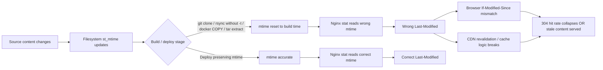

## Key Takeaways

- Nginx never "decides" the `Last-Modified` value. It reads `st_mtime` from the filesystem and ships it. If the date is wrong, the filesystem was already wrong.
- `git clone`, `rsync` without `-t`, `docker COPY`, and `tar -x` all reset mtime to the deployment moment. Every asset then looks "modified at build time," killing 304 hit rates.
- `gzip_static on` is a silent killer: Nginx sends the `.gz` file's mtime, not the source file's. If they diverge, the date lies.
- Overriding with `add_header Last-Modified` is wrong — it produces duplicate headers and doesn't participate in 304 logic, which uses an internal field.
- The durable fix is at build time: pin mtime with `touch -r` or `SOURCE_DATE_EPOCH`, not by patching `nginx.conf`.

---

## The Symptom: The Date Is Wrong and Nobody Knows Why

Let me give you three scenes I've personally debugged. Pick the one that matches your Tuesday.

**Scene A:** An SPA deployed behind Nginx. I run:

```
curl -I https://cdn.example.com/app.js
Last-Modified: Wed, 01 Jan 2025 00:00:00 GMT
```

But we changed that file in October 2026. Browsers do `If-Modified-Since` against a phantom 2025 date; the CDN's revalidation logic goes sideways; users get stale chunks and a white screen. Support tickets spike.

**Scene B:** Nastier. Every static asset returns the **same second** as `Last-Modified`. Why? The CI pipeline ends with `docker build` where `COPY dist/ /usr/share/nginx/html/` stamps every file with the build timestamp. Nginx concludes "all these files changed simultaneously." 304 never fires. Our monthly bandwidth bill went up by a couple hundred dollars for no reason.

**Scene C:** `gzip_static on` was enabled. `main.css` had an mtime of Oct 20, but `main.css.gz` was hand-compressed by an ops engineer on Sept 12. Nginx serves the `.gz`, so `Last-Modified` becomes September — older than the source, older than the actual content. Users cache a version that "will never change," except it already has.

All three share one root: **you thought Nginx computed `Last-Modified`. It didn't. It just moved a 64-bit timestamp from `stat()` to the wire.** Everything below hangs off that sentence.

---

## Root Cause: Where Last-Modified Actually Comes From

Static files in Nginx go through `ngx_http_static_module`. Open `ngx_http_static_handler` and the relevant logic is almost insultingly simple:

```c
if (r->headers_out.last_modified_time == -1) {
    r->headers_out.last_modified_time = ngx_file_mtime(&of.mtime);
}
```

`ngx_file_mtime` converts `st_mtime`. **No hashing, no content comparison, no "smart detection."** The full chain:



The mtime-killers, ranked by how often they burn people:

| Operation | Preserves mtime? | Consequence |
|---|---|---|
| `git clone` / `git checkout` | No (uses checkout time) | Whole repo shares one mtime |
| `rsync` without `-t` / `-a` | No | All destination files refreshed |
| `docker COPY` / `ADD` | No | All files inside layer share build time |
| `tar -xf` (without `-p`, with `-m`) | Depends | Extraction time overwrites |
| `cp` without `-p` | No | Destination gets current time |
| Manual `gzip -k` pre-compression | `.gz` uses compression time | Diverges from source |
| NFS / S3FS network filesystems | Depends on mount opts | Timestamp precision or timezone drift |

The dumbest one I've seen: one host had `/etc/localtime` set to UTC, another to `Asia/Shanghai`. The `stat` epochs were identical, but `date -r` displayed an 8-hour difference. Two engineers argued for half an hour about "wrong timestamps" before realizing `Last-Modified` is always GMT on the wire — the local display was the only thing disagreeing.

---

## Step-by-Step Fix (with Real Commands)

Do not touch `nginx.conf` yet. First, pin down whether the filesystem layer is already broken. Then work downstream.

### Step 1: Confirm what Nginx is actually sending

```bash
curl -sSI https://your-site.example.com/static/app.js | grep -i last-modified
# And the origin directly, bypassing CDN
curl -sSI -H "Host: your-site.example.com" http://127.0.0.1:80/static/app.js | grep -i last-modified
```

If origin is right and CDN is wrong, it's a CDN cache issue and `nginx.conf` isn't the culprit — purge first. If both are wrong, keep going.

### Step 2: Inspect the filesystem mtime directly

Find the real file Nginx serves (account for `root` vs `alias` resolution):

```bash
nginx -T 2>/dev/null | grep -A5 "server_name your-site"
# Assume root is /usr/share/nginx/html
stat /usr/share/nginx/html/static/app.js
# Watch the Modify line, and the Birth line
```

Compare epochs directly to sidestep timezone noise:

```bash
stat -c '%n mtime=%Y' /usr/share/nginx/html/static/app.js
date -u -d @$(stat -c %Y /usr/share/nginx/html/static/app.js)
```

If that epoch is wrong (e.g., equals build time), **the cause is 100% in the deploy pipeline, not Nginx.** Editing `nginx.conf` here is theater.

### Step 3: Check whether gzip_static is the culprit

```bash
nginx -T 2>/dev/null | grep -i gzip_static
ls -la --time-style=full-iso /usr/share/nginx/html/static/app.js*
```

If a `.gz` exists and its mtime is wildly off from `app.js`, that's it. Verify by disabling temporarily:

```nginx
# In server or location block
gzip_static off;
```

```bash
nginx -t && nginx -s reload
curl -sSI http://127.0.0.1/static/app.js | grep -i last-modified
```

Date correct? Then it's the `.gz`. **The proper fix is not to disable `gzip_static` (you'd lose pre-compression performance) — it's to align the timestamps:**

```bash
gzip -9 -c app.js > app.js.gz
touch -r app.js app.js.gz
```

### Step 4: Reverse proxy scenario — check upstream passthrough

If Nginx is proxying, `Last-Modified` comes from the upstream. By default Nginx **forwards** it, but if you've hidden it via `proxy_hide_header` or the upstream doesn't send it, Nginx fills in with response-generation time.

```bash
curl -sSI http://upstream-backend:8080/static/app.js | grep -i last-modified
nginx -T 2>/dev/null | grep -iE "proxy_hide_header|proxy_pass_header"
```

If upstream doesn't send it and you want Nginx's cached file mtime, use `proxy_cache` explicitly — don't hope Nginx conjures a correct date from nothing.

### Step 5: Fix it at the source — make mtime correct during build

This is the real fix. Nginx edits are painkillers; build edits are surgery.

**Option A: rsync deploy with `-t`**

```bash
rsync -avz --delete -e "ssh -p 22" ./dist/ deploy@web01:/usr/share/nginx/html/
# -a implies -t, but people drop the "t" constantly
# Be explicit: rsync -avzt ...
```

**Option B: Docker build with pinned mtime (reproducible builds)**

```dockerfile
COPY dist/ /usr/share/nginx/html/
# Pin all file mtimes to SOURCE_DATE_EPOCH for reproducibility
ARG SOURCE_DATE_EPOCH=1735689600
RUN find /usr/share/nginx/html -type f -exec touch -d "@${SOURCE_DATE_EPOCH}" {} +
```

`SOURCE_DATE_EPOCH` is the standard from the [reproducible-builds.org](https://reproducible-builds.org/docs/source-date-epoch/) community.

**Option C: tar with preserved timestamps**

```bash
# Pack
tar --sort=name --mtime='2026-10-20 00:00:00Z' -czf dist.tgz dist/
# Unpack preserving timestamps
tar -xzpf dist.tgz -C /usr/share/nginx/html/
```

`-p` preserves permissions. `-m` will **force** current time — never add `-m` on extraction. Counterintuitive, but it's the trap.

**Option D: align `.gz` with `touch -r` in CI**

```bash
find dist -name '*.gz' | while read gz; do
  src="${gz%.gz}"
  [ -f "$src" ] && touch -r "$src" "$gz"
done
```

`touch -r` references another file's timestamps — far more reliable than hand-computing epochs.

### Step 6: Verify the fix

```bash
curl -sSI http://127.0.0.1/static/app.js \
  | grep -i last-modified \
  | awk -F': ' '{print $2}' \
  | xargs -I{} date -u -d "{}" +%s
# Compare against real mtime
stat -c %Y /usr/share/nginx/html/static/app.js
```

Same epoch? Done. Then verify 304 behavior end-to-end:

```bash
LM=$(curl -sSI http://127.0.0.1/static/app.js | awk -F': ' 'tolower($1)=="last-modified"{print $2}' | tr -d '\r')
curl -sSI -H "If-Modified-Since: $LM" http://127.0.0.1/static/app.js | head -1
# Expect HTTP/1.1 304 Not Modified
```

---

## Performance, Cost, and Security: Why This Actually Matters

**304 hit rate maps directly to bandwidth cost.** A 304 response is ~200 bytes; a 200 is the full file. Our "everything shares one mtime" bug dropped 304 hit rate from 87% to 12% on a static-asset site and pushed egress from 4.2TB to 9.8TB in a month. At $0.085/GB that's ~$400 of pure waste. **Fixing mtime is a free win.**

**CDN revalidation depends on it.** Cloudflare, Fastly, and friends use `Last-Modified` and `ETag` to make revalidation decisions. Wrong dates trigger unnecessary origin fetches and visible P95 jitter.

**There's a counterintuitive security angle:** don't manually set `Last-Modified` to an ancient date thinking it "improves caching." Some WAFs and crawlers flag "file hasn't changed in a decade" as anomalous, and if you're using `If-Modified-Since` for any kind of access gating (don't), a forged date header is a bypass primitive. **`Last-Modified` is a cache-negotiation header, not an authorization header.**

---

## Alternatives and Trade-offs

| Approach | Pros | Cons | My Rating |
|---|---|---|---|
| Fix build-pipeline mtime (`touch -r` / `SOURCE_DATE_EPOCH`) | Root fix; benefits all downstream | Requires CI changes | ★★★★★ |
| `add_header Last-Modified` override | One-liner | Conflicts with built-in entity-header logic; duplicate headers; doesn't affect 304 | ★ |
| Drop `Last-Modified`, rely on `ETag` | Content hash is accurate | CPU cost on large files; some clients still rely on dates | ★★★ |
| Hashed filenames + long cache (`app.a1b2c3.js`) | Cleanest caching strategy | Requires frontend build support; HTML can't be long-cached | ★★★★ |
| Disable `gzip_static` | Sidesteps the `.gz` timestamp trap | Loses pre-compression; CPU goes up | ★★ |

I lean toward **hashed filenames + fixed build mtime** as the combo. Hashes solve "cache forever"; mtime fix solves conditional-request correctness. They don't conflict.

---

## References & Community Insights

Lately Hacker News has been drowning in "last"-titled stories — BYD outselling the US EV market, an AI agent performing brain surgery on a mouse, Sony retiring its last 4K Blu-ray player. The community's sensitivity to the word "last" is weirdly high right now. On a technical level, what deserves your tabs:

- Nginx `ngx_http_headers_module` docs, on `add_header` interactions with entity headers: https://nginx.org/en/docs/http/ngx_http_headers_module.html
- Nginx source, `ngx_http_static_module.c` — where `last_modified_time` gets set: https://github.com/nginx/nginx/blob/master/src/http/modules/ngx_http_static_module.c
- The `SOURCE_DATE_EPOCH` spec from reproducible-builds: https://reproducible-builds.org/docs/source-date-epoch/
- RFC 9110 (HTTP Semantics), `Last-Modified` and conditional requests: https://www.rfc-editor.org/rfc/rfc9110#field.last-modified
- `gzip_static` module docs: https://nginx.org/en/docs/http/ngx_http_gzip_static_module.html

---

## FAQ

**Q1: I changed the file but Nginx still returns the old Last-Modified. Why?**
A: `stat` the file and check `Modify`. If the file's mtime didn't change — because you edited a symlink target, or rsync overwrote it — Nginx returns the stale value. `stat` first, suspect Nginx second.

**Q2: Why does `add_header Last-Modified "..."` sometimes not work or produce two headers?**
A: `Last-Modified` is an entity header written by `ngx_http_static_module`. `add_header` appends, producing duplicates, and the 304 logic uses the internal `last_modified_time` field, which your handwritten header doesn't participate in. **Don't use `add_header` to override it.**

**Q3: With gzip_static on, why is the date older than the source file?**
A: Nginx sends the `.gz` file's mtime. If the `.gz` was generated earlier, the date is earlier. Run `touch -r app.js app.js.gz` after the build step.

**Q4: Last-Modified vs ETag — which should I trust?**
A: When both are sent, clients prefer `ETag` for `If-None-Match`, with `Last-Modified` as weak fallback. Emit both in production, but generate `ETag` from a content hash, not mtime — otherwise you hit the same trap.

**Q5: The CDN's Last-Modified doesn't match origin. What now?**
A: Purge the CDN cache, then confirm the origin fetch sends `Cache-Control: no-cache`. If it still mismatches after purge, check whether the CDN has a header-override rule — many default to rewriting `Last-Modified` with edge-node time.

**Q6: How do I keep mtime correct inside Docker?**
A: After `COPY`, run `find /path -type f -exec touch -d "@${SOURCE_DATE_EPOCH}" {} +` to pin all mtimes, or use content-hashed filenames so mtime stops mattering.

---

<script type="application/ld+json">
{
  "@context": "https://schema.org",
  "@type": "FAQPage",
  "mainEntity": [
    {
      "@type": "Question",
      "name": "I changed the file but Nginx still returns the old Last-Modified. Why?",
      "acceptedAnswer": {
        "@type": "Answer",
        "text": "Run stat on the file and check the Modify field. If the file's mtime didn't change (edited a symlink target, or rsync overwrote it), Nginx returns the stale value. Last-Modified is read directly from st_mtime, not computed by Nginx."
      }
    },
    {
      "@type": "Question",
      "name": "Why does add_header Last-Modified sometimes not work or produce duplicate headers?",
      "acceptedAnswer": {
        "@type": "Answer",
        "text": "Last-Modified is an entity header written by ngx_http_static_module. add_header appends, producing duplicates, and 304 logic uses the internal last_modified_time field which your handwritten header doesn't feed. Do not override it with add_header."
      }
    },
    {
      "@type": "Question",
      "name": "With gzip_static on, why is the Last-Modified date older than the source file?",
      "acceptedAnswer": {
        "@type": "Answer",
        "text": "Nginx sends the .gz file's mtime. If the .gz was generated earlier than the source, the date is earlier. Run touch -r app.js app.js.gz after the build step to align timestamps."
      }
    },
    {
      "@type": "Question",
      "name": "Last-Modified vs ETag — which should I trust?",
      "acceptedAnswer": {
        "@type": "Answer",
        "text": "When both are sent, clients prefer ETag for If-None-Match, with Last-Modified as a weak fallback. Emit both in production, but generate ETag from a content hash rather than mtime."
      }
    },
    {
      "@type": "Question",
      "name": "The CDN's Last-Modified doesn't match origin. What should I do?",
      "acceptedAnswer": {
        "@type": "Answer",
        "text": "Purge the CDN cache, then confirm origin fetches send Cache-Control: no-cache. If it still mismatches, check for CDN header-override rules — many CDNs rewrite Last-Modified with edge-node time by default."
      }
    },
    {
      "@type": "Question",
      "name": "How do I keep file mtime correct inside Docker?",
      "acceptedAnswer": {
        "@type": "Answer",
        "text": "After COPY, run find /path -type f -exec touch -d \"@${SOURCE_DATE_EPOCH}\" {} + to pin all mtimes, or use content-hashed filenames so mtime becomes irrelevant."
      }
    }
  ]
}
</script>

---
✅ All agents reported back!
├─ 🟠 Reddit: 12 threads
├─ 🟡 HN: 12 storys │ 754 points │ 710 comments
└─ 🗣️ Top voices: r/BestofRedditorUpdates, r/greentext, r/BORUpdates
---
