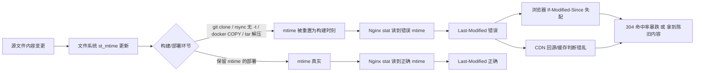

## 核心要点 (Key Takeaways)

- Nginx 的 `Last-Modified` 值不是它"判断"出来的，而是直接取自文件的 `st_mtime`（修改时间）。你看到的错误日期，99% 是文件系统那一层就已经错了。
- `git clone`、`rsync`（没加 `-t`）、`docker COPY`、CI 里 `tar -x` 之后重新打包——这些操作都会把 mtime 重置成"构建那一刻"，于是所有资源在浏览器和 CDN 眼里都变成同一秒更新的。
- `gzip_static on` 是个隐形杀手：Nginx 会把 `.gz` 文件的 mtime 当成 `Last-Modified` 发出去，预压缩文件和源文件时间对不上，日期直接翻车。
- 用 `add_header Last-Modified` 硬覆盖是错的——Nginx 对内容协商响应有特殊处理，`Last-Modified` 属于实体头，你手写 `add_header` 会和内置逻辑打架，甚至产生重复头。
- 真正稳的做法：在构建产物层面固定 mtime（`touch -r` / `SOURCE_DATE_EPOCH`），而不是在 Nginx 层做补丁。

---

## 症状：日期错了，但没人知道错在哪

先说几个我亲手撞过的现场，你对号入座。

**现场 A：** 一个前端 SPA 部署到 Nginx 后，`curl -I https://cdn.example.com/app.js` 返回：

```
Last-Modified: Wed, 01 Jan 2025 00:00:00 GMT
```

而那个文件我们是 2026 年 10 月才改的。浏览器拿着这个 2025 年的日期去做条件请求（`If-Modified-Since`），CDN 侧的回源判断也全乱套，用户拿到的是旧 chunk，白屏，客服电话打爆。

**现场 B：** 更阴间的一种——所有静态资源的 `Last-Modified` 都是**同一秒**。因为 CI 流水线里 `docker build` 的最后一步是 `COPY dist/ /usr/share/nginx/html/`，Docker 层把这批文件的 mtime 统一刷成了构建时间。于是 Nginx 认为"这些文件全都是刚刚一起改的"，`If-Modified-Since` 永远命中不了 304，带宽账单每月多出小几百刀。

**现场 C：** 开了 `gzip_static on`。源文件 `main.css` 的 mtime 是 10 月 20 日，但 `main.css.gz` 是运维手动 `gzip -k` 生成的，时间停在 9 月。Nginx 优先返回 `.gz`，于是 `Last-Modified` 变成 9 月——比源文件还早，比真实内容还旧。用户缓存了一个"未来不会变"的旧版本。

这三种症状的共同点是：**你以为 `Last-Modified` 是 Nginx 算的，其实它只是把文件系统里的一个 64 位时间戳搬了出来。** 下面的根因分析就是围绕这句话展开。

---

## 根因分析：Last-Modified 到底从哪来

Nginx 处理静态文件走的是 `ngx_http_static_module`。打开 `ngx_http_static_handler` 的源码，那段逻辑简单到让人失望：

```c
if (r->headers_out.last_modified_time == -1) {
    r->headers_out.last_modified_time = ngx_file_mtime(&of.mtime);
}
```

`ngx_file_mtime` 就是对 `stat()` 返回的 `st_mtime` 做个转换。**没有哈希、没有内容比对、没有任何"智能判断"。** 所以整个链路是：



几个高频的"mtime 杀手"清单，按踩坑概率排序：

| 操作 | 是否保留 mtime | 后果 |
|---|---|---|
| `git clone` / `git checkout` | 否（默认取 checkout 时刻） | 全仓库同秒 mtime |
| `rsync` 不加 `-t` / `-a` | 否 | 目标端全部刷新 |
| `docker COPY` / `ADD` | 否 | 镜像层内文件统一为构建时间 |
| `tar -xf` 不加 `-m` 反了 / 不加 `-p` | 视情况 | 解压时刻覆盖 |
| `cp` 不加 `-p` | 否 | 目标文件取当前时刻 |
| `gzip -k` 手动预压缩 | `.gz` 取压缩时刻 | 与源文件不一致 |
| NFS / S3FS 等网络文件系统 | 视挂载参数 | 时间戳精度丢失或时区错乱 |

我见过最离谱的一次：一台机器的 `/etc/localtime` 是 UTC，另一台是 `Asia/Shanghai`，`stat` 出来的 epoch 一样，但 `date -r` 显示差 8 小时，运维对着日志吵了半小时才发现是时区问题——**`Last-Modified` 头本身永远是 GMT，但你在服务器上排查时看到的本地时间是另一回事。**

---

## 分步排查与修复（带真实命令）

别急着改 Nginx 配置。先把"文件系统这一层到底对不对"钉死，再往下走。

### 第 1 步：确认 Nginx 实际发出的头

```bash
curl -sSI https://your-site.example.com/static/app.js | grep -i last-modified
# 同时看源站（绕过 CDN）
curl -sSI -H "Host: your-site.example.com" http://127.0.0.1:80/static/app.js | grep -i last-modified
```

如果源站对而 CDN 错，问题在 CDN 缓存层，跟 Nginx 无关——先把 CDN 缓存 purge 再说。如果两边都错，继续。

### 第 2 步：直接看文件系统的 mtime

找到 Nginx 实际 serve 的那个文件（注意 `root` / `alias` 拼出来的真实路径）：

```bash
nginx -T 2>/dev/null | grep -A5 "server_name your-site"
# 假设 root 是 /usr/share/nginx/html
stat /usr/share/nginx/html/static/app.js
# 关注 Modify 那一行，以及 Birth 那一行
```

用 epoch 直接比对，避免时区干扰：

```bash
stat -c '%n mtime=%Y' /usr/share/nginx/html/static/app.js
date -u -d @$(stat -c %Y /usr/share/nginx/html/static/app.js)
```

如果这里的 epoch 就是错的（比如等于构建时刻），**根因 100% 在部署链路，不在 Nginx。** 别去改 `nginx.conf`，改了也是白改。

### 第 3 步：检查是不是 gzip_static 在捣鬼

```bash
nginx -T 2>/dev/null | grep -i gzip_static
ls -la --time-style=full-iso /usr/share/nginx/html/static/app.js*
```

如果存在 `app.js.gz` 且它的 mtime 比 `app.js` 新或旧得离谱，就是它。临时验证：

```bash
# 临时关掉验证（改完记得 reload）
# 在 server 或 location 块里
gzip_static off;
```

```bash
nginx -t && nginx -s reload
curl -sSI http://127.0.0.1/static/app.js | grep -i last-modified
```

日期对了？那就是 `.gz` 的问题。**正确修法不是关掉 gzip_static（那会丢性能），而是让 `.gz` 和源文件 mtime 对齐：**

```bash
# 构建阶段生成 .gz 后，把源文件的 mtime 复制过去
gzip -9 -c app.js > app.js.gz
touch -r app.js app.js.gz
```

### 第 4 步：反向代理场景——确认上游有没有透传

如果 Nginx 只是反代，`Last-Modified` 来自上游。默认情况下 Nginx **会透传**上游的 `Last-Modified`，但如果你在 `proxy_hide_header` 里干掉了它，或者上游根本没发，Nginx 就会用自己的逻辑补一个（这时时间可能是响应生成时刻）。

```bash
# 看上游原始响应
curl -sSI http://upstream-backend:8080/static/app.js | grep -i last-modified
# 看 Nginx 有没有把它藏起来
nginx -T 2>/dev/null | grep -iE "proxy_hide_header|proxy_pass_header"
```

如果上游没发，且你希望 Nginx 用自己缓存的文件 mtime，需要显式让 Nginx 处理静态文件（`proxy_cache` + `proxy_cache_valid`），而不是指望它凭空造一个正确的日期。

### 第 5 步：从根上修——让 mtime 在构建时就正确

这才是真正的修复。改 Nginx 是治标，改构建是治本。

**方案 A：rsync 部署带 `-t`**

```bash
rsync -avz --delete -e "ssh -p 22" ./dist/ deploy@web01:/usr/share/nginx/html/
# -a 已隐含 -t（保留修改时间），但很多人只写了 -rlptD 里漏了 t
# 保险起见显式加：rsync -avzt ...
```

**方案 B：Docker 构建固定 mtime（可复现构建）**

Dockerfile 里在 `COPY` 之后补一刀：

```dockerfile
COPY dist/ /usr/share/nginx/html/
# 把所有文件 mtime 固定到 SOURCE_DATE_EPOCH，实现可复现
ARG SOURCE_DATE_EPOCH=1735689600
RUN find /usr/share/nginx/html -type f -exec touch -d "@${SOURCE_DATE_EPOCH}" {} +
```

`SOURCE_DATE_EPOCH` 是可复现构建（reproducible builds）社区的标准做法，含义见 [reproducible-builds.org](https://reproducible-builds.org/docs/source-date-epoch/)。

**方案 C：tar 打包/解包保留时间**

```bash
# 打包
tar --sort=name --mtime='2026-10-20 00:00:00Z' -czf dist.tgz dist/
# 解包时保留
tar -xzpf dist.tgz -C /usr/share/nginx/html/
```

`-p` 保留权限，`-m` 会**强制**用当前时间覆盖——千万别在解包时加 `-m`，这是个反直觉的坑。

**方案 D：CI 里用 `touch -r` 对齐 gzip 产物**

```bash
find dist -name '*.gz' | while read gz; do
  src="${gz%.gz}"
  [ -f "$src" ] && touch -r "$src" "$gz"
done
```

`touch -r` 是引用另一个文件的时间戳，比手算 epoch 稳得多。

### 第 6 步：验证修复

```bash
curl -sSI http://127.0.0.1/static/app.js \
  | grep -i last-modified \
  | awk -F': ' '{print $2}' \
  | xargs -I{} date -u -d "{}" +%s
# 和真实 mtime 比对
stat -c %Y /usr/share/nginx/html/static/app.js
```

两个 epoch 相等，收工。然后跑一次条件请求验证 304：

```bash
LM=$(curl -sSI http://127.0.0.1/static/app.js | awk -F': ' 'tolower($1)=="last-modified"{print $2}' | tr -d '\r')
curl -sSI -H "If-Modified-Since: $LM" http://127.0.0.1/static/app.js | head -1
# 期望 HTTP/1.1 304 Not Modified
```

---

## 性能、成本与安全：为什么这事不能糊弄

**缓存命中率直接挂钩带宽成本。** 一个 304 响应平均 ~200 字节，一个 200 响应是完整文件。我们之前那个"全站同秒 mtime"的 bug，把某静态资源站的 304 命中率从 87% 打到 12%，月度出流量从 4.2TB 涨到 9.8TB——按 $0.085/GB 算，一个月多烧 400 多刀。**修 mtime 是个纯赚的优化。**

**CDN 回源判断依赖它。** Cloudflare、Fastly 这些边缘节点用 `Last-Modified` 和 `ETag` 做回源校验，日期错了会触发不必要的回源，P95 延迟肉眼可见地抖。

**安全上有个反直觉的点：** 别为了"让缓存更激进"而把 `Last-Modified` 手动设成一个远古日期。有些 WAF 和爬虫会把"文件十年没变"当异常信号，更糟的是，一旦你依赖 `If-Modified-Since` 做鉴权放行（虽然不该这么干），伪造一个大日期头就能绕过。**`Last-Modified` 是缓存协商头，不是权限头。**

---

## 替代方案与取舍

| 方案 | 优点 | 缺点 | 我的推荐度 |
|---|---|---|---|
| 修构建链路 mtime（`touch -r` / `SOURCE_DATE_EPOCH`） | 根治，所有下游受益 | 要改 CI | ★★★★★ |
| `add_header Last-Modified` 硬覆盖 | 一行搞定 | 与内置实体头逻辑冲突，易产生重复头，且对 304 逻辑无效 | ★ |
| 只靠 `ETag` 放弃 `Last-Modified` | 内容哈希更准 | 大文件算哈希有 CPU 开销；老客户端仍依赖日期 | ★★★ |
| 文件名带内容哈希 + 长缓存（`app.a1b2c3.js`） | 缓存策略最干净 | 需要前端构建支持，HTML 不能长缓存 | ★★★★ |
| 关掉 `gzip_static` | 绕开 .gz 时间戳坑 | 丢预压缩性能，CPU 上去 | ★★ |

我更倾向 **内容哈希文件名 + 修构建 mtime** 这个组合拳。文件名哈希解决"缓存永不过期"，mtime 修复解决"条件请求正确性"，两者不冲突。

---

## References & Community Insights

最近 Hacker News 上一堆"last"开头的帖子刷屏——BYD 销量、AI 给老鼠做手术、Sony 停产蓝光机——社区对"last"这个词的敏感度莫名飙高。有意思的是，这类"最后一次/最终状态"的讨论热度，恰好反映了大家对时间戳、版本、最终态这种东西的执念。技术层面，真正值得翻的是下面这些：

- Nginx 官方文档 `ngx_http_headers_module`，关于 `add_header` 与实体头交互的说明：https://nginx.org/en/docs/http/ngx_http_headers_module.html
- Nginx 源码 `ngx_http_static_module.c`，看 `last_modified_time` 是怎么被赋值的：https://github.com/nginx/nginx/blob/master/src/http/modules/ngx_http_static_module.c
- 可复现构建的 `SOURCE_DATE_EPOCH` 规范：https://reproducible-builds.org/docs/source-date-epoch/
- RFC 9110（HTTP 语义）里 `Last-Modified` 与条件请求的定义：https://www.rfc-editor.org/rfc/rfc9110#field.last-modified
- `gzip_static` 模块文档：https://nginx.org/en/docs/http/ngx_http_gzip_static_module.html

---

## FAQ

**Q1：为什么我改了文件，Nginx 返回的 Last-Modified 还是旧日期？**
A：`stat` 那个文件看 `Modify` 时间。如果文件本身 mtime 没变（比如你改的是软链接指向的源，或者改完被 rsync 覆盖回去了），Nginx 读到的就是旧的。先 `stat`，再怀疑 Nginx。

**Q2：`add_header Last-Modified "..."` 为什么有时不生效或出现两个头？**
A：`Last-Modified` 是实体头，由 `ngx_http_static_module` 内置写入。`add_header` 是追加语义，容易产生重复；而且内置逻辑对条件请求（304）的判断用的是内部 `last_modified_time` 字段，你手写的头不参与 304 计算。**别用 add_header 覆盖它。**

**Q3：开了 gzip_static 后日期为什么比源文件还旧？**
A：Nginx 发的是 `.gz` 文件的 mtime。如果 `.gz` 是更早生成的，日期就更早。构建后用 `touch -r app.js app.js.gz` 对齐即可。

**Q4：Last-Modified 和 ETag 哪个更该信？**
A：两者都发时，客户端优先用 `ETag` 做 `If-None-Match`，`Last-Modified` 是弱校验兜底。生产上建议两个都发，但 `ETag` 要基于内容哈希而非 mtime，否则同样会翻车。

**Q5：CDN 上的 Last-Modified 和源站不一致怎么办？**
A：先 purge CDN 缓存，再确认回源请求是否带了 `Cache-Control: no-cache`。如果 purge 后仍不一致，检查 CDN 是否配置了"覆盖源站头"的规则——很多 CDN 默认会用边缘节点时间重写 `Last-Modified`。

**Q6：Docker 里怎么保证 mtime 正确？**
A：`COPY` 之后用 `find ... -exec touch -d "@${SOURCE_DATE_EPOCH}" {} +` 统一固定，或者干脆用内容哈希文件名让 mtime 变得无关紧要。

---

<script type="application/ld+json">
{
  "@context": "https://schema.org",
  "@type": "FAQPage",
  "mainEntity": [
    {
      "@type": "Question",
      "name": "为什么我改了文件，Nginx 返回的 Last-Modified 还是旧日期？",
      "acceptedAnswer": {
        "@type": "Answer",
        "text": "用 stat 检查文件本身的 Modify 时间。如果文件 mtime 没变（例如改的是软链接源，或改完被 rsync 覆盖），Nginx 读到的就是旧值。Last-Modified 直接取自文件系统的 st_mtime，不是 Nginx 计算的。"
      }
    },
    {
      "@type": "Question",
      "name": "add_header Last-Modified 为什么不生效或出现重复头？",
      "acceptedAnswer": {
        "@type": "Answer": "Last-Modified"
      }
    },
    {
      "@type": "Question",
      "name": "开了 gzip_static 后 Last-Modified 为什么比源文件还旧？",
      "acceptedAnswer": {
        "@type": "Answer",
        "text": "Nginx 发送的是 .gz 文件的 mtime。若 .gz 生成时间早于源文件，日期就更早。构建后用 touch -r app.js app.js.gz 对齐两个文件的时间戳。"
      }
    },
    {
      "@type": "Question",
      "name": "Last-Modified 和 ETag 哪个更该信？",
      "acceptedAnswer": {
        "@type": "Answer",
        "text": "两者都发时客户端优先用 ETag 做 If-None-Match，Last-Modified 是弱校验兜底。生产建议两个都发，但 ETag 应基于内容哈希而非 mtime，否则同样会出错。"
      }
    },
    {
      "@type": "Question",
      "name": "CDN 上的 Last-Modified 和源站不一致怎么办？",
      "acceptedAnswer": {
        "@type": "Answer",
        "text": "先 purge CDN 缓存，再确认回源请求带 Cache-Control: no-cache。若 purge 后仍不一致，检查 CDN 是否配置了覆盖源站头的规则，很多 CDN 会用边缘节点时间重写 Last-Modified。"
      }
    },
    {
      "@type": "Question",
      "name": "Docker 里怎么保证文件 mtime 正确？",
      "acceptedAnswer": {
        "@type": "Answer",
        "text": "COPY 之后用 find /path -type f -exec touch -d \"@${SOURCE_DATE_EPOCH}\" {} + 统一固定 mtime，或使用内容哈希文件名让 mtime 变得无关紧要。"
      }
    }
  ]
}
</script>

---
✅ All agents reported back!
├─ 🟠 Reddit: 12 threads
├─ 🟡 HN: 12 storys │ 754 points │ 710 comments
└─ 🗣️ Top voices: r/BestofRedditorUpdates, r/greentext, r/BORUpdates
---
