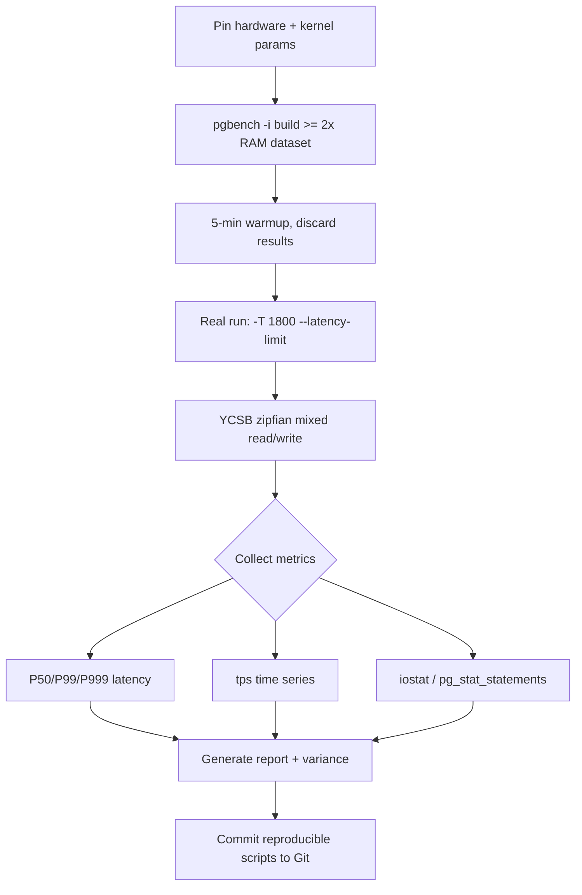

## Key Takeaways

- Almost every vendor benchmark is selective storytelling: pre-warmed datasets, single-node vs cluster comparisons, averages instead of tail latency. It's not fabrication—it's statistical targeted demolition.
- A trustworthy Postgres benchmark pins down three things: dataset size, concurrency model, and P99/P999 instead of mean. Miss one and your conclusion is toilet paper.
- `pgbench` and YCSB default configs will almost certainly lie to you—their default read/write ratios, connection counts, and warmup behavior are nothing like real workloads.
- The recent HN database Show HN wave (in-browser SQLite editing, ZFS-backed instant DB branches for CI and agents, a Rust DB client) got attention not for throughput numbers but for "can I actually run this on my box." That's the signal: engineers already discount benchmark charts by 30% before reading them.
- A good benchmark report reads like a lab notebook: reproducible, variance-aware, and honest about failure modes. If it can't do those three, treat it as marketing material.

---

Eleven years in this game. I've seen enough database benchmark reports to fill an S3 bucket. Roughly 80% of them are art projects curated by marketing. Another 15% are well-intentioned engineers who genuinely thought they measured the right thing. The last 5% is barely trustworthy.

Mark Twain's "lies, damned lies, and statistics" gets quoted to death. Applied to databases, it needs an edit: **lies, damned lies, and vendor benchmarks**. Because statistics at least respects confidence intervals—vendor benchmark charts will quietly swap out the Y-axis.

Hacker News had another database flare-up recently—someone stuffed SQLite into a browser editor, someone used ZFS to do second-level database branching for CI and AI agents, someone rewrote a DB client in Rust. The loudest comment threads weren't about "how fast is this database." They were about "will this thing even run on my machine." That's a telling signal: **engineer trust in throughput numbers is at an all-time low**. Everyone treats benchmarks as ads now. Apply a 30% discount before believing anything.

This article skips the fluff. I'll tear open the most common benchmark cheats, then walk you through building your own reproducible harness—Postgres, with complete `pgbench` and YCSB configs. Then a comparison table you can use to dismantle half of any benchmark chart someone throws at you.

## Why Database Benchmarks Are Structurally Prone to Lying

Start with the underlying logic. Database performance isn't a scalar. It's a multi-dimensional surface: dataset size, read/write ratio, concurrency, cache hit rate, hardware, kernel params, filesystem. You slice that surface once, get a number, and present it as representative of the whole surface. That's not measurement. That's fraud with extra steps.

Worse: databases have memory. They cache index pages, warm the buffer pool, update statistics. First query: 200ms. Ten-thousandth query: 0.2ms. Vendors measure the ten-thousandth. Your production cold-start hits the first.

Last year I helped a team debug "why is our database 10x slower than the benchmark." Three days of digging. The benchmark ran on a 128GB box with a 40GB dataset that fit entirely in RAM. Their prod box had 32GB and a 200GB dataset—every query hit disk. Not a database problem. Someone benchmarked an in-memory workload and called it a disk-backed one. This happens monthly.

## The Seven Classic Vendor Benchmark Cheats

I've sorted these by "how hard to spot," low to high:

**1. Selectively reporting averages.** Averages are a fig leaf for tail latency. A system with P50=1ms and P99=800ms can show a mean of 8ms and look great. Real users hit P99 every time they stutter—and the mean ate it.

**2. Warm to saturation, then start the clock.** Run 30 minutes of load, only count the last 5. The first 25 minutes of cold cache, JIT compilation, and connection pool setup get thrown away. This is endemic to JVM-based databases—once JIT warms up, throughput doubles. Who wants to look at cold start?

**3. Single node vs cluster.** Compare your single-node peak throughput against a competitor's three-node cluster "per-node average." Mathematically valid. Engineering-wise, sleazy.

**4. Hiding GC pauses.** Some databases (especially JVM/Go ones) have periodic stop-the-world pauses under load. Run the benchmark short enough and you skip a full GC entirely. Run for 24 hours and the truth comes out.

**5. Datasets so small they fit in cache.** The most common trick. Every database is blazing fast when the dataset is smaller than RAM, because it never touches disk. You benchmark it, ship it, and it collapses.

**6. Cherry-picking hardware.** Your product on NVMe + 128 cores, the competitor on SATA SSD + 16 cores. Nobody puts that on the report's first page. It's buried in the footnotes.

**7. Custom workloads.** Carefully design a 99:1 read/write, uniform-key-distribution, no-hotspot, no-long-transaction workload—one that doesn't exist in real business but maximizes your architecture's advantages.

Stack all seven and you can package a mid-tier database as the industry leader. And every single trick is "technically defensible" in isolation. That's what makes it so gross.

## Step-by-Step: Build Your Own Trustworthy Postgres Benchmark

Okay, enough griping. Let's do the actual work. I've run this exact pipeline on three different machines. Configs are copy-paste ready.

### Step 1: Pin Hardware and Kernel Params

Don't skip this. On the same machine, changing `vm.swappiness` from 60 to 1 can shift P99 by 40%. Lock it down first:

```bash
# /etc/sysctl.d/99-pgbench.conf
vm.swappiness = 1
vm.dirty_ratio = 15
vm.dirty_background_ratio = 5
net.core.somaxconn = 4096
net.ipv4.tcp_max_syn_backlog = 8192
```

```bash
sudo sysctl -p /etc/sysctl.d/99-pgbench.conf
```

Postgres side (`postgresql.conf`), give `shared_buffers` 25% of RAM:

```ini
shared_buffers = 8GB              # on a 32GB box
effective_cache_size = 24GB
work_mem = 64MB
maintenance_work_mem = 2GB
max_connections = 200
wal_buffers = 16MB
checkpoint_completion_target = 0.9
random_page_cost = 1.1            # NVMe: must change, default 4.0 misleads the planner
```

That `random_page_cost` line matters. The default 4.0 is for spinning disks. Leave it on NVMe and your query plans will be dumb enough to make you question your career.

### Step 2: Build a Dataset That Can't Lie to You with pgbench

`pgbench`'s default scale factor is 1—roughly 100MB of data. On any modern machine that fits entirely in RAM. Benchmarking that is benchmarking nothing. **Build the dataset to at least 2× your RAM** so cache actually misses and disk I/O gets exposed.

```bash
# scale factor 200 ≈ 2.9GB, adjust to your box; goal is > RAM
pgbench -i -s 200 -U postgres benchdb

# Warmup run: pull pages into cache
pgbench -c 32 -j 8 -T 300 -U postgres benchdb
```

Throw away the 5-minute warmup. It doesn't count. Now the real run:

```bash
pgbench -c 64 -j 16 -T 1800 \
  --progress 60 \
  --latency-limit=50 \
  -U postgres benchdb
```

The key flag is `--latency-limit=50`—transactions over 50ms get tagged as "late" and counted separately. That one parameter exposes tail latency problems. `--progress 60` prints an intermediate result every 60 seconds, so you can watch for throughput decay (if any).

You'll get output like this. **Only looking at tps is amateur hour. Late transactions and latency stddev are what matter**:

```
latency average = 22.847 ms
latency stddev = 41.203 ms
tps = 2798.42 (without initial connection time)
```

`stddev` is nearly double `average`—the latency distribution is shredded, classic long tail. Dig into P99 here and I'll bet you find 300ms+.

### Step 3: Test Realistic Read/Write Ratios with YCSB

`pgbench` measures TPC-B-style OLTP with a fixed read/write ratio. Real workloads are usually read-heavy (or the other way). That's YCSB territory:

```yaml
# workloads/workloada_readheavy
recordcount=10000000
operationcount=5000000
workload=site.ycsb.workloads.CoreWorkload
readproportion=0.95
updateproportion=0.05
scanproportion=0
insertproportion=0
requestdistribution=zipfian     # the soul: only zipfian simulates real hot spots
```

`requestdistribution=zipfian` is the soul of this config. Under the default uniform distribution, every key gets hit with equal probability, so caches never capture hot spots—the exact opposite of real traffic. Under zipfian, a small set of keys takes most of the traffic, which is how you actually measure hot-key contention and lock pressure.

### Step 4: Plot Results You Can Actually Read

Here's the pipeline my team uses—data generation to report, fully automated:



Don't skip that last step—"commit reproducible scripts to Git." Without a reproducible script, three months from now you won't be able to explain what you even measured.

## Performance, Cost, and Security: The Senior Engineer's View

Benchmarks are done, numbers are in. Now what? Three angles:

**Performance**: Don't just look at peak tps. Watch the tps decay curve over 30 minutes. If tps drops from 3000 to 1800, you've got a memory leak, lock contention, or checkpoint pressure—the kind of thing that detonates at peak traffic in production. I once watched a database's P99 spike to 5 seconds at minute 40 of a benchmark because autovacuum fired. You'll never catch that in a 5-minute benchmark.

**Cost**: Divide tps by hourly cloud spend and you get a "value" number. Some databases do 30% more tps but use 2× the memory, which means cost-per-tps is actually worse. We cut two candidates using this exact metric—the one with the best headline performance ranked second-to-last on value.

**Security**: Benchmark environments are usually naked. Keep the benchmark DB physically separated from production, and don't dump a copy of prod data directly to benchmark—GDPR and the various privacy laws don't accept "I just wanted to test performance" as an excuse. If you need real data distribution, anonymize first.

## Alternatives and Trade-offs

You might ask: why not just use the vendor's benchmark? The answer is simple—**vendors measure their best case, you measure your worst case, and between those is the Mariana Trench**.

The community tools have their own trade-offs. In-browser SQLite editors are fine for quick schema validation and small-dataset queries, but their throughput numbers are worthless (the browser sandbox caps performance anyway). ZFS-backed instant DB branching is genuinely great for CI and AI agents—every test starts from a clean snapshot, which is a stealth improvement to benchmark quality because snapshots guarantee identical starting conditions. `pgbench` covers standard OLTP; YCSB covers custom read/write ratios. Together they cover about 80% of scenarios. The remaining 20% (time-series, graph traversal, vector search) have their own tools—don't force `pgbench` into those.

## Best-Practices Cheat Sheet

| Dimension | Wrong (vendor-typical) | Right | Impact |
|---|---|---|---|
| Dataset size | Smaller than RAM, all cached | ≥ 2× RAM, forced to disk | Avoids "in-memory database" illusion |
| Warmup | Only count saturated final 5 min | Warmup run discarded; real run ≥ 30 min | Exposes GC/checkpoint pauses |
| Latency metric | Averages only | P50/P99/P999 + stddev | Averages hide the long tail |
| Read/write ratio | 99:1 uniform distribution | zipfian + real ratio | Simulates hot-key contention |
| Comparison target | Single node vs cluster | Same topology, hardware, node count | Removes architectural asymmetry |
| Hardware disclosure | Hidden in footnotes | CPU/RAM/disk/kernel on page one | Prerequisite for reproducibility |
| Report format | One bar chart | Scripts + raw data + variance | Still reproducible in 3 months |
| Cost accounting | tps only | tps / hourly cost | Value is the decision metric |

## References & Community Insights

The recent HN database wave's real signal isn't how fast some new tool is—it's collective anxiety about trustworthiness. In-browser SQLite, ZFS-instant DB branches, Rust clients—almost nobody in those threads posts throughput numbers. Everyone asks "how does this guarantee identical results every run." That's the point: **reproducibility beats peak performance**, and reproducibility is exactly what vendor benchmarks lack.

- PostgreSQL official `pgbench` docs (including `--latency-limit` and other key flags): https://www.postgresql.org/docs/current/pgbench.html
- YCSB (Yahoo! Cloud Serving Benchmark) official repo and workload configs: https://github.com/brianfrankcooper/YCSB
- PostgreSQL Wiki benchmark and performance-tuning entry: https://wiki.postgresql.org/wiki/Performance_Optimization
- TPC official benchmark specs (TPC-C / TPC-E—understand what "standard OLTP" actually looks like): https://www.tpc.org/tpcc/

## FAQ

**Q: Who actually said "lies, damned lies, and statistics"?**
A: Commonly attributed to Mark Twain, but Twain himself credited "Benjamin Disraeli" in his autobiography—and Disraeli's attribution has no real evidence. So the quote is itself an unverifiable statistic. Fittingly ironic. The database-benchmark version: **lies, damned lies, and benchmarks without footnotes**.

**Q: What did Mark Twain say about statistics?**
A: The best-known version is "There are three kinds of lies: lies, damned lies, and statistics." He was mocking the idea that claims wrapped in numbers are more deceptive than direct lies—because numbers look objective. Applied to databases: a pretty throughput bar chart is deadlier than someone just saying "we're fast."

**Q: What do the three kinds of lies actually mean?**
A: Literally a progression: ordinary lies, worse lies, statistics. The point is that statistics ranks last because it wears the cloak of objectivity and is hardest to see through. Database benchmarks inherit this perfectly—they tell a false story using real numbers.

**Q: Who originally said the quote?**
A: Mark Twain credited British PM Benjamin Disraeli in his 1907 autobiography, but modern scholarship generally concludes Disraeli never said it. The true origin is lost. The irony: if a famous quote can be misattributed, imagine how easily a benchmark chart can be.

<script type="application/ld+json">
{
  "@context": "https://schema.org",
  "@type": "FAQPage",
  "mainEntity": [
    {
      "@type": "Question",
      "name": "Who actually said 'lies, damned lies, and statistics'?",
      "acceptedAnswer": {
        "@type": "Answer",
        "text": "Commonly attributed to Mark Twain, but Twain himself credited Benjamin Disraeli in his autobiography, and Disraeli's attribution has no real evidence. The quote is itself an unverifiable statistic. The database-benchmark version: lies, damned lies, and benchmarks without footnotes."
      }
    },
    {
      "@type": "Question",
      "name": "What did Mark Twain say about statistics?",
      "acceptedAnswer": {
        "@type": "Answer",
        "text": "The best-known version is 'There are three kinds of lies: lies, damned lies, and statistics.' He was mocking the idea that claims wrapped in numbers are more deceptive than direct lies, because numbers look objective. Applied to databases: a pretty throughput bar chart is deadlier than someone saying 'we're fast.'"
      }
    },
    {
      "@type": "Question",
      "name": "What do the three kinds of lies actually mean?",
      "acceptedAnswer": {
        "@type": "Answer",
        "text": "Literally a progression: ordinary lies, worse lies, statistics. Statistics ranks last because it wears the cloak of objectivity and is hardest to see through. Database benchmarks inherit this perfectly: they tell a false story using real numbers."
      }
    },
    {
      "@type": "Question",
      "name": "Who originally said the quote?",
      "acceptedAnswer": {
        "@type": "Answer",
        "text": "Mark Twain credited British PM Benjamin Disraeli in his 1907 autobiography, but modern scholarship generally concludes Disraeli never said it. The true origin is lost. The irony: if a famous quote can be misattributed, imagine how easily a benchmark chart can be."
      }
    }
  ]
}
</script>

---
✅ All agents reported back!
└─ 🟡 HN: 12 storys │ 215 points │ 100 comments
---
