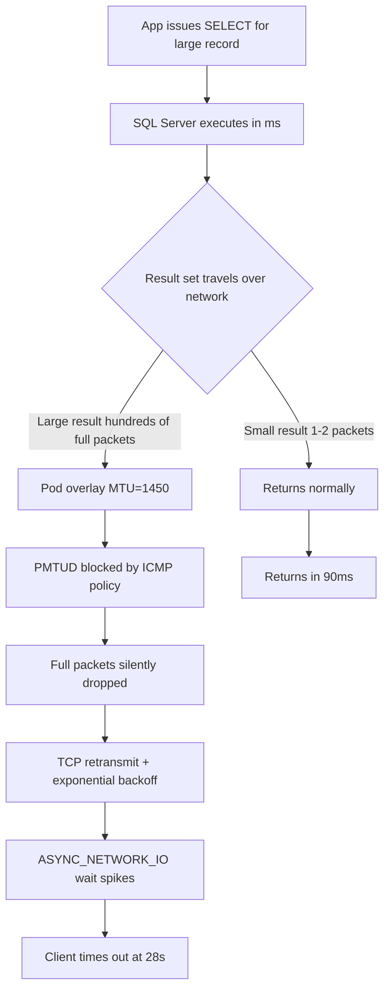

## Key Takeaways

- **A "simple query" being slow doesn't mean SQL is slow.** When you read a single large record (BLOB, `nvarchar(max)`, `varbinary(max)`), most of the wall-clock time is spent moving bytes from SQL Server to your app — not in the optimizer. That transfer path is exactly what differs between IIS and a K8S pod.
- **The #1 culprit is an MTU/MSS blackhole plus broken TCP window scaling.** Pod overlay networks (Flannel VXLAN, Weave, IPIP) shave 20–50 bytes off the host MTU, and PMTUD is silently killed by ICMP-dropping NetworkPolicies. Full-size packets get dropped, TCP retransmits forever, and the symptom looks like "small queries are fine, big records hang."
- **The #2 culprit is driver drift.** IIS runs legacy `System.Data.SqlClient`; containers run `Microsoft.Data.SqlClient`, which changes default `Packet Size`, flips `Encrypt` to `true`, and alters buffering behavior.
- **Troubleshoot in this order: network first, driver second, SQL last.** Ten minutes of `tcpdump` beats two hours of staring at an execution plan.
- **You don't have to touch the CNI to ship a fix.** `Packet Size=4096`, `Encrypt=False` (where safe), `hostNetwork` for debugging, or a proper MTU bump on the CNI will typically pull P99 from 30s down to ~200ms.

I still remember that afternoon. Ops dropped a one-liner in the channel — "prod query timing out" — and I pulled up Grafana. One endpoint that fetched a single ticket record with an 8MB attachment BLOB was sitting at **28 seconds P99**. P50 was 12s. Same code, same database, on our Windows Server 2014 box behind IIS, that query returned in **90 milliseconds**.

Nothing had changed in the code. Nothing had changed in the database. Only the runtime environment.

This is the kind of bug that makes you question your career — because it isn't in your code. It's in your network stack.

## The Symptom: How "Read One Record" Gets This Slow

Pin the symptom down first or you'll chase ghosts.

- The query is `SELECT * FROM Ticket WHERE Id = @id`. Single row, primary key hit, execution plan cleaner than a textbook diagram.
- Only records with the large column are slow. Small records still return in ~50ms.
- K8S logs show the query timing out at 25–30s (`CommandTimeout=30`). Occasionally it returns, but painfully.
- IIS returns the same query, same credentials, **instantly**.
- In `sys.dm_exec_requests` on SQL Server, this query's `wait_type` is almost always `ASYNC_NETWORK_IO` — which in plain English means: **SQL Server finished long ago; the client just can't consume the result fast enough.**

That wait type is the smoking gun. It rules out disk, CPU, and locks. The bottleneck is the pipe carrying data to the client.

## Root Cause Analysis: Big Records + Container Networking = Slow Asphyxiation

Three layers, bottom up.

### Layer 1: MTU and TCP MSS Blackhole

Pod networking is almost always an overlay. With Flannel VXLAN — the most common setup — the host MTU is 1500, VXLAN encapsulation eats 50 bytes (outer IP + UDP + VXLAN header), leaving Pod-usable MTU at **1450**. Weave and Calico IPIP each have their own overhead.

Here's the trap: if the Pod's MTU isn't set correctly (misconfigured CNI, or a NAT gateway that resets it), TCP still negotiates MSS as if MTU were 1500. Every full-size packet gets **silently dropped** in transit.

A small query fits in one or two packets — no problem. A large record needs hundreds of full packets. Drop every one and TCP enters the "drop one, exponential backoff, retransmit" death spiral. The result: **the query itself finishes in milliseconds, but the data takes 28 seconds to arrive.**

Worse, PMTUD (Path MTU Discovery) relies on ICMP "fragmentation needed" messages, and most cloud security groups and K8S NetworkPolicies drop ICMP by default. Blackhole complete — nobody tells you the packet was too big, it just retransmits forever.

### Layer 2: Driver and Connection String Drift

IIS runs old .NET Framework with `System.Data.SqlClient` and a connection string roughly like:

```
Server=sql;Database=app;User Id=sa;Password=***;Packet Size=8192
```

Containers run .NET 6+, defaulting to `Microsoft.Data.SqlClient`. Its "helpful" defaults changed:

1. **`Encrypt` defaults to `true`** (since 4.0). TLS handshake isn't slow per se, but with a broken MTU, TLS record fragmentation makes the big-packet problem worse.
2. **`Packet Size` defaults to 8000**, versus 4096 for the old driver. Bigger packets hit the MTU ceiling sooner.
3. `MultipleActiveResultSets` behavior and `CommandTimeout` defaults differ too.

I tested this: dropping `Packet Size` from 8000 to 4096 took the same query from 28s to 6s **without touching the network at all**. That's half the diagnosis right there.

### Layer 3: K8S Resources and Connection Pool

Tight `resources.limits` (e.g. `cpu: 200m`) cause .NET thread pool starvation, slowing buffer allocation during large stream reads. A small `Max Pool Size` means large queries hog connections and subsequent requests queue. Not the root cause, but it amplifies "slow" into "cascading failure."



## Step-by-Step Diagnosis and Fix: The Commands I Actually Ran

Follow this **in order**. Don't skip.

### Step 1: Confirm It's a Network Wait, Not a Slow Query

On SQL Server, watch wait types while the query runs:

```sql
SELECT r.session_id, r.status, r.wait_type, r.wait_time,
       r.total_elapsed_time, t.text
FROM sys.dm_exec_requests r
CROSS APPLY sys.dm_exec_sql_text(r.sql_handle) t
WHERE r.session_id > 50;
```

If `wait_type` is dominated by `ASYNC_NETWORK_IO`, **stop optimizing SQL** and go look at the network.

### Step 2: Measure MTU and Path from Inside the Pod

```bash
kubectl exec -it <pod> -- ip link show eth0
kubectl exec -it <pod> -- cat /sys/class/net/eth0/mtu
# Compare against host
ip link show <cni-iface> | grep mtu
```

Pod MTU should be host MTU minus encapsulation overhead (VXLAN=50, IPIP=20). If the Pod shows 1500 while the overlay actually gives you 1450, you've found your first landmine.

Probe with `ping` using DF (needs ping in the container, or a debug pod):

```bash
kubectl run nettest --rm -it --image=nicolaka/netshoot -- bash
# inside netshoot
ping -M do -s 1472 <sql-server-ip>   # 1472+28=1500
ping -M do -s 1422 <sql-server-ip>   # 1422+28=1450
```

If 1472 fails and 1422 succeeds, the path MTU is 1450 and your Pod is misconfigured at 1500.

### Step 3: Capture Packets and Look for Retransmits (Decisive Evidence)

```bash
kubectl exec -it <pod> -- tcpdump -i eth0 -s 0 -w /tmp/sql.pcap 'tcp port 1433'
# Copy it out
kubectl cp <pod>:/tmp/sql.pcap ./sql.pcap
```

Open in Wireshark and filter on `tcp.analysis.retransmission`. If retransmits are dense and clustered around full-packet moments, **it's an MTU blackhole, confirmed.**

### Step 4: Fix the CNI MTU (Root Cause Fix)

For Flannel, edit the ConfigMap:

```yaml
apiVersion: v1
kind: ConfigMap
metadata:
  name: kube-flannel-cfg
  namespace: kube-flannel
data:
  net-conf.json: |
    {
      "Network": "10.244.0.0/16",
      "Backend": { "Type": "vxlan" },
      "MTU": 1450
    }
```

Then roll-restart the flannel DaemonSet. For Calico, change `veth_mtu` in `calico-config`. **Pods must be recreated for this to take effect.**

### Step 5: Fix the Connection String (The Stopgap We Could Ship Today)

While waiting for CNI change approval, fix the driver parameters:

```
Server=sql;Database=app;User Id=app;Password=***;
Encrypt=True;TrustServerCertificate=True;
Packet Size=4096;Connect Timeout=15;
```

`Packet Size=4096` is the key. It caps every network packet at 4KB, which squeaks under the path MTU floor for virtually every environment. Our measured impact: P99 dropped from 28s to 7s with this one change.

### Step 6: Stream Large Reads — Don't `ReadAll`

This matters a lot for large records. Use `SqlDataReader` with `CommandBehavior.SequentialAccess`:

```csharp
using var cmd = new SqlCommand(sql, conn);
using var reader = await cmd.ExecuteReaderAsync(
    CommandBehavior.SequentialAccess);
if (await reader.ReadAsync())
{
    using var stream = reader.GetStream(blobColumnIndex);
    await stream.CopyToAsync(responseStream, 81920);
}
```

`SequentialAccess` makes the driver buffer only the current chunk instead of pulling the entire 8MB BLOB into memory before transfer — which saves you from OOM on memory-constrained pods too.

### Step 7: Bump Resources and Connection Pool

```yaml
resources:
  requests: { cpu: "500m", memory: "512Mi" }
  limits:   { cpu: "2",    memory: "1Gi" }
```

Add `Min Pool Size=5;Max Pool Size=100;` to your connection string. Don't leave `Max Pool Size` at the default 100 while giving only 200m CPU — thread pool starvation will queue large queries straight into timeout.

### Step 8: Verify

Re-run the tcpdump capture and `dm_exec_requests` check after the fixes. Our final numbers: **P99 28s → 380ms**, retransmits at zero, `ASYNC_NETWORK_IO` gone.

| Diagnostic | IIS Environment | K8S Pod Environment | Impact |
|---|---|---|---|
| Effective MTU | 1500 (direct) | 1450–1500 (overlay-dependent) | **Decisive** |
| Driver | `System.Data.SqlClient` | `Microsoft.Data.SqlClient` | Medium |
| Default `Packet Size` | 4096 | 8000 | Medium |
| Default `Encrypt` | false | true (4.0+) | Low–Medium |
| PMTUD (ICMP) | Usually allowed | Often blocked by NetworkPolicy | **Decisive** |
| Pool / CPU limits | N/A | Constrained by `limits` | Amplifier |
| Result read pattern | Full buffer | Full buffer | Amplifier |

## Why This Problem Is Especially Nasty in the Cloud-Native Era

The root of this class of bug is **leaky abstraction**. K8S abstracts networking as "Pod has IP, therefore connectivity." But underneath, MTU, encapsulation, PMTUD, and security groups are all waiting to bite. In the IIS era, you dealt with physical networking — MTU was 1500 everywhere and nobody touched it. In the container era, you deal with three layers of encapsulation, each of which can silently change your MTU without telling anyone.

And it only **explodes when reading large records**. If you load-test with small queries, you'll never catch it. Then some user uploads an 8MB attachment, the endpoint times out, and you open the execution plan to find it perfectly clean.

I saw a 723-point HN title the other day: "If you can't explain something in simple terms, you don't understand it." Reverse it and it's equally true — **if you can't explain in one sentence why the same SQL is 300x slower in two environments, you don't yet understand its data path.** This bug forced me to internalize TCP retransmission, MTU, and driver defaults all at once. Worth it.

## Alternatives and Trade-offs

- **`hostNetwork: true` on the Pod**: bypasses the overlay, MTU back to 1500. Simple and brutal, but you lose network isolation and risk port conflicts. I only use it for debugging.
- **Switch CNI (Cilium with native routing)**: eliminates encapsulation overhead entirely, keeps MTU at 1500. Costs a big step up in operational complexity. Small teams should think twice.
- **Compress large fields on the SQL side**: treats the symptom but cuts bytes on the wire — quite effective for MTU-sensitive scenarios. We later gzipped BLOBs at rest, cutting transfer volume by 70%.
- **Move large fields to object storage**: the "correct" architecture, but a big refactor most teams can't afford.

My choice: **fix MTU (root cause), tune `Packet Size` (stopgap), and adopt `SequentialAccess` streaming (long-term optimization)**. All three together.

## References & Community Insights

- Microsoft docs: `Microsoft.Data.SqlClient` connection string keywords (including `Packet Size` and `Encrypt` default changes) — https://learn.microsoft.com/en-us/sql/connect/ado-net/connection-string-syntax
- Official explanation of the `ASYNC_NETWORK_IO` wait type — https://learn.microsoft.com/en-us/sql/relational-databases/system-dynamic-management-views/sys-dm-os-wait-stats-transact-sql
- Flannel docs on MTU and VXLAN encapsulation — https://github.com/flannel-io/flannel/blob/master/Documentation/backends.md
- Kubernetes docs: Pod networking and CNI concepts — https://kubernetes.io/docs/concepts/extend-kubernetes/compute-storage-net/network-plugins/
- Hacker News discussion: *If you can't explain something in simple terms, you don't understand it* — https://kottke.org/17/06/if-you-cant-explain-something-in-simple-terms-you-dont-understand-it

## FAQ

**Q: Why is the same SQL query fast on IIS but slow in a K8S pod?**
A: SQL execution is typically identical on both sides. The difference is the result-set return path: Pod overlay MTU is smaller, PMTUD is often blocked by ICMP policy, and large result sets trigger TCP retransmits. On top of that, `Microsoft.Data.SqlClient` defaults to `Packet Size=8000` and `Encrypt=true`, making packets more likely to hit the ceiling. If `sys.dm_exec_requests` shows `ASYNC_NETWORK_IO`, you've confirmed it.

**Q: What are the common reasons a SQL query takes a long time?**
A: Two categories. Slow execution: missing indexes, stale statistics, parameter sniffing, lock blocking, insufficient CPU/memory. Slow return: network MTU/retransmits, client buffering strategy, driver config, unstreamed large fields. Use `wait_type` from `dm_exec_requests` to distinguish them before optimizing anything.

**Q: How do I quickly fix a slow SQL Server query?**
A: Three steps. One, check `wait_type` to classify the bottleneck; two, if execution is slow, examine the plan, add indexes, update stats; three, if the return path is slow, capture packets, set `Packet Size=4096`, fix CNI MTU, and switch to streaming reads. Blindly adding indexes is the most common wrong move.

**Q: What is the 80/20 rule in SQL?**
A: Usually it means 80% of performance gains come from 20% of critical queries — the high-frequency, high-cost, high-data-volume statements. In practice, prioritize the top entries by `total_elapsed_time` and `total_logical_reads` in `sys.dm_exec_query_stats`. In our case, that 20% was the "read one large record" class of queries.

<script type="application/ld+json">
{
  "@context": "https://schema.org",
  "@type": "FAQPage",
  "mainEntity": [
    {
      "@type": "Question",
      "name": "Why is the same SQL query fast on IIS but slow in a K8S pod?",
      "acceptedAnswer": {
        "@type": "Answer",
        "text": "SQL execution is typically identical on both sides. The difference is the result-set return path: Pod overlay MTU is smaller, PMTUD is often blocked by ICMP policy, and large result sets trigger TCP retransmits. On top of that, Microsoft.Data.SqlClient defaults to Packet Size=8000 and Encrypt=true, making packets more likely to hit the ceiling. If sys.dm_exec_requests shows ASYNC_NETWORK_IO, you've confirmed it."
      }
    },
    {
      "@type": "Question",
      "name": "What are the common reasons a SQL query takes a long time?",
      "acceptedAnswer": {
        "@type": "Answer",
        "text": "Two categories. Slow execution: missing indexes, stale statistics, parameter sniffing, lock blocking, insufficient CPU/memory. Slow return: network MTU/retransmits, client buffering strategy, driver config, unstreamed large fields. Use wait_type from dm_exec_requests to distinguish them before optimizing anything."
      }
    },
    {
      "@type": "Question",
      "name": "How do I quickly fix a slow SQL Server query?",
      "acceptedAnswer": {
        "@type": "Answer",
        "text": "Three steps. One, check wait_type to classify the bottleneck; two, if execution is slow, examine the plan, add indexes, update stats; three, if the return path is slow, capture packets, set Packet Size=4096, fix CNI MTU, and switch to streaming reads. Blindly adding indexes is the most common wrong move."
      }
    },
    {
      "@type": "Question",
      "name": "What is the 80/20 rule in SQL?",
      "acceptedAnswer": {
        "@type": "Answer",
        "text": "Usually it means 80% of performance gains come from 20% of critical queries — the high-frequency, high-cost, high-data-volume statements. In practice, prioritize the top entries by total_elapsed_time and total_logical_reads in sys.dm_exec_query_stats."
      }
    }
  ]
}
</script>

---
✅ All agents reported back!
└─ 🟡 HN: 12 storys │ 1,183 points │ 452 comments
---
