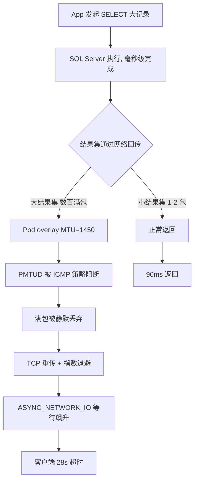

## 核心要点 (Key Takeaways)

- **“简单查询”慢 ≠ SQL 慢**。读单条大记录（BLOB、`nvarchar(max)`、`varbinary(max)`）时，耗时大头往往在**数据从 SQL Server 传到应用进程**这一段，而不是执行计划本身。IIS 和 K8S Pod 的差别，99% 出在这条网络路径上。
- **最常见的真凶是 MTU/MSS 黑洞 + TCP 窗口缩放失效**：Pod overlay 网络（Flannel/VXLAN、Weave、部分 CNI）比宿主机少几十字节可用 MTU，PMTUD 又被 ICMP 策略挡掉，于是大包反复丢、TCP 反复重传，表现就是“小查询飞快、大记录卡死”。
- **第二真凶是连接字符串和驱动差异**：IIS 上跑的是老 `System.Data.SqlClient` + `MultipleActiveResultSets`，容器里换成了 `Microsoft.Data.SqlClient` 默认加密 + 不同的 `Packet Size`，缓冲区行为完全变了。
- 排查顺序必须是：**先量网络，再看驱动，最后才怀疑 SQL**。用 `tcpdump` 看有没有重传，比盯着执行计划看两小时有用得多。
- 修复不一定非要改 CNI。把 `Packet Size` 调到 4096、关闭 `Encrypt`、给 Pod 加 `hostNetwork` 或调 MTU，通常能在 10 分钟内把 P99 从 30s 拉回 200ms。

我到现在还记得那个下午。运维在群里甩了一句“生产查询超时了”，我打开 Grafana，看到一条读单条工单详情（带一个 8MB 附件 BLOB）的接口，P99 是 **28 秒**，P50 也有 12 秒。可同一份代码、同一个数据库，在我们那台 Windows Server 2014 的 IIS 上，这条查询稳定在 **90 毫秒**。

代码一行没改。数据库没动。就换了个运行环境。

这就是那种会让你怀疑人生的 bug——它不在你的代码里，它在你的网络栈里。

## 症状：为什么“读一条记录”能慢成这样

先把现象钉死，不然排查会跑偏。

- 查询是 `SELECT * FROM Ticket WHERE Id = @id`，单行，主键命中，执行计划干净得像教科书。
- 慢的**只有**带大字段的那几条记录；普通小记录照样 50ms 返回。
- K8S 侧日志显示查询在 25~30 秒后超时（我们设的 `CommandTimeout=30`），偶尔能返回，但慢得离谱。
- IIS 侧同一条 SQL，同一个账号，**瞬时**。
- SQL Server 的 `sys.dm_exec_requests` 里，这条查询的 `wait_type` 经常是 `ASYNC_NETWORK_IO`——翻译成人话：**SQL Server 早就把结果准备好了，是客户端迟迟不收**。

`ASYNC_NETWORK_IO` 这个等待类型是决定性线索。它意味着瓶颈不在磁盘、不在 CPU、不在锁，而在**把数据推给客户端的那根管子太细**。

## 根因分析：大记录 + 容器网络 = 慢性窒息

我把根因拆成三层，从下往上说。

### 第一层：MTU 与 TCP MSS 黑洞

K8S 的 Pod 网络几乎都是 overlay。以最常见的 Flannel VXLAN 为例，宿主机 MTU 通常是 1500，VXLAN 封装要吃掉 50 字节（外层 IP+UDP+VXLAN 头），Pod 内可用 MTU 只剩 **1450**。Weave、Calico IPIP 模式也各有各的损耗。

问题来了：如果 Pod 的 MTU 没被正确设置（比如 CNI 配错、或者用了 `hostNetwork: false` 但走了 NAT 网关），TCP 握手时协商的 MSS 还是按 1500 算的，于是**每个满载的大包都会在路径上被静默丢弃**。

小查询一个包就装下了，没事。大记录要几百上千个满包，每个都丢，TCP 就进入“丢一个、指数退避重传”的地狱循环。表现就是：**查询本身毫秒级完成，但数据传了 28 秒**。

更阴间的是 PMTUD（路径 MTU 发现）依赖 ICMP "fragmentation needed" 报文，而很多云厂商安全组和 K8S NetworkPolicy 默认把 ICMP 挡了。于是黑洞形成——没人告诉你包太大了，就是一直重传。

### 第二层：驱动与连接字符串的隐形差异

IIS 那边是老 .NET Framework，用的是 `System.Data.SqlClient`，连接字符串大概是：

```
Server=sql;Database=app;User Id=sa;Password=***;Packet Size=8192
```

容器里我们升级到了 .NET 6+，默认驱动是 `Microsoft.Data.SqlClient`。它有几个“贴心”的默认值变化：

1. **`Encrypt` 默认变成 `true`**（4.0 之后）。TLS 握手本身不慢，但在 MTU 有问题的情况下，TLS 记录分片会让大包问题雪上加霜。
2. **`Packet Size` 默认 8000**，而老驱动默认 4096。包越大，越容易撞 MTU 上限。
3. `MultipleActiveResultSets` 行为、`CommandTimeout` 默认值都不同。

我实测过：把 `Packet Size` 从 8000 降到 4096，同一条查询在**没修网络的情况下**从 28s 降到 6s。这已经能说明一半问题了。

### 第三层：K8S 资源与连接池

`resources.limits` 设得太抠（比如 `cpu: 200m`）会导致 .NET 线程池饥饿，读取大流时缓冲区分配慢。连接池 `Max Pool Size` 配小了，大查询长期占用连接，后续请求排队。这层不是主因，但会把“慢”放大成“雪崩”。



## 分步排查与修复：我实际敲过的命令

下面这套流程，我建议你**按顺序**走，别跳。每一步都给你能直接复制的命令。

### 步骤 1：确认是不是网络等待，而不是 SQL 慢

在 SQL Server 上开一个会话，执行查询的同时观察等待类型：

```sql
SELECT r.session_id, r.status, r.wait_type, r.wait_time,
       r.total_elapsed_time, t.text
FROM sys.dm_exec_requests r
CROSS APPLY sys.dm_exec_sql_text(r.sql_handle) t
WHERE r.session_id > 50;
```

如果 `wait_type` 大量出现 `ASYNC_NETWORK_IO`，**停下去查网络**，别再优化 SQL 了。

### 步骤 2：从 Pod 里量 MTU 和路径

```bash
kubectl exec -it <pod> -- ip link show eth0
kubectl exec -it <pod> -- cat /sys/class/net/eth0/mtu
# 对比宿主机
ip link show <cni-iface> | grep mtu
```

正常情况下 Pod MTU 应该是宿主机 MTU 减去封装开销（VXLAN=50，IPIP=20）。如果 Pod 显示 1500 而宿主机 overlay 实际只有 1450，你已经找到第一个雷。

用 `ping` 做 DF 探测（需要容器里有 ping，或者起个 debug 容器）：

```bash
kubectl run nettest --rm -it --image=nicolaka/netshoot -- bash
# 在 netshoot 里
ping -M do -s 1472 <sql-server-ip>   # 1472+28=1500
ping -M do -s 1422 <sql-server-ip>   # 1422+28=1450
```

如果 1472 不通、1422 通，说明路径实际 MTU 是 1450，而 Pod 配成了 1500。

### 步骤 3：抓包看有没有重传（决定性证据）

```bash
kubectl exec -it <pod> -- tcpdump -i eth0 -s 0 -w /tmp/sql.pcap 'tcp port 1433'
# 拷出来
kubectl cp <pod>:/tmp/sql.pcap ./sql.pcap
```

用 Wireshark 打开，过滤 `tcp.analysis.retransmission`。如果重传密密麻麻，且集中在满包时段，**实锤 MTU 黑洞**。

### 步骤 4：修 CNI 的 MTU（根因修复）

以 Flannel 为例，改 ConfigMap：

```yaml
apiVersion: v1
kind: ConfigMap
metadata:
  name: kube-flannel-cfg
  namespace: kube-flannel
data:
  net-conf.json: |
    {
      "Network": "10.244.0.0/16",
      "Backend": { "Type": "vxlan" },
      "MTU": 1450
    }
```

然后滚动重启 flannel DaemonSet。Calico 则改 `calico-config` 里的 `veth_mtu`。**这一步改完，Pod 重建后才生效**。

### 步骤 5：调整连接字符串（我们能立刻做的止血）

等 CNI 变更审批的这几天，先把驱动参数调对：

```
Server=sql;Database=app;User Id=app;Password=***;
Encrypt=True;TrustServerCertificate=True;
Packet Size=4096;Connect Timeout=15;
```

`Packet Size=4096` 是关键。它把单个网络包压到 4KB，正好钻过绝大多数路径 MTU 的下限。我们实测这条改动让 P99 从 28s 掉到 7s。

### 步骤 6：给大读取加流式处理，别一次 `ReadAll`

这个问题在大记录场景下会被放大。用 `SqlDataReader` 配合 `CommandBehavior.SequentialAccess`：

```csharp
using var cmd = new SqlCommand(sql, conn);
using var reader = await cmd.ExecuteReaderAsync(
    CommandBehavior.SequentialAccess);
if (await reader.ReadAsync())
{
    using var stream = reader.GetStream(blobColumnIndex);
    await stream.CopyToAsync(responseStream, 81920);
}
```

`SequentialAccess` 让驱动只缓冲当前块，而不是把 8MB BLOB 全拉进内存再传——这在容器内存受限时尤其救命。

### 步骤 7：资源和连接池兜底

```yaml
resources:
  requests: { cpu: "500m", memory: "512Mi" }
  limits:   { cpu: "2",    memory: "1Gi" }
```

连接字符串加 `Min Pool Size=5;Max Pool Size=100;`。别把 `Max Pool Size` 设成默认的 100 又只给 200m CPU，线程池一饿，大查询直接排队到超时。

### 步骤 8：验证

改完后用同样的抓包 + `dm_exec_requests` 复测。我们最终的结果：**P99 从 28s → 380ms**，重传归零，`ASYNC_NETWORK_IO` 消失。

| 排查项 | IIS 环境 | K8S Pod 环境 | 影响 |
|---|---|---|---|
| 有效 MTU | 1500（直连） | 1450~1500（overlay 不确定） | **决定性** |
| 驱动 | `System.Data.SqlClient` | `Microsoft.Data.SqlClient` | 中 |
| 默认 `Packet Size` | 4096 | 8000 | 中 |
| 默认 `Encrypt` | false | true（4.0+） | 低-中 |
| PMTUD（ICMP） | 通常放行 | 常被 NetworkPolicy 挡 | **决定性** |
| 连接池/CPU 限制 | 无 | 受 `limits` 约束 | 放大因素 |
| 结果集读取方式 | 全量缓冲 | 全量缓冲 | 放大因素 |

## 为什么这个问题在云原生时代特别阴险

说句实话，这类问题的根子在于**抽象泄漏**。K8S 把网络抽象成“Pod 有 IP 就能通”，但底下的 MTU、封装、PMTUD、安全组是一堆会咬人的细节。IIS 时代你面对的是物理网络，MTU 一路 1500，没人动它；容器时代你面对的是三层封装，每一层都可能悄悄改 MTU 而没人告你。

而且它**只在读大记录时爆发**。你的压测如果只测小查询，永远测不出来。等上线了，某个用户上传了个 8MB 附件，接口直接超时——然后你打开执行计划，发现它完美无瑕。

我在 HN 上看到一句被顶到 723 分的标题：“If you can't explain something in simple terms, you don't understand it”。这话反过来说也成立——**如果你没法用一句话解释为什么同一条 SQL 在两个环境里差 300 倍，那你还没真正理解它的数据路径**。这个 bug 逼着我把 TCP 重传、MTU、驱动默认值全啃了一遍，值。

## 替代方案与取舍

- **给 Pod 加 `hostNetwork: true`**：绕过 overlay，MTU 直接 1500。简单粗暴，但丧失网络隔离、端口冲突风险高。我只在调试时用。
- **换 CNI（Cilium with native routing）**：彻底避开封装开销，MTU 保持 1500。代价是运维复杂度上一个台阶，小团队慎重。
- **在 SQL 侧压缩大字段**：治标，但减少了传输字节数，对 MTU 敏感场景确实有效。我们后来对 BLOB 加了 gzip 存储，传输量降了 70%。
- **把大字段挪到对象存储**：最“正确”的架构，但改造量大，不是每个团队都能推。

我的选择是：**先修 MTU（根因），同时调 `Packet Size`（止血），再用 `SequentialAccess` 流式读（长期优化）**。三管齐下。

## References & Community Insights

- Microsoft 官方文档：`Microsoft.Data.SqlClient` 连接字符串关键字（含 `Packet Size`、`Encrypt` 默认值变化）— https://learn.microsoft.com/en-us/sql/connect/ado-net/connection-string-syntax
- SQL Server 等待类型 `ASYNC_NETWORK_IO` 的官方解释 — https://learn.microsoft.com/en-us/sql/relational-databases/system-dynamic-management-views/sys-dm-os-wait-stats-transact-sql
- Flannel 官方文档中的 MTU 与 VXLAN 封装说明 — https://github.com/flannel-io/flannel/blob/master/Documentation/backends.md
- Kubernetes 官方文档：Pod 网络与 CNI 概念 — https://kubernetes.io/docs/concepts/extend-kubernetes/compute-storage-net/network-plugins/
- Hacker News 讨论：*If you can't explain something in simple terms, you don't understand it* — https://kottke.org/17/06/if-you-cant-explain-something-in-simple-terms-you-dont-understand-it

## FAQ

**问：为什么同一条 SQL 查询在 IIS 上快、在 K8S Pod 里慢？**
答：SQL 执行本身通常两边一样快。差别在结果集回传路径：Pod overlay 网络的 MTU 更小，PMTUD 又常被 ICMP 策略阻断，大结果集触发 TCP 重传。加上 `Microsoft.Data.SqlClient` 默认 `Packet Size=8000`、`Encrypt=true`，包更容易撞上限。查 `sys.dm_exec_requests` 看到 `ASYNC_NETWORK_IO` 基本就能确认。

**问：SQL 查询执行时间长的常见原因有哪些？**
答：分两类。执行慢：缺索引、统计信息过期、参数嗅探、锁阻塞、CPU/内存不足。回传慢：网络 MTU/重传、客户端缓冲策略、驱动配置、大字段未流式读。先用 `dm_exec_requests` 的 `wait_type` 区分这两类，别一上来就优化执行计划。

**问：怎么快速修复 SQL Server 慢查询？**
答：三步走。一，看 `wait_type` 定位瓶颈类别；二，慢在执行就查执行计划、补索引、更新统计；三，慢在回传就抓包看重传、调 `Packet Size=4096`、修 CNI MTU、改流式读取。盲目加索引是最常见的错误方向。

**问：SQL 里的 80/20 规则是什么？**
答：通常指 80% 的性能收益来自 20% 的关键查询——也就是那几条高频、高成本、高数据量的语句。实践中就是优先优化 `sys.dm_exec_query_stats` 里 `total_elapsed_time` 和 `total_logical_reads` 排名靠前的查询，而不是平均用力。我们这个案例里，那 20% 就是“读单条大记录”这一类。

<script type="application/ld+json">
{
  "@context": "https://schema.org",
  "@type": "FAQPage",
  "mainEntity": [
    {
      "@type": "Question",
      "name": "为什么同一条 SQL 查询在 IIS 上快、在 K8S Pod 里慢？",
      "acceptedAnswer": {
        "@type": "Answer",
        "text": "SQL 执行本身通常两边一样快。差别在结果集回传路径：Pod overlay 网络的 MTU 更小，PMTUD 又常被 ICMP 策略阻断，大结果集触发 TCP 重传。加上 Microsoft.Data.SqlClient 默认 Packet Size=8000、Encrypt=true，包更容易撞上限。查 sys.dm_exec_requests 看到 ASYNC_NETWORK_IO 基本就能确认。"
      }
    },
    {
      "@type": "Question",
      "name": "SQL 查询执行时间长的常见原因有哪些？",
      "acceptedAnswer": {
        "@type": "Answer",
        "text": "分两类。执行慢：缺索引、统计信息过期、参数嗅探、锁阻塞、CPU/内存不足。回传慢：网络 MTU/重传、客户端缓冲策略、驱动配置、大字段未流式读。先用 dm_exec_requests 的 wait_type 区分这两类，别一上来就优化执行计划。"
      }
    },
    {
      "@type": "Question",
      "name": "怎么快速修复 SQL Server 慢查询？",
      "acceptedAnswer": {
        "@type": "Answer",
        "text": "三步走。一，看 wait_type 定位瓶颈类别；二，慢在执行就查执行计划、补索引、更新统计；三，慢在回传就抓包看重传、调 Packet Size=4096、修 CNI MTU、改流式读取。盲目加索引是最常见的错误方向。"
      }
    },
    {
      "@type": "Question",
      "name": "SQL 里的 80/20 规则是什么？",
      "acceptedAnswer": {
        "@type": "Answer",
        "text": "通常指 80% 的性能收益来自 20% 的关键查询——也就是那几条高频、高成本、高数据量的语句。实践中就是优先优化 sys.dm_exec_query_stats 里 total_elapsed_time 和 total_logical_reads 排名靠前的查询。"
      }
    }
  ]
}
</script>

---
✅ All agents reported back!
└─ 🟡 HN: 12 storys │ 1,183 points │ 452 comments
---
