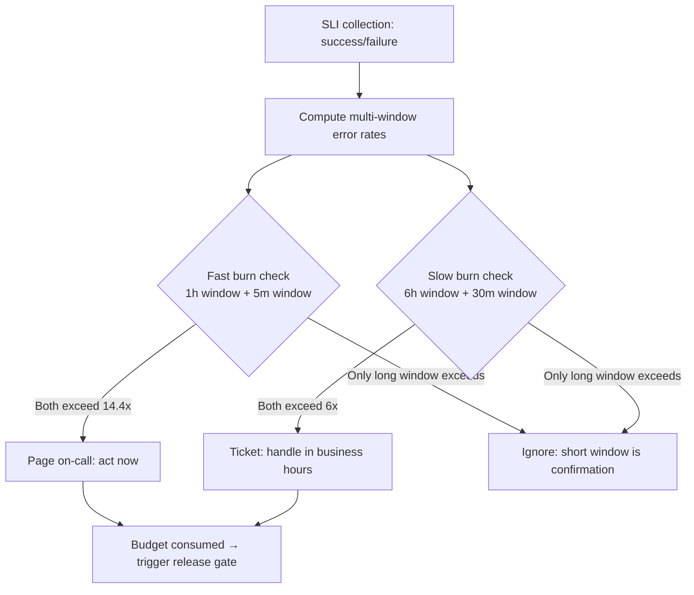

## Key Takeaways

- **Error budget = eligible events × (1 − SLO target)**. The formula is the easy part. What actually determines alert quality is how you define "eligible events" and how you slice the rolling window.
- A 99.9% SLO gives you about **43.2 minutes of full-outage-equivalent budget** in a 30-day window. If you measure by request volume, it's 0.1% of total requests. That number is far smaller than most people's gut feeling.
- Multi-window multi-burn-rate alerting (from the Google SRE Workbook) is still the only sane approach in 2026 — but you must recompute the thresholds against your own traffic curves. Copy-pasting 14.4 will produce daily false pages.
- The fast-burn vs. slow-burn split is a trade-off between detection latency and false-positive rate. Those two numbers are not arbitrary.
- Before wiring error-budget gates into CI/CD, settle **ownership**. Otherwise dev teams treat it as yet another release-blocking bureaucracy and route around it.

---

## 1. Why People Still Screw Up Error Budgets in 2026

I've seen too many teams with beautiful SLO docs, eight Grafana panels, and zero humans looking at the burn-rate curve when things actually break. Alerts? All on CPU and P99 latency.

Last month I helped a friend debug their payment gateway. Their SLO was 99.95%, and the panel showed 62% budget remaining. Looked fine. But the panel used a *calendar-month* window while the alerting used a *7-day rolling* window. Two different clocks. A 12-minute outage early in the month got diluted by the calendar window — because that month's total request volume was unusually high, the 0.05% budget got smeared so thin it was invisible. By the time they noticed, 40% of the budget was gone.

That's the real failure mode of error budget calculation: **the formula is dead, the definitions are alive**. You can compute `1 - SLO` to five decimal places, but if event counting, window boundaries, and aggregation dimensions aren't aligned, the number is just pretty garbage.

And here's the thing — nobody's talking about this. I scrolled through recent HN discussions and the topic is *dead silent*. Between late October and mid-November 2026, there's basically zero serious SLO discussion on Hacker News. The front page is "Who wants to be hired" and "why is it so hard to buy a digital bus ticket in 2026." What does that tell you? Error budgeting has become *infrastructure* — assumed knowledge. People who know it use it quietly. People who don't keep stepping on the same rakes. Nobody posts anymore.

So this piece is me dumping every rake I've stepped on, every number I've computed, every alert I've configured.

---

## 2. Under the Hood: Tearing the Formula Apart

### 2.1 Three Numbers, All of Which Must Be Right

The core of error budgeting is three quantities:

```
Error budget (absolute) = total eligible events × (1 − SLO target)
```

Take a 99.9% SLO over a 30-day window with 10 million eligible requests:

```
10,000,000 × (1 − 0.999) = 10,000 failed requests allowed
```

In time terms, 30 days = 43,200 minutes:

```
43,200 × 0.001 = 43.2 minutes
```

43.2 minutes. That's your entire monthly error allowance. One flaky database failover, one botched rollout, one third-party API timeout storm eats most of it.

**Pitfall #1: what counts as an "eligible event."** Do you count all HTTP requests, or only successes + failures while excluding 4xx client errors? That definition directly sets your budget base. My usual rule:

- 5xx counts as failure
- 2xx/3xx counts as success
- 4xx gets special handling — user input errors are excluded, but 429 (accidental rate limiting) counts as failure
- Health checks and probe traffic are excluded entirely

Inconsistent definitions are catastrophic. I've seen a team where the SLI counted *all* requests but the error-rate alert counted requests *excluding 4xx*. The two panels never agreed, and the on-call engineers simply stopped trusting either of them.

### 2.2 Three Ways to Slice the Window, Each With Its Own Poison

| Window type | Calculation | Pros | Fatal flaw |
|---|---|---|---|
| Calendar month | Resets at 00:00 on the 1st | Aligns with finance/reporting; easy to narrate | Uneven traffic across the month dilutes incidents; cross-month outages get split in half |
| Rolling (30d rolling) | Always looks back 30 days | Incident impact stays visible; no "reset at month start" | One old incident drags for 30 days; team goes "budget's gone anyway, why bother" |
| Fixed period (e.g. quarterly) | Resets at quarter start | Buffer for big migrations | Too slow for feedback — effectively no signal |

My choice: **rolling window for alerting, calendar month for governance**. Alerting wants "how bad is it *now*," and rolling windows are the most honest. Reporting to the business and gating releases? Calendar month, because humans think in months.

### 2.3 Burn Rate: Quantifying How Fast the Budget Drains

Burn rate is defined as: **current error rate divided by the allowed error rate**.

```
burn_rate = current_error_rate / (1 − SLO)
```

At SLO 99.9%, allowed error rate is 0.1%. If your actual error rate is 1%, burn rate is 10 — meaning one hour of errors equals ten hours of normal budget, and the 30-day budget burns out in 3 days (30/10).

The classic multi-window scheme from the Google SRE Workbook looks like this:



The key phrase is "multi-window": **the long window provides sensitivity, the short window provides confirmation**. Alert only fires when *both* windows exceed threshold, which kills a huge amount of transient-jitter noise.

Classic thresholds (for a 30-day SLO window):

- Fast burn: 1h window burn rate > 14.4 AND 5m window > 14.4 → 2% of budget burned in 1 hour → page immediately
- Slow burn: 6h window burn rate > 6 AND 30m window > 6 → 5% of budget burned in 6 hours → open ticket

**Pitfall #2: 14.4 and 6 are not for copy-pasting.** Those numbers come from a derivation assuming a 30-day window and specific false-positive rate targets. If your SLO window is 7 days, or your traffic has strong diurnal cycles, copying them will page you daily. My practice: run shadow mode for two weeks, plot the actual burn-rate distribution, *then* set thresholds.

---

## 3. Implementation: PromQL, Configs, and CI/CD Gates

### 3.1 Computing Rolling-Window Error Budget in PromQL

Assume Prometheus, with metrics `http_requests_total{status=~"5.."}` and `http_requests_total`:

```promql
# 30-day rolling window error rate
sum(rate(http_requests_total{status=~"5.."}[30d]))
/
sum(rate(http_requests_total[30d]))

# Remaining error budget fraction (SLO = 99.9%)
1 - (
  sum(rate(http_requests_total{status=~"5.."}[30d]))
  /
  sum(rate(http_requests_total[30d]))
) / 0.001

# Fast burn: 1h burn rate
(
  sum(rate(http_requests_total{status=~"5.."}[1h]))
  /
  sum(rate(http_requests_total[1h]))
) / 0.001
```

Heads up: `[30d]` windows are *expensive* in vanilla Prometheus — `rate()` scans 30 days of raw samples. In production I always pre-aggregate with recording rules, or move to VictoriaMetrics / Mimir which handle large-window queries far better. Running `rate(...[30d])` natively on tens of millions of series can push queries into 30-second timeouts. Don't ask how I know.

### 3.2 Multi-Window Alert Rules (Reusable With Your Own Thresholds)

```yaml
groups:
  - name: slo_burn_rate
    rules:
      # Fast burn: 1h + 5m dual-window confirmation
      - alert: SLOFastBurn
        expr: |
          (
            sum(rate(http_requests_total{status=~"5.."}[1h]))
            / sum(rate(http_requests_total[1h]))
          ) / 0.001 > 14.4
          and
          (
            sum(rate(http_requests_total{status=~"5.."}[5m]))
            / sum(rate(http_requests_total[5m]))
          ) / 0.001 > 14.4
        for: 2m
        labels:
          severity: page
        annotations:
          summary: "SLO fast burn: ~2% of monthly budget burned in 1h"

      # Slow burn: 6h + 30m dual-window confirmation
      - alert: SLOSlowBurn
        expr: |
          (
            sum(rate(http_requests_total{status=~"5.."}[6h]))
            / sum(rate(http_requests_total[6h]))
          ) / 0.001 > 6
          and
          (
            sum(rate(http_requests_total{status=~"5.."}[30m]))
            / sum(rate(http_requests_total[30m]))
          ) / 0.001 > 6
        for: 15m
        labels:
          severity: ticket
        annotations:
          summary: "SLO slow burn: ~5% of monthly budget burned in 6h"
```

Don't skip the `for: 2m` cooldown — it exists precisely to filter out spikes that sit right on the threshold.

### 3.3 CI/CD Error-Budget Gate

This is the part teams resist most. My approach is a **tiered** gate, not a binary "budget exhausted → freeze all releases":

```yaml
# Pseudocode: budget check inside the release pipeline
budget_remaining = 1 - (current_error_rate / allowed_error_rate)

if budget_remaining > 0.5:
    allow_release()          # green: ship freely
elif budget_remaining > 0.2:
    allow_release_with_warning()   # yellow: requires on-call sign-off
elif budget_remaining > 0:
    require_reliability_review()   # orange: needs a signature
else:
    block_release_except_hotfix()  # red: only fix-type releases pass
```

**Pitfall #3: the gate must have an escape hatch.** A hard freeze sounds hardcore, but in practice the business side says "this feature has a contractual deadline" once, and the gate becomes decorative. Tiered gating plus an explicit exception process (who signs, under what conditions) survives far longer.

---

## 4. Tool Comparison: Don't Spin Up a Platform to Compute One Number

| Tool | Type | Error budget calc | Multi-window burn alerts | Cost | Who it fits |
|---|---|---|---|---|---|
| Prometheus + Grafana | Self-hosted | Hand-written PromQL / recording rules | Hand-written Alertmanager rules | Low (high labor cost) | Teams already on Prometheus who'll write YAML |
| Sloth (Slok/sloth) | OSS generator | Auto-generates PromQL from SLO spec | Auto-generates multi-window rules | Free | Teams with many SLOs who don't want to hand-copy thresholds |
| Nobl9 | SaaS | Built-in | Built-in | Per-SLO pricing; not cheap for mid/large teams | Teams that want turnkey and have budget |
| Datadog SLO | SaaS | Built-in | Built-in (incl. burn-rate alerts) | Bundled into Datadog bill | Teams already on Datadog |
| Grafana SLO (OSS) | Self-hosted / Cloud | Built-in | Built-in | OSS free / cloud usage-based | Teams on the Grafana stack |

For small-to-mid scale, I **default to Sloth** — write one YAML describing the SLO, and it generates the PromQL, recording rules, and multi-window alert rules for you, sparing you the threshold arithmetic. I get why large orgs pay for Nobl9, but honestly — for computing `1 - SLO`, a SaaS subscription always feels like a bad trade to me.

---

## 5. Performance, Cost, and the Organizational Truth

Technically correct but organizationally broken is the most common way error budgets die.

**Performance cost**: `[30d]` queries are genuinely expensive. If your SLI sits on a gateway handling hundreds of thousands of requests per second, storing 30 days of raw samples in Prometheus and running `rate` on them will make Grafana spin. Two fixes exist: pre-aggregate with recording rules, or move to a backend that supports downsampled queries. We once pushed a 30-day window query from 28 seconds to 1.2 seconds using recording rules plus 5-minute-granularity pre-aggregation.

**Organizational cost**: error-budget **ownership** must be written down. When the budget burns out, is it the release team's fault, the platform team's, or the third-party dependency's? Without a clear definition, every postmortem turns into a blame-shifting contest. I hold one line firmly: **error budget belongs to the service owner, not SRE**. SRE provides tooling and alerts; the owner consumes the budget and makes release decisions.

**A counterintuitive observation**: budget remaining *too high* (say, persistently > 80%) is also a bad sign. It means your SLO is too loose, or you're not measuring what users actually care about. A budget that never runs out is a permanent license to coast — and reliability investment keeps getting deprioritized.

---

## 6. FAQ

**Q1: How much does 99.9% vs. 99.95% SLO differ in error budget?**

A factor of two. 99.9% allows 0.1% error rate; 99.95% allows 0.05%. Over a 30-day window, 99.9% gives you 43.2 minutes, 99.95% gives you just 21.6. That extra 0.05 percentage points typically means additional redundancy and automatic failover — and the cost scales non-linearly.

**Q2: Can error budgets be shared across services?**

Technically yes (e.g., aggregate by business domain), but I don't recommend it. Shared budgets let a single service's failure get "drowned out" in the aggregate, and nobody feels responsible. Compute per-SLI; manage per-SLO.

**Q3: My burn-rate alerts are constantly false-firing. What do I do?**

Don't touch the threshold yet. Check two things first: whether your SLI's "eligible events" definition accidentally includes health checks or probe traffic, and whether your traffic has strong periodicity (e.g., an e-commerce flash sale at the top of the hour). Fixed thresholds will inevitably false-fire on periodic traffic — use seasonality-aware anomaly detection, or lengthen the window to cover a full cycle.

**Q4: How do I set an initial SLO with no historical data?**

Measure first, set targets later. Run four weeks, plot the actual availability distribution, and pick a value slightly below current performance as the starting point — e.g., if you're actually at 99.93%, start at 99.9%. Set it too high and the budget burns through on day one, so the team stops trusting the whole thing. Set it too low and there's zero improvement pressure.

**Q5: How should the error budget interact with release frequency?**

Use tiered gating, not binary freezes. When the budget is healthy, encourage more releases (fast iteration is itself a reliability investment). When it's tight, tighten but preserve the fix path. The key is showing the release team that "shipping more ≠ burning budget" — only releases that *actually introduce faults* consume budget. That's what motivates them to invest in canaries and gradual rollouts.

---

## References & Community Insights

- Google SRE Workbook — Alerting on SLOs (the original source for multi-window multi-burn-rate alerting): https://sre.google/workbook/alerting-on-slos/
- Sloth — a generator that produces Prometheus rules from SLO specs: https://github.com/slok/sloth
- Prometheus docs — recording rules and `rate()` performance at scale: https://prometheus.io/docs/prometheus/latest/configuration/recording_rules/
- Recent Hacker News discussion (community interest in SLOs is near zero in late 2026, consistent with the topic being fully "infrastructuralized"): https://news.ycombinator.com/item?id=50338726

---

<script type="application/ld+json">
{
  "@context": "https://schema.org",
  "@type": "FAQPage",
  "mainEntity": [
    {
      "@type": "Question",
      "name": "How much does 99.9% vs. 99.95% SLO differ in error budget?",
      "acceptedAnswer": {
        "@type": "Answer",
        "text": "A factor of two. 99.9% allows 0.1% error rate; 99.95% allows 0.05%. Over a 30-day window, 99.9% gives you 43.2 minutes, 99.95% gives you just 21.6. The extra 0.05 percentage points typically means additional redundancy and automatic failover, and cost scales non-linearly."
      }
    },
    {
      "@type": "Question",
      "name": "Can error budgets be shared across services?",
      "acceptedAnswer": {
        "@type": "Answer",
        "text": "Technically yes, by aggregating at the business-domain level, but it is not recommended. Shared budgets let a single service's failure get drowned out in the aggregate, blurring ownership. Compute per-SLI; manage per-SLO."
      }
    },
    {
      "@type": "Question",
      "name": "My burn-rate alerts are constantly false-firing. What do I do?",
      "acceptedAnswer": {
        "@type": "Answer",
        "text": "First check whether the SLI's eligible-events definition includes health checks or probe traffic, then check whether traffic is strongly periodic. Fixed thresholds inevitably false-fire on periodic traffic — use seasonality-aware anomaly detection or lengthen the window to cover a full cycle."
      }
    },
    {
      "@type": "Question",
      "name": "How do I set an initial SLO with no historical data?",
      "acceptedAnswer": {
        "@type": "Answer",
        "text": "Measure first, set targets later. Run four weeks, plot actual availability, and pick a value slightly below current performance as the starting point — e.g., start at 99.9% if you're actually at 99.93%. Set it too high and the budget burns through on day one; set it too low and there's no improvement pressure."
      }
    },
    {
      "@type": "Question",
      "name": "How should the error budget interact with release frequency?",
      "acceptedAnswer": {
        "@type": "Answer",
        "text": "Use tiered gating rather than binary freezes. When the budget is healthy, encourage releases; when it is tight, tighten but preserve the fix path. Showing that only fault-introducing releases consume budget is what drives adoption of canaries and gradual rollouts."
      }
    }
  ]
}
</script>

---
✅ All agents reported back!
└─ 🟡 HN: 2 storys │ 87 points │ 702 comments
---
