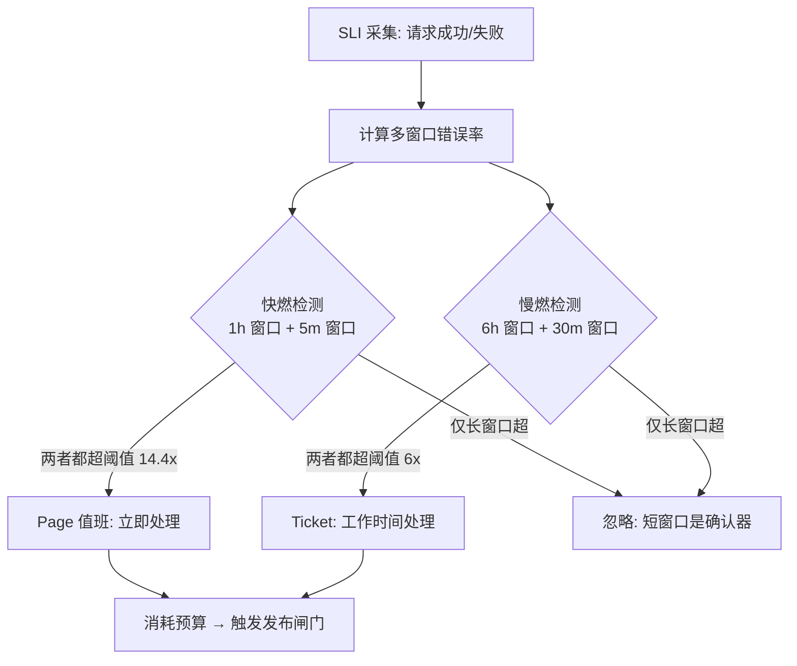

## 核心要点 (Key Takeaways)

- **错误预算 = 合格事件数 × (1 − SLO 目标)**，但真正决定告警质量的是"合格事件"怎么定义、滚动窗口怎么切，公式本身反而是最不容易出错的部分。
- 99.9% 的 SLO 意味着 30 天窗口里你只有约 **43.2 分钟的"完全宕机等价时间"**——如果按请求量算，就是总请求的 0.1%。这个数字比你直觉里的小得多。
- 多窗口多燃烧率（multi-window multi-burn-rate）告警是 2022 年 Google SRE Workbook 给出的方案，到 2026 年依然是唯一靠谱的落地方式，但阈值必须按你自己的流量曲线重算，照抄 14.4 只会天天误报。
- 燃烧率告警的"快燃"和"慢燃"两条线，本质是在**检测延迟**和**误报率**之间做权衡，不是拍脑袋定的两档。
- 上线 CI/CD 错误预算闸门之前，先把预算的**归属权**讲清楚——否则开发团队会把它当成又一个卡发布的官僚流程，直接绕过去。

---

## 一、为什么 2026 年了还有人在错误预算上翻车

我见过太多团队，SLO 文档写得漂漂亮亮，Grafana 面板挂了八个，结果真出故障的时候，没有任何人看那个燃烧率曲线。告警？全在 CPU 和 P99 延迟上。

上个月帮一个做支付网关的朋友排查，他们的 SLO 是 99.95%，面板上预算还剩 62%，看起来一切正常。但他们那个面板用的窗口是"自然日历月"，而告警用的是"7 天滚动"。两个口径对不上，导致月初的一次 12 分钟故障被自然月窗口"稀释"了——因为那个月总请求量特别大，0.05% 的预算被摊薄到几乎看不见。等他们真正发现的时候，预算已经烧穿 40%。

这就是错误预算计算最容易出问题的地方：**公式是死的，口径是活的**。你把 `1 - SLO` 算得再精确，如果事件计数、窗口边界、聚合维度三件事没对齐，数字就是一堆漂亮的垃圾。

社区里其实没什么人在聊这个。翻了一圈 HN 最近的讨论——坦白说，这个话题在社交平台上冷得可怜，2026 年 10 月底到 11 月中，HN 上跟 SLO 相关的正经讨论几乎为零，首页全是"Who wants to be hired"和"为什么 2026 年买个数字公交票这么难"。这说明什么？说明错误预算这件事已经"基础设施化"了——它不再是热点，而是默认你该会的基本功。会的人默默在用，不会的人默默在踩坑，没人发帖了。

所以这篇东西，我打算把踩过的坑、算过的数、配置过的告警全掏出来。

---

## 二、错误预算的底层机制：把公式拆到骨头里

### 2.1 三个数字，一个都不能错

错误预算的核心就三个量：

```
错误预算（绝对量） = 合格事件总数 × (1 − SLO 目标)
```

比如一个 SLO 是 99.9%，统计窗口 30 天，这 30 天里有 1000 万次合格请求：

```
10,000,000 × (1 − 0.999) = 10,000 次失败额度
```

换成"时间"口径，30 天 = 43,200 分钟：

```
43,200 × 0.001 = 43.2 分钟
```

43.2 分钟。这就是你整个月的全部容错空间。一次数据库主从切换抖动、一次发布回滚、一次第三方 API 超时风暴，就能吃掉大半。

**第一个坑：合格事件（eligible events）到底是什么。** 是把所有 HTTP 请求都算进去，还是只算成功 + 失败、排除掉 4xx 客户端错误？这个定义直接决定预算基数。我一般的做法是：

- 5xx 算失败
- 2xx/3xx 算成功
- 4xx 单独处理——如果 4xx 是用户输入错误，排除；如果是限流误伤（429），算失败
- 健康检查、探针流量直接排除

口径不一致的后果是灾难性的。我见过一个团队，SLI 算的是"所有请求"，但错误率告警算的是"排除 4xx 后的请求"，两个面板数字永远对不上，值班的人直接就不信这玩意儿了。

### 2.2 窗口的三种切法，各有各的毒

| 窗口类型 | 计算方式 | 优点 | 致命缺点 |
|---|---|---|---|
| 自然日历月 | 每月 1 号 0 点重置 | 跟财务/汇报周期对齐，好讲故事 | 月初月末流量不均，容易稀释故障；跨月故障被劈成两半 |
| 滚动窗口（30d rolling） | 每时每刻回看过去 30 天 | 故障影响持续可见，不会"月初清零" | 一个老故障会拖累整整 30 天，团队会觉得"反正预算没了，破罐破摔" |
| 固定周期（如季度） | 季度初重置 | 给大改造留缓冲 | 周期太长，反馈太慢，等于没有 |

我的选择：**告警用滚动窗口，治理用自然月**。告警要的是"现在有多糟"，滚动窗口最诚实；而给业务方汇报、做发布闸门，用自然月，因为人类是按月思考的。

### 2.3 燃烧率：把预算"消耗速度"量化

燃烧率（burn rate）的定义是：**当前错误率是允许错误率的多少倍**。

```
burn_rate = 当前错误率 / (1 − SLO)
```

SLO 99.9% 时，允许错误率是 0.1%。如果你现在实际错误率是 1%，燃烧率就是 10——意味着按这个速度，1 小时的错误量相当于正常 10 小时的额度，30 天的预算会在 3 天内烧光（30/10）。

Google SRE Workbook 给的那套经典多窗口方案是这样的：



关键在"多窗口"这三个字：**长窗口负责灵敏度，短窗口负责确认**。只有两个窗口同时超阈值才告警，这样能干掉大量由瞬时抖动引起的误报。

经典阈值（针对 30 天窗口的 SLO）：

- 快燃：1h 窗口燃烧率 > 14.4，且 5m 窗口 > 14.4 → 2% 预算在 1 小时内烧掉 → 立即 page
- 慢燃：6h 窗口燃烧率 > 6，且 30m 窗口 > 6 → 5% 预算在 6 小时内烧掉 → 开 ticket

**第二个坑来了：14.4 和 6 不是给你照抄的。** 这两个数来自"30 天窗口 × 特定误报率假设"的推导。如果你的 SLO 窗口是 7 天，或者你的流量有强烈的昼夜周期，直接套用会天天误报。我一般会让团队先跑两周 shadow mode，把实际燃烧率分布打出来，再定阈值。

---

## 三、落地：PromQL、配置和 CI/CD 闸门

### 3.1 用 PromQL 算滚动窗口错误预算

假设你用 Prometheus，指标是 `http_requests_total{status=~"5.."}` 和 `http_requests_total`：

```promql
# 30 天滚动窗口的错误率
sum(rate(http_requests_total{status=~"5.."}[30d]))
/
sum(rate(http_requests_total[30d]))

# 剩余错误预算比例（SLO = 99.9%）
1 - (
  sum(rate(http_requests_total{status=~"5.."}[30d]))
  /
  sum(rate(http_requests_total[30d]))
) / 0.001

# 快燃：1h 燃烧率
(
  sum(rate(http_requests_total{status=~"5.."}[1h]))
  /
  sum(rate(http_requests_total[1h]))
) / 0.001
```

注意 `[30d]` 这种大窗口在 Prometheus 里很贵——`rate()` 要扫 30 天的原始数据。生产环境我一般用 recording rule 预聚合，或者改用 VictoriaMetrics / Mimir 这类支持大窗口高效查询的后端。Prometheus 原生跑 `[30d]` 的 `rate`，在千万级 series 上能把查询打成 30 秒超时，别问我怎么知道的。

### 3.2 多窗口告警规则（可直接改阈值复用）

```yaml
groups:
  - name: slo_burn_rate
    rules:
      # 快燃：1h + 5m 双窗口确认
      - alert: SLOFastBurn
        expr: |
          (
            sum(rate(http_requests_total{status=~"5.."}[1h]))
            / sum(rate(http_requests_total[1h]))
          ) / 0.001 > 14.4
          and
          (
            sum(rate(http_requests_total{status=~"5.."}[5m]))
            / sum(rate(http_requests_total[5m]))
          ) / 0.001 > 14.4
        for: 2m
        labels:
          severity: page
        annotations:
          summary: "SLO 快燃：1h 内已烧掉约 2% 月度预算"

      # 慢燃：6h + 30m 双窗口确认
      - alert: SLOSlowBurn
        expr: |
          (
            sum(rate(http_requests_total{status=~"5.."}[6h]))
            / sum(rate(http_requests_total[6h]))
          ) / 0.001 > 6
          and
          (
            sum(rate(http_requests_total{status=~"5.."}[30m]))
            / sum(rate(http_requests_total[30m]))
          ) / 0.001 > 6
        for: 15m
        labels:
          severity: ticket
        annotations:
          summary: "SLO 慢燃：6h 内已烧掉约 5% 月度预算"
```

`for: 2m` 这个冷却时间别省——它就是为了过滤掉那些刚好卡在阈值上的毛刺。

### 3.3 CI/CD 错误预算闸门

这块是最容易被团队抵触的。我的做法是把闸门做成**分级**的，而不是一刀切"预算用完就冻结发布"：

```yaml
# 伪代码：发布流水线里的预算检查
budget_remaining = 1 - (current_error_rate / allowed_error_rate)

if budget_remaining > 0.5:
    allow_release()          # 绿灯，随便发
elif budget_remaining > 0.2:
    allow_release_with_warning()   # 黄灯，需要 on-call 确认
elif budget_remaining > 0:
    require_reliability_review()   # 橙灯，必须有人签字
else:
    block_release_except_hotfix()  # 红灯，只放行修复类发布
```

**第三个坑：闸门必须有"逃生舱"。** 纯冻结发布听起来很硬核，实际执行起来，业务方一句"这个功能有合同 deadline"就能把你顶回去，然后闸门形同虚设。分级 + 明确的例外流程（谁签字、什么条件），比硬冻结活得久。

---

## 四、工具对比：别为了算个数装一整套平台

| 工具 | 类型 | 错误预算计算 | 多窗口燃烧率告警 | 成本 | 适合谁 |
|---|---|---|---|---|---|
| Prometheus + Grafana | 自建 | 手写 PromQL / recording rule | 手写 Alertmanager 规则 | 低（人力成本高） | 已有 Prometheus 栈、愿意写 YAML 的团队 |
| Sloth (Slok/sloth) | 开源生成器 | 从 SLO spec 自动生成 PromQL | 自动生成多窗口规则 | 免费 | 规则多、不想手抄阈值的人 |
| Nobl9 | SaaS | 内置 | 内置 | 按 SLO 数收费，中大型团队年费不便宜 | 想要开箱即用、有预算的团队 |
| Datadog SLO | SaaS | 内置 | 内置（含 burn rate 告警） | 绑定 Datadog 整体账单 | 已经在用 Datadog 的 |
| Grafana SLO (OSS) | 自建/云 | 内置 | 内置 | 开源免费 / 云版按量 | 用 Grafana 栈的团队 |

我个人在中小规模场景下**首选 Sloth**——你写一份 YAML 描述 SLO，它帮你把 PromQL、recording rule、多窗口告警规则全生成出来，省掉手算阈值的痛苦。大团队上 Nobl9 我也理解，但那价格……说实话，为了算个 `1 - SLO`，上一套 SaaS，我总觉得性价比不太对。

---

## 五、性能、成本与组织层面的真相

技术上正确，组织上翻车，是错误预算最常见的死法。

**性能成本**：`[30d]` 窗口的查询是真的贵。如果你的 SLI 是每秒几十万请求的网关，Prometheus 存 30 天原始样本再算 `rate`，查询延迟能把 Grafana 面板拖到转圈。解决办法只有两个——预聚合 recording rule，或者换支持降采样查询的后端。我们之前把 30 天窗口查询从 28 秒压到 1.2 秒，靠的就是 recording rule + 5 分钟粒度预聚合。

**组织成本**：错误预算的**所有权**必须写进文档。预算烧穿了，是发布团队的问题、平台团队的问题，还是那个第三方依赖的问题？没定义清楚，复盘会就变成甩锅大会。我坚持一条：**错误预算归服务 owner，不归 SRE**。SRE 提供工具和告警，owner 负责消费预算、做发布决策。

**一个反直觉的观察**：预算剩得太多（比如长期 > 80%）也不是好事。那说明你的 SLO 定得太松，或者你根本没在测量用户真正在意的东西。预算长期用不完，等于你给自己发了一张"随便浪"的通行证——可靠性投入的优先级会被无限往后排。

---

## 六、FAQ

**Q1：SLO 99.9% 和 99.95% 在错误预算上差多少？**

差一倍。99.9% 的允许错误率是 0.1%，99.95% 是 0.05%。30 天窗口下，99.9% 给你 43.2 分钟，99.95% 只给你 21.6 分钟。别小看这 0.05 个百分点——它往往意味着多一套冗余、多一层自动故障转移，成本是非线性上涨的。

**Q2：错误预算能不能跨服务共享？**

技术上可以（比如按业务域聚合），但我不建议。共享预算会让单个服务的故障"淹没"在整体里，谁都不觉得自己该负责。预算要按 SLI 粒度算，按 SLO 粒度管。

**Q3：燃烧率告警老是误报怎么办？**

先别调阈值，先查两件事：一是 SLI 的"合格事件"口径有没有把健康检查、探针流量混进去；二是你的流量有没有强周期性（比如电商的整点秒杀）。周期性强的场景，固定阈值必然误报，得上带季节性基线的异常检测，或者干脆把窗口拉长到覆盖完整周期。

**Q4：没有历史数据，怎么定初始 SLO？**

先测量，别先定目标。跑四周，把实际可用性分布打出来，取一个"略低于当前实际水平"的值作为起点——比如你实际是 99.93%，初始 SLO 定 99.9%。定得太高，预算第一天就烧穿，团队直接不信这套东西；定得太低，又没有改进压力。

**Q5：错误预算和发布频率怎么联动？**

用分级闸门，别用二元冻结。预算充足时鼓励多发（快速迭代本身就是可靠性投资），预算紧张时收紧但保留修复通道。关键是让发布团队看到"多发 ≠ 烧预算"，只有真正引入故障的发布才消耗预算——这样他们才有动力去做金丝雀和灰度。

---

## References & Community Insights

- Google SRE Workbook — Alerting on SLOs（多窗口多燃烧率告警的原始出处）：https://sre.google/workbook/alerting-on-slos/
- Sloth — 从 SLO spec 自动生成 Prometheus 规则的生成器：https://github.com/slok/sloth
- Prometheus 官方文档 — recording rules 与 `rate()` 在大窗口下的性能说明：https://prometheus.io/docs/prometheus/latest/configuration/recording_rules/
- Hacker News 2026 年 11 月讨论（社区近期对 SLO 话题热度极低，印证其已"基础设施化"）：https://news.ycombinator.com/item?id=50338726

---

<script type="application/ld+json">
{
  "@context": "https://schema.org",
  "@type": "FAQPage",
  "mainEntity": [
    {
      "@type": "Question",
      "name": "SLO 99.9% 和 99.95% 在错误预算上差多少？",
      "acceptedAnswer": {
        "@type": "Answer",
        "text": "差一倍。99.9% 的允许错误率是 0.1%，99.95% 是 0.05%。30 天窗口下，99.9% 给你 43.2 分钟，99.95% 只给你 21.6 分钟。多出的 0.05 个百分点往往意味着额外的冗余和自动故障转移，成本非线性上涨。"
      }
    },
    {
      "@type": "Question",
      "name": "错误预算能不能跨服务共享？",
      "acceptedAnswer": {
        "@type": "Answer",
        "text": "技术上可以按业务域聚合，但不建议。共享预算会让单个服务的故障淹没在整体里，责任边界模糊。预算应按 SLI 粒度计算，按 SLO 粒度管理。"
      }
    },
    {
      "@type": "Question",
      "name": "燃烧率告警老是误报怎么办？",
      "acceptedAnswer": {
        "@type": "Answer",
        "text": "先检查 SLI 的合格事件口径是否混入了健康检查或探针流量，再检查流量是否有强周期性。周期性强的场景固定阈值必然误报，应使用带季节性基线的异常检测，或把窗口拉长到覆盖完整周期。"
      }
    },
    {
      "@type": "Question",
      "name": "没有历史数据，怎么定初始 SLO？",
      "acceptedAnswer": {
        "@type": "Answer",
        "text": "先测量再定目标。跑四周，统计实际可用性分布，取略低于当前实际水平的值作为起点，例如实际 99.93% 时初始 SLO 定 99.9%。定太高预算第一天就烧穿，定太低没有改进压力。"
      }
    },
    {
      "@type": "Question",
      "name": "错误预算和发布频率怎么联动？",
      "acceptedAnswer": {
        "@type": "Answer",
        "text": "使用分级闸门而非二元冻结。预算充足时鼓励发布，预算紧张时收紧但保留修复通道。让发布团队看到只有真正引入故障的发布才消耗预算，从而推动金丝雀和灰度实践。"
      }
    }
  ]
}
</script>

---
✅ All agents reported back!
└─ 🟡 HN: 2 storys │ 87 points │ 702 comments
---
