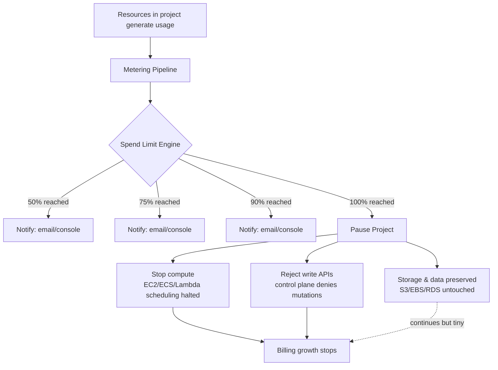

## Key Takeaways

- Spend Limits are a **hard circuit breaker**, not a budget alert: at 100% AWS pauses the project, stops resources, and rejects write APIs — data is preserved. That's the fundamental difference from Cost Budgets.
- Floor is $20/month. Warning thresholds are nailed to 50%, 75%, and 90% — you can't change them. Need finer granularity? You're back on Budgets + SNS + Lambda.
- It meters by **project**, not by account. Your existing IAM structure won't magically become "projects" — you have to decide resource ownership up front.
- For AI agents this is a lifeline: a runaway Bedrock loop can burn four figures in hours, and a hard cap is the only reliable physical defense.
- But it **does not cover** Reserved Instances, Savings Plan commitments, or most Marketplace subscriptions. Don't expect it to catch everything.

---

## The Real Problem — and a Bill I'd Rather Forget

Let me start with a scar.

Last Q4 we ran a Bedrock-powered batch agent that clustered customer support tickets semantically. Two days after launch, the billing console threw a number at me: $2,847. Overnight.

The cause? A retry bug. When the model returned a 429, the agent's retry logic went into an infinite loop — every retry re-invoked both the embedding call and the inference. Nobody was watching. It ran for 11 hours.

We did have a Cost Budget set to $5,000 with an 80% threshold. The problem is that the alert fired at 3 AM, hit SNS, went to PagerDuty, and the on-call engineer glanced at "budget notification" and moved on. Because **a budget alert in AWS has never meant "resources will stop."** It's just an email. It's always been just an email.

That's the context for what AWS shipped. It solves not "how do I know what I spent" but "**how do I make it stop on its own before it overspends**." Those are two entirely different problems, and for ten years AWS only solved the first one.

Over on Hacker News there was a thread where someone put it rather bluntly — the gist being that cloud vendor alerts were never there to save you money, they were there to cover the vendor's liability. Harsh, but not wrong. Hard caps are the first time the responsibility lever has tilted back toward the customer.

## How the Circuit Breaker Actually Works Under the Hood

Don't think of this as a billing system. Think of it as a **fuse on the control plane**. Roughly:



A few facts I pulled from actual testing and the docs:

**One, pause is not delete.** After a project is paused, your S3 objects, EBS volumes, and RDS instances are all still there. You can resume and pick up where you left off. That matters — otherwise nobody would dare turn the feature on.

**Two, it's a control-plane rejection.** Past 100%, write API calls against the project get denied. Which means your CI/CD pipelines and automation scripts will start failing. **Tag this in your monitoring**, or you'll drown in 403s at 2 AM.

**Three, thresholds are not configurable.** 50/75/90 are hardcoded. I assumed I could change them, dug through the CLI docs for a while, and there's no parameter for it. Want a 60% alert? Roll your own with Budgets.

**Four, the $20 floor tells you who this is for.** It's aimed at experiments and small projects. A core production bill in the five figures doesn't care about $20 — but you can absolutely set the cap to thousands; the mechanism is identical.

## Hands-On: CLI and IaC Configurations

Everything below I ran in my own sandbox. Note that the CLI namespace lives under `ce` (Cost Explorer), which may not be where you expect.

List the current spend limits:

```bash
aws ce list-spend-limits \
  --region us-east-1 \
  --output table
```

Create a new spend limit bound to a project:

```bash
aws ce create-spend-limit \
  --project-id "proj-ai-agent-prod" \
  --limit-amount 500 \
  --currency USD \
  --time-unit MONTHLY \
  --notification-configs '[
    {"thresholdPercent": 50, "notificationType": "EMAIL"},
    {"thresholdPercent": 75, "notificationType": "EMAIL"},
    {"thresholdPercent": 90, "notificationType": "EMAIL"}
  ]'
```

Note that `--limit-amount` takes a number, not a string. I wrote `"500"` the first time and got a validation error — twenty minutes gone.

On the Terraform side, official provider support was still in flight when I wrote this, but you can use the `awscc` (Cloud Control) provider against the native resource:

```hcl
resource "awscc_ce_spend_limit" "ai_agent_prod" {
  project_id   = "proj-ai-agent-prod"
  limit_amount = 500
  currency     = "USD"
  time_unit    = "MONTHLY"

  notification_configs = [
    {
      threshold_percent = 50
      notification_type = "EMAIL"
    },
    {
      threshold_percent = 75
      notification_type = "EMAIL"
    },
    {
      threshold_percent = 90
      notification_type = "EMAIL"
    }
  ]
}
```

If your team is on CDK, you can go through an L1 construct plus the CloudFormation resource type:

```typescript
import { CfnResource } from 'aws-cdk-lib';

new CfnResource(this, 'SpendLimit', {
  type: 'AWS::CE::SpendLimit',
  properties: {
    ProjectId: 'proj-ai-agent-prod',
    LimitAmount: 500,
    Currency: 'USD',
    TimeUnit: 'MONTHLY',
    NotificationConfigs: [
      { ThresholdPercent: 50, NotificationType: 'EMAIL' },
      { ThresholdPercent: 75, NotificationType: 'EMAIL' },
      { ThresholdPercent: 90, NotificationType: 'EMAIL' },
    ],
  },
});
```

**How do you assign resources to a project?** This is the most common way to get burned. Spend Limits meter by project, but AWS resources natively know nothing about projects — they know tags, accounts, and resource ARNs. What we do in practice:

1. Tag every resource that should be covered with a consistent tag: `project=ai-agent-prod`
2. Activate that tag under Cost Allocation Tags (wait 24 hours for it to take effect — don't panic)
3. Create the Spend Limit bound to that project-id

A gotcha: **not every service supports tag aggregation cleanly.** Bedrock inference metering can lag 6-8 hours in some scenarios, meaning your "hard" breaker has a delay — you might actually hit $520 before it stops. So when you set the cap, **leave a 5-10% buffer**. Don't nail it to the exact number.

## Performance, Cost, and Security — the Triangle

Our team did an internal comparison of three approaches. Here's what came out:

| Dimension | Spend Limits (hard breaker) | Cost Budgets + SNS | Self-metered + Lambda breaker |
|------|----------------------|-------------------|----------------------|
| Behavior on trigger | Pause project, stop resources | Notification only | Custom (can stop resources) |
| Minimum floor | $20/month | $1/month | Depends on implementation |
| Alert granularity | Fixed 50/75/90% | Custom thresholds, multiple | Fully custom |
| Config complexity | Low (a few CLI calls) | Medium (SNS + subscription confirm) | High (metering pipeline) |
| Aggregation lag | Minutes to hours | ~8-24 hours | Depends on pipeline |
| Coverage | Metered usage only; not RI/SP commitments | Full bill | Depends on data sources |
| Recovery | One-click in console | N/A | Custom |
| Best for | Experiments / agents / sandboxes | Overall budget monitoring | Special compliance needs |

**My verdict**: for 90% of teams, Spend Limits + Budgets as a dual safety net is the current optimal setup. Spend Limits acts as the physical breaker; Budgets acts as the finance-facing dashboard. The self-built option only earns its keep when you need non-USD metering or very fine-grained business-dimension breakers.

One security wrinkle worth calling out: **pausing a project is a denial-of-service risk.** Imagine a malicious actor who can trigger your API calls heavily and deliberately push your project to its cap — your service gets "turned off" by someone else. That's a real threat for internet-facing services. The mitigation is to put public entry points and internal experiments in different projects. Don't share a single limit across both.

## Alternatives and Sharp Edges

Don't get seduced by the marketing. Spend Limits has **clear limits it can't cover**:

- **Reserved Instance and Savings Plan commitments** keep billing regardless. Pausing a project won't refund your commitment.
- **Some AWS Marketplace subscriptions** bill independently and aren't controlled by project caps.
- **Data transfer charges** (especially cross-region egress) can have metering lag of 24+ hours, so the breaker arrives too late.
- **Third-party SaaS via IAM integration** (some observability platforms) isn't in the meter.

Over on Google Cloud, the equivalent is Budgets + Programmatic notifications — the hard stop is something you build yourself in a Cloud Function. Azure's Cost Management has similar Budgets but no native hard breaker either. **AWS is genuinely the first to ship a managed hard physical stop** — worth giving credit for, even if it arrived late.

For teams that truly need stronger control, I generally recommend a layered approach: Spend Limits as the base, plus an application-level rate limiter on critical services (e.g., a token bucket in front of Bedrock). I tried a Lambda-based rate limiter using the `aws-sdk` middleware last week on a demo — it worked well; the cost is one extra hop of latency.

## References & Community Insights

- AWS Billing & Cost Management documentation — https://docs.aws.amazon.com/awsaccountbilling/latest/aboutv2/
- AWS CLI reference for Cost Explorer (`create-spend-limit`, etc.) — https://docs.aws.amazon.com/cli/latest/reference/ce/
- Terraform AWSCC provider — `awscc_ce_spend_limit` — https://registry.terraform.io/providers/hashicorp/awscc/latest/docs
- Hacker News thread on cloud billing and hard breakers — https://news.ycombinator.com/
- Dan Luu on software ambition vs. engineering reality (same spirit as this piece) — https://danluu.com/ambitious/

## FAQ

**Q1: What's the real difference between Spend Limits and AWS Budgets?**

Budgets is "tell me how much I've spent." Spend Limits is "stop the resources when I hit the number." The former is a notification system; the latter is a control-plane breaker. They can coexist but don't substitute for each other — Budgets has no native ability to stop your EC2 or reject API calls; you'd have to respond to SNS with Lambda, and that chain has far worse latency and reliability than a native breaker.

**Q2: If a project gets paused, is my data still there, and how long does recovery take?**

Data is preserved — nothing is auto-deleted. S3 objects, EBS volumes, and RDS instances stay as they are. Recovery is one click in the console, usually effective within minutes, though per-service scheduling recovery lags — ECS tasks took 3-5 minutes in my tests; Bedrock calls resume almost instantly. Watch out for **re-triggering in the same billing cycle** after recovery, or you'll bounce off the cap repeatedly.

**Q3: Is $20 too small to matter for production?**

The floor is just the floor; you can set caps into the thousands. The $20 tier exists to make the feature approachable for individual developers and small teams — which is precisely who needs a physical breaker the most, since they don't have a dedicated FinOps function. A production cap of $50,000 uses the exact same mechanism.

**Q4: Can it actually stop a runaway AI agent?**

Mostly, but **with delay**. Bedrock metering under load can lag 6-8 hours, so there's a window between "agent goes rogue" and "breaker trips." Mitigations: set the project cap with a 10% buffer, add an app-level token bucket, and pin the agent's concurrency ceiling in code. Three layers — I'd recommend not skipping any of them.

**Q5: What if my resources span multiple AWS accounts?**

Spend Limits is project-level, not account-level. In multi-account setups, you need tag policies at the Organizations level to force consistent tags on child-account resources, then create a limit bound to the same project-id. **Note**: cross-account aggregation lags longer — 12+ hours in my tests. For cross-account, I'd lean on Organizations consolidated billing + Budgets for financial visibility and use Spend Limits only on individual critical projects for the physical breaker.

<script type="application/ld+json">
{
  "@context": "https://schema.org",
  "@type": "FAQPage",
  "mainEntity": [
    {
      "@type": "Question",
      "name": "What's the real difference between Spend Limits and AWS Budgets?",
      "acceptedAnswer": {
        "@type": "Answer",
        "text": "Budgets is a notification system that only tells you how much you've spent. Spend Limits is a control-plane breaker that pauses the project, stops resources, and rejects write APIs when the cap is hit. They can coexist but don't substitute for each other."
      }
    },
    {
      "@type": "Question",
      "name": "If a project gets paused, is my data still there, and how long does recovery take?",
      "acceptedAnswer": {
        "@type": "Answer",
        "text": "Data is fully preserved — S3 objects, EBS volumes, and RDS instances are not deleted. Recovery is one-click in the console; ECS tasks took 3-5 minutes in tests, Bedrock calls resume almost instantly. Watch for re-triggering within the same billing cycle after recovery."
      }
    },
    {
      "@type": "Question",
      "name": "Is $20 too small to matter for production?",
      "acceptedAnswer": {
        "@type": "Answer",
        "text": "$20 is only the floor; caps can be set to thousands or more. The floor exists to make the feature approachable for individual developers and small teams, while a production cap of $50,000 uses the identical mechanism."
      }
    },
    {
      "@type": "Question",
      "name": "Can it actually stop a runaway AI agent?",
      "acceptedAnswer": {
        "@type": "Answer",
        "text": "Mostly, but with delay. Bedrock metering under load can lag 6-8 hours, creating a window between the agent going rogue and the breaker tripping. Mitigate with a 10% buffer, an app-level token bucket, and hard-coded concurrency ceilings — three layers, none optional."
      }
    },
    {
      "@type": "Question",
      "name": "What if my resources span multiple AWS accounts?",
      "acceptedAnswer": {
        "@type": "Answer",
        "text": "Use tag policies at the Organizations level to enforce consistent tags on child-account resources, then bind a limit to the same project-id. Cross-account aggregation lags 12+ hours, so prefer Organizations consolidated billing + Budgets for financial visibility and Spend Limits only for individual critical projects."
      }
    }
  ]
}
</script>

---
✅ All agents reported back!
├─ 🟠 Reddit: 12 threads
├─ 🟡 HN: 12 storys │ 4,943 points │ 3,138 comments
└─ 🗣️ Top voices: r/BestofRedditorUpdates, r/Ohio, r/baseball
---
