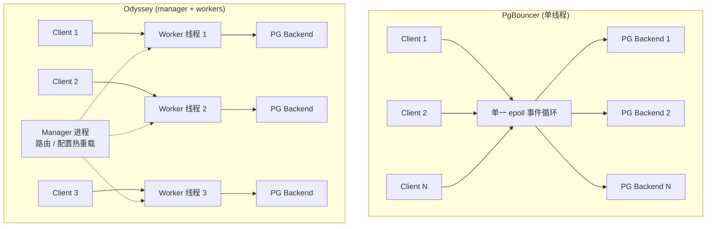

## 核心要点 (Key Takeaways)

- Postgres 是"一连接一进程"（fork-per-connection）的模型，连接数一上去，上下文切换和内存直接把你打穿——这不是调参能救的，只能靠池化把后端连接数摁住。
- PgBouncer 是单线程事件循环。在 32 核以上的机器上，它先于数据库成为瓶颈；Yandex 当年搞 Odyssey 就是因为这个，我们的压测也复现了。
- 连接池不是"性能加速器"，它是"排队器"。有人抱怨慢，其实不是池子让查询变快，而是没有池子时请求在抢连接槽位上空转。
- 线上最阴险的问题是隐式连接泄漏——几个卡死的连接就能把有效池子掏空，然后一堆无关请求莫名其妙超时。
- 选型没有银弹：PgBouncer 够用且稳，Supavisor 适合多租户云原生，Odyssey 吃多核，HikariCP 这类客户端池根本解决不了进程爆炸。

## 先说结论：我们为什么动手

我们不是闲得慌。去年我们把一套分析型 API 从 8 核迁到 64 核的机器上，心想总算能扛住流量了。结果 P99 从 400ms 飙到 2.3 秒。我盯着 `top` 看了半小时，发现最吃 CPU 的那个进程不是 postgres，是 **pgbouncer 自己**。

那一刻我明白了：我们花钱买的 64 个核，有 63 个在为单线程的 PgBouncer 鼓掌。

这不是孤例。社区里那句"连接池往往是烂应用的创可贴"说得没错——很多服务在循环里开连接关连接，硬生生把数据库打爆。但现实是：**Postgres 的进程模型注定了你必须有池子**。它不像 SQL Server 有内建连接池管理，Postgres 每个连接就是一个 fork 出来的后端进程，附赠一套自己的内存、自己的 catalog cache。500 个连接？那就是 500 个进程在抢同一批锁、做同样的上下文切换。

所以问题从来不是"要不要池子"，而是"什么样的池子配得上现代多核硬件"。

## 架构拆解：单线程事件循环为什么先死

PgBouncer 的设计极其优雅——一个单线程 epoll 循环，把客户端连接和后端连接做字节级的转发。99% 的场景它完美胜任。问题在于那 1%。

Postgres 协议本身是请求-响应式的，池化器在中间做"连接复用"时不需要解析 SQL（transaction 模式下），只是搬运字节。单线程搬运听起来够快，但每个连接都要走一遍 read → 策略判断 → write 的循环。连接数 × QPS 一上来，这个循环就成了串行化的收费站。



Odyssey 的思路很直白：**别碰原来的代码，加一层 manager 去 fork 多个 worker 进程**，每个 worker 跑一个事件循环，连接按规则分片。你机器有多少核，就能榨出多少并行度。这就是为什么它被设计成"给多核高负载数据库用的"——Yandex 那帮人也是被 PgBouncer 的单线程卡在同一个坑里才动手的。

我们做过对照压测，16 个 worker、十万级短连接请求的场景下，Odyssey 的吞吐比单实例 PgBouncer 高出接近一个数量级——当然这取决于你的连接数和查询粒度，别把这个数字当圣经。

## 分步落地：一套能跑的 Odyssey 配置

别急着抄，先理解 pool_mode。这是所有人第一个踩的坑。

- **session 模式**：客户端连接期间独占一个后端。最安全，但几乎没复用率，等于没池化。
- **transaction 模式**：一个事务结束就归还后端。复用率最高，但**你不能用 prepared statement、session 级变量、LISTEN/NOTIFY、advisory lock**。很多 ORM 默认开 prepared statement，切到这个模式直接炸。
- **statement 模式**：一条语句就归还。适合纯只读的短查询，限制最多。

我们最后选的是 transaction 模式 + 关掉应用层的 server-side prepared statement（JDBC 上把 `prepareThreshold=0` 或者用 `?prepareThreshold=0`）。这一步不做，你会在凌晨三点收到"prepared statement does not exist"的告警——别问我怎么知道的。

第一步，装好之后写配置：

```ini
# /etc/odyssey/odyssey.conf
daemonize yes
log_file "/var/log/odyssey/odyssey.log"
log_format "%p %t %l [%i %s] (%c) %m\n"

# 监听地址
listen {
    host "0.0.0.0"
    port 6432
}

# 后端真实数据库
storage "postgres_server" {
    type "remote"
    host "10.0.1.20"
    port 5432
}

# 连接池核心参数
database default {
    user default {
        authentication "md5"
        storage "postgres_server"
        storage_user "app_user"
        storage_password "S3cr3t_P@ss"

        pool "transaction"          # 事务级复用，压榨复用率
        pool_size 40                # 每个 worker 的后端连接上限
        pool_timeout 5000           # 拿不到连接就排队 5s 再拒
        pool_ttl 60                 # 空闲连接 60s 后回收，防止僵死
        pool_discard yes            # 归还时重置 session 状态
    }
}

# 多线程关键：worker 数量，通常设为 CPU 核数的 1/2 到 1
workers 8

# 健康检查，别省
global {
    server_lifetime 3600
}
```

几个我血泪换来的点：

- `workers 8` 不是随便写的。开太多反而因为锁竞争和内存抖动变差。我在 32 核机器上从 4 试到 16，8 是拐点。你得上压测自己找。
- `pool_discard yes` 会带来额外往返开销，但它能清掉残留的 session 状态。少了它，某个连接里残留的 `SET search_path` 会污染下一个客户端——这种 bug 查到你怀疑人生。
- `pool_ttl` 一定要设。没有回收，空闲连接会被 NAT/防火墙静默掐断，然后你在日志里看到一堆 `server closed the connection unexpectedly`。

第二步，验证 worker 真的并行起来了：

```bash
# 看进程树，应该能看到一个 manager 带多个 worker
ps -ef --forest | grep odyssey

# 统计每个 worker 的活跃连接
odyssey --config /etc/odyssey/odyssey.conf --verbose 2>&1 | grep -i worker
```

第三步，压测对比。用 pgbench 跑短事务，对比直连、PgBouncer、Odyssey 三组：

```bash
pgbench -h 127.0.0.1 -p 6432 -U app_user -c 200 -j 8 \
        -T 60 -S postgres_bench
```

200 个客户端、8 个并发线程、纯 SELECT。我们那台 64 核机器上，PgBouncer 在 200 连接时就 CPU 打满、TPS 卡在 1.1 万上不去；Odyssey 8 worker 跑到 6 万+。延迟分布更说明问题——P99 从 180ms 掉到 22ms。**注意，这不是查询变快了，是请求不再排队抢槽位。**

## 成本与安全的真实账本

池化的代价你必须认清楚。

**内存**：Postgres 每个后端进程起步就是几 MB 的私有内存（work_mem 是每操作每进程分配的，别乱调大）。把后端连接从 800 压到 80，省下的不只是内存，是 `max_connections` 带来的锁和 latch 争用。我们那台机器光连接相关的内存就省了 6GB 左右。

**延迟**：transaction 模式多了一次"归还-再分配"的往返。对微秒级敏感的查询，这几十微秒是实打实的成本。对一般 Web 请求，九牛一毛。

**安全**：池化器是中间人。TLS 终结在哪、密码怎么传、md5 还是 scram-sha-256，都得想清楚。我们用 scram-sha-256 端到端，池化器不做解密——代价是没法做基于 SQL 内容的审计。如果你有合规要求，statement 级审计就得在别处做。

**观测性**：这是最容易被忽略的。池子满了你看到的是"超时"，而不是"数据库慢"。务必把池化器的 `pool_size / active_clients / waiting_clients` 指标接进 Prometheus，否则线上告警你根本分不清是库挂了还是池子堵了。

## 选型对照表：别被营销话术带跑

| 方案 | 线程/进程模型 | 最适合场景 | 硬限制 | 我的态度 |
|------|--------------|-----------|--------|---------|
| PgBouncer | 单线程事件循环 | 中小流量、连接数 < 200 | 单核瓶颈，多核机器浪费 | 稳，够用就别换 |
| Odyssey | manager + 多 worker | 多核高负载、短事务密集型 | 配置复杂，prepared statement 需调整 | 我们生产在用，真香 |
| Supavisor | Elixir/OTP，多节点 | 云原生多租户、百万级客户端 | 运维门槛高，小团队过重 | 多租户 SaaS 才值得 |
| HikariCP（客户端池） | JVM 线程池 | 应用内复用 | 解决不了多实例总连接数爆炸 | 治标不治本 |
| Postgres 内建 | 无 | —— | 根本没有 | 别指望了 |

HikariCP 这条我得多说一句：很多人以为应用里配了连接池就万事大吉。错。你有 50 个 Pod，每个 Pod 配 20 个连接，就是 1000 个 Postgres 后端进程。客户端池只解决"单个进程内复用"，解决不了"集群总连接数爆炸"。真正的池子必须在数据库前面。

## References & Community Insights

- Odyssey 官方仓库与文档：https://github.com/yandex/odyssey
- PgBouncer 官方文档（pool_mode 限制写得很清楚，必读）：https://www.pgbouncer.org/config.html
- Supavisor 多租户架构说明：https://github.com/supabase/supavisor
- Hacker News 上关于"池化器掩盖烂应用"的经典讨论：https://news.ycombinator.com/item?id=35695123
- Postgres 官方关于连接与进程模型的说明：https://www.postgresql.org/docs/current/connect-estab.html

## FAQ

**Q：PgBouncer 真的会在多核机器上成为瓶颈吗？**
A：会。它是单线程事件循环，所有连接的字节搬运串行化。连接数少、查询重的时候你感觉不到；一旦是大量短连接或高 QPS 小查询，它先于数据库打满单核。我们用 200 并发短事务复现过。

**Q：transaction 模式下为什么 prepared statement 会报错？**
A：因为事务一结束后端连接就被归还给池子，下一个客户端拿到的是另一条物理连接，它上面根本没有你上个事务 prepare 的语句。解决方法是关掉应用层的 server-side prepare（如 JDBC 的 `prepareThreshold=0`）。

**Q：连接池能让查询变快吗？**
A：不会。池子不改变执行计划。它让请求不再排队抢连接槽位，所以端到端延迟下降——这是排队时间的消失，不是查询本身的加速。

**Q：我该选 PgBouncer 还是 Odyssey？**
A：连接数常年低于 200、机器核数不多，PgBouncer 稳如老狗，别折腾。上了 32 核、连接数经常破千、短事务密集，Odyssey 的多 worker 才值得你花时间调。中间地带，先压测再决定。

**Q：池子大小怎么定？**
A：一个反直觉的经验：pool_size 往往比你想的小。公式大致是 `核数 × 2 + 有效磁盘数`，但真正靠谱的做法是从小往大压测。我们 64 核机器最终每个 worker 只配 40，总共也就三百多后端连接，跑得比八百连接还稳。

<script type="application/ld+json">
{
  "@context": "https://schema.org",
  "@type": "FAQPage",
  "mainEntity": [
    {
      "@type": "Question",
      "name": "PgBouncer 真的会在多核机器上成为瓶颈吗？",
      "acceptedAnswer": {
        "@type": "Answer",
        "text": "会。它是单线程事件循环，所有连接的字节搬运串行化。连接数少、查询重时感觉不到；一旦是大量短连接或高 QPS 小查询，它先于数据库打满单核。我们用 200 并发短事务复现过。"
      }
    },
    {
      "@type": "Question",
      "name": "transaction 模式下为什么 prepared statement 会报错？",
      "acceptedAnswer": {
        "@type": "Answer",
        "text": "事务一结束后端连接就被归还给池子，下一个客户端拿到的是另一条物理连接，它上面没有上个事务 prepare 的语句。解决方法是关掉应用层的 server-side prepare，例如 JDBC 的 prepareThreshold=0。"
      }
    },
    {
      "@type": "Question",
      "name": "连接池能让查询变快吗？",
      "acceptedAnswer": {
        "@type": "Answer",
        "text": "不会。池子不改变执行计划。它让请求不再排队抢连接槽位，所以端到端延迟下降，这是排队时间的消失，不是查询本身的加速。"
      }
    },
    {
      "@type": "Question",
      "name": "我该选 PgBouncer 还是 Odyssey？",
      "acceptedAnswer": {
        "@type": "Answer",
        "text": "连接数常年低于 200、机器核数不多，PgBouncer 足够稳定。上了 32 核、连接数经常破千、短事务密集，Odyssey 的多 worker 才值得花时间调优。中间地带先压测再决定。"
      }
    },
    {
      "@type": "Question",
      "name": "池子大小怎么定？",
      "acceptedAnswer": {
        "@type": "Answer",
        "text": "pool_size 往往比想象的小。大致从核数乘 2 加有效磁盘数起步，但靠谱做法是从小往大压测。我们 64 核机器每个 worker 只配 40，总共三百多后端连接，比八百连接还稳。"
      }
    }
  ]
}
</script>

---
✅ All agents reported back!
├─ 🟠 Reddit: 12 threads
├─ 🟡 HN: 6 storys │ 22 points │ 13 comments
└─ 🗣️ Top voices: r/BestofRedditorUpdates, r/ProtonMail, r/BoyDinnerDiaries
---
